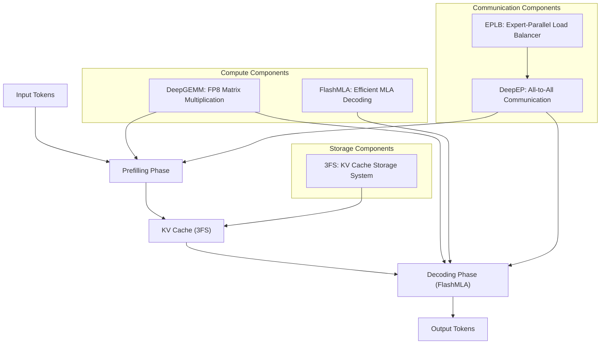
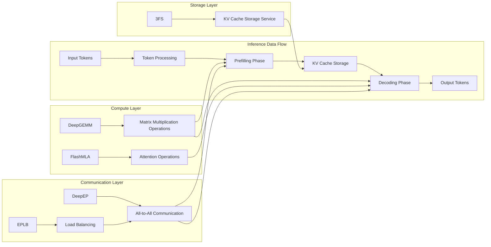
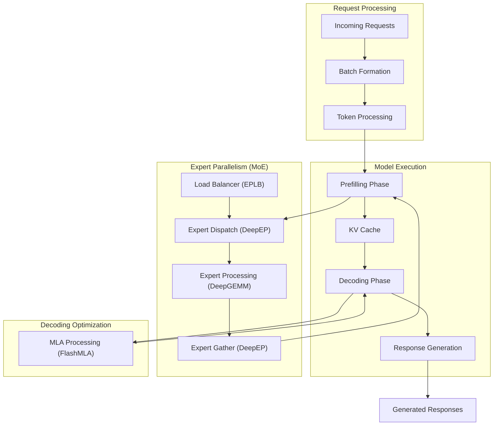
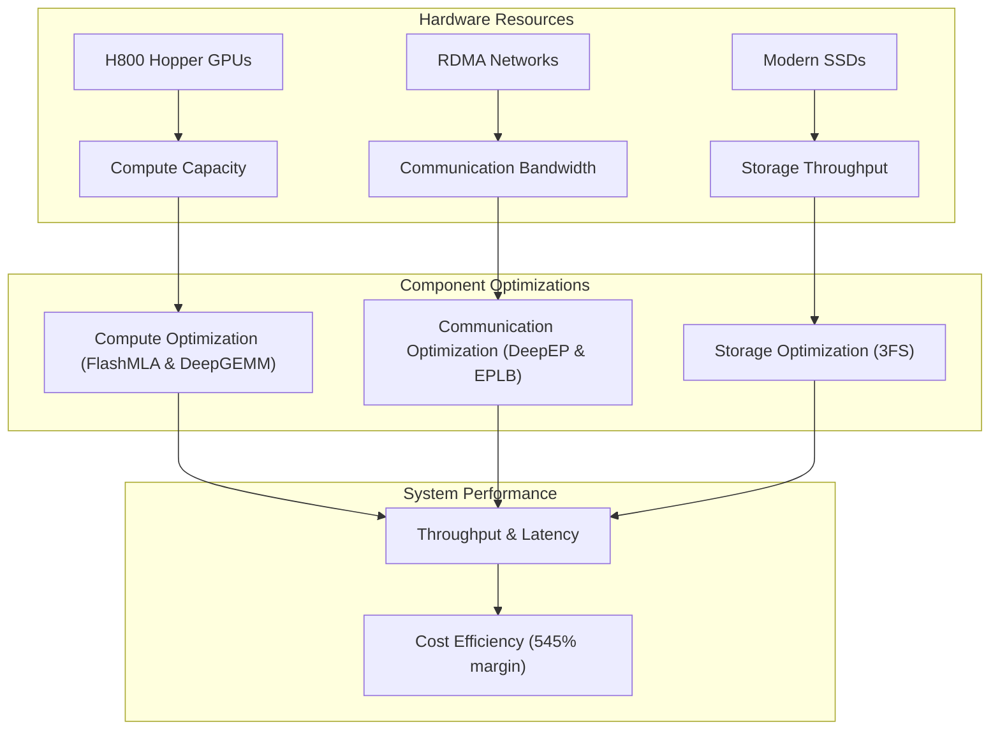

<!-- source: DeepWiki mcp.deepwiki.com · repo deepseek-ai/open-infra-index · page 3.1 Inference System Architecture · fetched 2026-10-30 -->

# Inference System Architecture

Relevant source files

The following files were used as context for generating this wiki page:

- [202502OpenSourceWeek/day_6_one_more_thing_deepseekV3R1_inference_system_overview.md](202502OpenSourceWeek/day_6_one_more_thing_deepseekV3R1_inference_system_overview.md)
- [202502OpenSourceWeek/figures/Diagram of DeepSeek's Online Inference System.jpg](202502OpenSourceWeek/figures/Diagram of DeepSeek's Online Inference System.jpg)

## Introduction and Purpose

This document details the architecture, components, and data flow of the DeepSeek V3/R1 Inference System. It provides a technical explanation of how various specialized components work together to enable efficient inference for large AI models.

For information about specific performance optimization techniques, see [Performance Optimization](#3.2). For details on the open-sourcing approach, see [Open-Sourcing Strategy](#3.3).

Sources: [README.md:85-95]()

## System Overview

The DeepSeek Inference System Architecture is designed to optimize both throughput and latency for large language models, particularly focusing on the V3/R1 models. It achieves this through specialized components that work together to handle computation, communication, and storage operations efficiently.

### High-Level System Architecture

Sources: [README.md:28-83]()

## Key System Components

The inference system integrates several specialized components, each optimized for specific tasks within the inference process:

### 1. Computation Components

| Component | Description | Key Specifications |
|-----------|-------------|-------------------|
| **FlashMLA** | Efficient MLA (Multi-query and Look-ahead Attention) Decoding Kernel for Hopper GPUs | • 3000 GB/s memory-bound • BF16 580 TFLOPS compute-bound on H800 • Paged KV cache (block size 64) |
| **DeepGEMM** | FP8 GEMM library for dense and MoE matrix operations | • Up to 1350+ FP8 TFLOPS on Hopper GPUs • Supports dense layout and two MoE layouts • Just-In-Time compiled |

### 2. Communication Components

| Component | Description | Key Specifications |
|-----------|-------------|-------------------|
| **DeepEP** | EP communication library for MoE model training and inference | • Efficient all-to-all communication • Intranode and internode support with NVLink and RDMA • High-throughput kernels for prefilling • Low-latency kernels for decoding • Native FP8 dispatch support |
| **EPLB** | Expert-parallel load balancer | • Optimizes workload distribution across GPUs • Enhances resource utilization |

### 3. Storage Component

| Component | Description | Key Specifications |
|-----------|-------------|-------------------|
| **3FS** (Fire-Flyer File System) | Parallel file system for high-speed data access | • 6.6 TiB/s aggregate read throughput in a 180-node cluster • 40+ GiB/s peak throughput per client node for KVCache lookup |

Sources: [README.md:28-83]()

## Inference Pipeline and Data Flow

The inference process consists of two main phases: prefilling and decoding. Each phase utilizes the system components in different ways to optimize performance.

### Inference Pipeline Architecture

Sources: [README.md:85-95]()

### Detailed Data Flow

#### 1. Prefilling Phase

During the prefilling phase, the system processes the input context tokens:

1. **Token Processing**: Input tokens are encoded and prepared for model processing
2. **Matrix Multiplication**: DeepGEMM performs matrix multiplications using FP8 precision
3. **MoE Routing**: For MoE models, tokens are routed to appropriate experts using DeepEP
4. **KV Cache Generation**: Key-Value pairs are generated and stored in the KV cache managed by 3FS
5. **Load Balancing**: EPLB ensures balanced workload distribution across GPUs

#### 2. Decoding Phase

During the decoding phase, the system generates output tokens one at a time:

1. **Attention Computation**: FlashMLA performs efficient multi-query and look-ahead attention operations
2. **Matrix Multiplication**: DeepGEMM handles continued matrix multiplications
3. **Expert Communication**: DeepEP provides low-latency all-to-all communication for MoE operations
4. **KV Cache Access**: 3FS provides fast access to the KV cache for attention computations
5. **Token Generation**: Each new token is generated and added to the sequence for the next iteration

Sources: [README.md:28-36, 38-48, 50-59, 66-67, 73-80]()

## Communication-Computation Overlapping

A key optimization in the DeepSeek inference system is the overlapping of communication and computation operations, which significantly reduces latency.

### Timeline Comparison

```mermaid
gantt
    title Communication-Computation Overlapping
    dateFormat s
    axisFormat %S
    
    section SequentialProcessing["Sequential Processing"]
    Communication (Chunk 1)    :a1, 0, 2s
    Computation (Chunk 1)      :a2, after a1, 3s
    Communication (Chunk 2)    :a3, after a2, 2s
    Computation (Chunk 2)      :a4, after a3, 3s
    
    section OverlappedProcessing["Overlapped Processing"]
    Communication (Chunk 1)    :b1, 0, 2s
    Computation (Chunk 1)      :b2, after b1, 3s
    Communication (Chunk 2)    :b3, after b1, 2s
    Computation (Chunk 2)      :b4, after b3, 3s
```

In the overlapped processing approach, communication for the next chunk begins as soon as the current chunk's communication is complete, without waiting for computation to finish. This technique is implemented through DeepEP's flexible GPU resource control.

Sources: [README.md:48, 87-89]()

## MoE Parallelism and Load Balancing

For Mixture of Experts (MoE) models, the system implements specialized parallelism and load balancing mechanisms to efficiently handle the expert routing and processing.

### MoE Processing Flow

Sources: [README.md:38-48, 66-67, 85-95]()

## System Performance

The DeepSeek V3/R1 Inference System achieves significant performance metrics in production environments:

| Metric | Value |
|--------|-------|
| Input tokens per second per H800 node | 73.7k |
| Output tokens per second per H800 node | 14.8k |
| Cost profit margin | 545% |

### Component-Level Performance

| Component | Performance Metric | Value |
|-----------|-------------------|-------|
| FlashMLA | Memory-bound performance | 3000 GB/s |
| FlashMLA | BF16 compute-bound performance | 580 TFLOPS |
| DeepGEMM | FP8 performance | Up to 1350+ TFLOPS |
| 3FS | KV Cache lookup throughput per node | 40+ GiB/s peak |
| 3FS | Aggregate read throughput (180-node cluster) | 6.6 TiB/s |

Sources: [README.md:36, 54-55, 78, 93-94]()

## Hardware Utilization and Scaling

The inference system efficiently utilizes available hardware resources to maximize performance.

### Hardware Resource Utilization

The system scales efficiently across nodes through DeepEP's cross-node communication capabilities and EPLB's load balancing, enabling high-throughput processing of parallel inference requests.

Sources: [README.md:36, 44, 54-55, 73-80, 93-94]()

## Conclusion

The DeepSeek V3/R1 Inference System architecture integrates specialized components for computation (FlashMLA, DeepGEMM), communication (DeepEP, EPLB), and storage (3FS) to create a high-performance inference platform. Through techniques like communication-computation overlapping, expert parallelism, and efficient load balancing, the system achieves impressive throughput and latency metrics while maintaining cost efficiency.

Sources: [README.md:85-95]()

---

