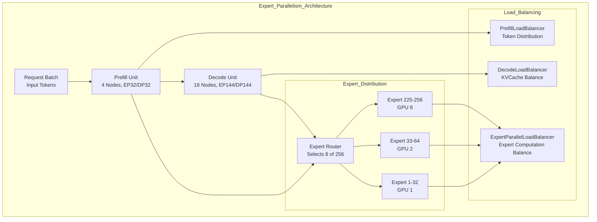
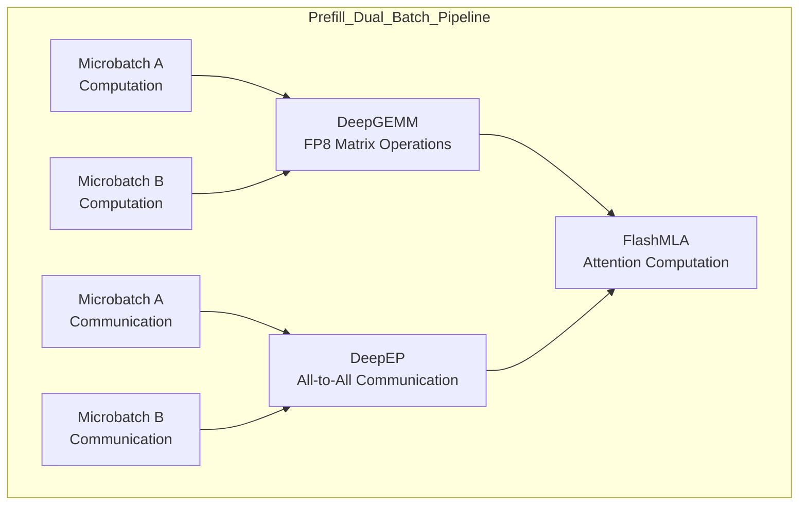
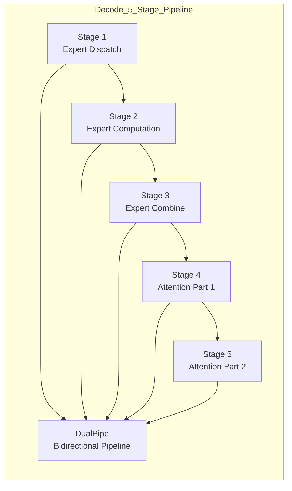
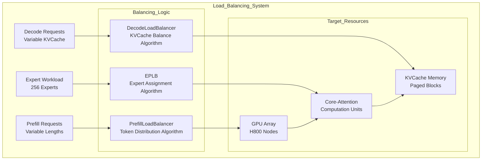

<!-- source: DeepWiki mcp.deepwiki.com · repo deepseek-ai/open-infra-index · page 3.2 Performance Optimization · fetched 2026-10-30 -->

# Performance Optimization

Relevant source files

The following files were used as context for generating this wiki page:

- [202502OpenSourceWeek/day_6_one_more_thing_deepseekV3R1_inference_system_overview.md](202502OpenSourceWeek/day_6_one_more_thing_deepseekV3R1_inference_system_overview.md)
- [202502OpenSourceWeek/figures/H800 Node Count For Inference Service.jpg](202502OpenSourceWeek/figures/H800 Node Count For Inference Service.jpg)

This document covers performance optimization strategies and metrics for the DeepSeek-V3/R1 inference system. It focuses on the core optimization techniques including Expert Parallelism (EP), communication-computation overlapping, and load balancing mechanisms that enable high throughput and low latency serving of MoE models at scale.

For overall system architecture details, see [3.1](#3.1). For detailed technical analysis of communication-computation overlapping, see [4.1](#4.1). For economic analysis and cost calculations, see [4.2](#4.2).

## Core Optimization Objectives

The DeepSeek-V3/R1 inference system optimization targets two primary objectives: **higher throughput** and **lower latency**. These objectives are achieved through cross-node Expert Parallelism (EP) which provides two key benefits:

1. **Throughput Enhancement**: EP scales batch size significantly, improving GPU matrix computation efficiency
2. **Latency Reduction**: EP distributes experts across GPUs, with each GPU processing only a subset of experts, reducing memory access demands

However, EP introduces system complexity in two critical areas:
- Cross-node communication overhead requiring computation-communication overlapping
- Multi-node coordination necessitating load balancing across Data Parallelism (DP) instances

Sources: [202502OpenSourceWeek/day_6_one_more_thing_deepseekV3R1_inference_system_overview.md:1-17]()

## Expert Parallelism Architecture

### Parallelism Configuration

DeepSeek-V3/R1 models contain 256 experts per layer with only 8 experts activated per request. This high sparsity requires extremely large batch sizes to ensure sufficient utilization per expert. The system employs different parallelism degrees for prefill and decode phases:

| Phase | Expert EP | MLA/Shared Expert DP | Nodes per Unit | Experts per GPU |
|-------|-----------|---------------------|----------------|-----------------|
| **Prefilling** | EP32 | DP32 | 4 | 9 routed + 1 shared |
| **Decoding** | EP144 | DP144 | 18 | 2 routed + 1 shared |

### Expert Parallelism Flow

Sources: [202502OpenSourceWeek/day_6_one_more_thing_deepseekV3R1_inference_system_overview.md:18-24]()

## Communication-Computation Overlapping

### Dual-Batch Overlapping Strategy

During the prefilling phase, the system employs a dual-batch overlap strategy that splits request batches into two microbatches. These microbatches execute alternately, allowing the communication cost of one microbatch to be hidden behind the computation of the other.

### 5-Stage Pipeline for Decoding

During the decoding phase, execution durations across different stages are unbalanced. The attention layer is subdivided into two steps, creating a 5-stage pipeline for seamless communication-computation overlapping.

Sources: [202502OpenSourceWeek/day_6_one_more_thing_deepseekV3R1_inference_system_overview.md:25-36]()

## Load Balancing Mechanisms

The system implements three distinct load balancing strategies to maximize resource utilization across all GPUs and prevent performance bottlenecks.

### Load Balancer Types

| Load Balancer | Key Issue | Optimization Objectives |
|---------------|-----------|------------------------|
| **Prefill Load Balancer** | Varying request counts and sequence lengths across DP instances | Balance core-attention computation and input token counts per GPU |
| **Decode Load Balancer** | Uneven request counts and sequence lengths causing KVCache disparities | Balance KVCache usage and request counts per GPU |
| **Expert-Parallel Load Balancer** | Inherently high-load experts causing computation imbalance | Minimize maximum dispatch receive load across all GPUs |

### Load Balancing Architecture

Sources: [202502OpenSourceWeek/day_6_one_more_thing_deepseekV3R1_inference_system_overview.md:38-55]()

## Performance Metrics and Statistics

### Hardware Configuration and Precision

All DeepSeek-V3/R1 inference services run on H800 GPUs with training-consistent precision:
- **Matrix multiplications and dispatch transmissions**: FP8 format
- **Core MLA computations and combine transmissions**: BF16 format

### Dynamic Resource Allocation

The system implements dynamic resource scaling based on load patterns:
- **Peak daytime hours**: Services deployed across all available nodes
- **Low-load nighttime**: Inference nodes reduced, resources reallocated to research and training

Over a 24-hour period (UTC+8 02/27/2025 12:00 PM to 02/28/2025 12:00 PM):
- **Peak node occupancy**: 278 nodes (V3 + R1 combined)
- **Average occupancy**: 226.75 nodes
- **Total H800 GPUs**: 2,214 GPUs peak, 1,814 GPUs average
- **Daily infrastructure cost**: $87,072 (at $2/GPU/hour)

### Throughput and Token Processing Statistics

| Metric | Value | Description |
|--------|-------|-------------|
| **Total Input Tokens** | 608B | 24-hour period total |
| **KV Cache Hits** | 342B (56.3%) | Tokens served from on-disk cache |
| **Total Output Tokens** | 168B | Generated responses |
| **Average Output Speed** | 20-22 tokens/sec | Per-request generation rate |
| **Average KVCache Length** | 4,989 tokens | Per output token |
| **H800 Prefill Throughput** | ~73.7k tokens/sec | Per node input processing |
| **H800 Decode Throughput** | ~14.8k tokens/sec | Per node output generation |

### Economic Performance Analysis

Theoretical revenue calculation based on DeepSeek-R1 pricing:
- **R1 Pricing**: $0.14/M input tokens (cache hit), $0.55/M input tokens (cache miss), $2.19/M output tokens
- **Theoretical Daily Revenue**: $562,027
- **Theoretical Profit Margin**: 545%

Actual revenue is substantially lower due to:
- DeepSeek-V3 lower pricing compared to R1
- Free access for web and mobile app users
- Automatic nighttime discounts during off-peak hours

Sources: [202502OpenSourceWeek/day_6_one_more_thing_deepseekV3R1_inference_system_overview.md:60-89]()

---

