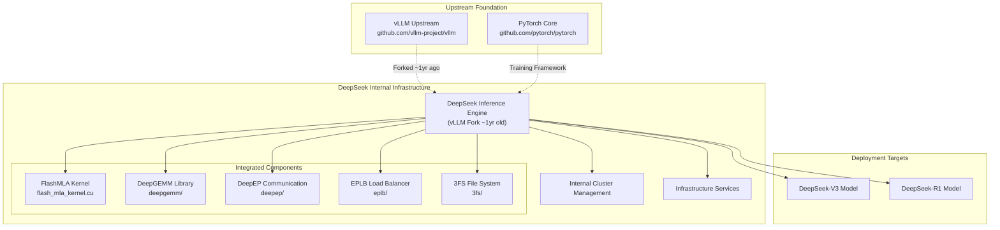
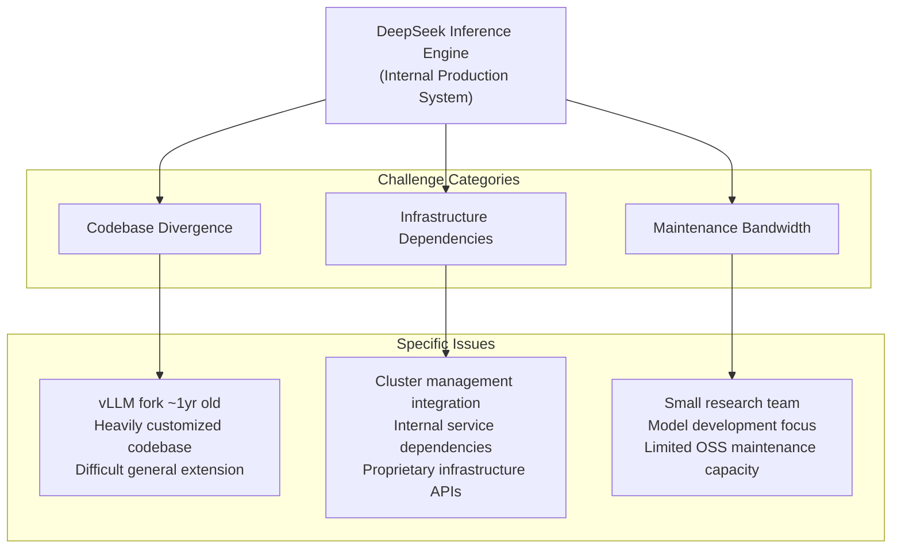
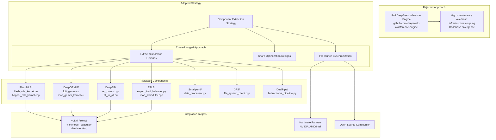
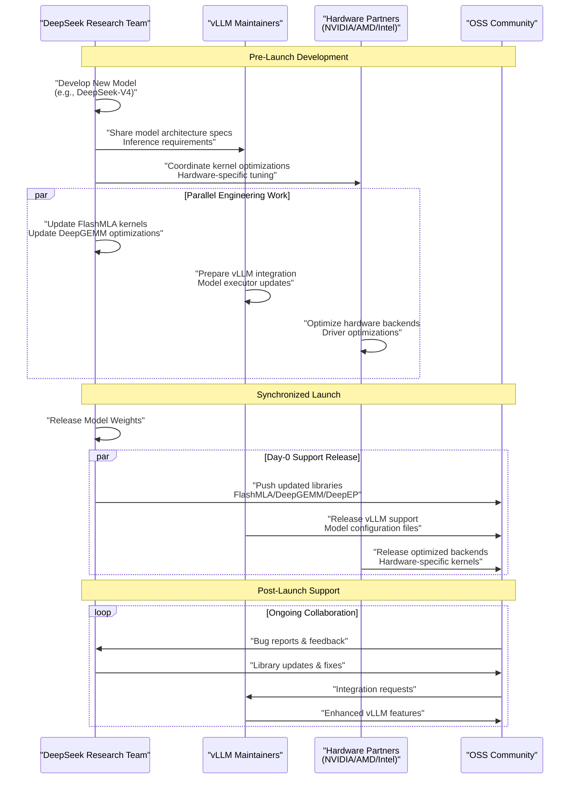

<!-- source: DeepWiki mcp.deepwiki.com · repo deepseek-ai/open-infra-index · page 3.3 Open-Sourcing Strategy · fetched 2026-10-30 -->

# Open-Sourcing Strategy

Relevant source files

The following files were used as context for generating this wiki page:

- [OpenSourcing_DeepSeek_Inference_Engine/README.md](OpenSourcing_DeepSeek_Inference_Engine/README.md)

## Purpose and Scope

This document outlines DeepSeek's strategic approach to open-sourcing its inference engine capabilities. It explains the challenges encountered with direct open-sourcing, the alternative strategy adopted, and how this approach benefits both the open-source community and DeepSeek's development goals. For details about the overall inference system architecture, see [Inference System Architecture](#3.1), and for performance optimization techniques, see [Performance Optimization](#3.2).

Sources: [OpenSourcing_DeepSeek_Inference_Engine/README.md:1-47]()

## Background: The DeepSeek Inference Engine

DeepSeek's inference engine is an integral part of the DeepSeek V3/R1 Inference System, built upon vLLM but extensively customized for DeepSeek's models and infrastructure. The engine orchestrates the operation of multiple components—including FlashMLA, DeepGEMM, DeepEP, and EPLB—to deliver efficient inference for large language models.

### DeepSeek Inference Engine Architecture

Sources: [OpenSourcing_DeepSeek_Inference_Engine/README.md:11-17]()

## Challenges in Direct Open-Sourcing

After careful consideration, DeepSeek identified three major challenges that made directly open-sourcing their complete inference engine impractical:

### Open-Sourcing Challenges

Sources: [OpenSourcing_DeepSeek_Inference_Engine/README.md:18-26]()

## Strategic Approach to Open-Sourcing

Rather than directly open-sourcing the entire inference engine, DeepSeek adopted a modular approach that focuses on contributing valuable components to existing open-source projects, particularly vLLM.

### Modular Open-Source Strategy Implementation

Sources: [OpenSourcing_DeepSeek_Inference_Engine/README.md:27-33]()

## Implementation of the Strategy

DeepSeek's open-sourcing strategy is implemented through three primary approaches:

### 1. Extracting Standalone Components

DeepSeek has modularized key components of its inference engine and released them as independent libraries:

- **FlashMLA**: Efficient MLA Decoding Kernel for Hopper GPUs
- **DeepGEMM**: FP8 GEMM Library achieving up to 1350+ TFLOPS
- **DeepEP**: EP Communication Library for MoE models
- **EPLB**: Expert-Parallel Load Balancer for optimizing MoE workloads

These components can be integrated into existing open-source frameworks like vLLM, allowing the community to benefit from DeepSeek's technological advancements without the overhead of maintaining an entire inference engine.

### 2. Sharing Design Optimizations

Beyond standalone libraries, DeepSeek contributes design improvements and implementation details directly to existing open-source projects. This includes:

- Optimization techniques for communication-computation overlapping
- Design patterns for efficient model parallelism
- Implementation details for high-performance inference

### 3. Pre-launch Synchronization Protocol

DeepSeek implements a "Day-0 SOTA Support" commitment for new model releases:

Sources: [OpenSourcing_DeepSeek_Inference_Engine/README.md:39-46]()

## Benefits of the Modular Strategy

### For the Open-Source Community

| Benefit | Description |
|---------|-------------|
| **Focused Libraries** | Standalone components that solve specific problems without complex dependencies |
| **Integration Flexibility** | Ability to incorporate individual optimizations into existing frameworks |
| **Day-0 Model Support** | Synchronized releases ensure new models are supported immediately |
| **Cross-Hardware Compatibility** | Optimizations developed with hardware partners benefit all users |

### For DeepSeek

| Benefit | Description |
|---------|-------------|
| **Sustainable Maintenance** | Manageable scope for a small research team |
| **Ecosystem Leverage** | Building on and contributing to established projects like vLLM |
| **Focus on Research** | More resources dedicated to model development |
| **Community Collaboration** | Direct engagement with developers using DeepSeek models |

Sources: [OpenSourcing_DeepSeek_Inference_Engine/README.md:34-37]()

## Conclusion

DeepSeek's open-sourcing strategy represents a pragmatic approach to contributing valuable technology to the open-source community while maintaining focus on their core research mission. By extracting standalone components, sharing optimizations, and synchronizing with the community for new model releases, DeepSeek ensures that their advancements in inference technology benefit the broader AI ecosystem without creating unsustainable maintenance burdens.

This strategy enables the efficient deployment of DeepSeek's advanced models like DeepSeek-V3 and DeepSeek-R1 across a wide range of hardware and software configurations, while fostering collaboration with the open-source community.

Sources: [OpenSourcing_DeepSeek_Inference_Engine/README.md:1-47]()

---

