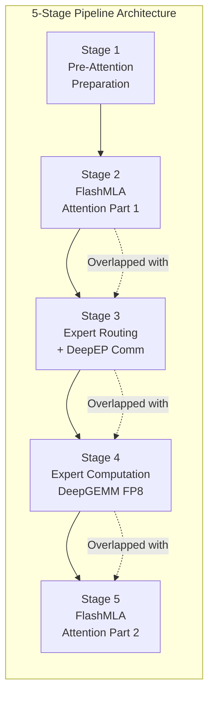
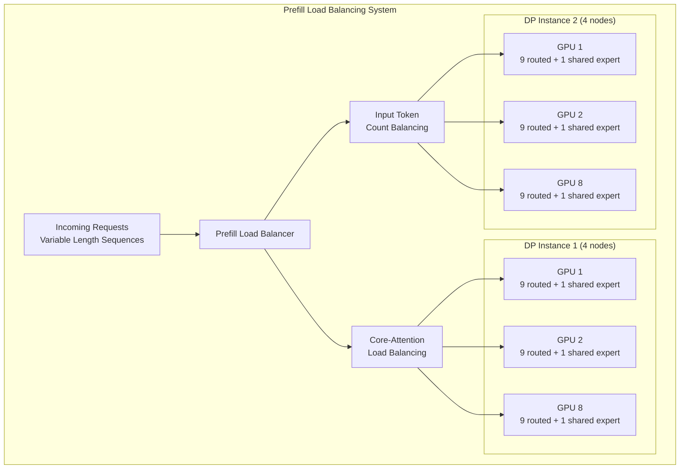
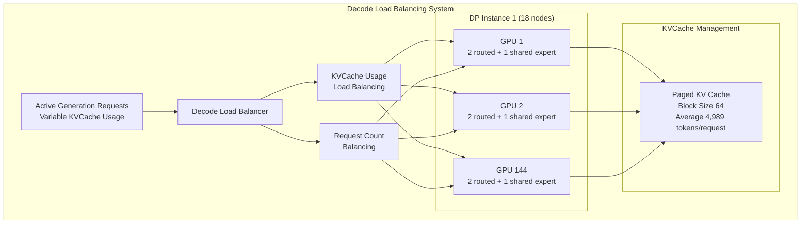
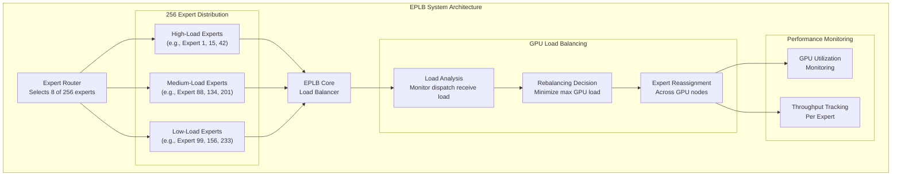
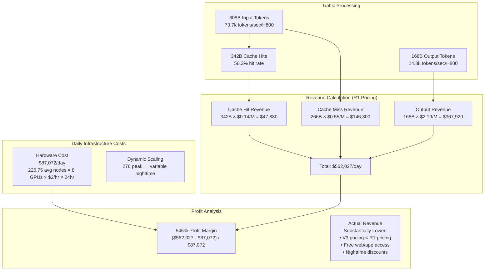
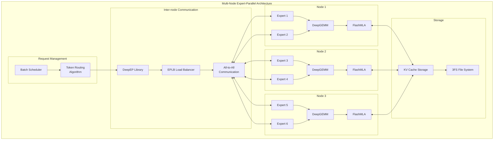

<!-- source: DeepWiki mcp.deepwiki.com · repo deepseek-ai/open-infra-index · page 4 Technical Deep Dives · fetched 2026-10-30 -->

# Technical Deep Dives

<details>
<summary>Relevant source files</summary>

The following files were used as context for generating this wiki page:

- [202502OpenSourceWeek/day_6_one_more_thing_deepseekV3R1_inference_system_overview.md](202502OpenSourceWeek/day_6_one_more_thing_deepseekV3R1_inference_system_overview.md)

</details>


## Purpose and Scope

This section provides in-depth technical examinations of specific optimization techniques implemented in the DeepSeek infrastructure. These deep dives focus on core performance optimization strategies that enable the exceptional throughput and efficiency demonstrated in DeepSeek's V3/R1 models.

For a high-level overview of individual infrastructure components, see [Components](#2). For the complete architecture of the inference system, see [DeepSeek V3/R1 Inference System](#3).

## Communication-Computation Overlapping

Communication-computation overlapping enables concurrent execution of data transfer and computational operations in expert parallelism (EP) architectures. DeepSeek implements distinct strategies for prefilling and decoding phases to maximize GPU utilization.

### Dual-Batch Strategy for Prefilling Phase

During prefilling, DeepSeek employs a dual-batch overlap strategy where batches are split into two microbatches that execute alternately. The communication cost of one microbatch is hidden behind the computation of the other.

**Dual-Batch Prefilling Pipeline**
```mermaid
gantt
    title "Dual-Batch Communication-Computation Overlap (Prefilling)"
    dateFormat s
    axisFormat %S
    
    section "Microbatch A"
    "Comm A1" :microbatch_a_comm1, 0, 1s
    "Comp A1" :microbatch_a_comp1, after microbatch_a_comm1, 2s
    "Comm A2" :microbatch_a_comm2, after microbatch_a_comp1, 1s
    "Comp A2" :microbatch_a_comp2, after microbatch_a_comm2, 2s
    
    section "Microbatch B"
    "Comm B1" :microbatch_b_comm1, 1s, 1s
    "Comp B1" :microbatch_b_comp1, after microbatch_b_comm1, 2s
    "Comm B2" :microbatch_b_comm2, after microbatch_b_comp1, 1s
    "Comp B2" :microbatch_b_comp2, after microbatch_b_comm2, 2s
```

**Architecture: EP32/DP32 (4 nodes per deployment unit)**
- Each GPU handles 9 routed experts and 1 shared expert
- 32 redundant routed experts across the deployment unit
- Alternating microbatch execution hides `DeepEP` all-to-all communication latency

Sources: [202502OpenSourceWeek/day_6_one_more_thing_deepseekV3R1_inference_system_overview.md:22-30]()

### 5-Stage Pipeline for Decoding Phase

During decoding, execution durations of different stages are unbalanced. DeepSeek subdivides the attention layer into two steps and uses a 5-stage pipeline to achieve seamless communication-computation overlapping.

**5-Stage Decoding Pipeline**


**Architecture: EP144/DP144 (18 nodes per deployment unit)**
- Each GPU manages 2 routed experts and 1 shared expert
- 256 total experts with 8 active per layer
- Pipeline stages overlap communication with computation phases

Sources: [202502OpenSourceWeek/day_6_one_more_thing_deepseekV3R1_inference_system_overview.md:21-36]()

### Performance Impact

Measured performance with overlapping optimizations on H800 GPUs:

| Phase | Throughput | Architecture | Key Components |
|-------|------------|--------------|----------------|
| Prefilling | 73.7k input tokens/sec/H800 | EP32/DP32, 4 nodes | Dual-batch + DeepEP + DeepGEMM |
| Decoding | 14.8k output tokens/sec/H800 | EP144/DP144, 18 nodes | 5-stage pipeline + FlashMLA |

Sources: [202502OpenSourceWeek/day_6_one_more_thing_deepseekV3R1_inference_system_overview.md:76-77]()

## Load Balancing Strategies

DeepSeek implements three specialized load balancing systems to address performance bottlenecks in large-scale expert parallelism across multiple GPU nodes.

### Prefill Load Balancer

**Problem**: Varying request counts and sequence lengths across DP instances cause imbalanced core-attention computation and dispatch send load.

**Optimization Objectives**:
- Balance core-attention computation across GPUs (computational load balancing)
- Equalize input token counts per GPU (dispatch send load balancing)



Sources: [202502OpenSourceWeek/day_6_one_more_thing_deepseekV3R1_inference_system_overview.md:41-45]()

### Decode Load Balancer

**Problem**: Uneven request counts and sequence lengths across DP instances cause disparities in core-attention computation (linked to KVCache usage) and dispatch send load.

**Optimization Objectives**:
- Balance KVCache usage across GPUs (core-attention computational load balancing)
- Equalize request counts per GPU (dispatch send load balancing)



Sources: [202502OpenSourceWeek/day_6_one_more_thing_deepseekV3R1_inference_system_overview.md:46-50](), [202502OpenSourceWeek/day_6_one_more_thing_deepseekV3R1_inference_system_overview.md:75]()

### Expert-Parallel Load Balancer (EPLB)

**Problem**: Inherently high-load experts result in imbalanced expert computational workloads across different GPUs.

**Optimization Objective**: Balance expert computation on each GPU by minimizing the maximum dispatch receive load across all GPUs.



Sources: [202502OpenSourceWeek/day_6_one_more_thing_deepseekV3R1_inference_system_overview.md:51-54]()

## Economic Analysis

DeepSeek's inference system demonstrates exceptional economic efficiency through technical optimizations, achieving a 545% profit margin based on theoretical R1 pricing.

### Production Metrics (24-hour period: UTC+8 02/27/2025 12:00 PM to 02/28/2025 12:00 PM)

**Infrastructure Scale**:
- Peak node occupancy: 278 H800 nodes (V3 + R1 combined)
- Average occupancy: 226.75 H800 nodes
- Dynamic scaling: Full deployment during peak daytime, reduced deployment at night
- Hardware cost: $2/hour per H800 GPU

**Traffic Statistics**:
- Total input tokens: 608B tokens/day
- Cache hit rate: 56.3% (342B tokens hit on-disk KV cache)
- Total output tokens: 168B tokens/day
- Average output speed: 20-22 tokens/second
- Average KV cache length: 4,989 tokens per output token

Sources: [202502OpenSourceWeek/day_6_one_more_thing_deepseekV3R1_inference_system_overview.md:65-75]()

### Cost Structure and Revenue Analysis



Sources: [202502OpenSourceWeek/day_6_one_more_thing_deepseekV3R1_inference_system_overview.md:67-68](), [202502OpenSourceWeek/day_6_one_more_thing_deepseekV3R1_inference_system_overview.md:78-86]()

### Technical Optimization Impact on Economics

| Component | Technical Capability | Economic Impact |
|-----------|---------------------|-----------------|
| FlashMLA | 580 TFLOPS BF16, 3000 GB/s memory bandwidth | Maximizes token generation throughput per H800 |
| DeepGEMM | 1350+ FP8 TFLOPS | Accelerates expert computation, reduces hardware requirements |
| DeepEP | Cross-node expert parallelism | Enables 256-expert MoE scaling across 18 nodes |
| EPLB | Expert load balancing | Maximizes GPU utilization, prevents bottlenecks |
| 3FS | 6.6 TiB/s throughput, 40+ GiB/s per node | Eliminates storage bottlenecks for KV cache operations |

The 545% profit margin demonstrates how technical optimizations directly translate to economic efficiency in large-scale AI inference systems.

Sources: [202502OpenSourceWeek/day_6_one_more_thing_deepseekV3R1_inference_system_overview.md:61-68](), [202502OpenSourceWeek/day_6_one_more_thing_deepseekV3R1_inference_system_overview.md:78-86]()

## Node Scaling with Expert Parallelism

DeepSeek's expert parallelism approach enables efficient scaling across multiple GPU nodes:



Sources: README.md:41-49, 66-70, 74-83, 86-97

## Optimization Analysis: Prefilling vs. Decoding

The DeepSeek infrastructure employs different optimization strategies for prefilling and decoding phases:

| Phase | Communication Pattern | Computation Characteristic | Key Optimizations |
|-------|----------------------|----------------------------|-------------------|
| Prefilling | High-volume batch data | Compute-bound | DeepEP high-throughput kernels, DeepGEMM FP8, batch processing |
| Decoding | Low-latency token exchanges | Memory-bound | FlashMLA, low-latency DeepEP kernels, KV cache optimization |

```mermaid
graph TD
    subgraph "Prefilling Optimizations"
        BatchProc["Batch Processing"]
        HTKernel["High-Throughput Kernels"]
        EP["DeepEP Communication"]
        GEMM["DeepGEMM FP8 1350+ TFLOPS"]
    end
    
    subgraph "Decoding Optimizations"
        FMLA["FlashMLA 580 TFLOPS<br>3000 GB/s"]
        LLKernel["Low-Latency Kernels"]
        KVC["KV Cache Optimization"]
        FS["3FS 40+ GiB/s/node"]
    end
    
    subgraph "Common Infrastructure"
        LoadBal["EPLB Load Balancing"]
        OverlapTech["Comm-Comp Overlapping"]
        StreamMgmt["CUDA Stream Management"]
    end
    
    BatchProc & HTKernel --> PrefillPerf["73.7k Input Tokens/sec/H800"]
    EP & GEMM --> PrefillPerf
    
    FMLA & LLKernel --> DecodePerf["14.8k Output Tokens/sec/H800"]
    KVC & FS --> DecodePerf
    
    LoadBal & OverlapTech & StreamMgmt --> PrefillPerf
    LoadBal & OverlapTech & StreamMgmt --> DecodePerf
```



Sources: README.md:28-36, 41-49, 54-59, 66-70, 74-83, 87-97

## Future Optimization Directions

The DeepSeek infrastructure continues to evolve with several promising optimization paths:

1. **Further precision optimization**: Moving beyond FP8 to INT4/INT8 for specific operations
2. **Memory hierarchy optimization**: Better leveraging GPU/CPU/SSD memory tiers
3. **Dynamic expert allocation**: Runtime adjustment of expert placement based on workload
4. **Advanced batching techniques**: More sophisticated token clustering for varied length processing
5. **Hardware-specific optimizations**: Targeting next-generation GPU architectures

These optimizations aim to further improve both technical performance metrics and economic efficiency.

Sources: README.md:86-97

---

