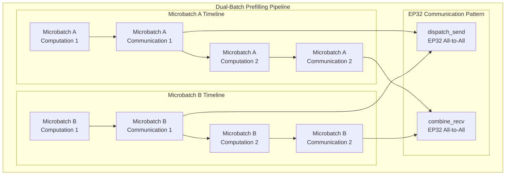
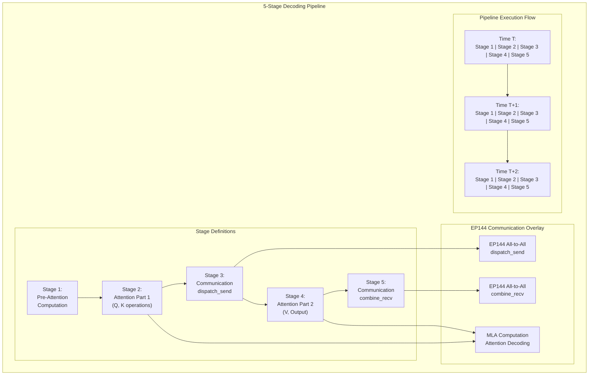
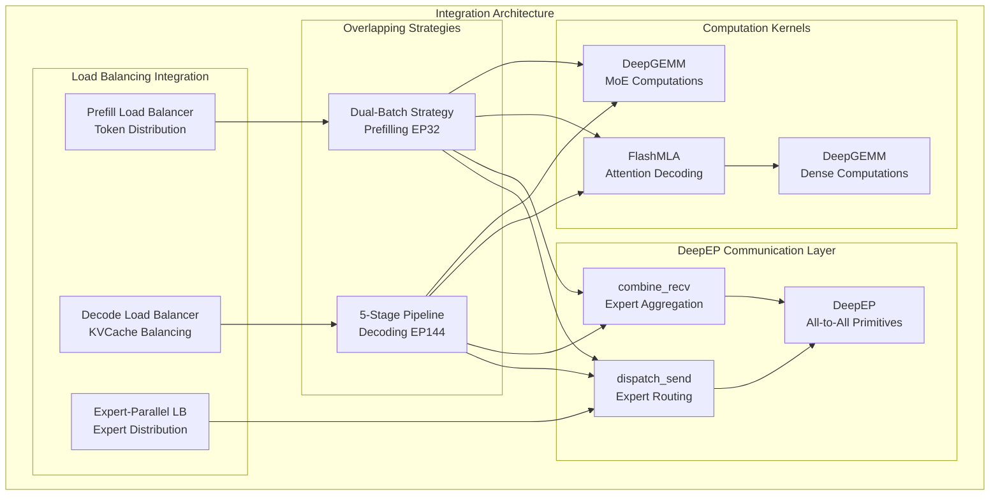

<!-- source: DeepWiki mcp.deepwiki.com · repo deepseek-ai/open-infra-index · page 4.1 Communication-Computation Overlapping · fetched 2026-10-30 -->

# Communication-Computation Overlapping

Relevant source files

The following files were used as context for generating this wiki page:

- [202502OpenSourceWeek/day_6_one_more_thing_deepseekV3R1_inference_system_overview.md](202502OpenSourceWeek/day_6_one_more_thing_deepseekV3R1_inference_system_overview.md)
- [202502OpenSourceWeek/figures/Communication-Computation Overlapping during Decoding Phase.png](202502OpenSourceWeek/figures/Communication-Computation Overlapping during Decoding Phase.png)
- [202502OpenSourceWeek/figures/Communication-Computation Overlapping during Prefilling Phase.png](202502OpenSourceWeek/figures/Communication-Computation Overlapping during Prefilling Phase.png)

## Purpose and Scope

This document explains the communication-computation overlapping mechanisms used in DeepSeek's inference system to hide cross-node communication latency behind computational operations. This optimization is critical for achieving high throughput and low latency in Expert Parallel (EP) deployments of DeepSeek-V3 and R1 models.

The techniques covered include the dual-batch overlapping strategy for the prefilling phase and the 5-stage pipeline approach for the decoding phase. For information about the broader inference system architecture, see [Inference System Architecture](#3.1). For details about the Expert Parallel communication implementation, see [DeepEP](#2.2.1).

## Problem Statement

Large-scale cross-node Expert Parallelism introduces significant communication overhead that can severely impact inference performance. The challenge is particularly acute in DeepSeek-V3/R1 models due to their sparse MoE architecture, where only 8 out of 256 experts per layer are activated, necessitating communication across multiple nodes to maintain sufficient batch sizes per expert.

The system employs different parallelism degrees for different phases:
- **Prefilling Phase**: `EP32` (Routed Expert) with `DP32` (MLA/Shared Expert) across 4 nodes
- **Decoding Phase**: `EP144` (Routed Expert) with `DP144` (MLA/Shared Expert) across 18 nodes

Without proper overlapping strategies, communication latencies would create bottlenecks that undermine the throughput and latency benefits of Expert Parallelism.

**Sources**: [202502OpenSourceWeek/day_6_one_more_thing_deepseekV3R1_inference_system_overview.md:9-24]()

## Dual-Batch Strategy for Prefilling Phase

### Overview

The prefilling phase uses a dual-batch overlap strategy where a batch of requests is split into two microbatches that execute alternately. This allows the communication cost of one microbatch to be hidden behind the computation of the other microbatch.

### Technical Implementation

The dual-batch strategy operates within the `EP32` configuration where each deployment unit spans 4 nodes. Each GPU handles 9 routed experts and 1 shared expert, creating communication patterns that must be carefully orchestrated to achieve overlapping.

The alternating execution pattern ensures that while one microbatch is performing expensive all-to-all communication operations (`dispatch_send` and `combine_recv`), the other microbatch is executing matrix computations on the GPU cores.

**Sources**: [202502OpenSourceWeek/day_6_one_more_thing_deepseekV3R1_inference_system_overview.md:25-30]()

## 5-Stage Pipeline for Decoding Phase

### Pipeline Architecture

The decoding phase faces a different challenge: execution durations of different stages are inherently unbalanced. To address this, the attention layer is subdivided into two steps, creating a 5-stage pipeline that achieves seamless communication-computation overlapping.

### Stage Breakdown

The 5-stage pipeline operates within the `EP144` configuration spanning 18 nodes, where each GPU manages 2 routed experts and 1 shared expert. The stages are carefully designed to balance computational load:

| Stage | Operation | Communication Pattern | GPU Utilization |
|-------|-----------|----------------------|-----------------|
| 1 | Pre-attention computation | None | High |
| 2 | Attention Part 1 (Q, K) | None | High |
| 3 | Expert dispatch | `dispatch_send` EP144 | Low compute, high comm |
| 4 | Attention Part 2 (V, Output) | None | High |
| 5 | Expert combine | `combine_recv` EP144 | Low compute, high comm |

The subdivision of the attention layer into two computational stages (2 and 4) ensures that communication stages (3 and 5) can be overlapped with meaningful computation from other pipeline stages.

**Sources**: [202502OpenSourceWeek/day_6_one_more_thing_deepseekV3R1_inference_system_overview.md:32-35]()

## System Integration with DeepEP

The communication-computation overlapping mechanisms integrate closely with the DeepEP communication library and the overall parallelism strategy. The overlapping patterns must coordinate with:

The overlapping strategies must work in coordination with three load balancers:
- **Prefill Load Balancer**: Balances core-attention computation and input token distribution
- **Decode Load Balancer**: Balances KVCache usage and request distribution  
- **Expert-Parallel Load Balancer**: Balances expert computation across GPUs

**Sources**: [202502OpenSourceWeek/day_6_one_more_thing_deepseekV3R1_inference_system_overview.md:38-55]()

## Performance Impact and Measurements

The communication-computation overlapping mechanisms contribute significantly to the system's overall performance characteristics. The system achieves:

- **Prefilling throughput**: ~73.7k tokens/s input per H800 node (including cache hits)
- **Decoding throughput**: ~14.8k tokens/s output per H800 node
- **Overall processing**: 608B input tokens and 168B output tokens in 24 hours across peak deployment of 278 nodes

The overlapping strategies are essential for these performance figures, as without proper overlap, communication latencies would create significant bottlenecks in the EP32/EP144 configurations required to handle the sparse activation patterns of the MoE architecture.

Additional performance details can be found in the DeepSeek profile data repository for more comprehensive analysis of the overlapping mechanisms' effectiveness.

**Sources**: [202502OpenSourceWeek/day_6_one_more_thing_deepseekV3R1_inference_system_overview.md:73-77](), [202502OpenSourceWeek/day_6_one_more_thing_deepseekV3R1_inference_system_overview.md:36-36]()

---

