# Page: Overview

# Overview

<details>
<summary>Relevant source files</summary>

The following files were used as context for generating this wiki page:

- [LICENSE](LICENSE)
- [README.md](README.md)

</details>


## Purpose and Scope

This document introduces the DeepSeek AI infrastructure repository, which contains seven core infrastructure components released during DeepSeek's February 2025 Open-Source Week initiative. These components form the foundational building blocks of DeepSeek's production AI training and inference systems, specifically optimized for large-scale Mixture of Experts (MoE) models including DeepSeek-V3 and DeepSeek-R1.

This overview covers the high-level system architecture, component relationships, and production performance characteristics. For detailed technical information about individual components, see [Components](#2). For comprehensive inference system documentation, see [DeepSeek V3/R1 Inference System](#3). For in-depth technical analyses, see [Technical Deep Dives](#4).

Sources: [README.md:1-112]()

## DeepSeek Open-Source Week Initiative

DeepSeek's Open-Source Week represents a systematic release of production-tested infrastructure components that power their online AI services. Starting February 24, 2025, DeepSeek released one component daily for six days, culminating in a comprehensive inference system overview.

The initiative emphasizes practical, battle-tested code rather than theoretical contributions - all components are documented, deployed, and actively serving production workloads handling millions of daily requests for DeepSeek's V3 and R1 models.

### Release Timeline

| Day | Component | Category | Key Capability |
|-----|-----------|----------|----------------|
| 1 | `FlashMLA` | Compute Optimization | MLA decoding kernel for Hopper GPUs |
| 2 | `DeepEP` | Communication & Parallelism | Expert Parallel communication library |
| 3 | `DeepGEMM` | Compute Optimization | FP8 GEMM library for dense and MoE |
| 4 | `DualPipe` + `EPLB` | Communication & Parallelism | Pipeline parallelism and load balancing |
| 5 | `3FS` + `Smallpond` | Storage & Data Processing | File system and data processing |
| 6 | Inference System | Integration | Complete V3/R1 inference architecture |

Sources: [README.md:18-104]()

## System Architecture Overview

The DeepSeek infrastructure implements a comprehensive software-hardware co-design optimized for MoE model architectures. The system integrates specialized compute kernels, communication libraries, and storage solutions to achieve high throughput and efficiency.

**DeepSeek Infrastructure System Architecture**

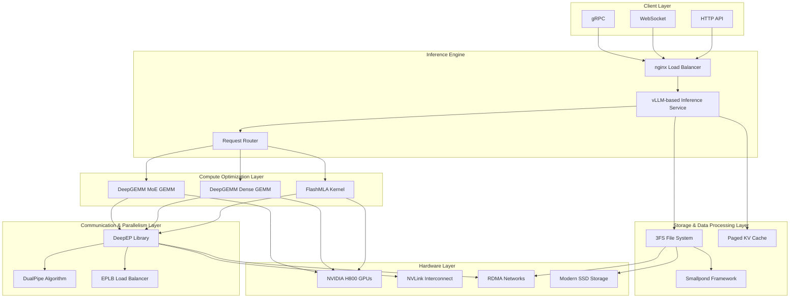

Sources: [README.md:32-87]()

## Component Categories and Relationships

The seven core components are organized into three functional categories, each addressing specific optimization challenges in large-scale AI infrastructure.

**Component Categorization and Data Flow**

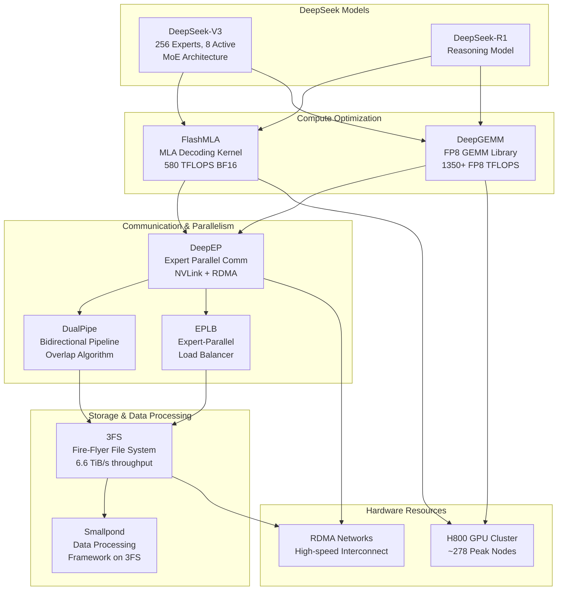

Sources: [README.md:32-87]()

## Production Performance Metrics

The integrated system achieves significant performance benchmarks in production environments, demonstrating the effectiveness of the co-designed infrastructure components.

### Inference Performance

| Metric | Value | Hardware Context |
|--------|-------|------------------|
| Input tokens/second | 73.7k per H800 node | Production V3/R1 serving |
| Output tokens/second | 14.8k per H800 node | Production V3/R1 serving |
| Daily input volume | 608B tokens | Aggregate system throughput |
| Daily output volume | 168B tokens | Aggregate system throughput |
| Cost profit margin | 545% | Economic efficiency analysis |

### Component Performance

| Component | Performance Metric | Hardware |
|-----------|-------------------|----------|
| `FlashMLA` | 580 TFLOPS BF16 compute-bound | H800 GPU |
| `FlashMLA` | 3000 GB/s memory-bound | H800 GPU |
| `DeepGEMM` | 1350+ FP8 TFLOPS | Hopper GPUs |
| `3FS` | 6.6 TiB/s aggregate read | 180-node cluster |
| `3FS` | 40+ GiB/s per client | KV cache lookup |

### Cache Performance

The production system maintains efficient caching with Redis achieving 342B cache hits at a 56.3% hit rate, significantly reducing computational overhead for repeated queries.

Sources: [README.md:96-100]()

## Research and Publications

The infrastructure components are supported by peer-reviewed research publications that detail the theoretical foundations and empirical evaluations.

### Current Publications

- **ISCA 2025**: "Insights into DeepSeek-V3: Scaling Challenges and Reflections on Hardware for AI Architectures" - Industry track paper analyzing V3 scaling challenges
- **SC 2024**: "Fire-Flyer AI-HPC: A Cost-Effective Software-Hardware Co-Design for Deep Learning" - Comprehensive system architecture analysis

These publications provide deeper technical context for the infrastructure design decisions and performance optimizations implemented across the component suite.

Sources: [README.md:12-14](), [README.md:107-111]()

---

# Page: Components

# Components

<details>
<summary>Relevant source files</summary>

The following files were used as context for generating this wiki page:

- [README.md](README.md)

</details>


## Purpose and Scope

This document provides a comprehensive overview of the seven core infrastructure components released during DeepSeek's Open-Source Week initiative. These components form the foundational building blocks of DeepSeek's production AI infrastructure, specifically optimized for large-scale Mixture of Experts (MoE) model training and inference.

The components are organized into three functional categories: Compute Optimization, Communication & Parallelism, and Storage & Data Processing. For detailed implementation specifics of individual components, refer to their respective subsections ([2.1](#2.1), [2.2](#2.2), [2.3](#2.3)). For information about the complete inference system architecture, see [DeepSeek V3/R1 Inference System](#3).

## Component Architecture Overview

The following diagram illustrates how all seven components integrate within the DeepSeek AI infrastructure:

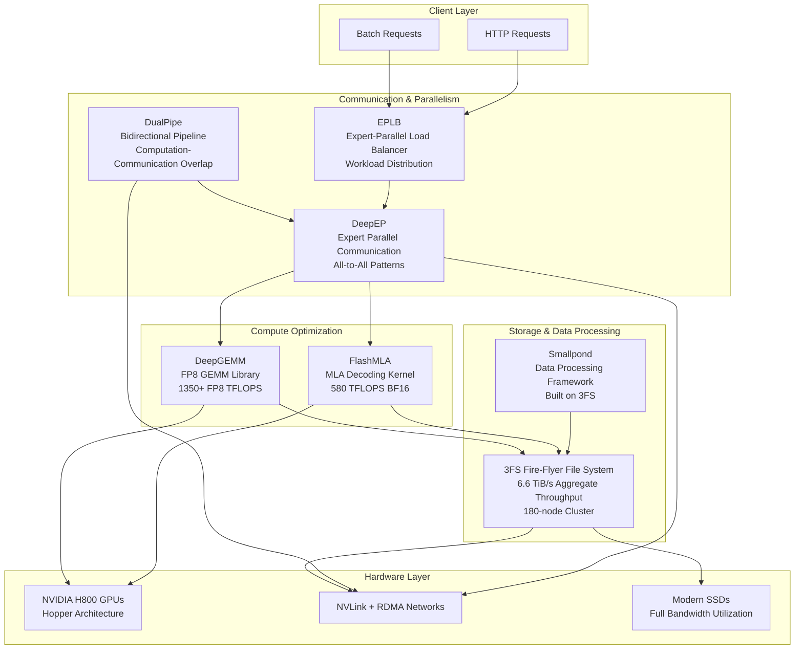

Sources: [README.md:32-87]()

## Component Categories and Specifications

The seven components are categorized based on their primary functional roles within the infrastructure:

| Category | Components | Primary Function | Key Performance Metrics |
|----------|------------|------------------|-------------------------|
| **Compute Optimization** | FlashMLA, DeepGEMM | Optimizing core computational operations | 580 TFLOPS (FlashMLA), 1350+ TFLOPS (DeepGEMM) |
| **Communication & Parallelism** | DeepEP, DualPipe, EPLB | Distributed communication and parallelization | All-to-All patterns, bidirectional pipelines |
| **Storage & Data Processing** | 3FS, Smallpond | High-performance storage and data pipelines | 6.6 TiB/s throughput, 40+ GiB/s per node |

Sources: [README.md:32-87]()

## Compute Optimization Components

### FlashMLA - Efficient MLA Decoding Kernel

`FlashMLA` provides optimized Multi-Layer Attention decoding specifically designed for NVIDIA Hopper GPUs with variable-length sequence support.

**Technical Specifications:**
- **Memory Performance**: 3000 GB/s memory-bound operations
- **Compute Performance**: 580 TFLOPS compute-bound on H800
- **Precision Support**: BF16 operations
- **Cache Architecture**: Paged KV cache with block size 64

### DeepGEMM - FP8 General Matrix Multiply Library

`DeepGEMM` delivers high-performance matrix operations supporting both dense and MoE computations for V3/R1 model training and inference.

**Technical Specifications:**
- **Peak Performance**: 1350+ FP8 TFLOPS on Hopper GPUs
- **Implementation**: Just-In-Time compiled with ~300 lines core logic
- **Layout Support**: Dense layout and two MoE layouts
- **Dependencies**: Minimal dependency footprint

Sources: [README.md:32-64]()

## Communication & Parallelism Components

### DeepEP - Expert Parallel Communication Library

`DeepEP` implements efficient all-to-all communication patterns for MoE model distributed processing.

**Communication Features:**
- **Network Support**: NVLink intranode and RDMA internode
- **Kernel Types**: High-throughput (training/prefilling) and low-latency (decoding)
- **Precision Support**: Native FP8 dispatch
- **Resource Management**: Flexible GPU resource control for computation-communication overlap

### DualPipe - Bidirectional Pipeline Parallelism

`DualPipe` enables bidirectional pipeline parallelism algorithm optimized for V3/R1 training with computation-communication overlap.

### EPLB - Expert-Parallel Load Balancer

`EPLB` manages workload distribution across expert parallel architectures for optimal resource utilization in V3/R1 systems.

Sources: [README.md:42-75]()

## Storage & Data Processing Components

### 3FS - Fire-Flyer File System

`3FS` provides a parallel file system utilizing full bandwidth of modern SSDs and RDMA networks.

**Performance Specifications:**
- **Aggregate Throughput**: 6.6 TiB/s in 180-node cluster
- **Benchmark Performance**: 3.66 TiB/min on GraySort (25-node cluster)
- **Per-Node Performance**: 40+ GiB/s peak throughput for KVCache lookup
- **Architecture**: Disaggregated with strong consistency semantics

**Use Cases:**
- Training data preprocessing and dataset loading
- Model checkpoint saving and reloading
- Embedding vector search operations
- KVCache lookups for V3/R1 inference

### Smallpond - Data Processing Framework

`Smallpond` operates as a data processing framework built on top of the `3FS` infrastructure, providing efficient data pipeline management.

Sources: [README.md:76-87]()

## Production Integration Architecture

The following diagram shows how components integrate in the production V3/R1 inference system:

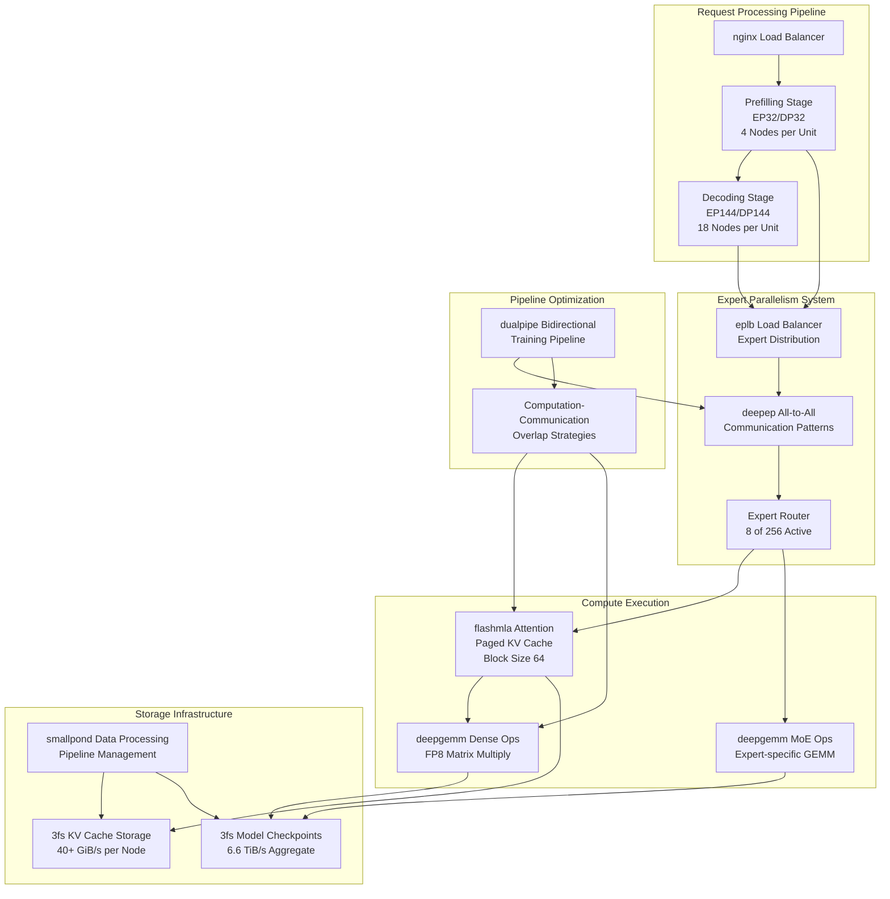

**Production Performance Metrics:**
- **Throughput**: 73.7k input tokens/sec per H800 node
- **Output Generation**: 14.8k output tokens/sec per H800 node  
- **Cost Efficiency**: 545% profit margin

Sources: [README.md:89-105]()

---

# Page: Compute Optimization

# Compute Optimization

<details>
<summary>Relevant source files</summary>

The following files were used as context for generating this wiki page:

- [README.md](README.md)

</details>


## Purpose and Scope

This section covers the core computational optimization components within the DeepSeek AI infrastructure, specifically focusing on components that accelerate the most computationally intensive operations in AI model training and inference. The compute optimization layer consists of two primary components: FlashMLA for attention mechanism optimization and DeepGEMM for matrix multiplication acceleration.

For detailed communication and parallelism strategies, see [Communication & Parallelism](#2.2). For storage and data processing infrastructure, see [Storage & Data Processing](#2.3).

## Component Overview

The compute optimization layer provides two specialized libraries that form the computational backbone of DeepSeek's V3/R1 models:

| Component | Primary Function | Target Hardware | Key Performance Metric |
|-----------|------------------|-----------------|------------------------|
| FlashMLA | Multi-Layer Attention decoding | NVIDIA Hopper GPUs | 580 TFLOPS BF16 compute-bound |
| DeepGEMM | FP8 matrix multiplication | NVIDIA Hopper GPUs | 1350+ FP8 TFLOPS |

Both components are production-tested and optimized specifically for the MoE (Mixture of Experts) architecture used in DeepSeek's V3/R1 models.

Sources: [README.md:32-63]()

## Compute Optimization Architecture

The following diagram illustrates how the compute optimization components integrate with the broader inference and training pipeline:

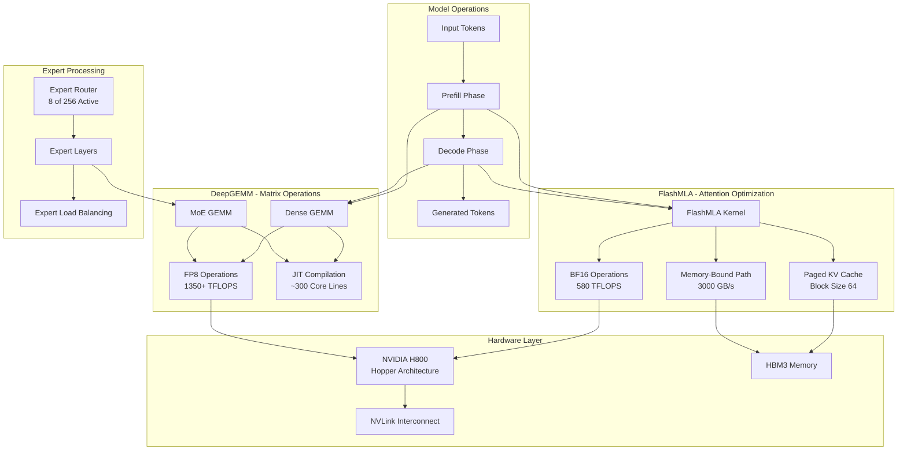

This architecture demonstrates the dual-path optimization approach: FlashMLA handles attention computations with memory-bandwidth optimization, while DeepGEMM accelerates matrix operations with compute-throughput optimization.

Sources: [README.md:32-63]()

## Computational Workload Distribution

The following diagram shows how different computational patterns are distributed across the optimization components:

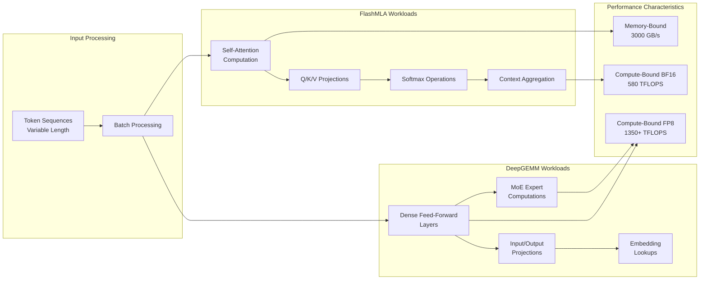

This distribution shows that FlashMLA primarily handles memory-intensive attention operations, while DeepGEMM focuses on compute-intensive matrix multiplications across both dense and MoE patterns.

Sources: [README.md:32-63]()

## Integration with Hardware Architecture

Both compute optimization components are specifically designed for NVIDIA Hopper architecture GPUs, particularly the H800. The integration leverages several hardware features:

### FlashMLA Hardware Integration
- **Paged KV Cache**: Uses block size 64 optimized for H800 memory hierarchy
- **BF16 Precision**: Balances numerical precision with memory bandwidth utilization
- **Memory Bandwidth**: Achieves 3000 GB/s memory throughput on memory-bound workloads

### DeepGEMM Hardware Integration  
- **FP8 Precision**: Maximizes compute throughput using Hopper's FP8 tensor cores
- **JIT Compilation**: Runtime optimization for varying matrix dimensions
- **Dual Layout Support**: Handles both dense computations and MoE expert routing patterns

The combined optimization strategy achieves production performance metrics of 73.7k input tokens and 14.8k output tokens per second per H800 node in the DeepSeek V3/R1 inference system.

Sources: [README.md:40](), [README.md:59](), [README.md:97]()

## Performance Optimization Strategy

The compute optimization approach follows a workload-specific strategy:

1. **Attention Operations**: FlashMLA optimizes for variable-length sequences and memory bandwidth utilization
2. **Matrix Operations**: DeepGEMM optimizes for high compute throughput with minimal dependencies
3. **Mixed Precision**: Strategic use of BF16 and FP8 based on numerical requirements and hardware capabilities
4. **Runtime Compilation**: JIT compilation ensures optimal performance across diverse matrix dimensions

This strategy enables the system to achieve a cost profit margin of 545% in production deployments.

Sources: [README.md:98]()

## Component Details

For comprehensive technical documentation of each compute optimization component:

- **FlashMLA**: See [FlashMLA](#2.1.1) for detailed kernel implementation, memory optimization techniques, and performance characteristics
- **DeepGEMM**: See [DeepGEMM](#2.1.2) for matrix multiplication algorithms, FP8 optimizations, and JIT compilation details

Sources: [README.md:32-63]()

---

# Page: FlashMLA

# FlashMLA

<details>
<summary>Relevant source files</summary>

The following files were used as context for generating this wiki page:

- [README.md](README.md)

</details>


## Purpose and Scope

FlashMLA is an efficient Multi-Layer Attention (MLA) decoding kernel specifically optimized for NVIDIA Hopper GPUs. This component serves as a critical compute optimization layer within DeepSeek's inference system, handling attention computations for variable-length sequences in production environments. FlashMLA is designed to maximize both memory bandwidth utilization and computational throughput for the MLA architecture used in DeepSeek V3 and R1 models.

For information about general matrix operations optimization, see [DeepGEMM](#2.1.2). For distributed communication patterns in MoE architectures, see [DeepEP](#2.2.1). For the complete inference system architecture, see [Inference System Architecture](#3.1).

## Architecture Overview

### System Integration

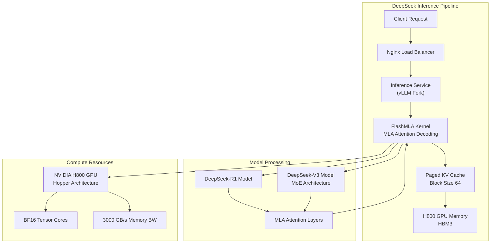

Sources: [README.md:32-41]()

### FlashMLA Core Components

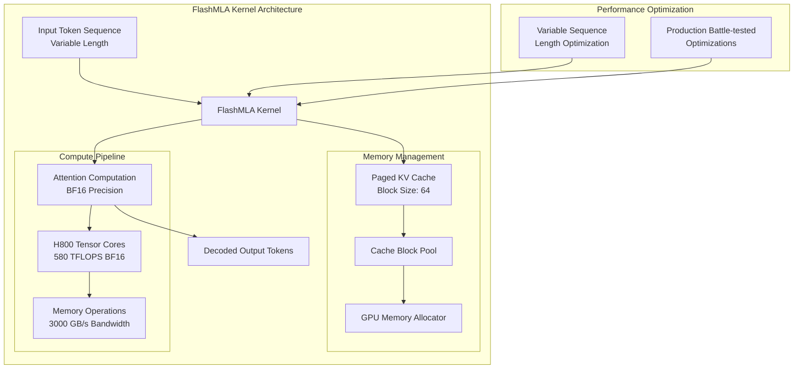

Sources: [README.md:32-41]()

## Performance Characteristics

### Computational Performance

FlashMLA achieves dual performance optimization modes depending on the computational characteristics of the workload:

| Performance Mode | Throughput | Hardware Utilization | Use Case |
|------------------|------------|---------------------|----------|
| Memory-bound | 3000 GB/s | Memory bandwidth limited | Large sequence lengths, sparse attention patterns |
| Compute-bound | 580 TFLOPS BF16 | Tensor core utilization | Dense attention computations, shorter sequences |

### Hardware Optimization

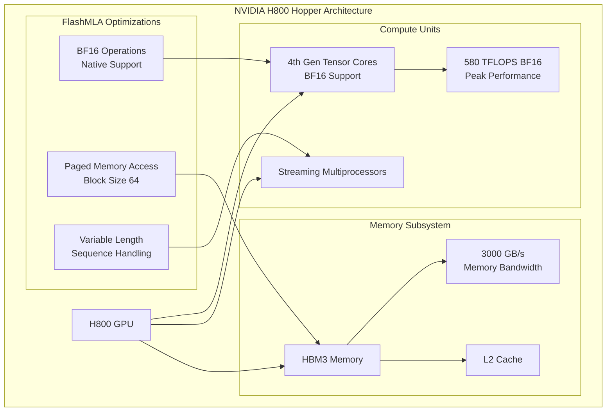

Sources: [README.md:38-40]()

## Technical Implementation

### Paged KV Cache Architecture

FlashMLA implements a paged KV cache system with a fixed block size of 64 tokens. This design enables efficient memory utilization for variable-length sequences while maintaining high-performance access patterns optimized for the Hopper architecture.

| Cache Parameter | Value | Purpose |
|-----------------|-------|---------|
| Block Size | 64 tokens | Optimal memory alignment for H800 |
| Precision | BF16 | Balance between precision and performance |
| Access Pattern | Paged | Efficient variable-length sequence handling |

### Integration with Inference System

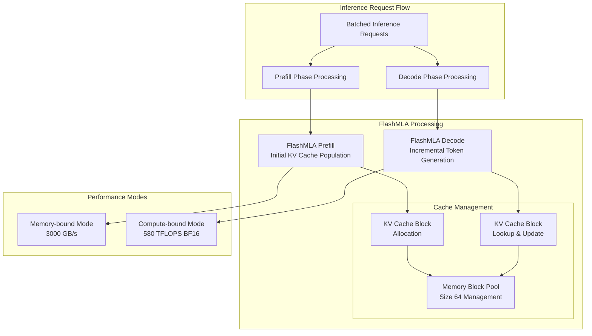

Sources: [README.md:32-41]()

## Production Deployment

FlashMLA has been battle-tested in DeepSeek's production inference environment, serving as a core component for both DeepSeek V3 and R1 model inference. The kernel's optimization for variable-length sequences makes it particularly well-suited for real-world inference workloads where sequence lengths vary significantly across requests.

### Key Production Features

- **BF16 Native Support**: Full support for BF16 precision across all operations
- **Paged KV Cache**: Block-based cache management with 64-token blocks
- **Variable Sequence Optimization**: Efficient handling of varying input sequence lengths
- **Hopper Architecture Tuning**: Specifically optimized for NVIDIA H800 GPUs

The component integrates seamlessly with DeepSeek's broader inference infrastructure, working in conjunction with expert parallelism systems and load balancing mechanisms to deliver high-throughput, low-latency inference for production workloads.

Sources: [README.md:32-41]()

---

# Page: DeepGEMM

# DeepGEMM

<details>
<summary>Relevant source files</summary>

The following files were used as context for generating this wiki page:

- [README.md](README.md)

</details>


## Purpose and Scope

DeepGEMM is a high-performance FP8 General Matrix Multiply (GEMM) library designed specifically for AI workloads on NVIDIA Hopper GPUs. It serves as a core computational component in the DeepSeek infrastructure, providing optimized matrix multiplication operations for both dense neural network layers and Mixture of Experts (MoE) computations.

This document covers the technical architecture, performance characteristics, and integration patterns of DeepGEMM within the broader DeepSeek AI infrastructure. For information about attention mechanisms optimization, see [FlashMLA](#2.1.1). For expert parallelism communication patterns, see [DeepEP](#2.2.1).

## System Architecture

DeepGEMM implements a Just-In-Time (JIT) compilation approach to deliver optimal performance across diverse matrix sizes while maintaining minimal dependencies and clean code architecture.

### Core Architecture

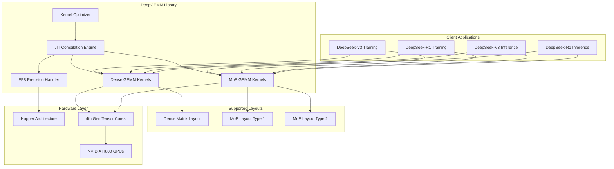

**DeepGEMM Core Architecture**

The architecture centers around a JIT compilation engine that generates optimized kernels for specific matrix configurations at runtime. This approach allows DeepGEMM to adapt to diverse workloads while maintaining a compact codebase of approximately 300 lines for core logic.

Sources: [README.md:54-64]()

### Integration with DeepSeek Infrastructure

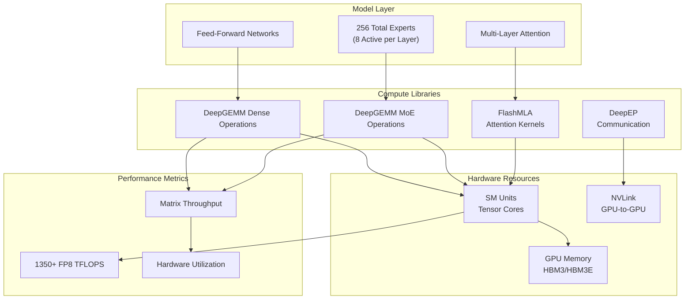

**DeepGEMM Integration in DeepSeek Infrastructure**

DeepGEMM operates as a foundational compute layer, providing optimized matrix operations for both the dense components of neural networks and the expert-specific computations in MoE architectures. The library interfaces directly with hardware Tensor Cores to achieve peak performance.

Sources: [README.md:54-64](), [README.md:96-99]()

## Performance Characteristics

DeepGEMM delivers exceptional computational performance through targeted optimizations for FP8 precision and Hopper GPU architecture.

### Performance Metrics

| Metric | Value | Description |
|--------|-------|-------------|
| Peak Performance | 1350+ FP8 TFLOPS | Maximum theoretical throughput on H800 GPUs |
| Precision Support | FP8 | Optimized for mixed-precision training and inference |
| Code Complexity | ~300 lines | Core logic implementation size |
| Compilation | JIT | Just-In-Time kernel generation |
| Dependencies | Minimal | Clean, tutorial-like implementation |

### Optimization Strategies

DeepGEMM employs several key optimization techniques:

1. **JIT Compilation**: Generates specialized kernels for specific matrix dimensions and layouts at runtime
2. **FP8 Precision**: Leverages Hopper's native FP8 support for maximum throughput
3. **Layout Optimization**: Supports multiple memory layouts optimized for different access patterns
4. **Kernel Fusion**: Combines operations to reduce memory bandwidth requirements

Sources: [README.md:59-63]()

## MoE-Specific Optimizations

DeepGEMM provides specialized support for MoE computations, which are critical for DeepSeek-V3's 256-expert architecture.

### MoE Layout Support

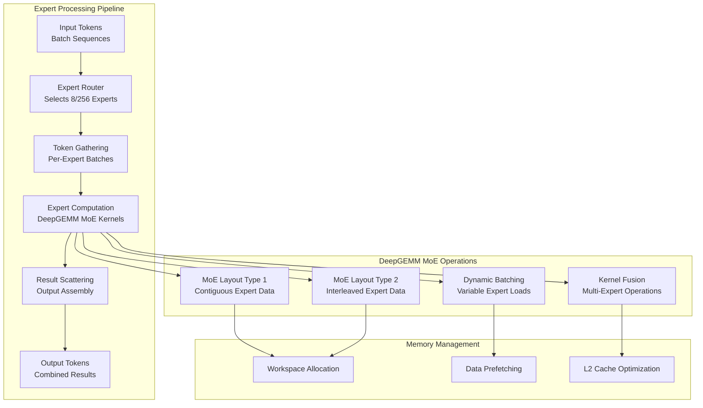

**MoE Processing with DeepGEMM**

The MoE-specific optimizations handle the complex memory access patterns and dynamic batching requirements of expert computations. Two distinct layout types accommodate different expert organization strategies used in DeepSeek-V3 training and inference.

Sources: [README.md:63]()

## Integration with Training and Inference

DeepGEMM serves both training and inference workloads across the DeepSeek model family, providing consistent performance across different operational modes.

### Operational Modes

| Mode | Models | Characteristics | DeepGEMM Usage |
|------|--------|----------------|----------------|
| Training | V3, R1 | Large batch sizes, backward pass | Dense + MoE kernels |
| Inference | V3, R1 | Variable sequence lengths | Optimized for throughput |
| Prefilling | V3, R1 | Parallel token processing | High-throughput mode |
| Decoding | V3, R1 | Sequential generation | Low-latency mode |

### Production Performance

In production environments, DeepGEMM contributes to the overall system performance metrics:

- **Input Token Processing**: 73.7k tokens per second per H800 node
- **Output Token Generation**: 14.8k tokens per second per H800 node
- **Cost Efficiency**: 545% profit margin through optimized compute utilization

Sources: [README.md:96-99]()

## Technical Implementation

DeepGEMM's implementation philosophy prioritizes simplicity and performance, achieving expert-level kernel performance with minimal code complexity.

### Key Implementation Features

1. **Minimal Dependencies**: Clean implementation without heavy external requirements
2. **JIT Compilation**: Runtime kernel specialization for optimal performance
3. **Cross-Platform**: Designed for NVIDIA Hopper architecture with forward compatibility
4. **Modular Design**: Separate handling of dense and MoE computation patterns

### Performance Comparison

The library consistently outperforms expert-tuned kernels across most matrix sizes while maintaining a significantly smaller codebase. This is achieved through intelligent kernel selection and JIT optimization strategies that adapt to specific workload characteristics.

Sources: [README.md:60-62]()

---

# Page: Communication & Parallelism

# Communication & Parallelism

<details>
<summary>Relevant source files</summary>

The following files were used as context for generating this wiki page:

- [README.md](README.md)

</details>


This document covers the communication and parallelization components that enable distributed training and inference for large-scale MoE (Mixture of Experts) models. These systems handle the complex communication patterns required to efficiently distribute workloads across multiple nodes and GPUs, with particular focus on expert parallel communication, pipeline parallelism, and dynamic load balancing.

For compute optimization components like matrix operations and attention kernels, see [Compute Optimization](#2.1). For storage and data processing infrastructure, see [Storage & Data Processing](#2.3).

## MoE Communication Architecture Overview

The DeepSeek MoE architecture requires sophisticated communication patterns to coordinate work across distributed expert layers. The system employs different parallelization strategies for training versus inference, and for prefill versus decode phases.

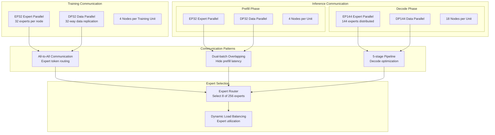

**Sources:** [README.md:42-53](), [README.md:89-104]()

## Expert Parallel Communication with DeepEP

DeepEP provides the foundational communication primitives for expert parallel training and inference. It handles the all-to-all communication patterns required when tokens are dynamically routed to different experts across nodes.

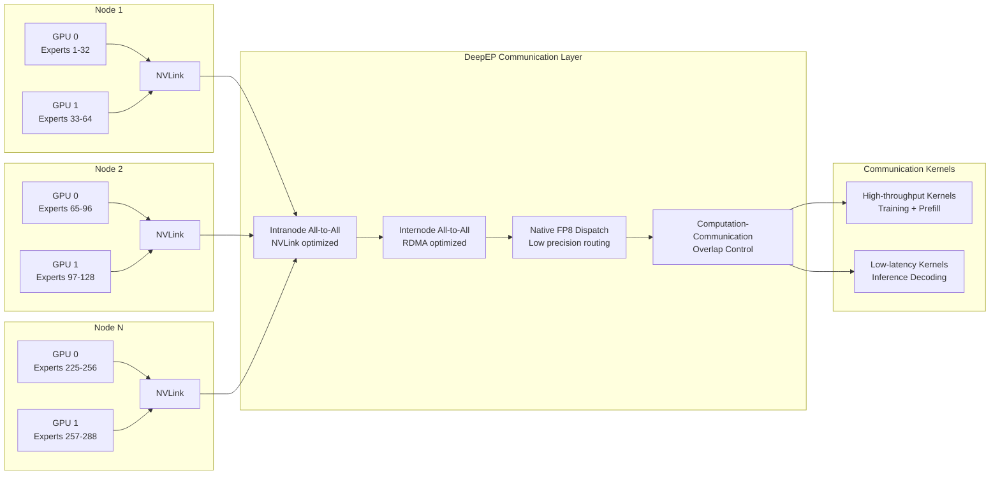

**Sources:** [README.md:42-53]()

## Pipeline Parallelism with DualPipe

DualPipe implements bidirectional pipeline parallelism specifically optimized for the V3/R1 model architectures. It enables computation-communication overlap during training by managing forward and backward passes across pipeline stages.

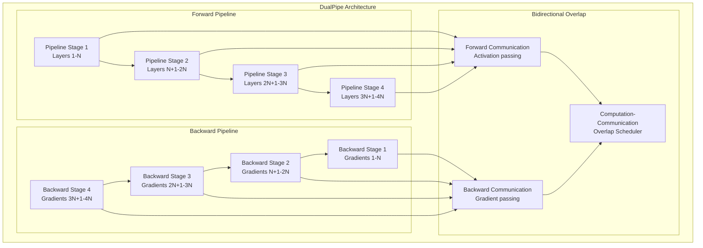

**Sources:** [README.md:67-68](), [README.md:73-74]()

## Expert Load Balancing with EPLB

EPLB manages the distribution of tokens across experts to maintain balanced utilization and prevent expert capacity overflow. It operates at both the prefill and decode phases with different optimization strategies.

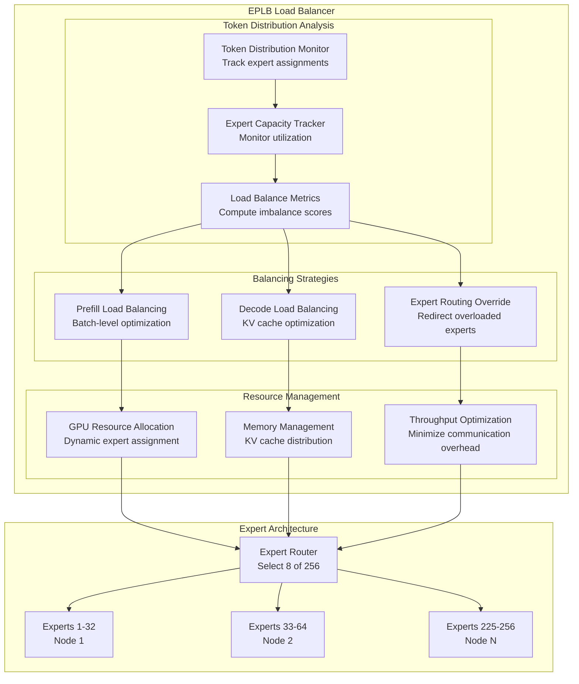

**Sources:** [README.md:70-71]()

## Integrated Communication Orchestration

The communication and parallelism components work together to enable the high-throughput, low-latency performance reported in the production V3/R1 inference system.

| Component | Function | Performance Impact |
|-----------|----------|-------------------|
| `DeepEP` | Expert parallel all-to-all communication | Enables 256-expert MoE scaling across nodes |
| `DualPipe` | Bidirectional pipeline parallelism | Hides communication latency in training |  
| `EPLB` | Expert load balancing | Maintains 73.7k tokens/sec/node throughput |

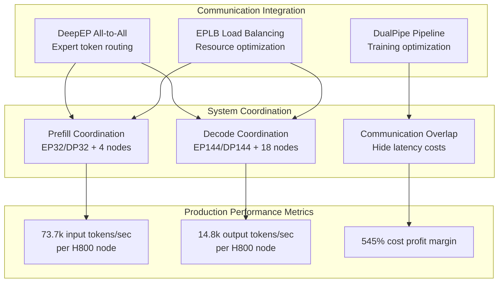

**Sources:** [README.md:89-104]()

---

# Page: DeepEP

# DeepEP

<details>
<summary>Relevant source files</summary>

The following files were used as context for generating this wiki page:

- [README.md](README.md)

</details>


## Purpose and Scope

DeepEP is the expert parallel (EP) communication library designed specifically for efficient MoE (Mixture of Experts) model training and inference across multiple nodes. This component handles the complex all-to-all communication patterns required when distributing expert computations across GPU clusters, optimizing both high-throughput training scenarios and low-latency inference workloads.

DeepEP focuses exclusively on expert-level parallelization communication. For pipeline parallelism strategies, see [DualPipe](#2.2.2). For expert workload distribution and balancing, see [EPLB](#2.2.3).

## System Architecture

DeepEP serves as the communication backbone for MoE model architectures, particularly those with large numbers of experts like DeepSeek-V3's 256-expert configuration where only 8 experts are active per layer.

### High-Level Integration

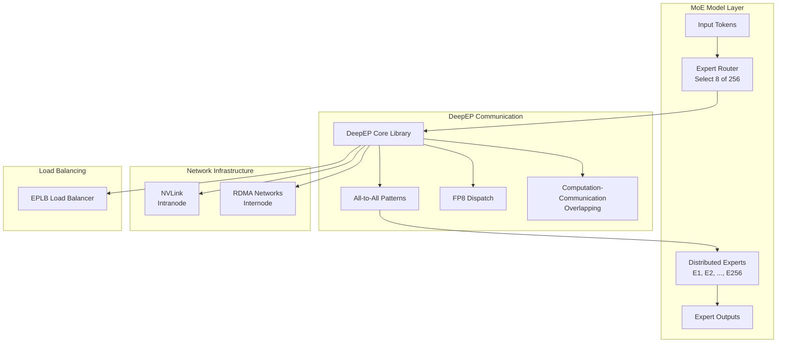

Sources: [README.md:42-52]()

### Communication Pattern Architecture

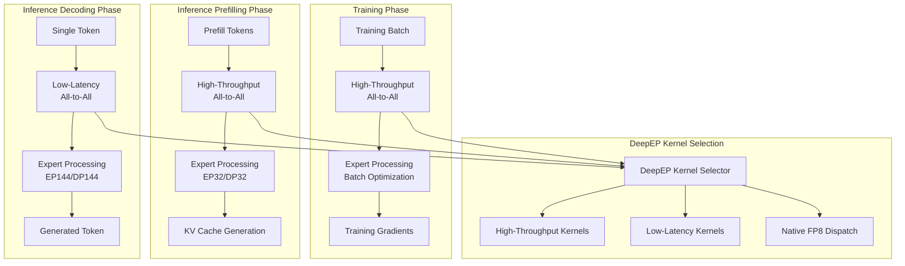

Sources: [README.md:47-52]()

## Communication Patterns

### All-to-All Communication

DeepEP implements optimized all-to-all communication patterns that are fundamental to expert parallel processing in MoE architectures. When tokens are routed to different experts across multiple nodes, the system must efficiently redistribute data according to expert assignments.

| Communication Type | Optimization Target | Use Case | Parallelism Strategy |
|-------------------|-------------------|----------|---------------------|
| High-Throughput | Maximize data transfer rate | Training, Prefilling | EP32/DP32 (4 nodes) |
| Low-Latency | Minimize communication delay | Decoding | EP144/DP144 (18 nodes) |

### Network Layer Support

DeepEP provides native support for both intranode and internode communication:

- **NVLink**: High-bandwidth GPU-to-GPU communication within nodes
- **RDMA**: Low-latency inter-node communication across the cluster

The library automatically selects the appropriate communication path based on the source and destination GPU locations.

Sources: [README.md:48]()

## Performance Characteristics

### Kernel Optimization Strategies

DeepEP employs different kernel optimizations depending on the workload phase:

```mermaid
graph LR
    subgraph "Training Workload"
        TRAIN_BATCH["Large Batch Size"]
        TRAIN_KERNEL["High-Throughput Kernel"]
        TRAIN_PERF["Optimize for<br/>Aggregate Bandwidth"]
    end
    
    subgraph "Inference Prefilling"
        PREFILL_BATCH["Medium Batch Size"]
        PREFILL_KERNEL["High-Throughput Kernel"]
        PREFILL_PERF["Optimize for<br/>Token Throughput"]
    end
    
    subgraph "Inference Decoding"
        DECODE_BATCH["Small Batch Size<br/>Single Tokens"]
        DECODE_KERNEL["Low-Latency Kernel"]
        DECODE_PERF["Optimize for<br/>Response Time"]
    end
    
    TRAIN_BATCH --> TRAIN_KERNEL
    TRAIN_KERNEL --> TRAIN_PERF
    
    PREFILL_BATCH --> PREFILL_KERNEL
    PREFILL_KERNEL --> PREFILL_PERF
    
    DECODE_BATCH --> DECODE_KERNEL
    DECODE_KERNEL --> DECODE_PERF
```

Sources: [README.md:49-50]()

### FP8 Support

DeepEP provides native FP8 dispatch support, enabling efficient mixed-precision communication patterns that align with the FP8 computations performed by expert layers. This reduces memory bandwidth requirements and improves overall system throughput.

Sources: [README.md:51]()

## Integration with System Components

### Expert Parallel Load Balancer Integration

DeepEP works closely with EPLB to ensure efficient expert utilization:

```mermaid
graph TB
    subgraph "Token Routing Flow"
        INPUT_TOKENS["Input Tokens"]
        EXPERT_ROUTER["Expert Router<br/>Token Assignment"]
        DEEPEP_COMM["DeepEP Communication<br/>All-to-All Redistribution"]
        EXPERT_COMPUTE["Expert Computation<br/>Distributed Processing"]
        EPLB_BALANCE["EPLB Load Balancing<br/>Dynamic Adjustment"]
        OUTPUT_GATHER["Output Gathering<br/>All-to-All Collection"]
    end
    
    INPUT_TOKENS --> EXPERT_ROUTER
    EXPERT_ROUTER --> DEEPEP_COMM
    DEEPEP_COMM --> EXPERT_COMPUTE
    EXPERT_COMPUTE --> EPLB_BALANCE
    EPLB_BALANCE --> OUTPUT_GATHER
    OUTPUT_GATHER --> DEEPEP_COMM
```

Sources: [README.md:42-52]()

### Computation-Communication Overlapping

DeepEP provides flexible GPU resource control that enables computation-communication overlapping strategies. This allows the system to hide communication latency by performing expert computations while data transfers are in progress.

The library supports dual-batch overlapping during prefilling phases and multi-stage pipeline overlapping during decoding phases, working in coordination with other system components like DualPipe.

Sources: [README.md:52]()

## Deployment Architecture

DeepEP operates across the distributed GPU infrastructure supporting DeepSeek-V3/R1 models:

### Node Configuration

| Phase | Expert Parallelism | Data Parallelism | Nodes per Unit |
|-------|------------------|-----------------|----------------|
| Prefilling | EP32 | DP32 | 4 |
| Decoding | EP144 | DP144 | 18 |

### Resource Management

DeepEP manages communication resources across the cluster, coordinating with the underlying RDMA network infrastructure and NVLink topology to optimize data movement patterns for the 256-expert MoE architecture where only 8 experts are active per layer.

Sources: [README.md:42-52]()

---

# Page: DualPipe

# DualPipe

<details>
<summary>Relevant source files</summary>

The following files were used as context for generating this wiki page:

- [README.md](README.md)

</details>


DualPipe is a bidirectional pipeline parallelism algorithm designed to optimize computation-communication overlap during DeepSeek V3 and R1 model training. It implements advanced pipeline scheduling strategies to maximize hardware utilization by enabling simultaneous forward and backward pass execution across multiple pipeline stages.

For information about expert-parallel load balancing, see [EPLB](#2.2.3). For details on expert-parallel communication primitives, see [DeepEP](#2.2.1).

## Overview

DualPipe addresses the fundamental challenge of pipeline parallelism in large language model training: minimizing pipeline bubble overhead while maintaining high throughput. Traditional unidirectional pipeline approaches suffer from significant idle time during pipeline startup and shutdown phases. DualPipe's bidirectional design enables continuous utilization of compute resources by overlapping forward and backward passes in both directions along the pipeline.

The algorithm is specifically optimized for the DeepSeek V3 and R1 model architectures, taking advantage of their MoE (Mixture of Experts) structure and Multi-Layer Attention mechanisms. DualPipe coordinates with other parallelism strategies including expert parallelism (via DeepEP) and data parallelism to create a comprehensive distributed training solution.

**Sources:** [README.md:67-68]()

## System Architecture

DualPipe operates as part of the broader parallelism infrastructure, integrating closely with the expert parallelism and communication optimization systems.

### DualPipe Pipeline Flow

```mermaid
graph TD
    subgraph "Pipeline Stage Architecture"
        subgraph "Forward Direction"
            F_Stage0["F_Stage_0<br/>Input Processing"]
            F_Stage1["F_Stage_1<br/>Early Layers"]
            F_Stage2["F_Stage_2<br/>Middle Layers"]
            F_Stage3["F_Stage_3<br/>Output Layers"]
        end
        
        subgraph "Backward Direction"
            B_Stage3["B_Stage_3<br/>Gradient Computation"]
            B_Stage2["B_Stage_2<br/>Gradient Propagation"]
            B_Stage1["B_Stage_1<br/>Weight Updates"]
            B_Stage0["B_Stage_0<br/>Input Gradients"]
        end
    end
    
    subgraph "Communication Layer"
        COMM_FWD["Forward Communication<br/>Activations Transfer"]
        COMM_BWD["Backward Communication<br/>Gradient Transfer"]
        OVERLAP["Computation-Communication<br/>Overlap Manager"]
    end
    
    subgraph "Integration Points"
        DEEPEP_INT["DeepEP Integration<br/>Expert Routing"]
        EXPERT_COMM["Expert Communication<br/>All-to-All Patterns"]
        LOAD_BALANCE["Dynamic Load Balancing"]
    end
    
    F_Stage0 --> F_Stage1
    F_Stage1 --> F_Stage2
    F_Stage2 --> F_Stage3
    
    B_Stage3 --> B_Stage2
    B_Stage2 --> B_Stage1
    B_Stage1 --> B_Stage0
    
    F_Stage1 --> COMM_FWD
    F_Stage2 --> COMM_FWD
    F_Stage3 --> COMM_FWD
    
    B_Stage2 --> COMM_BWD
    B_Stage1 --> COMM_BWD
    B_Stage0 --> COMM_BWD
    
    COMM_FWD --> OVERLAP
    COMM_BWD --> OVERLAP
    
    F_Stage1 --> DEEPEP_INT
    F_Stage2 --> DEEPEP_INT
    B_Stage2 --> DEEPEP_INT
    B_Stage1 --> DEEPEP_INT
    
    DEEPEP_INT --> EXPERT_COMM
    EXPERT_COMM --> LOAD_BALANCE
    OVERLAP --> LOAD_BALANCE
```

**Sources:** [README.md:67-68](), [README.md:92-94]()

### Integration with V3/R1 Training Pipeline

DualPipe coordinates with the broader training infrastructure to optimize end-to-end performance:

```mermaid
graph TB
    subgraph "Training Workflow"
        BATCH_INPUT["Training Batch Input<br/>Input Tokens"]
        DUALPIPE_SCHED["DualPipe Scheduler<br/>Bidirectional Pipeline"]
        FORWARD_PASS["Forward Pass Execution<br/>MLA + MoE Layers"]
        BACKWARD_PASS["Backward Pass Execution<br/>Gradient Computation"]
        OPTIMIZER_UPDATE["Optimizer Update<br/>Parameter Updates"]
    end
    
    subgraph "Parallelism Coordination"
        EXPERT_PARALLEL["Expert Parallelism<br/>256 Experts, 8 Active"]
        DATA_PARALLEL["Data Parallelism<br/>Batch Distribution"]
        TENSOR_PARALLEL["Tensor Parallelism<br/>Layer Sharding"]
    end
    
    subgraph "Communication Infrastructure"
        DEEPEP_COMM["DeepEP Communication<br/>Expert All-to-All"]
        NVLINK_COMM["NVLink Communication<br/>Intranode Transfer"]
        RDMA_COMM["RDMA Communication<br/>Internode Transfer"]
    end
    
    subgraph "Computation Kernels"
        DEEPGEMM_DENSE["DeepGEMM Dense<br/>FP8 Matrix Operations"]
        DEEPGEMM_MOE["DeepGEMM MoE<br/>Expert Computations"]
        FLASHMLA_KERNEL["FlashMLA Kernel<br/>Attention Computation"]
    end
    
    BATCH_INPUT --> DUALPIPE_SCHED
    DUALPIPE_SCHED --> FORWARD_PASS
    FORWARD_PASS --> BACKWARD_PASS
    BACKWARD_PASS --> OPTIMIZER_UPDATE
    
    DUALPIPE_SCHED --> EXPERT_PARALLEL
    DUALPIPE_SCHED --> DATA_PARALLEL
    DUALPIPE_SCHED --> TENSOR_PARALLEL
    
    EXPERT_PARALLEL --> DEEPEP_COMM
    DATA_PARALLEL --> NVLINK_COMM
    TENSOR_PARALLEL --> RDMA_COMM
    
    FORWARD_PASS --> DEEPGEMM_DENSE
    FORWARD_PASS --> DEEPGEMM_MOE
    FORWARD_PASS --> FLASHMLA_KERNEL
    BACKWARD_PASS --> DEEPGEMM_DENSE
    BACKWARD_PASS --> DEEPGEMM_MOE
```

**Sources:** [README.md:42-52](), [README.md:54-64](), [README.md:32-40]()

## Computation-Communication Overlap Strategy

DualPipe implements sophisticated overlap techniques to hide communication latency behind computation. The algorithm coordinates with the broader infrastructure to ensure maximum resource utilization during training.

### Overlap Patterns

| Phase | Forward Direction | Backward Direction | Communication Type |
|-------|------------------|-------------------|-------------------|
| Startup | Active Pipeline Fill | Idle | Activation Transfer |
| Steady State | Continuous Forward | Continuous Backward | Bidirectional Overlap |
| Shutdown | Pipeline Drain | Active Gradient Flow | Gradient Transfer |

The bidirectional approach ensures that while one direction is in startup/shutdown phase, the other direction maintains steady-state operation, minimizing overall pipeline bubbles.

### Performance Characteristics

DualPipe's effectiveness is measured through its integration with the V3/R1 training pipeline:

| Metric | Impact |
|--------|--------|
| Pipeline Utilization | Maximized through bidirectional scheduling |
| Communication Overlap | Achieved via coordinated forward/backward passes |
| Expert Load Balancing | Integrated with EPLB for dynamic distribution |
| Memory Efficiency | Optimized activation and gradient buffering |

**Sources:** [README.md:92-94](), [README.md:73-74]()

## Production Integration

DualPipe operates as a core component of the DeepSeek training infrastructure, contributing to the overall performance metrics achieved in V3 and R1 model training. The algorithm's bidirectional pipeline approach directly supports the high-throughput requirements of large-scale model training.

The system integrates with:
- **DeepEP** for expert-parallel communication coordination
- **EPLB** for dynamic load balancing across experts
- **DeepGEMM** for optimized matrix operations within pipeline stages
- **FlashMLA** for efficient attention computation

This integration enables the comprehensive parallelism strategy that supports DeepSeek's production training workloads, where computation-communication overlap is critical for maintaining training efficiency at scale.

**Sources:** [README.md:65-75](), [README.md:19-30]()

---

# Page: EPLB

# EPLB

<details>
<summary>Relevant source files</summary>

The following files were used as context for generating this wiki page:

- [README.md](README.md)

</details>


## Purpose and Scope

EPLB (Expert-Parallel Load Balancer) is a specialized load balancing system designed for Mixture of Experts (MoE) model architectures, specifically optimized for DeepSeek-V3 and R1 models. This document covers EPLB's role in managing workload distribution across expert-parallel configurations, its integration with the broader inference pipeline, and its optimization strategies for both prefill and decode phases.

For information about the underlying expert-parallel communication patterns, see [DeepEP](#2.2.1). For broader parallelism strategies, see [DualPipe](#2.2.2).

## Architecture Overview

EPLB operates within DeepSeek's MoE inference system, managing load distribution across 256 experts where only 8 are active per layer. The load balancer addresses the fundamental challenge of expert utilization imbalance that can occur during both training and inference phases.

### System Integration

```mermaid
graph TB
    subgraph "Request Flow"
        INPUT["Input Tokens"]
        PREFILL["Prefill Phase<br/>EP32/DP32"]
        DECODE["Decode Phase<br/>EP144/DP144"]
        OUTPUT["Output Tokens"]
    end
    
    subgraph "EPLB Core Components"
        ROUTER["Expert Router<br/>Selects 8 of 256"]
        LOAD_MONITOR["Load Monitor<br/>Track Expert Utilization"]
        BALANCER["Load Balancer<br/>Redistribute Workload"]
        SCHEDULER["Expert Scheduler<br/>Optimize Assignment"]
    end
    
    subgraph "Expert Layer"
        EXPERT_1["Expert 1"]
        EXPERT_8["Expert 8"]
        EXPERT_DOTS["..."]
        EXPERT_256["Expert 256"]
    end
    
    subgraph "Communication Layer"
        DEEPEP["DeepEP<br/>All-to-All Communication"]
        OVERLAP_ENGINE["Communication-Computation<br/>Overlap Engine"]
    end
    
    INPUT --> PREFILL
    PREFILL --> DECODE
    DECODE --> OUTPUT
    
    PREFILL --> ROUTER
    DECODE --> ROUTER
    ROUTER --> LOAD_MONITOR
    LOAD_MONITOR --> BALANCER
    BALANCER --> SCHEDULER
    
    SCHEDULER --> EXPERT_1
    SCHEDULER --> EXPERT_8
    SCHEDULER --> EXPERT_256
    
    EXPERT_1 --> DEEPEP
    EXPERT_8 --> DEEPEP
    EXPERT_256 --> DEEPEP
    DEEPEP --> OVERLAP_ENGINE
```

Sources: [README.md:70-71](), [README.md:89-105]()

## Load Balancing Strategies

EPLB implements distinct load balancing strategies optimized for different phases of MoE model inference, addressing the varying computational and communication patterns between prefill and decode operations.

### Prefill Phase Balancing

During the prefill phase, EPLB manages load distribution across EP32/DP32 configurations with 4 nodes per processing unit. The primary focus is on token-level load balancing to ensure efficient parallel processing of input sequences.

```mermaid
graph TB
    subgraph "Prefill Load Balancing"
        TOKEN_BATCH["Input Token Batch<br/>Variable Length Sequences"]
        TOKEN_ANALYZER["Token Distribution<br/>Analyzer"]
        EXPERT_PREDICTOR["Expert Selection<br/>Predictor"]
        LOAD_CALCULATOR["Load Calculator<br/>Per Expert"]
    end
    
    subgraph "Expert Assignment"
        ASSIGNMENT_ENGINE["Assignment Engine"]
        REBALANCE_LOGIC["Rebalancing Logic"]
        MIGRATION_HANDLER["Token Migration<br/>Handler"]
    end
    
    subgraph "Execution Units"
        NODE_1["Node 1<br/>EP32 Slice"]
        NODE_2["Node 2<br/>EP32 Slice"]
        NODE_3["Node 3<br/>EP32 Slice"]
        NODE_4["Node 4<br/>EP32 Slice"]
    end
    
    TOKEN_BATCH --> TOKEN_ANALYZER
    TOKEN_ANALYZER --> EXPERT_PREDICTOR
    EXPERT_PREDICTOR --> LOAD_CALCULATOR
    
    LOAD_CALCULATOR --> ASSIGNMENT_ENGINE
    ASSIGNMENT_ENGINE --> REBALANCE_LOGIC
    REBALANCE_LOGIC --> MIGRATION_HANDLER
    
    ASSIGNMENT_ENGINE --> NODE_1
    ASSIGNMENT_ENGINE --> NODE_2
    ASSIGNMENT_ENGINE --> NODE_3
    ASSIGNMENT_ENGINE --> NODE_4
```

Sources: [README.md:97](), [README.md:91-94]()

### Decode Phase Balancing

The decode phase operates under EP144/DP144 configurations with 18 nodes per processing unit, requiring different load balancing considerations due to the sequential nature of token generation and KV cache management.

```mermaid
graph TB
    subgraph "Decode Load Balancing"
        KV_CACHE["KV Cache<br/>Management"]
        SEQUENCE_TRACKER["Active Sequence<br/>Tracker"]
        EXPERT_UTILIZATION["Real-time Expert<br/>Utilization Monitor"]
    end
    
    subgraph "Dynamic Rebalancing"
        UTILIZATION_ANALYZER["Utilization<br/>Analyzer"]
        REBALANCE_TRIGGER["Rebalancing<br/>Trigger Logic"]
        MIGRATION_SCHEDULER["Migration<br/>Scheduler"]
    end
    
    subgraph "EP144 Node Groups"
        GROUP_1["Nodes 1-9<br/>Expert Subset"]
        GROUP_2["Nodes 10-18<br/>Expert Subset"]
        GROUP_DOTS["..."]
        GROUP_N["Nodes N-144<br/>Expert Subset"]
    end
    
    KV_CACHE --> SEQUENCE_TRACKER
    SEQUENCE_TRACKER --> EXPERT_UTILIZATION
    EXPERT_UTILIZATION --> UTILIZATION_ANALYZER
    
    UTILIZATION_ANALYZER --> REBALANCE_TRIGGER
    REBALANCE_TRIGGER --> MIGRATION_SCHEDULER
    
    MIGRATION_SCHEDULER --> GROUP_1
    MIGRATION_SCHEDULER --> GROUP_2
    MIGRATION_SCHEDULER --> GROUP_N
```

Sources: [README.md:97](), [README.md:91-94]()

## Performance Metrics and Optimization

EPLB contributes to the overall system performance by maintaining high expert utilization and minimizing load imbalance penalties. The system achieves significant throughput improvements in production deployments.

### Key Performance Indicators

| Metric | Value | Description |
|--------|-------|-------------|
| Input Tokens/sec/node | 73.7k | Per H800 node throughput |
| Output Tokens/sec/node | 14.8k | Per H800 node generation rate |
| Expert Utilization | Variable | Balanced across 256 experts |
| Cost Efficiency | 545% profit margin | Production cost optimization |

### Load Balancing Algorithms

EPLB employs sophisticated algorithms to manage expert assignment and workload distribution:

```mermaid
flowchart TB
    subgraph "Load Balancing Algorithm Flow"
        START["Request Arrival"]
        ANALYZE["Analyze Current<br/>Expert Load"]
        PREDICT["Predict Expert<br/>Requirements"]
        ASSIGN["Assign Experts<br/>to Request"]
        MONITOR["Monitor Execution<br/>Performance"]
        ADJUST["Adjust Future<br/>Assignments"]
    end
    
    subgraph "Optimization Criteria"
        THROUGHPUT["Maximize<br/>Throughput"]
        LATENCY["Minimize<br/>Latency"]
        UTILIZATION["Balance Expert<br/>Utilization"]
        COMMUNICATION["Minimize Communication<br/>Overhead"]
    end
    
    START --> ANALYZE
    ANALYZE --> PREDICT
    PREDICT --> ASSIGN
    ASSIGN --> MONITOR
    MONITOR --> ADJUST
    ADJUST --> ANALYZE
    
    ASSIGN --> THROUGHPUT
    ASSIGN --> LATENCY
    ASSIGN --> UTILIZATION
    ASSIGN --> COMMUNICATION
```

Sources: [README.md:96-99](), [README.md:91-94]()

## Integration with Communication Systems

EPLB works closely with DeepEP to optimize communication patterns during expert-parallel execution. The integration focuses on minimizing all-to-all communication overhead while maintaining load balance.

### Communication-Computation Overlap

The load balancer coordinates with communication overlap strategies to hide latency during expert execution:

```mermaid
graph TB
    subgraph "EPLB Communication Integration"
        LOAD_DECISION["Load Balancing<br/>Decision"]
        COMM_PATTERN["Communication<br/>Pattern Analysis"]
        OVERLAP_COORD["Overlap<br/>Coordination"]
    end
    
    subgraph "DeepEP Integration"
        ALL_TO_ALL["All-to-All<br/>Communication"]
        NVLINK_COMM["NVLink<br/>Communication"]
        RDMA_COMM["RDMA<br/>Communication"]
    end
    
    subgraph "Overlap Strategies"
        DUAL_BATCH["Dual-batch<br/>Overlapping"]
        PIPELINE_5["5-stage<br/>Pipeline"]
        ASYNC_COMM["Async Communication<br/>Scheduling"]
    end
    
    LOAD_DECISION --> COMM_PATTERN
    COMM_PATTERN --> OVERLAP_COORD
    
    OVERLAP_COORD --> ALL_TO_ALL
    OVERLAP_COORD --> NVLINK_COMM
    OVERLAP_COORD --> RDMA_COMM
    
    ALL_TO_ALL --> DUAL_BATCH
    NVLINK_COMM --> PIPELINE_5
    RDMA_COMM --> ASYNC_COMM
```

Sources: [README.md:47-52](), [README.md:73-74]()

## Production Deployment Considerations

EPLB is battle-tested in production environments serving DeepSeek V3 and R1 models. The system handles dynamic workload variations and maintains consistent performance under varying load conditions.

### Scalability and Resource Management

The load balancer adapts to different cluster configurations and resource availability:

- **Node-level scaling**: Automatically adjusts to available H800 nodes
- **Memory management**: Coordinates with KV cache systems for optimal memory utilization  
- **Network optimization**: Minimizes cross-node communication through intelligent expert placement
- **Fault tolerance**: Handles node failures and expert reassignment dynamically

### Monitoring and Observability

EPLB provides detailed metrics for system monitoring and performance analysis:

- Real-time expert utilization tracking
- Load imbalance detection and alerting
- Communication pattern analysis
- Performance degradation early warning systems

Sources: [README.md:96-99](), [README.md:89-105]()

---

# Page: Storage & Data Processing

# Storage & Data Processing

<details>
<summary>Relevant source files</summary>

The following files were used as context for generating this wiki page:

- [README.md](README.md)

</details>


This document provides technical documentation of DeepSeek's high-performance storage and data processing infrastructure that supports both training and inference workloads for large AI models. The system consists of two primary components: the Fire-Flyer File System (3FS) and the Smallpond data processing framework. For information about compute optimization, see [Compute Optimization](#2.1), and for details on communication and parallelism, see [Communication & Parallelism](#2.2).

## Overview

The Storage & Data Processing subsystem provides the foundational data infrastructure for DeepSeek's AI operations, delivering high-bandwidth storage and specialized data processing capabilities optimized for large-scale model training and inference. The system handles:

1. Training data preprocessing and loading pipeline
2. KV cache storage and retrieval during inference phases
3. Model checkpoint persistence and loading operations
4. Embedding vector storage and search operations

### Storage & Data Processing System Architecture

```mermaid
graph TB
    subgraph "DeepSeek Storage Infrastructure"
        ThreeFS[3FS_FileSystem]
        Smallpond[Smallpond_Framework]
        ThreeFS -->|"provides_storage_backend"| Smallpond
    end

    subgraph "Data Sources & Operations"
        TrainingDatasets[training_datasets]
        ModelCheckpoints[model_checkpoints] 
        KVCacheData[kv_cache_data]
        EmbeddingVectors[embedding_vectors]
    end

    subgraph "Client Systems"
        TrainingPipeline[training_pipeline]
        InferenceEngine[inference_engine]
        VectorSearch[vector_search_service]
        CheckpointManager[checkpoint_manager]
    end

    TrainingDatasets -->|"stored_in"| ThreeFS
    ModelCheckpoints -->|"persisted_in"| ThreeFS
    KVCacheData -->|"cached_in"| ThreeFS
    EmbeddingVectors -->|"indexed_in"| ThreeFS
    
    Smallpond -->|"preprocessed_data"| TrainingPipeline
    ThreeFS -->|"kv_cache_lookup"| InferenceEngine
    ThreeFS -->|"checkpoint_io"| CheckpointManager
    ThreeFS -->|"vector_retrieval"| VectorSearch
```

Sources: [README.md:74-87]()

## Core Components

### 3FS (Fire-Flyer File System)

The Fire-Flyer File System (3FS) is a high-performance parallel file system engineered for AI workloads, providing maximum bandwidth utilization of modern SSDs and RDMA network infrastructure. The system implements a disaggregated architecture with strong consistency guarantees suitable for distributed training and inference operations.

#### Technical Specifications

- **Architecture**: Disaggregated storage with strong consistency semantics
- **Network**: RDMA-optimized with modern SSD backend integration
- **Performance Metrics**: 
  - Aggregate read throughput: 6.6 TiB/s (180-node cluster configuration)
  - GraySort benchmark: 3.66 TiB/min (25-node cluster configuration)
  - KV Cache lookup: 40+ GiB/s peak per client node

#### 3FS Integration Points

| Operation Type | Performance Target | DeepSeek V3/R1 Integration |
|----------------|-------------------|---------------------------|
| `training_data_preprocessing` | High-throughput sequential reads | Smallpond framework data pipeline |
| `dataset_loading` | Low-latency random access | Training loop data loading |
| `checkpoint_save_load` | High-bandwidth writes/reads | Model state persistence during training |
| `embedding_vector_search` | Low-latency point queries | RAG and similarity search operations |
| `kv_cache_lookup` | Ultra-low latency access | V3/R1 inference attention mechanism |

#### 3FS System Architecture

```mermaid
graph TB
    subgraph "3FS Client Layer"
        ClientAPI[fs_client_api]
        CacheManager[client_cache_manager]
        IOScheduler[io_request_scheduler]
    end
    
    subgraph "3FS Metadata Layer"
        MetadataServer[metadata_server]
        ConsistencyEngine[consistency_engine]
        NamespaceManager[namespace_manager]
    end
    
    subgraph "3FS Storage Layer"
        DataNodes[data_node_cluster]
        StorageEngine[storage_engine]
        ReplicationManager[replication_manager]
    end
    
    subgraph "Network Infrastructure"
        RDMALayer[rdma_transport_layer]
        NetworkFabric[infiniband_fabric]
    end
    
    ClientAPI -->|"requests"| IOScheduler
    IOScheduler -->|"metadata_ops"| MetadataServer
    IOScheduler -->|"data_ops"| DataNodes
    
    MetadataServer -->|"consistency"| ConsistencyEngine
    MetadataServer -->|"namespace"| NamespaceManager
    
    DataNodes -->|"storage_ops"| StorageEngine
    StorageEngine -->|"replication"| ReplicationManager
    
    DataNodes & MetadataServer -->|"network_io"| RDMALayer
    RDMALayer -->|"transport"| NetworkFabric
```

Sources: [README.md:78-84]()

### Smallpond

Smallpond is a data processing framework built on top of the 3FS storage backend, providing specialized data preprocessing and pipeline management capabilities for large language model training workflows.

#### Smallpond Framework Components

```mermaid
graph TB
    subgraph "Smallpond Processing Pipeline"
        DataIngestion[data_ingestion_engine]
        FilteringStage[content_filtering_stage]
        TransformStage[data_transform_stage]
        TokenizationStage[tokenization_stage]
        PackingStage[sequence_packing_stage]
        OutputStage[output_formatting_stage]
    end
    
    subgraph "3FS Storage Backend"
        RawDataStore[raw_data_store]
        ProcessedDataStore[processed_data_store]
        MetadataStore[processing_metadata_store]
        IndexStore[data_index_store]
    end
    
    subgraph "Training Integration"
        DataLoader[training_data_loader]
        BatchSampler[batch_sampler]
    end
    
    DataIngestion -->|"reads_from"| RawDataStore
    DataIngestion -->|"processes_to"| FilteringStage
    FilteringStage -->|"pipes_to"| TransformStage
    TransformStage -->|"feeds"| TokenizationStage
    TokenizationStage -->|"sequences_to"| PackingStage
    PackingStage -->|"formats_to"| OutputStage
    
    OutputStage -->|"writes_to"| ProcessedDataStore
    OutputStage -->|"metadata_to"| MetadataStore
    OutputStage -->|"indexes_to"| IndexStore
    
    ProcessedDataStore -->|"loads_from"| DataLoader
    MetadataStore -->|"sampling_info"| BatchSampler
    IndexStore -->|"lookup_table"| DataLoader
```

Sources: [README.md:87]()


## DeepSeek Infrastructure Integration

The 3FS and Smallpond systems integrate with the complete DeepSeek infrastructure stack, providing critical storage and data processing services for both training and inference operations.

### Training Workflow Integration

```mermaid
graph TB
    subgraph "Data Processing Layer"
        smallpond_pipeline[smallpond_data_pipeline]
        threeFS_backend[3fs_storage_backend]
        data_preprocessor[data_preprocessing_engine]
    end
    
    subgraph "Training Execution"
        deepspeed_engine[deepspeed_training_engine]
        pytorch_dataloader[pytorch_data_loader]
        checkpoint_handler[checkpoint_persistence_handler]
    end
    
    subgraph "Compute Infrastructure"
        dualpipe_parallelism[dualpipe_bidirectional_pipeline]
        deepep_communication[deepep_expert_parallel]
        eplb_loadbalancer[eplb_expert_loadbalancer]
    end
    
    smallpond_pipeline -->|"processes_raw_data"| data_preprocessor
    data_preprocessor -->|"writes_to"| threeFS_backend
    threeFS_backend -->|"serves_data_to"| pytorch_dataloader
    pytorch_dataloader -->|"feeds_batches_to"| deepspeed_engine
    
    deepspeed_engine -->|"checkpoint_state"| checkpoint_handler
    checkpoint_handler -->|"persists_to"| threeFS_backend
    
    deepspeed_engine -->|"uses_parallelism"| dualpipe_parallelism
    deepspeed_engine -->|"expert_communication"| deepep_communication
    deepep_communication -->|"load_balancing"| eplb_loadbalancer
```

### Inference Workflow Integration

```mermaid
graph TB
    subgraph "Storage & Cache Layer"
        threeFS_kvcache[3fs_kv_cache_storage]
        model_checkpoint_store[3fs_model_checkpoint_store] 
        embedding_vector_store[3fs_embedding_vector_store]
    end
    
    subgraph "Inference Engine Components"
        vllm_inference_engine[vllm_based_inference_engine]
        flashmla_attention[flashmla_attention_kernel]
        paged_kv_cache[paged_kv_cache_manager]
    end
    
    subgraph "Expert Processing"
        moe_expert_router[moe_expert_router]
        deepgemm_kernels[deepgemm_fp8_kernels]
        expert_parallel_comm[deepep_expert_communication]
    end
    
    subgraph "Load Balancing"
        prefill_load_balancer[prefill_phase_load_balancer]
        decode_load_balancer[decode_phase_load_balancer]
        eplb_expert_balancer[eplb_expert_load_balancer]
    end
    
    model_checkpoint_store -->|"loads_model_to"| vllm_inference_engine
    threeFS_kvcache -->|"cache_storage"| paged_kv_cache
    embedding_vector_store -->|"vector_lookup"| vllm_inference_engine
    
    vllm_inference_engine -->|"attention_ops"| flashmla_attention
    flashmla_attention -->|"kv_cache_ops"| paged_kv_cache
    paged_kv_cache -->|"cache_persistence"| threeFS_kvcache
    
    vllm_inference_engine -->|"expert_routing"| moe_expert_router
    moe_expert_router -->|"compute_ops"| deepgemm_kernels
    moe_expert_router -->|"communication"| expert_parallel_comm
    
    vllm_inference_engine -->|"prefill_balancing"| prefill_load_balancer
    vllm_inference_engine -->|"decode_balancing"| decode_load_balancer
    expert_parallel_comm -->|"expert_balancing"| eplb_expert_balancer
```

Sources: [README.md:74-87]()

## Performance Characteristics

The 3FS and Smallpond systems deliver high-performance storage and data processing capabilities optimized for AI workloads, with specific performance targets designed for DeepSeek's large-scale model operations.

### 3FS Performance Benchmarks

| Benchmark Type | Performance Value | Configuration | Workload Characteristics |
|----------------|------------------|---------------|-------------------------|
| Aggregate Read Throughput | 6.6 TiB/s | 180-node cluster | Sequential read operations |
| GraySort Benchmark | 3.66 TiB/min | 25-node cluster | External sorting workload |
| KV Cache Lookup | 40+ GiB/s per node | Per client node | Random access patterns |

### 3FS Performance Architecture

```mermaid
graph TB
    subgraph "Performance Optimization Stack"
        rdma_optimization[rdma_network_optimization]
        ssd_bandwidth_utilization[modern_ssd_bandwidth_utilization]
        disaggregated_consistency[disaggregated_consistency_protocol]
    end
    
    subgraph "Workload-Specific Performance"
        sequential_read_performance[sequential_read_6_6_TiBs]
        random_access_performance[kv_cache_40_GiBs_per_node]
        sorting_performance[graysort_3_66_TiB_per_min]
    end
    
    subgraph "Hardware Resource Utilization"
        nvme_ssd_arrays[nvme_ssd_storage_arrays]
        infiniband_rdma[infiniband_rdma_fabric]
        storage_cpu_cores[storage_node_cpu_cores]
        dram_buffer_pools[dram_buffer_memory_pools]
    end
    
    rdma_optimization & ssd_bandwidth_utilization -->|"enables"| sequential_read_performance
    rdma_optimization & disaggregated_consistency -->|"enables"| random_access_performance
    ssd_bandwidth_utilization & disaggregated_consistency -->|"enables"| sorting_performance
    
    nvme_ssd_arrays -->|"provides_storage"| ssd_bandwidth_utilization
    infiniband_rdma -->|"provides_network"| rdma_optimization
    storage_cpu_cores -->|"manages"| disaggregated_consistency
    dram_buffer_pools -->|"buffers_io"| rdma_optimization
```

### V3/R1 Inference Performance Impact

The storage system performance directly impacts DeepSeek V3/R1 inference throughput and latency characteristics:

| Storage Operation | Impact on Inference | Performance Requirement |
|------------------|-------------------|------------------------|
| `kv_cache_lookup` | Decoding phase latency | < 1ms access time per lookup |
| `model_checkpoint_loading` | Service startup time | Full model load < 60 seconds |
| `embedding_vector_search` | RAG response latency | < 10ms for vector similarity queries |

Sources: [README.md:78-84]()

## Repository Structure and Implementation

The storage and data processing components are implemented across dedicated repositories that integrate with the broader DeepSeek infrastructure:

### Component Repositories

| Component | Repository | Primary Functionality |
|-----------|------------|---------------------|
| 3FS (Fire-Flyer File System) | [3FS GitHub Repository](https://github.com/deepseek-ai/3FS) | High-performance parallel file system |
| Smallpond | [Smallpond GitHub Repository](https://github.com/deepseek-ai/smallpond) | Data processing framework on 3FS |

### Technical Implementation Architecture

```mermaid
graph TB
    subgraph "Repository Organization"
        threeFS_repo[3FS_repository]
        smallpond_repo[smallpond_repository]
        inference_integration[inference_system_integration]
    end
    
    subgraph "3FS Core Components"
        fs_client_library[fs_client_api_library]
        metadata_server_impl[metadata_server_implementation]
        storage_node_daemon[storage_node_daemon_process]
        rdma_transport_layer[rdma_transport_implementation]
    end
    
    subgraph "Smallpond Processing Engine"
        data_pipeline_framework[data_processing_pipeline_framework]
        preprocessing_modules[data_preprocessing_modules]
        batch_generation_system[training_batch_generation_system]
    end
    
    subgraph "Integration Points"
        vllm_kv_cache_integration[vllm_kv_cache_backend_integration]
        training_dataloader_hooks[training_dataloader_filesystem_hooks]
        checkpoint_persistence_layer[model_checkpoint_persistence_interface]
    end
    
    threeFS_repo -->|"implements"| fs_client_library
    threeFS_repo -->|"implements"| metadata_server_impl
    threeFS_repo -->|"implements"| storage_node_daemon
    threeFS_repo -->|"implements"| rdma_transport_layer
    
    smallpond_repo -->|"implements"| data_pipeline_framework
    smallpond_repo -->|"implements"| preprocessing_modules
    smallpond_repo -->|"implements"| batch_generation_system
    
    fs_client_library -->|"provides"| vllm_kv_cache_integration
    fs_client_library -->|"provides"| training_dataloader_hooks
    fs_client_library -->|"provides"| checkpoint_persistence_layer
    
    data_pipeline_framework -->|"uses"| fs_client_library
    batch_generation_system -->|"reads_from"| storage_node_daemon
```

Sources: [README.md:86-87]()

## Production Deployment and Usage

The storage and data processing systems support the production DeepSeek V3/R1 inference system, handling massive daily throughput and providing the storage backbone for model operations.

### Production Scale Metrics

Based on the DeepSeek V3/R1 inference system performance data:

| Metric | Daily Volume | Storage System Impact |
|--------|-------------|----------------------|
| Input Token Processing | 608B tokens/day | Training data and model checkpoint access |
| Output Token Generation | 168B tokens/day | KV cache storage and retrieval |
| Cache Hit Operations | 342B cache hits/day | 3FS KV cache storage performance |
| Cache Hit Rate | 56.3% | Reduces storage I/O load by >50% |

### Production Integration Workflow

```mermaid
graph TB
    subgraph "Daily Production Operations"
        input_token_processing[608B_input_tokens_daily]
        output_token_generation[168B_output_tokens_daily] 
        kv_cache_operations[342B_cache_hits_daily]
    end
    
    subgraph "3FS Storage Backend"
        model_parameter_storage[v3_r1_model_parameters_storage]
        kv_cache_persistence[kv_cache_persistence_layer]
        checkpoint_versioning[checkpoint_version_management]
        training_data_archive[training_dataset_archive]
    end
    
    subgraph "Inference Engine Integration"
        vllm_model_loader[vllm_model_loading_service]
        paged_kv_cache_manager[paged_kv_cache_block_manager]
        prefill_decode_scheduler[prefill_decode_phase_scheduler]
    end
    
    input_token_processing -->|"requires_model_access"| model_parameter_storage
    model_parameter_storage -->|"serves_model_to"| vllm_model_loader
    
    output_token_generation -->|"generates_kv_cache"| kv_cache_operations
    kv_cache_operations -->|"stored_in"| kv_cache_persistence
    kv_cache_persistence -->|"managed_by"| paged_kv_cache_manager
    
    vllm_model_loader -->|"scheduling"| prefill_decode_scheduler
    paged_kv_cache_manager -->|"cache_lookup"| prefill_decode_scheduler
    
    checkpoint_versioning -->|"version_control"| model_parameter_storage
    training_data_archive -->|"provides_data_for"| checkpoint_versioning
```

Sources: [README.md:96-98]()

## Summary

The Storage & Data Processing subsystem, comprising 3FS and Smallpond, forms the backbone of DeepSeek's data infrastructure. With its exceptional performance characteristics and specialized design for AI workloads, this system enables the efficient training and deployment of DeepSeek's large language models.

The 3FS file system provides the raw storage capabilities with impressive throughput metrics, while Smallpond builds on this foundation to offer sophisticated data processing functionality. Together, these components address the significant data management challenges inherent in modern AI infrastructure.

Sources: README.md:74-83

---

# Page: 3FS (Fire-Flyer File System)

# 3FS (Fire-Flyer File System)

<details>
<summary>Relevant source files</summary>

The following files were used as context for generating this wiki page:

- [README.md](README.md)

</details>


## Purpose and Scope

This document covers the Fire-Flyer File System (3FS), a high-performance parallel file system designed to support DeepSeek's AI training and inference workloads. 3FS provides disaggregated storage with strong consistency semantics, optimized for modern SSD and RDMA network hardware.

For information about the data processing framework that operates on top of 3FS, see [Smallpond](#2.3.2). For broader context on DeepSeek's storage and data processing infrastructure, see [Storage & Data Processing](#2.3).

Sources: [README.md:76-87]()

## System Overview

3FS is a parallel file system that serves as the primary storage backbone for DeepSeek's AI infrastructure. It achieves exceptional throughput by fully utilizing modern hardware capabilities, including high-speed SSDs and RDMA networking technologies.

### Key Characteristics

| Characteristic | Specification |
|---|---|
| **Aggregate Read Throughput** | 6.6 TiB/s (180-node cluster) |
| **GraySort Benchmark** | 3.66 TiB/min (25-node cluster) |
| **Per-Client Peak Throughput** | 40+ GiB/s for KVCache lookup |
| **Architecture** | Disaggregated with strong consistency |
| **Network Technology** | RDMA-optimized |
| **Storage Hardware** | Modern SSD utilization |

Sources: [README.md:80-83]()

## System Architecture

### 3FS Infrastructure Architecture

```mermaid
graph TB
    subgraph "Client Layer"
        V3_TRAINING["V3/R1 Training Nodes"]
        V3_INFERENCE["V3/R1 Inference Nodes"]
        SMALLPOND_CLIENT["Smallpond Framework"]
        OTHER_CLIENTS["Other AI Workloads"]
    end
    
    subgraph "3FS Cluster (180 nodes)"
        subgraph "Metadata Layer"
            META_PRIMARY["Primary Metadata Server"]
            META_SECONDARY["Secondary Metadata Servers"]
            CONSISTENCY_MGR["Strong Consistency Manager"]
        end
        
        subgraph "Storage Nodes"
            STORAGE_1["Storage Node 1<br/>Modern SSDs"]
            STORAGE_2["Storage Node 2<br/>Modern SSDs"]
            STORAGE_N["Storage Node N<br/>Modern SSDs"]
        end
        
        subgraph "Network Infrastructure"
            RDMA_FABRIC["RDMA Network Fabric"]
            BANDWIDTH_AGGREGATOR["Bandwidth Aggregation"]
        end
    end
    
    subgraph "Hardware Layer"
        SSD_HARDWARE["Modern SSD Hardware<br/>Full Bandwidth Utilization"]
        RDMA_HARDWARE["RDMA Network Hardware<br/>High-speed Interconnect"]
    end
    
    %% Client connections
    V3_TRAINING --> META_PRIMARY
    V3_INFERENCE --> META_PRIMARY
    SMALLPOND_CLIENT --> META_PRIMARY
    OTHER_CLIENTS --> META_PRIMARY
    
    %% Metadata management
    META_PRIMARY --> META_SECONDARY
    META_PRIMARY --> CONSISTENCY_MGR
    
    %% Storage access
    V3_TRAINING --> STORAGE_1
    V3_TRAINING --> STORAGE_2
    V3_TRAINING --> STORAGE_N
    
    V3_INFERENCE --> STORAGE_1
    V3_INFERENCE --> STORAGE_2
    V3_INFERENCE --> STORAGE_N
    
    %% Network layer
    STORAGE_1 --> RDMA_FABRIC
    STORAGE_2 --> RDMA_FABRIC
    STORAGE_N --> RDMA_FABRIC
    RDMA_FABRIC --> BANDWIDTH_AGGREGATOR
    
    %% Hardware mapping
    STORAGE_1 --> SSD_HARDWARE
    STORAGE_2 --> SSD_HARDWARE
    STORAGE_N --> SSD_HARDWARE
    RDMA_FABRIC --> RDMA_HARDWARE
```

Sources: [README.md:78-84]()

### Data Flow and Access Patterns

```mermaid
graph TB
    subgraph "Workload Types"
        TRAINING_DATA["Training Data<br/>Preprocessing & Loading"]
        CHECKPOINT_OPS["Checkpoint Operations<br/>Save/Reload"]
        KVCACHE_LOOKUP["KVCache Lookups<br/>40+ GiB/s per node"]
        EMBEDDING_SEARCH["Embedding Vector Search"]
    end
    
    subgraph "3FS Core Services"
        PARALLEL_ACCESS["Parallel File Access<br/>6.6 TiB/s aggregate"]
        CONSISTENCY_ENGINE["Strong Consistency Engine<br/>Disaggregated Architecture"]
        BANDWIDTH_OPTIMIZER["Bandwidth Optimization<br/>Full SSD Utilization"]
    end
    
    subgraph "Storage Operations"
        SEQUENTIAL_READ["Sequential Reads<br/>Training Data Streaming"]
        RANDOM_ACCESS["Random Access<br/>KVCache & Embeddings"]
        CHECKPOINT_IO["Large Block I/O<br/>Model Checkpoints"]
        METADATA_OPS["Metadata Operations<br/>File System Management"]
    end
    
    subgraph "Performance Characteristics"
        GRAYSORT_PERF["GraySort Benchmark<br/>3.66 TiB/min (25-node)"]
        CLIENT_THROUGHPUT["Per-Client Performance<br/>40+ GiB/s peak"]
        AGGREGATE_BANDWIDTH["Cluster Aggregate<br/>6.6 TiB/s read"]
    end
    
    %% Workload mapping
    TRAINING_DATA --> PARALLEL_ACCESS
    CHECKPOINT_OPS --> CONSISTENCY_ENGINE
    KVCACHE_LOOKUP --> BANDWIDTH_OPTIMIZER
    EMBEDDING_SEARCH --> PARALLEL_ACCESS
    
    %% Service to operation mapping
    PARALLEL_ACCESS --> SEQUENTIAL_READ
    PARALLEL_ACCESS --> RANDOM_ACCESS
    CONSISTENCY_ENGINE --> CHECKPOINT_IO
    CONSISTENCY_ENGINE --> METADATA_OPS
    BANDWIDTH_OPTIMIZER --> RANDOM_ACCESS
    
    %% Performance outcomes
    SEQUENTIAL_READ --> GRAYSORT_PERF
    RANDOM_ACCESS --> CLIENT_THROUGHPUT
    PARALLEL_ACCESS --> AGGREGATE_BANDWIDTH
```

Sources: [README.md:84-87]()

## Performance Characteristics

### Benchmark Results

3FS demonstrates exceptional performance across different workload patterns:

| Benchmark | Configuration | Performance |
|---|---|---|
| **Aggregate Read Throughput** | 180-node cluster | 6.6 TiB/s |
| **GraySort Benchmark** | 25-node cluster | 3.66 TiB/min |
| **KVCache Lookup** | Per-client node | 40+ GiB/s peak |

### Hardware Utilization

The system achieves high performance through:

- **Full SSD Bandwidth Utilization**: Maximizes the throughput potential of modern SSD hardware
- **RDMA Network Optimization**: Leverages high-speed RDMA interconnects for low-latency, high-bandwidth communication
- **Disaggregated Architecture**: Separates compute and storage for better resource utilization and scalability

Sources: [README.md:80-83]()

## Integration with DeepSeek Infrastructure

### AI Workload Support

3FS serves as the foundational storage layer for multiple DeepSeek AI workloads:

#### Training Workloads
- **Data Preprocessing**: High-throughput access to raw training datasets
- **Dataset Loading**: Efficient streaming of preprocessed training data to GPU clusters
- **Checkpoint Operations**: Fast save and reload of model checkpoints during training

#### Inference Workloads  
- **KVCache Storage**: High-performance storage and retrieval of key-value caches for attention mechanisms
- **Embedding Vector Search**: Fast access to embedding vectors for semantic search and retrieval operations

### System Integration Architecture

```mermaid
graph TB
    subgraph "DeepSeek AI Infrastructure"
        subgraph "Training System"
            V3_TRAINING_CLUSTER["V3/R1 Training<br/>DeepSpeed + PyTorch"]
            TRAINING_CHECKPOINTS["Model Checkpoints<br/>Periodic Saves"]
            TRAINING_DATA_PIPELINE["Training Data Pipeline<br/>Preprocessing & Loading"]
        end
        
        subgraph "Inference System"
            V3_INFERENCE_CLUSTER["V3/R1 Inference<br/>vLLM-based Engine"]
            KVCACHE_MANAGER["KVCache Manager<br/>FlashMLA Integration"]
            EMBEDDING_SERVICE["Embedding Service<br/>Vector Search"]
        end
        
        subgraph "Data Processing Layer"
            SMALLPOND_FRAMEWORK["Smallpond Framework<br/>Data Processing on 3FS"]
            SPARK_OFFLINE["Spark Offline Processing<br/>Analytics & ETL"]
        end
    end
    
    subgraph "3FS Storage Cluster"
        FS_CORE["3FS Core System<br/>6.6 TiB/s aggregate"]
        CONSISTENCY_LAYER["Strong Consistency<br/>Disaggregated Architecture"]
        RDMA_NETWORK["RDMA Network<br/>High-speed Interconnect"]
    end
    
    %% Training connections
    V3_TRAINING_CLUSTER --> TRAINING_CHECKPOINTS
    TRAINING_CHECKPOINTS --> FS_CORE
    TRAINING_DATA_PIPELINE --> FS_CORE
    
    %% Inference connections  
    V3_INFERENCE_CLUSTER --> KVCACHE_MANAGER
    KVCACHE_MANAGER --> FS_CORE
    EMBEDDING_SERVICE --> FS_CORE
    
    %% Data processing
    SMALLPOND_FRAMEWORK --> FS_CORE
    SPARK_OFFLINE --> FS_CORE
    
    %% Internal 3FS architecture
    FS_CORE --> CONSISTENCY_LAYER
    FS_CORE --> RDMA_NETWORK
```

Sources: [README.md:84-87]()

## Use Cases and Applications

### Primary Use Cases

1. **Training Data Management**
   - Preprocessing large-scale training datasets
   - Streaming data to distributed training clusters
   - Managing dataset versions and transformations

2. **Model Lifecycle Management** 
   - Saving training checkpoints at regular intervals
   - Loading checkpoints for training resumption or fine-tuning
   - Managing multiple model versions and experiments

3. **Inference Optimization**
   - High-speed KVCache storage and retrieval for attention mechanisms
   - Supporting FlashMLA's paged KV cache requirements
   - Embedding vector storage for semantic search operations

4. **Data Processing Workflows**
   - Serving as the storage backend for Smallpond framework
   - Supporting Spark-based offline analytics and ETL operations
   - Enabling data-intensive AI research and experimentation

### Performance Requirements Met

- **High Throughput**: 6.6 TiB/s aggregate read performance supports massive parallel training workloads
- **Low Latency**: 40+ GiB/s per-client throughput enables real-time inference serving
- **Strong Consistency**: Disaggregated architecture ensures data integrity across distributed operations
- **Scalability**: 180-node cluster demonstrates horizontal scaling capabilities

Sources: [README.md:84-87]()

---

# Page: Smallpond

# Smallpond

<details>
<summary>Relevant source files</summary>

The following files were used as context for generating this wiki page:

- [README.md](README.md)

</details>


## Purpose and Scope

Smallpond is a data processing framework that operates on top of the 3FS (Fire-Flyer File System) to provide efficient data pipeline management for DeepSeek's AI infrastructure. This framework handles data preprocessing, transformation, and workflow orchestration tasks required for both training and inference workloads in the DeepSeek ecosystem.

For information about the underlying file system that Smallpond operates on, see [3FS (Fire-Flyer File System)](#2.3.1). For details about the broader inference system architecture, see [Inference System Architecture](#3.1).

## Architecture Overview

Smallpond is designed as a layer above 3FS that provides data processing abstractions while leveraging the high-performance characteristics of the underlying file system. The framework integrates with the broader DeepSeek infrastructure to support both offline batch processing and online inference data needs.

### System Architecture

```mermaid
graph TB
    subgraph "Data Sources"
        TRAINING_DATA["Training Datasets"]
        INFERENCE_DATA["Inference Requests"]
        CHECKPOINTS["Model Checkpoints"]
        EMBEDDINGS["Embedding Vectors"]
    end
    
    subgraph "Smallpond Framework"
        PIPELINE_MANAGER["Pipeline Manager"]
        WORKFLOW_ENGINE["Workflow Engine"]
        DATA_PROCESSOR["Data Processor"]
        TASK_SCHEDULER["Task Scheduler"]
    end
    
    subgraph "3FS File System Layer"
        FS_CLIENT["3FS Client"]
        FS_METADATA["Metadata Service"]
        FS_STORAGE["Distributed Storage"]
    end
    
    subgraph "Processing Workers"
        PREPROCESS["Preprocessing Workers"]
        TRANSFORM["Transform Workers"]
        VALIDATE["Validation Workers"]
    end
    
    subgraph "Output Systems"
        V3_TRAINING["V3/R1 Training"]
        V3_INFERENCE["V3/R1 Inference"]
        SPARK_JOBS["Spark Analytics"]
    end
    
    TRAINING_DATA --> PIPELINE_MANAGER
    INFERENCE_DATA --> PIPELINE_MANAGER
    CHECKPOINTS --> PIPELINE_MANAGER
    EMBEDDINGS --> PIPELINE_MANAGER
    
    PIPELINE_MANAGER --> WORKFLOW_ENGINE
    WORKFLOW_ENGINE --> DATA_PROCESSOR
    DATA_PROCESSOR --> TASK_SCHEDULER
    
    TASK_SCHEDULER --> PREPROCESS
    TASK_SCHEDULER --> TRANSFORM
    TASK_SCHEDULER --> VALIDATE
    
    PREPROCESS --> FS_CLIENT
    TRANSFORM --> FS_CLIENT
    VALIDATE --> FS_CLIENT
    
    FS_CLIENT --> FS_METADATA
    FS_CLIENT --> FS_STORAGE
    
    FS_STORAGE --> V3_TRAINING
    FS_STORAGE --> V3_INFERENCE
    FS_STORAGE --> SPARK_JOBS
```

Sources: [README.md:87]()

### Data Processing Pipeline

```mermaid
graph LR
    subgraph "Input Stage"
        RAW_DATA["Raw Data Files"]
        METADATA_EXTRACT["Metadata Extraction"]
    end
    
    subgraph "Processing Stage"
        DATA_VALIDATION["Data Validation"]
        FORMAT_CONVERSION["Format Conversion"]
        TOKENIZATION["Tokenization"]
        BATCHING["Batching"]
    end
    
    subgraph "Output Stage"
        PREPROCESSED["Preprocessed Data"]
        TRAINING_READY["Training Ready"]
        INFERENCE_CACHE["Inference Cache"]
    end
    
    subgraph "3FS Integration"
        FS_READ["3FS Read Operations"]
        FS_WRITE["3FS Write Operations"]
        CONSISTENCY_CHECK["Consistency Validation"]
    end
    
    RAW_DATA --> METADATA_EXTRACT
    METADATA_EXTRACT --> DATA_VALIDATION
    DATA_VALIDATION --> FORMAT_CONVERSION
    FORMAT_CONVERSION --> TOKENIZATION
    TOKENIZATION --> BATCHING
    
    DATA_VALIDATION --> FS_READ
    FORMAT_CONVERSION --> FS_READ
    TOKENIZATION --> FS_READ
    
    BATCHING --> FS_WRITE
    FS_WRITE --> CONSISTENCY_CHECK
    
    CONSISTENCY_CHECK --> PREPROCESSED
    PREPROCESSED --> TRAINING_READY
    PREPROCESSED --> INFERENCE_CACHE
```

Sources: [README.md:84-87]()

## Core Components

### Pipeline Manager

The Pipeline Manager serves as the central orchestration component that coordinates data processing workflows. It manages the lifecycle of data processing jobs and ensures proper resource allocation across the 3FS cluster.

### Workflow Engine

The Workflow Engine handles the execution of complex data processing workflows, providing capabilities for:
- Task dependency management
- Error handling and retry logic
- Progress monitoring and reporting
- Resource scheduling optimization

### Data Processor

The Data Processor component implements the core data transformation logic, supporting various data formats and processing operations required for AI/ML workloads:
- Text preprocessing for language models
- Image processing for vision tasks
- Vector embedding operations
- Data format conversions

### Task Scheduler

The Task Scheduler manages the distribution of processing tasks across available worker nodes, optimizing for:
- Load balancing across the cluster
- Efficient utilization of 3FS bandwidth
- Minimization of data movement overhead

## Integration with 3FS

Smallpond is designed to leverage the high-performance characteristics of 3FS, including:

| 3FS Feature | Smallpond Utilization |
|-------------|----------------------|
| 6.6 TiB/s aggregate throughput | Parallel data processing workflows |
| Strong consistency semantics | Reliable pipeline state management |
| 40+ GiB/s per node performance | High-speed data transformation |
| Disaggregated architecture | Scalable worker deployment |

### Performance Optimization

```mermaid
graph TB
    subgraph "Smallpond Optimizations"
        PARALLEL_IO["Parallel I/O Operations"]
        BATCH_PROCESSING["Batch Processing"]
        LOCALITY_AWARE["Data Locality Awareness"]
        PIPELINE_CACHE["Pipeline Caching"]
    end
    
    subgraph "3FS Features"
        HIGH_BANDWIDTH["6.6 TiB/s Throughput"]
        CONSISTENCY["Strong Consistency"]
        CLIENT_PERF["40+ GiB/s per Client"]
        RDMA_NETWORK["RDMA Networks"]
    end
    
    PARALLEL_IO --> HIGH_BANDWIDTH
    BATCH_PROCESSING --> CLIENT_PERF
    LOCALITY_AWARE --> RDMA_NETWORK
    PIPELINE_CACHE --> CONSISTENCY
```

Sources: [README.md:78-84]()

## Data Processing Workflows

### Training Data Preprocessing

Smallpond handles preprocessing of training datasets for DeepSeek V3 and R1 models, including:
- Dataset loading and validation
- Text tokenization and encoding
- Batch preparation and shuffling
- Checkpoint data management

### Inference Data Management

For inference workloads, Smallpond manages:
- KV cache data organization
- Embedding vector indexing
- Request preprocessing pipelines
- Response caching strategies

### Integration with Spark

Smallpond works alongside Spark for offline analytics and large-scale batch processing:

```mermaid
graph LR
    subgraph "Data Sources"
        LOGS["System Logs"]
        METRICS["Performance Metrics"]
        USER_DATA["User Interaction Data"]
    end
    
    subgraph "Processing Layer"
        SMALLPOND_JOBS["Smallpond Jobs"]
        SPARK_JOBS["Spark Jobs"]
    end
    
    subgraph "Storage Layer"
        FS_STORAGE["3FS Distributed Storage"]
    end
    
    subgraph "Output"
        TRAINING_DATASETS["Training Datasets"]
        ANALYTICS_REPORTS["Analytics Reports"]
    end
    
    LOGS --> SMALLPOND_JOBS
    METRICS --> SPARK_JOBS
    USER_DATA --> SMALLPOND_JOBS
    
    SMALLPOND_JOBS --> FS_STORAGE
    SPARK_JOBS --> FS_STORAGE
    
    FS_STORAGE --> TRAINING_DATASETS
    FS_STORAGE --> ANALYTICS_REPORTS
```

Sources: [README.md:84-87]()

## Performance Characteristics

Smallpond is designed to maximize utilization of the underlying 3FS infrastructure while providing efficient data processing capabilities:

- **Throughput**: Leverages 3FS's 6.6 TiB/s aggregate read throughput for large-scale data processing
- **Scalability**: Operates across 180-node clusters with disaggregated architecture
- **Consistency**: Maintains strong consistency semantics for reliable pipeline execution
- **Integration**: Seamlessly integrates with V3/R1 training and inference workflows

The framework supports the data requirements of DeepSeek's production services, handling training data preprocessing, dataset loading, checkpoint operations, and embedding vector search operations that power the V3 and R1 model deployments.

Sources: [README.md:78-87]()

---

# Page: DeepSeek V3/R1 Inference System

# DeepSeek V3/R1 Inference System

<details>
<summary>Relevant source files</summary>

The following files were used as context for generating this wiki page:

- [202502OpenSourceWeek/day_6_one_more_thing_deepseekV3R1_inference_system_overview.md](202502OpenSourceWeek/day_6_one_more_thing_deepseekV3R1_inference_system_overview.md)
- [README.md](README.md)

</details>


## Purpose and Scope

This document provides comprehensive technical documentation of the production DeepSeek V3/R1 Inference System, focusing on the large-scale Expert Parallelism (EP) architecture that serves DeepSeek's Mixture-of-Experts models. The system achieves higher throughput and lower latency through cross-node EP, computation-communication overlapping, and sophisticated load balancing strategies. This documentation covers the distributed inference architecture, prefill-decode disaggregation, performance optimizations, and production statistics from DeepSeek's online services.
</old_str>

<old_str>
## Key Performance Metrics

Production statistics from 24-hour period (UTC+8 02/27/2025 12:00 PM to 02/28/2025 12:00 PM):

| Metric | Value | Details |
|--------|-------|---------|
| **Token Processing** | | |
| Total input tokens | 608B | Daily processing volume |
| Total output tokens | 168B | Daily generation volume |
| Cache hit rate | 56.3% | 342B tokens from on-disk KV cache |
| Input tokens/sec per H800 | 73.7k | Including cache hits during prefill |
| Output tokens/sec per H800 | 14.8k | During decode phase |
| Average output speed | 20-22 tokens/sec | End-user experience |
| Average KV cache length | 4,989 tokens | Per output token |
| **Infrastructure** | | |
| Peak node count | 278 nodes | Combined V3/R1 services |
| Average node count | 226.75 nodes | 24-hour average |
| GPUs per node | 8 H800 | Total ~2,214 peak GPUs |
| **Economics** | | |
| Daily operational cost | $87,072 | At $2/hour per H800 GPU |
| Theoretical daily revenue | $562,027 | At R1 pricing rates |
| Cost profit margin | 545% | Theoretical calculation |

Sources: [202502OpenSourceWeek/day_6_one_more_thing_deepseekV3R1_inference_system_overview.md:67-81](), [202502OpenSourceWeek/day_6_one_more_thing_deepseekV3R1_inference_system_overview.md:73-76]()
</old_str>
<new_str>
## System Overview

The DeepSeek V3/R1 Inference System employs large-scale cross-node Expert Parallelism to serve MoE models where only 8 out of 256 experts per layer are activated. The system's high sparsity necessitates extremely large batch sizes to ensure sufficient per-expert batching for optimal throughput and latency. The architecture implements prefill-decode disaggregation with different parallelism degrees for each phase.

**Core System Characteristics:**
- **Model Architecture**: 256 experts per layer, 8 active experts per forward pass
- **Prefill Configuration**: EP32/DP32 across 4 nodes per deployment unit
- **Decode Configuration**: EP144/DP144 across 18 nodes per deployment unit  
- **Expert Distribution**: 32 redundant routed experts with dynamic load balancing

```mermaid
graph TD
    subgraph "Production Inference Pipeline"
        UserReq["User Requests<br/>(Web/APP/API)"] --> LoadBalancer["nginx Load Balancer"]
        LoadBalancer --> RequestRouter["Request Router"]
        
        subgraph "Prefill Phase - EP32/DP32"
            RequestRouter --> PrefillUnit1["Deployment Unit 1<br/>(4 nodes, 32 GPUs)"]
            RequestRouter --> PrefillUnit2["Deployment Unit 2<br/>(4 nodes, 32 GPUs)"]
            PrefillUnit1 --> PrefillEP["Expert Routing<br/>(9 routed + 1 shared per GPU)"]
            PrefillUnit2 --> PrefillEP
        end
        
        subgraph "Decode Phase - EP144/DP144"  
            PrefillEP --> DecodeUnit1["Deployment Unit 1<br/>(18 nodes, 144 GPUs)"]
            PrefillEP --> DecodeUnit2["Deployment Unit 2<br/>(18 nodes, 144 GPUs)"]
            DecodeUnit1 --> DecodeEP["Expert Routing<br/>(2 routed + 1 shared per GPU)"]
            DecodeUnit2 --> DecodeEP
        end
        
        subgraph "Storage & Cache"
            KVCache["KV Cache<br/>(3FS, 40+ GiB/s per node)"] <--> PrefillEP
            KVCache <--> DecodeEP
            DiskCache["On-disk Cache<br/>(56.3% hit rate)"] --> KVCache
        end
        
        DecodeEP --> OutputTokens["Output Tokens<br/>(168B tokens/day)"]
    end
```

Sources: [202502OpenSourceWeek/day_6_one_more_thing_deepseekV3R1_inference_system_overview.md:21-24](), [202502OpenSourceWeek/day_6_one_more_thing_deepseekV3R1_inference_system_overview.md:73-76]()

## System Overview

The DeepSeek V3/R1 Inference System is a high-performance, distributed inference architecture designed specifically for serving large-scale mixture-of-experts (MoE) models. The system leverages multiple optimized components to achieve exceptional throughput, low latency, and cost-effective scaling across GPU nodes.

```mermaid
graph TD
    subgraph "DeepSeek V3/R1 Inference System"
        Request["User Request"] --> Preprocessor["Request Preprocessor"]
        Preprocessor --> BatchManager["Batch Manager"]
        BatchManager --> Router["Cross-Node Router"]
        
        Router --> Node1["Inference Node 1"]
        Router --> Node2["Inference Node 2"]
        Router --> NodeN["Inference Node N"]
        
        subgraph "Inference Node Components"
            Prefill["Prefilling Phase"] --> KVCache["KV Cache (Managed by 3FS)"]
            KVCache --> Decode["Decoding Phase (FlashMLA)"]
            DeepEP["DeepEP Communication"] <--> Prefill
            DeepEP["DeepEP Communication"] <--> Decode
            EPLB["EPLB Load Balancer"] --> DeepEP
            DeepGEMM["DeepGEMM Computation"] --> Prefill
            DeepGEMM --> Decode
        end
        
        Node1 & Node2 & NodeN --> ResponseMerger["Response Merger"]
        ResponseMerger --> Response["User Response"]
    end
```

Sources: [README.md:85-101]()

## System Architecture

The system implements a sophisticated multi-stage architecture with disaggregated prefill and decode processing, each optimized for different computational and communication patterns.

**Architecture Overview Diagram**
```mermaid
flowchart TB
    subgraph "Client Interface Layer"
        WebUI["Web Interface"]
        MobileApp["Mobile App"] 
        APIClients["API Clients"]
    end
    
    subgraph "Load Balancing & Routing"
        NginxLB["nginx Load Balancer"]
        PrefillLB["Prefill Load Balancer<br/>(Balance input tokens & attention computation)"]
        DecodeLB["Decode Load Balancer<br/>(Balance KV cache usage & request counts)"]
        EPLB["Expert-Parallel Load Balancer<br/>(Balance expert computation load)"]
    end
    
    subgraph "Prefill Infrastructure - EP32/DP32"
        PrefillCluster["4-Node Deployment Units"]
        PrefillExperts["32 Redundant Routed Experts<br/>(9 routed + 1 shared per GPU)"]
        PrefillComm["DeepEP All-to-All Communication"]
        DualBatch["Dual-batch Overlapping Strategy"]
    end
    
    subgraph "Decode Infrastructure - EP144/DP144"
        DecodeCluster["18-Node Deployment Units"] 
        DecodeExperts["32 Redundant Routed Experts<br/>(2 routed + 1 shared per GPU)"]
        DecodeComm["DeepEP All-to-All Communication"]
        FiveStage["5-Stage Pipeline Overlapping"]
    end
    
    subgraph "Compute Engines"
        FlashMLA["FlashMLA<br/>(BF16 MLA computation, paged KV cache)"]
        DeepGEMM["DeepGEMM<br/>(FP8 matrix ops & dispatch transmission)"]
    end
    
    subgraph "Storage Systems"
        ThreeFS["3FS File System<br/>(6.6 TiB/s aggregate throughput)"]
        KVCacheFS["KV Cache Storage<br/>(40+ GiB/s per node)"]
        OnDiskCache["On-disk Cache<br/>(342B token hits, 56.3% rate)"]
    end
    
    WebUI & MobileApp & APIClients --> NginxLB
    NginxLB --> PrefillLB
    PrefillLB --> PrefillCluster
    PrefillCluster --> PrefillExperts
    PrefillExperts --> PrefillComm
    PrefillComm --> DualBatch
    
    DualBatch --> DecodeLB
    DecodeLB --> DecodeCluster
    DecodeCluster --> DecodeExperts
    DecodeExperts --> DecodeComm
    DecodeComm --> FiveStage
    
    EPLB --> PrefillExperts
    EPLB --> DecodeExperts
    
    PrefillExperts --> DeepGEMM
    DecodeExperts --> FlashMLA
    DecodeExperts --> DeepGEMM
    
    PrefillComm <--> ThreeFS
    DecodeComm <--> KVCacheFS
    KVCacheFS --> OnDiskCache
```

Sources: [202502OpenSourceWeek/day_6_one_more_thing_deepseekV3R1_inference_system_overview.md:21-24](), [202502OpenSourceWeek/day_6_one_more_thing_deepseekV3R1_inference_system_overview.md:38-55](), [202502OpenSourceWeek/day_6_one_more_thing_deepseekV3R1_inference_system_overview.md:57-58]()

## System Architecture

The DeepSeek V3/R1 Inference System follows a distributed architecture that efficiently processes inference requests through specialized components optimized for both the prefilling and decoding phases of inference.

```mermaid
flowchart TD
    subgraph "Request Processing"
        Input["Input Tokens"] --> TokenPreprocessor["Token Preprocessor"]
        TokenPreprocessor --> BatchScheduler["Batch Scheduler"]
        BatchScheduler --> Dispatcher["Node Dispatcher"]
    end
    
    subgraph "Inference Processing"
        Dispatcher --> PrefillPhase["Prefilling Phase"]
        PrefillPhase --> KVCacheStorage["KV Cache Storage (3FS)"]
        KVCacheStorage --> DecodePhase["Decoding Phase (FlashMLA)"]
        DecodePhase --> OutputGenerator["Output Generator"]
        OutputGenerator --> Output["Output Tokens"]
    end
    
    subgraph "Communication Layer"
        DeepEPComm["DeepEP Communication"] <--> PrefillPhase
        DeepEPComm <--> DecodePhase
        EPLBBalancer["EPLB Load Balancer"] --> DeepEPComm
    end
    
    subgraph "Computation Layer"
        DeepGEMMCompute["DeepGEMM FP8 Computation"] --> PrefillPhase
        DeepGEMMCompute --> DecodePhase
    end
    
    subgraph "Storage Layer"
        ThreeFSStorage["3FS Storage System"] --> KVCacheStorage
    end
```

Sources: [README.md:85-101]()

### Inference Workflow

The inference process in the DeepSeek V3/R1 system follows two main phases:

1. **Prefilling Phase**: 
   - Processes all input tokens to generate the initial hidden states
   - Handles variable-length inputs efficiently through batching
   - Uses DeepEP for expert routing across GPUs
   - Stores intermediate states in the KV cache managed by 3FS

2. **Decoding Phase**: 
   - Generates output tokens one at a time
   - Utilizes FlashMLA for optimized multi-head attention
   - Employs DeepGEMM for efficient FP8 computation
   - Balances expert loads using EPLB

## Component Integration

The DeepSeek V3/R1 Inference System integrates several specialized components that work together to create a high-performance inference pipeline.

```mermaid
graph TD
    subgraph "DeepSeek V3/R1 Inference System"
        direction LR
        subgraph "Compute Optimization"
            FlashMLA["FlashMLA<br>Optimized MLA Decoding"]
            DeepGEMM["DeepGEMM<br>FP8 Computation"]
        end
        
        subgraph "Communication"
            DeepEP["DeepEP<br>All-to-All Communication"]
            EPLB["EPLB<br>Expert Load Balancing"]
        end
        
        subgraph "Storage"
            ThreeFS["3FS<br>KV Cache Management"]
        end
        
        subgraph "Inference Logic"
            Prefilling["Prefilling Logic"]
            Decoding["Decoding Logic"]
            BatchManagement["Batch Management"]
        end
    end
    
    FlashMLA --> Decoding
    DeepGEMM --> Prefilling
    DeepGEMM --> Decoding
    
    DeepEP <--> Prefilling
    DeepEP <--> Decoding
    EPLB --> DeepEP
    
    ThreeFS --> Prefilling
    ThreeFS --> Decoding
    
    BatchManagement --> Prefilling
    Prefilling --> Decoding
```

Sources: [README.md:28-83]()

### Key Component Roles

| Component | Role in Inference System |
|-----------|--------------------------|
| FlashMLA | Provides optimized multi-head attention for variable-length sequences during decoding; achieves 3000 GB/s memory-bound performance and BF16 580 TFLOPS compute-bound on H800 |
| DeepGEMM | Handles FP8 matrix multiplications for both dense and MoE operations; delivers up to 1350+ FP8 TFLOPS on Hopper GPUs |
| DeepEP | Manages all-to-all communication for expert parallelism; supports both intranode and internode communication with NVLink and RDMA |
| EPLB | Optimizes expert-parallel load balancing across GPUs to prevent bottlenecks |
| 3FS | Provides high-performance storage for KV cache with 40+ GiB/s peak throughput per client node |

Sources: [README.md:28-83]()

## Optimization Techniques

The system employs three core optimization strategies to maximize resource utilization and minimize latency bottlenecks across the distributed inference infrastructure.

### Communication-Computation Overlapping

The system implements phase-specific overlapping strategies to hide communication latency behind computation operations.

**Prefill Phase: Dual-Batch Overlapping Strategy**
```mermaid
gantt
    title Dual-Batch Prefill Communication-Computation Overlap
    dateFormat s
    axisFormat %S
    
    section Microbatch A
    Communication A    :commA, 0, 2
    Computation A      :compA, 2, 6
    
    section Microbatch B  
    Communication B    :commB, 3, 5
    Computation B      :compB, 5, 9
    
    section Timeline
    Overlap Period     :milestone, overlap, 3, 0
```

**Decode Phase: 5-Stage Pipeline Strategy**
```mermaid
flowchart LR
    subgraph "5-Stage Decode Pipeline"
        Stage1["Stage 1<br/>Attention Layer Part 1"]
        Stage2["Stage 2<br/>Expert Communication"]
        Stage3["Stage 3<br/>Expert Computation"] 
        Stage4["Stage 4<br/>Expert Combine"]
        Stage5["Stage 5<br/>Attention Layer Part 2"]
        
        Stage1 --> Stage2
        Stage2 --> Stage3
        Stage3 --> Stage4
        Stage4 --> Stage5
        
        CommOverlap["Communication<br/>overlapped with<br/>computation stages"]
        CommOverlap -.-> Stage2
        CommOverlap -.-> Stage4
    end
```

Sources: [202502OpenSourceWeek/day_6_one_more_thing_deepseekV3R1_inference_system_overview.md:25-36]()

### Multi-Level Load Balancing

The system implements three distinct load balancers to optimize resource utilization across different computational bottlenecks:

**Load Balancing Architecture**
```mermaid
flowchart TD
    subgraph "Load Balancing Hierarchy"
        RequestFlow["Incoming Requests"] --> PrefillLB["Prefill Load Balancer"]
        
        subgraph "Prefill Load Balancer"
            PrefillObjective1["Balance core-attention computation<br/>(varying sequence lengths)"]
            PrefillObjective2["Balance input token counts per GPU<br/>(dispatch send load balancing)"]
        end
        
        PrefillLB --> DecodeLB["Decode Load Balancer"]
        
        subgraph "Decode Load Balancer"
            DecodeObjective1["Balance KV cache usage across GPUs<br/>(core-attention computation)"]
            DecodeObjective2["Balance request counts per GPU<br/>(dispatch send load balancing)"]
        end
        
        subgraph "Expert-Parallel Load Balancer (EPLB)"
            EPLBObjective["Minimize maximum dispatch receive load<br/>(balance expert computation)"]
        end
        
        PrefillLB --> EPLB["Expert-Parallel Load Balancer"]
        DecodeLB --> EPLB
    end
    
    subgraph "Target Resources"
        PrefillNodes["Prefill Deployment Units<br/>(4 nodes, 32 GPUs each)"]
        DecodeNodes["Decode Deployment Units<br/>(18 nodes, 144 GPUs each)"]
        ExpertGPUs["Expert Distribution<br/>(256 experts → 8 active per layer)"]
    end
    
    PrefillLB --> PrefillNodes
    DecodeLB --> DecodeNodes  
    EPLB --> ExpertGPUs
```

Sources: [202502OpenSourceWeek/day_6_one_more_thing_deepseekV3R1_inference_system_overview.md:38-55]()

### Expert Parallelism Scaling

Large-scale cross-node EP addresses the sparsity challenge of MoE models where only 8 of 256 experts are active per layer, requiring extremely large batch sizes for optimal expert utilization.

**Expert Parallelism Configuration**
```mermaid
flowchart TB
    subgraph "MoE Model Structure" 
        Layer["Model Layer"] --> ExpertSelection["Expert Selection<br/>(8 of 256 experts)"]
        ExpertSelection --> ActiveExperts["Active Experts<br/>(High sparsity)"]
    end
    
    subgraph "EP Scaling Strategy"
        LargeBatch["Large Batch Size<br/>(Required for expert efficiency)"] --> EPDistribution["EP Distribution"]
        
        subgraph "Prefill EP32 Configuration"
            PrefillUnit["4 nodes (32 GPUs)"]
            PrefillExperts["9 routed + 1 shared<br/>per GPU"]
        end
        
        subgraph "Decode EP144 Configuration" 
            DecodeUnit["18 nodes (144 GPUs)"]
            DecodeExperts["2 routed + 1 shared<br/>per GPU"]
        end
        
        EPDistribution --> PrefillUnit
        EPDistribution --> DecodeUnit
    end
    
    subgraph "Performance Benefits"
        HighThroughput["Enhanced GPU matrix<br/>computation efficiency"]
        LowLatency["Reduced memory access<br/>demands per GPU"]
    end
    
    ActiveExperts --> LargeBatch
    PrefillUnit --> HighThroughput
    DecodeUnit --> LowLatency
```

Sources: [202502OpenSourceWeek/day_6_one_more_thing_deepseekV3R1_inference_system_overview.md:18-24](), [202502OpenSourceWeek/day_6_one_more_thing_deepseekV3R1_inference_system_overview.md:5-7]()

## Production Economics and Dynamic Resource Allocation

The system implements dynamic resource allocation based on diurnal usage patterns, optimizing costs while maintaining service quality during peak and off-peak periods.

**Dynamic Resource Management**
```mermaid
flowchart TB
    subgraph "24-Hour Resource Allocation Cycle"
        DaytimePeak["Daytime Peak Load<br/>(High service demand)"] --> FullDeployment["All 278 nodes active<br/>(Inference services)"]
        NighttimeLow["Nighttime Low Load<br/>(Reduced demand)"] --> PartialDeployment["Reduced inference nodes<br/>(Resources to R&D/Training)"]
        
        FullDeployment --> ResourceMetrics["Peak: 278 nodes<br/>Average: 226.75 nodes<br/>8 H800 GPUs per node"]
        PartialDeployment --> CostOptimization["Dynamic cost optimization<br/>Research resource reallocation"]
    end
    
    subgraph "Economic Analysis (24-Hour Period)"
        OperationalCosts["Daily Operational Cost: $87,072<br/>($2/hour per H800 GPU)"]
        
        subgraph "Revenue Components"
            InputRevenue["Input Token Processing<br/>608B tokens (342B cache hits)"]
            OutputRevenue["Output Token Generation<br/>168B tokens"]
            CacheRevenue["Cache Hit Pricing<br/>$0.14/M input tokens"]
            MissRevenue["Cache Miss Pricing<br/>$0.55/M input tokens"] 
            OutputPricing["Output Token Pricing<br/>$2.19/M output tokens"]
        end
        
        TheoreticalRevenue["Theoretical Revenue: $562,027<br/>(At R1 pricing rates)"]
        ProfitMargin["Cost Profit Margin: 545%"]
        
        InputRevenue & OutputRevenue --> TheoreticalRevenue
        CacheRevenue & MissRevenue & OutputPricing --> TheoreticalRevenue
        OperationalCosts & TheoreticalRevenue --> ProfitMargin
    end
    
    subgraph "Actual Revenue Considerations"
        PricingDiff["V3 pricing < R1 pricing"]
        FreeServices["Web & APP access free"]
        NightDiscounts["Automatic off-peak discounts"]
        ActualRevenue["Actual Revenue << Theoretical"]
        
        PricingDiff & FreeServices & NightDiscounts --> ActualRevenue
    end
```

**Performance and Economic Metrics:**

| Resource Allocation | Peak Period | Off-Peak Period |
|--------------------|-----------|----|
| **Node Configuration** | 278 nodes active | Reduced allocation |
| **Service Priority** | Full inference capacity | Research/training priority |
| **Cost Optimization** | Maximum throughput | Resource reallocation |

| Economic Factor | Value | Impact |
|----------------|-------|--------|
| **Theoretical Profit Margin** | 545% | Based on R1 pricing |
| **Daily Operational Cost** | $87,072 | H800 GPU lease costs |
| **Cache Hit Efficiency** | 56.3% | Reduces computation costs |
| **Average Token Processing Speed** | 20-22 tokens/sec | End-user experience |

Sources: [202502OpenSourceWeek/day_6_one_more_thing_deepseekV3R1_inference_system_overview.md:65-86](), [202502OpenSourceWeek/day_6_one_more_thing_deepseekV3R1_inference_system_overview.md:82-86]()

## Related Documentation

For more detailed information about specific components of the inference system:

- For detailed information about the system architecture, see [Inference System Architecture](#3.1)
- For in-depth performance optimization details, see [Performance Optimization](#3.2)
- For the strategy behind open-sourcing components, see [Open-Sourcing Strategy](#3.3)
- For information about FlashMLA, see [FlashMLA](#2.1.1)
- For information about DeepEP, see [DeepEP](#2.2.1)
- For information about DeepGEMM, see [DeepGEMM](#2.1.2)
- For information about EPLB, see [EPLB](#2.2.3)
- For information about 3FS, see [3FS](#2.3.1)

---

# Page: Inference System Architecture

# Inference System Architecture

<details>
<summary>Relevant source files</summary>

The following files were used as context for generating this wiki page:

- [202502OpenSourceWeek/day_6_one_more_thing_deepseekV3R1_inference_system_overview.md](202502OpenSourceWeek/day_6_one_more_thing_deepseekV3R1_inference_system_overview.md)
- [202502OpenSourceWeek/figures/Diagram of DeepSeek's Online Inference System.jpg](202502OpenSourceWeek/figures/Diagram of DeepSeek's Online Inference System.jpg)

</details>


## Introduction and Purpose

This document details the architecture, components, and data flow of the DeepSeek V3/R1 Inference System. It provides a technical explanation of how various specialized components work together to enable efficient inference for large AI models.

For information about specific performance optimization techniques, see [Performance Optimization](#3.2). For details on the open-sourcing approach, see [Open-Sourcing Strategy](#3.3).

Sources: [README.md:85-95]()

## System Overview

The DeepSeek Inference System Architecture is designed to optimize both throughput and latency for large language models, particularly focusing on the V3/R1 models. It achieves this through specialized components that work together to handle computation, communication, and storage operations efficiently.

### High-Level System Architecture

```mermaid
graph TD
    Input["Input Tokens"] --> PrefillPhase["Prefilling Phase"]
    PrefillPhase --> KVCache["KV Cache (3FS)"]
    KVCache --> DecodePhase["Decoding Phase (FlashMLA)"]
    DecodePhase --> Output["Output Tokens"]
    
    subgraph ComputeComponents["Compute Components"]
        DeepGEMM["DeepGEMM: FP8 Matrix Multiplication"]
        FlashMLA["FlashMLA: Efficient MLA Decoding"]
    end
    
    subgraph CommunicationComponents["Communication Components"]
        DeepEP["DeepEP: All-to-All Communication"]
        EPLB["EPLB: Expert-Parallel Load Balancer"]
    end
    
    subgraph StorageComponents["Storage Components"]
        FS["3FS: KV Cache Storage System"]
    end
    
    DeepGEMM --> PrefillPhase
    DeepGEMM --> DecodePhase
    FlashMLA --> DecodePhase
    
    DeepEP --> PrefillPhase
    DeepEP --> DecodePhase
    EPLB --> DeepEP
    
    FS --> KVCache
```

Sources: [README.md:28-83]()

## Key System Components

The inference system integrates several specialized components, each optimized for specific tasks within the inference process:

### 1. Computation Components

| Component | Description | Key Specifications |
|-----------|-------------|-------------------|
| **FlashMLA** | Efficient MLA (Multi-query and Look-ahead Attention) Decoding Kernel for Hopper GPUs | • 3000 GB/s memory-bound<br>• BF16 580 TFLOPS compute-bound on H800<br>• Paged KV cache (block size 64) |
| **DeepGEMM** | FP8 GEMM library for dense and MoE matrix operations | • Up to 1350+ FP8 TFLOPS on Hopper GPUs<br>• Supports dense layout and two MoE layouts<br>• Just-In-Time compiled |

### 2. Communication Components

| Component | Description | Key Specifications |
|-----------|-------------|-------------------|
| **DeepEP** | EP communication library for MoE model training and inference | • Efficient all-to-all communication<br>• Intranode and internode support with NVLink and RDMA<br>• High-throughput kernels for prefilling<br>• Low-latency kernels for decoding<br>• Native FP8 dispatch support |
| **EPLB** | Expert-parallel load balancer | • Optimizes workload distribution across GPUs<br>• Enhances resource utilization |

### 3. Storage Component

| Component | Description | Key Specifications |
|-----------|-------------|-------------------|
| **3FS** (Fire-Flyer File System) | Parallel file system for high-speed data access | • 6.6 TiB/s aggregate read throughput in a 180-node cluster<br>• 40+ GiB/s peak throughput per client node for KVCache lookup |

Sources: [README.md:28-83]()

## Inference Pipeline and Data Flow

The inference process consists of two main phases: prefilling and decoding. Each phase utilizes the system components in different ways to optimize performance.

### Inference Pipeline Architecture

```mermaid
flowchart LR
    subgraph InferenceFlow["Inference Data Flow"]
        direction LR
        Input["Input Tokens"] --> TokenProc["Token Processing"]
        TokenProc --> Prefill["Prefilling Phase"]
        Prefill --> KVCache["KV Cache Storage"]
        KVCache --> Decode["Decoding Phase"]
        Decode --> Output["Output Tokens"]
    end
    
    subgraph ComputeLayer["Compute Layer"]
        DeepGEMM["DeepGEMM"] --> MatMul["Matrix Multiplication Operations"]
        FlashMLA["FlashMLA"] --> AttentionOp["Attention Operations"]
    end
    
    subgraph CommunicationLayer["Communication Layer"]
        DeepEP["DeepEP"] --> AllToAll["All-to-All Communication"]
        EPLB["EPLB"] --> LoadBalance["Load Balancing"]
    end
    
    subgraph StorageLayer["Storage Layer"]
        FS["3FS"] --> KVStore["KV Cache Storage Service"]
    end
    
    MatMul --> Prefill
    MatMul --> Decode
    AttentionOp --> Decode
    
    AllToAll --> Prefill
    AllToAll --> Decode
    LoadBalance --> AllToAll
    
    KVStore --> KVCache
```

Sources: [README.md:85-95]()

### Detailed Data Flow

#### 1. Prefilling Phase

During the prefilling phase, the system processes the input context tokens:

1. **Token Processing**: Input tokens are encoded and prepared for model processing
2. **Matrix Multiplication**: DeepGEMM performs matrix multiplications using FP8 precision
3. **MoE Routing**: For MoE models, tokens are routed to appropriate experts using DeepEP
4. **KV Cache Generation**: Key-Value pairs are generated and stored in the KV cache managed by 3FS
5. **Load Balancing**: EPLB ensures balanced workload distribution across GPUs

#### 2. Decoding Phase

During the decoding phase, the system generates output tokens one at a time:

1. **Attention Computation**: FlashMLA performs efficient multi-query and look-ahead attention operations
2. **Matrix Multiplication**: DeepGEMM handles continued matrix multiplications
3. **Expert Communication**: DeepEP provides low-latency all-to-all communication for MoE operations
4. **KV Cache Access**: 3FS provides fast access to the KV cache for attention computations
5. **Token Generation**: Each new token is generated and added to the sequence for the next iteration

Sources: [README.md:28-36, 38-48, 50-59, 66-67, 73-80]()

## Communication-Computation Overlapping

A key optimization in the DeepSeek inference system is the overlapping of communication and computation operations, which significantly reduces latency.

### Timeline Comparison

```mermaid
gantt
    title Communication-Computation Overlapping
    dateFormat s
    axisFormat %S
    
    section SequentialProcessing["Sequential Processing"]
    Communication (Chunk 1)    :a1, 0, 2s
    Computation (Chunk 1)      :a2, after a1, 3s
    Communication (Chunk 2)    :a3, after a2, 2s
    Computation (Chunk 2)      :a4, after a3, 3s
    
    section OverlappedProcessing["Overlapped Processing"]
    Communication (Chunk 1)    :b1, 0, 2s
    Computation (Chunk 1)      :b2, after b1, 3s
    Communication (Chunk 2)    :b3, after b1, 2s
    Computation (Chunk 2)      :b4, after b3, 3s
```

In the overlapped processing approach, communication for the next chunk begins as soon as the current chunk's communication is complete, without waiting for computation to finish. This technique is implemented through DeepEP's flexible GPU resource control.

Sources: [README.md:48, 87-89]()

## MoE Parallelism and Load Balancing

For Mixture of Experts (MoE) models, the system implements specialized parallelism and load balancing mechanisms to efficiently handle the expert routing and processing.

### MoE Processing Flow

```mermaid
graph TD
    subgraph RequestHandling["Request Processing"]
        Requests["Incoming Requests"] --> BatchFormation["Batch Formation"]
        BatchFormation --> TokenProcessing["Token Processing"]
    end
    
    subgraph ModelExecution["Model Execution"]
        TokenProcessing --> PrefillPhase["Prefilling Phase"]
        PrefillPhase --> KVCache["KV Cache"]
        KVCache --> DecodePhase["Decoding Phase"]
        DecodePhase --> ResponseGen["Response Generation"]
    end
    
    subgraph ExpertParallelism["Expert Parallelism (MoE)"]
        PrefillPhase --> ExpertDispatch["Expert Dispatch (DeepEP)"]
        ExpertDispatch --> ExpertProcessing["Expert Processing (DeepGEMM)"]
        ExpertProcessing --> ExpertGather["Expert Gather (DeepEP)"]
        ExpertGather --> PrefillPhase
        
        LoadBalancer["Load Balancer (EPLB)"] --> ExpertDispatch
    end
    
    subgraph DecodingOpt["Decoding Optimization"]
        DecodePhase --> MLAProcessing["MLA Processing (FlashMLA)"]
        MLAProcessing --> DecodePhase
    end
    
    ResponseGen --> Responses["Generated Responses"]
```

Sources: [README.md:38-48, 66-67, 85-95]()

## System Performance

The DeepSeek V3/R1 Inference System achieves significant performance metrics in production environments:

| Metric | Value |
|--------|-------|
| Input tokens per second per H800 node | 73.7k |
| Output tokens per second per H800 node | 14.8k |
| Cost profit margin | 545% |

### Component-Level Performance

| Component | Performance Metric | Value |
|-----------|-------------------|-------|
| FlashMLA | Memory-bound performance | 3000 GB/s |
| FlashMLA | BF16 compute-bound performance | 580 TFLOPS |
| DeepGEMM | FP8 performance | Up to 1350+ TFLOPS |
| 3FS | KV Cache lookup throughput per node | 40+ GiB/s peak |
| 3FS | Aggregate read throughput (180-node cluster) | 6.6 TiB/s |

Sources: [README.md:36, 54-55, 78, 93-94]()

## Hardware Utilization and Scaling

The inference system efficiently utilizes available hardware resources to maximize performance.

### Hardware Resource Utilization

```mermaid
graph TD
    subgraph HardwareResources["Hardware Resources"]
        H800["H800 Hopper GPUs"] --> ComputeRes["Compute Capacity"]
        RDMA["RDMA Networks"] --> CommRes["Communication Bandwidth"]
        SSD["Modern SSDs"] --> StorageRes["Storage Throughput"]
    end
    
    subgraph ComponentOptimization["Component Optimizations"]
        ComputeRes --> ComputeOpt["Compute Optimization (FlashMLA & DeepGEMM)"]
        CommRes --> CommOpt["Communication Optimization (DeepEP & EPLB)"]
        StorageRes --> StorageOpt["Storage Optimization (3FS)"]
    end
    
    subgraph SystemPerformance["System Performance"]
        ComputeOpt --> PerformanceMetrics["Throughput & Latency"]
        CommOpt --> PerformanceMetrics
        StorageOpt --> PerformanceMetrics
        PerformanceMetrics --> CostEfficiency["Cost Efficiency (545% margin)"]
    end
```

The system scales efficiently across nodes through DeepEP's cross-node communication capabilities and EPLB's load balancing, enabling high-throughput processing of parallel inference requests.

Sources: [README.md:36, 44, 54-55, 73-80, 93-94]()

## Conclusion

The DeepSeek V3/R1 Inference System architecture integrates specialized components for computation (FlashMLA, DeepGEMM), communication (DeepEP, EPLB), and storage (3FS) to create a high-performance inference platform. Through techniques like communication-computation overlapping, expert parallelism, and efficient load balancing, the system achieves impressive throughput and latency metrics while maintaining cost efficiency.

Sources: [README.md:85-95]()

---

# Page: Performance Optimization

# Performance Optimization

<details>
<summary>Relevant source files</summary>

The following files were used as context for generating this wiki page:

- [202502OpenSourceWeek/day_6_one_more_thing_deepseekV3R1_inference_system_overview.md](202502OpenSourceWeek/day_6_one_more_thing_deepseekV3R1_inference_system_overview.md)
- [202502OpenSourceWeek/figures/H800 Node Count For Inference Service.jpg](202502OpenSourceWeek/figures/H800 Node Count For Inference Service.jpg)

</details>


This document covers performance optimization strategies and metrics for the DeepSeek-V3/R1 inference system. It focuses on the core optimization techniques including Expert Parallelism (EP), communication-computation overlapping, and load balancing mechanisms that enable high throughput and low latency serving of MoE models at scale.

For overall system architecture details, see [3.1](#3.1). For detailed technical analysis of communication-computation overlapping, see [4.1](#4.1). For economic analysis and cost calculations, see [4.2](#4.2).

## Core Optimization Objectives

The DeepSeek-V3/R1 inference system optimization targets two primary objectives: **higher throughput** and **lower latency**. These objectives are achieved through cross-node Expert Parallelism (EP) which provides two key benefits:

1. **Throughput Enhancement**: EP scales batch size significantly, improving GPU matrix computation efficiency
2. **Latency Reduction**: EP distributes experts across GPUs, with each GPU processing only a subset of experts, reducing memory access demands

However, EP introduces system complexity in two critical areas:
- Cross-node communication overhead requiring computation-communication overlapping
- Multi-node coordination necessitating load balancing across Data Parallelism (DP) instances

Sources: [202502OpenSourceWeek/day_6_one_more_thing_deepseekV3R1_inference_system_overview.md:1-17]()

## Expert Parallelism Architecture

### Parallelism Configuration

DeepSeek-V3/R1 models contain 256 experts per layer with only 8 experts activated per request. This high sparsity requires extremely large batch sizes to ensure sufficient utilization per expert. The system employs different parallelism degrees for prefill and decode phases:

| Phase | Expert EP | MLA/Shared Expert DP | Nodes per Unit | Experts per GPU |
|-------|-----------|---------------------|----------------|-----------------|
| **Prefilling** | EP32 | DP32 | 4 | 9 routed + 1 shared |
| **Decoding** | EP144 | DP144 | 18 | 2 routed + 1 shared |

### Expert Parallelism Flow

```mermaid
graph TB
    subgraph "Expert_Parallelism_Architecture"
        REQUEST["Request Batch<br/>Input Tokens"] 
        PREFILL_UNIT["Prefill Unit<br/>4 Nodes, EP32/DP32"]
        DECODE_UNIT["Decode Unit<br/>18 Nodes, EP144/DP144"]
        
        subgraph "Expert_Distribution"
            EXPERT_ROUTER["Expert Router<br/>Selects 8 of 256"]
            EXPERT_1["Expert 1-32<br/>GPU 1"]
            EXPERT_2["Expert 33-64<br/>GPU 2"] 
            EXPERT_N["Expert 225-256<br/>GPU 8"]
        end
        
        subgraph "Load_Balancing"
            PREFILL_LB["PrefillLoadBalancer<br/>Token Distribution"]
            DECODE_LB["DecodeLoadBalancer<br/>KVCache Balance"]
            EPLB["ExpertParallelLoadBalancer<br/>Expert Computation Balance"]
        end
    end
    
    REQUEST --> PREFILL_UNIT
    PREFILL_UNIT --> DECODE_UNIT
    
    PREFILL_UNIT --> EXPERT_ROUTER
    DECODE_UNIT --> EXPERT_ROUTER
    EXPERT_ROUTER --> EXPERT_1
    EXPERT_ROUTER --> EXPERT_2
    EXPERT_ROUTER --> EXPERT_N
    
    PREFILL_UNIT --> PREFILL_LB
    DECODE_UNIT --> DECODE_LB
    EXPERT_1 --> EPLB
    EXPERT_2 --> EPLB
    EXPERT_N --> EPLB
```

Sources: [202502OpenSourceWeek/day_6_one_more_thing_deepseekV3R1_inference_system_overview.md:18-24]()

## Communication-Computation Overlapping

### Dual-Batch Overlapping Strategy

During the prefilling phase, the system employs a dual-batch overlap strategy that splits request batches into two microbatches. These microbatches execute alternately, allowing the communication cost of one microbatch to be hidden behind the computation of the other.

```mermaid
graph TB
    subgraph "Prefill_Dual_Batch_Pipeline"
        BATCH_A["Microbatch A<br/>Computation"]
        BATCH_B["Microbatch B<br/>Computation"]
        COMM_A["Microbatch A<br/>Communication"]
        COMM_B["Microbatch B<br/>Communication"]
        
        DEEPEP_COMM["DeepEP<br/>All-to-All Communication"]
        DEEPGEMM_COMP["DeepGEMM<br/>FP8 Matrix Operations"]
        FLASHMLA_ATTN["FlashMLA<br/>Attention Computation"]
    end
    
    BATCH_A --> DEEPGEMM_COMP
    BATCH_B --> DEEPGEMM_COMP
    COMM_A --> DEEPEP_COMM
    COMM_B --> DEEPEP_COMM
    
    DEEPGEMM_COMP --> FLASHMLA_ATTN
    DEEPEP_COMM --> FLASHMLA_ATTN
```

### 5-Stage Pipeline for Decoding

During the decoding phase, execution durations across different stages are unbalanced. The attention layer is subdivided into two steps, creating a 5-stage pipeline for seamless communication-computation overlapping.

```mermaid
graph LR
    subgraph "Decode_5_Stage_Pipeline"
        STAGE1["Stage 1<br/>Expert Dispatch"]
        STAGE2["Stage 2<br/>Expert Computation"]
        STAGE3["Stage 3<br/>Expert Combine"]
        STAGE4["Stage 4<br/>Attention Part 1"]
        STAGE5["Stage 5<br/>Attention Part 2"]
        
        DUALPIPE["DualPipe<br/>Bidirectional Pipeline"]
    end
    
    STAGE1 --> STAGE2
    STAGE2 --> STAGE3
    STAGE3 --> STAGE4
    STAGE4 --> STAGE5
    
    STAGE1 --> DUALPIPE
    STAGE2 --> DUALPIPE
    STAGE3 --> DUALPIPE
    STAGE4 --> DUALPIPE
    STAGE5 --> DUALPIPE
```

Sources: [202502OpenSourceWeek/day_6_one_more_thing_deepseekV3R1_inference_system_overview.md:25-36]()

## Load Balancing Mechanisms

The system implements three distinct load balancing strategies to maximize resource utilization across all GPUs and prevent performance bottlenecks.

### Load Balancer Types

| Load Balancer | Key Issue | Optimization Objectives |
|---------------|-----------|------------------------|
| **Prefill Load Balancer** | Varying request counts and sequence lengths across DP instances | Balance core-attention computation and input token counts per GPU |
| **Decode Load Balancer** | Uneven request counts and sequence lengths causing KVCache disparities | Balance KVCache usage and request counts per GPU |
| **Expert-Parallel Load Balancer** | Inherently high-load experts causing computation imbalance | Minimize maximum dispatch receive load across all GPUs |

### Load Balancing Architecture

```mermaid
graph TB
    subgraph "Load_Balancing_System"
        PREFILL_REQUESTS["Prefill Requests<br/>Variable Lengths"]
        DECODE_REQUESTS["Decode Requests<br/>Variable KVCache"]
        EXPERT_WORKLOAD["Expert Workload<br/>256 Experts"]
        
        subgraph "Balancing_Logic"
            PREFILL_BALANCER["PrefillLoadBalancer<br/>Token Distribution Algorithm"]
            DECODE_BALANCER["DecodeLoadBalancer<br/>KVCache Balance Algorithm"]  
            EPLB_BALANCER["EPLB<br/>Expert Assignment Algorithm"]
        end
        
        subgraph "Target_Resources"
            GPU_ARRAY["GPU Array<br/>H800 Nodes"]
            ATTENTION_CORES["Core-Attention<br/>Computation Units"]
            KVCACHE_MEMORY["KVCache Memory<br/>Paged Blocks"]
        end
    end
    
    PREFILL_REQUESTS --> PREFILL_BALANCER
    DECODE_REQUESTS --> DECODE_BALANCER
    EXPERT_WORKLOAD --> EPLB_BALANCER
    
    PREFILL_BALANCER --> GPU_ARRAY
    DECODE_BALANCER --> KVCACHE_MEMORY
    EPLB_BALANCER --> ATTENTION_CORES
    
    GPU_ARRAY --> ATTENTION_CORES
    ATTENTION_CORES --> KVCACHE_MEMORY
```

Sources: [202502OpenSourceWeek/day_6_one_more_thing_deepseekV3R1_inference_system_overview.md:38-55]()

## Performance Metrics and Statistics

### Hardware Configuration and Precision

All DeepSeek-V3/R1 inference services run on H800 GPUs with training-consistent precision:
- **Matrix multiplications and dispatch transmissions**: FP8 format
- **Core MLA computations and combine transmissions**: BF16 format

### Dynamic Resource Allocation

The system implements dynamic resource scaling based on load patterns:
- **Peak daytime hours**: Services deployed across all available nodes
- **Low-load nighttime**: Inference nodes reduced, resources reallocated to research and training

Over a 24-hour period (UTC+8 02/27/2025 12:00 PM to 02/28/2025 12:00 PM):
- **Peak node occupancy**: 278 nodes (V3 + R1 combined)
- **Average occupancy**: 226.75 nodes
- **Total H800 GPUs**: 2,214 GPUs peak, 1,814 GPUs average
- **Daily infrastructure cost**: $87,072 (at $2/GPU/hour)

### Throughput and Token Processing Statistics

| Metric | Value | Description |
|--------|-------|-------------|
| **Total Input Tokens** | 608B | 24-hour period total |
| **KV Cache Hits** | 342B (56.3%) | Tokens served from on-disk cache |
| **Total Output Tokens** | 168B | Generated responses |
| **Average Output Speed** | 20-22 tokens/sec | Per-request generation rate |
| **Average KVCache Length** | 4,989 tokens | Per output token |
| **H800 Prefill Throughput** | ~73.7k tokens/sec | Per node input processing |
| **H800 Decode Throughput** | ~14.8k tokens/sec | Per node output generation |

### Economic Performance Analysis

Theoretical revenue calculation based on DeepSeek-R1 pricing:
- **R1 Pricing**: $0.14/M input tokens (cache hit), $0.55/M input tokens (cache miss), $2.19/M output tokens
- **Theoretical Daily Revenue**: $562,027
- **Theoretical Profit Margin**: 545%

Actual revenue is substantially lower due to:
- DeepSeek-V3 lower pricing compared to R1
- Free access for web and mobile app users
- Automatic nighttime discounts during off-peak hours

Sources: [202502OpenSourceWeek/day_6_one_more_thing_deepseekV3R1_inference_system_overview.md:60-89]()

---

# Page: Open-Sourcing Strategy

# Open-Sourcing Strategy

<details>
<summary>Relevant source files</summary>

The following files were used as context for generating this wiki page:

- [OpenSourcing_DeepSeek_Inference_Engine/README.md](OpenSourcing_DeepSeek_Inference_Engine/README.md)

</details>


## Purpose and Scope

This document outlines DeepSeek's strategic approach to open-sourcing its inference engine capabilities. It explains the challenges encountered with direct open-sourcing, the alternative strategy adopted, and how this approach benefits both the open-source community and DeepSeek's development goals. For details about the overall inference system architecture, see [Inference System Architecture](#3.1), and for performance optimization techniques, see [Performance Optimization](#3.2).

Sources: [OpenSourcing_DeepSeek_Inference_Engine/README.md:1-47]()

## Background: The DeepSeek Inference Engine

DeepSeek's inference engine is an integral part of the DeepSeek V3/R1 Inference System, built upon vLLM but extensively customized for DeepSeek's models and infrastructure. The engine orchestrates the operation of multiple components—including FlashMLA, DeepGEMM, DeepEP, and EPLB—to deliver efficient inference for large language models.

### DeepSeek Inference Engine Architecture

```mermaid
graph TB
    subgraph "DeepSeek Internal Infrastructure"
        DeepSeekEngine["DeepSeek Inference Engine<br/>(vLLM Fork ~1yr old)"]
        ClusterMgmt["Internal Cluster Management"]
        InfraServices["Infrastructure Services"]
        
        subgraph "Integrated Components"
            FlashMLAComponent["FlashMLA Kernel<br/>flash_mla_kernel.cu"]
            DeepGEMMLib["DeepGEMM Library<br/>deepgemm/"]
            DeepEPComm["DeepEP Communication<br/>deepep/"]
            EPLBBalancer["EPLB Load Balancer<br/>eplb/"]
            FireFlyerFS["3FS File System<br/>3fs/"]
        end
        
        DeepSeekEngine --> FlashMLAComponent
        DeepSeekEngine --> DeepGEMMLib
        DeepSeekEngine --> DeepEPComm
        DeepSeekEngine --> EPLBBalancer
        DeepSeekEngine --> FireFlyerFS
        DeepSeekEngine --> ClusterMgmt
        DeepSeekEngine --> InfraServices
    end
    
    subgraph "Upstream Foundation"
        vLLMUpstream["vLLM Upstream<br/>github.com/vllm-project/vllm"]
        PyTorchCore["PyTorch Core<br/>github.com/pytorch/pytorch"]
    end
    
    subgraph "Deployment Targets"
        DeepSeekV3["DeepSeek-V3 Model"]
        DeepSeekR1["DeepSeek-R1 Model"]
    end
    
    vLLMUpstream -.->|"Forked ~1yr ago"| DeepSeekEngine
    PyTorchCore -.->|"Training Framework"| DeepSeekEngine
    DeepSeekEngine --> DeepSeekV3
    DeepSeekEngine --> DeepSeekR1
```

Sources: [OpenSourcing_DeepSeek_Inference_Engine/README.md:11-17]()

## Challenges in Direct Open-Sourcing

After careful consideration, DeepSeek identified three major challenges that made directly open-sourcing their complete inference engine impractical:

### Open-Sourcing Challenges

```mermaid
graph TD
    DeepSeekEngine["DeepSeek Inference Engine<br/>(Internal Production System)"]
    
    subgraph "Challenge Categories"
        CodebaseDivergence["Codebase Divergence"]
        InfraDependencies["Infrastructure Dependencies"] 
        MaintenanceBandwidth["Maintenance Bandwidth"]
    end
    
    subgraph "Specific Issues"
        vLLMFork["vLLM fork ~1yr old<br/>Heavily customized codebase<br/>Difficult general extension"]
        
        TightCoupling["Cluster management integration<br/>Internal service dependencies<br/>Proprietary infrastructure APIs"]
        
        TeamConstraints["Small research team<br/>Model development focus<br/>Limited OSS maintenance capacity"]
    end
    
    DeepSeekEngine --> CodebaseDivergence
    DeepSeekEngine --> InfraDependencies  
    DeepSeekEngine --> MaintenanceBandwidth
    
    CodebaseDivergence --> vLLMFork
    InfraDependencies --> TightCoupling
    MaintenanceBandwidth --> TeamConstraints
```

Sources: [OpenSourcing_DeepSeek_Inference_Engine/README.md:18-26]()

## Strategic Approach to Open-Sourcing

Rather than directly open-sourcing the entire inference engine, DeepSeek adopted a modular approach that focuses on contributing valuable components to existing open-source projects, particularly vLLM.

### Modular Open-Source Strategy Implementation

```mermaid
flowchart TD
    subgraph "Rejected Approach"
        MonolithicEngine["Full DeepSeek Inference Engine<br/>github.com/deepseek-ai/inference-engine"]
        MaintenanceIssues["High maintenance overhead<br/>Infrastructure coupling<br/>Codebase divergence"]
        MonolithicEngine --> MaintenanceIssues
    end
    
    subgraph "Adopted Strategy"
        ModularExtraction["Component Extraction Strategy"]
        
        subgraph "Three-Pronged Approach"
            StandaloneLibs["Extract Standalone Libraries"]
            DesignSharing["Share Optimization Designs"]
            SyncedReleases["Pre-launch Synchronization"]
        end
        
        ModularExtraction --> StandaloneLibs
        ModularExtraction --> DesignSharing
        ModularExtraction --> SyncedReleases
    end
    
    subgraph "Released Components"
        FlashMLARepo["FlashMLA/<br/>flash_mla_kernel.cu<br/>hopper_mla_kernel.cpp"]
        DeepGEMMRepo["DeepGEMM/<br/>fp8_gemm.cu<br/>moe_gemm_kernel.cu"]
        DeepEPRepo["DeepEP/<br/>ep_comm.cpp<br/>all_to_all.cu"]
        EPLBRepo["EPLB/<br/>expert_load_balancer.py<br/>moe_scheduler.cpp"]
        SmallpondRepo["Smallpond/<br/>data_processor.py"]
        ThreeFSRepo["3FS/<br/>file_system_client.cpp"]
        DualPipeRepo["DualPipe/<br/>bidirectional_pipeline.py"]
    end
    
    StandaloneLibs --> FlashMLARepo
    StandaloneLibs --> DeepGEMMRepo
    StandaloneLibs --> DeepEPRepo
    StandaloneLibs --> EPLBRepo
    StandaloneLibs --> SmallpondRepo
    StandaloneLibs --> ThreeFSRepo
    StandaloneLibs --> DualPipeRepo
    
    subgraph "Integration Targets"
        vLLMProject["vLLM Project<br/>vllm/model_executor/<br/>vllm/attention/"]
        HWPartners["Hardware Partners<br/>NVIDIA/AMD/Intel"]
        OSCommunity["Open Source Community"]
    end
    
    FlashMLARepo --> vLLMProject
    DeepGEMMRepo --> vLLMProject
    DeepEPRepo --> vLLMProject
    EPLBRepo --> vLLMProject
    
    SyncedReleases --> HWPartners
    SyncedReleases --> OSCommunity
```

Sources: [OpenSourcing_DeepSeek_Inference_Engine/README.md:27-33]()

## Implementation of the Strategy

DeepSeek's open-sourcing strategy is implemented through three primary approaches:

### 1. Extracting Standalone Components

DeepSeek has modularized key components of its inference engine and released them as independent libraries:

- **FlashMLA**: Efficient MLA Decoding Kernel for Hopper GPUs
- **DeepGEMM**: FP8 GEMM Library achieving up to 1350+ TFLOPS
- **DeepEP**: EP Communication Library for MoE models
- **EPLB**: Expert-Parallel Load Balancer for optimizing MoE workloads

These components can be integrated into existing open-source frameworks like vLLM, allowing the community to benefit from DeepSeek's technological advancements without the overhead of maintaining an entire inference engine.

### 2. Sharing Design Optimizations

Beyond standalone libraries, DeepSeek contributes design improvements and implementation details directly to existing open-source projects. This includes:

- Optimization techniques for communication-computation overlapping
- Design patterns for efficient model parallelism
- Implementation details for high-performance inference

### 3. Pre-launch Synchronization Protocol

DeepSeek implements a "Day-0 SOTA Support" commitment for new model releases:

```mermaid
sequenceDiagram
    participant DeepSeekTeam as "DeepSeek Research Team"
    participant vLLMMaintainers as "vLLM Maintainers"
    participant HardwarePartners as "Hardware Partners<br/>(NVIDIA/AMD/Intel)"
    participant Community as "OSS Community"
    
    Note over DeepSeekTeam,Community: Pre-Launch Development
    
    DeepSeekTeam->>DeepSeekTeam: "Develop New Model<br/>(e.g., DeepSeek-V4)"
    DeepSeekTeam->>vLLMMaintainers: "Share model architecture specs<br/>Inference requirements"
    DeepSeekTeam->>HardwarePartners: "Coordinate kernel optimizations<br/>Hardware-specific tuning"
    
    par Parallel Engineering Work
        DeepSeekTeam->>DeepSeekTeam: "Update FlashMLA kernels<br/>Update DeepGEMM optimizations"
        vLLMMaintainers->>vLLMMaintainers: "Prepare vLLM integration<br/>Model executor updates"
        HardwarePartners->>HardwarePartners: "Optimize hardware backends<br/>Driver optimizations"
    end
    
    Note over DeepSeekTeam,Community: Synchronized Launch
    
    DeepSeekTeam->>DeepSeekTeam: "Release Model Weights"
    par Day-0 Support Release
        DeepSeekTeam->>Community: "Push updated libraries<br/>FlashMLA/DeepGEMM/DeepEP"
        vLLMMaintainers->>Community: "Release vLLM support<br/>Model configuration files"
        HardwarePartners->>Community: "Release optimized backends<br/>Hardware-specific kernels"
    end
    
    Note over DeepSeekTeam,Community: Post-Launch Support
    
    loop Ongoing Collaboration
        Community->>DeepSeekTeam: "Bug reports & feedback"
        DeepSeekTeam->>Community: "Library updates & fixes"
        Community->>vLLMMaintainers: "Integration requests"
        vLLMMaintainers->>Community: "Enhanced vLLM features"
    end
```

Sources: [OpenSourcing_DeepSeek_Inference_Engine/README.md:39-46]()

## Benefits of the Modular Strategy

### For the Open-Source Community

| Benefit | Description |
|---------|-------------|
| **Focused Libraries** | Standalone components that solve specific problems without complex dependencies |
| **Integration Flexibility** | Ability to incorporate individual optimizations into existing frameworks |
| **Day-0 Model Support** | Synchronized releases ensure new models are supported immediately |
| **Cross-Hardware Compatibility** | Optimizations developed with hardware partners benefit all users |

### For DeepSeek

| Benefit | Description |
|---------|-------------|
| **Sustainable Maintenance** | Manageable scope for a small research team |
| **Ecosystem Leverage** | Building on and contributing to established projects like vLLM |
| **Focus on Research** | More resources dedicated to model development |
| **Community Collaboration** | Direct engagement with developers using DeepSeek models |

Sources: [OpenSourcing_DeepSeek_Inference_Engine/README.md:34-37]()

## Conclusion

DeepSeek's open-sourcing strategy represents a pragmatic approach to contributing valuable technology to the open-source community while maintaining focus on their core research mission. By extracting standalone components, sharing optimizations, and synchronizing with the community for new model releases, DeepSeek ensures that their advancements in inference technology benefit the broader AI ecosystem without creating unsustainable maintenance burdens.

This strategy enables the efficient deployment of DeepSeek's advanced models like DeepSeek-V3 and DeepSeek-R1 across a wide range of hardware and software configurations, while fostering collaboration with the open-source community.

Sources: [OpenSourcing_DeepSeek_Inference_Engine/README.md:1-47]()

---

# Page: Technical Deep Dives

# Technical Deep Dives

<details>
<summary>Relevant source files</summary>

The following files were used as context for generating this wiki page:

- [202502OpenSourceWeek/day_6_one_more_thing_deepseekV3R1_inference_system_overview.md](202502OpenSourceWeek/day_6_one_more_thing_deepseekV3R1_inference_system_overview.md)

</details>


## Purpose and Scope

This section provides in-depth technical examinations of specific optimization techniques implemented in the DeepSeek infrastructure. These deep dives focus on core performance optimization strategies that enable the exceptional throughput and efficiency demonstrated in DeepSeek's V3/R1 models.

For a high-level overview of individual infrastructure components, see [Components](#2). For the complete architecture of the inference system, see [DeepSeek V3/R1 Inference System](#3).

## Communication-Computation Overlapping

Communication-computation overlapping enables concurrent execution of data transfer and computational operations in expert parallelism (EP) architectures. DeepSeek implements distinct strategies for prefilling and decoding phases to maximize GPU utilization.

### Dual-Batch Strategy for Prefilling Phase

During prefilling, DeepSeek employs a dual-batch overlap strategy where batches are split into two microbatches that execute alternately. The communication cost of one microbatch is hidden behind the computation of the other.

**Dual-Batch Prefilling Pipeline**
```mermaid
gantt
    title "Dual-Batch Communication-Computation Overlap (Prefilling)"
    dateFormat s
    axisFormat %S
    
    section "Microbatch A"
    "Comm A1" :microbatch_a_comm1, 0, 1s
    "Comp A1" :microbatch_a_comp1, after microbatch_a_comm1, 2s
    "Comm A2" :microbatch_a_comm2, after microbatch_a_comp1, 1s
    "Comp A2" :microbatch_a_comp2, after microbatch_a_comm2, 2s
    
    section "Microbatch B"
    "Comm B1" :microbatch_b_comm1, 1s, 1s
    "Comp B1" :microbatch_b_comp1, after microbatch_b_comm1, 2s
    "Comm B2" :microbatch_b_comm2, after microbatch_b_comp1, 1s
    "Comp B2" :microbatch_b_comp2, after microbatch_b_comm2, 2s
```

**Architecture: EP32/DP32 (4 nodes per deployment unit)**
- Each GPU handles 9 routed experts and 1 shared expert
- 32 redundant routed experts across the deployment unit
- Alternating microbatch execution hides `DeepEP` all-to-all communication latency

Sources: [202502OpenSourceWeek/day_6_one_more_thing_deepseekV3R1_inference_system_overview.md:22-30]()

### 5-Stage Pipeline for Decoding Phase

During decoding, execution durations of different stages are unbalanced. DeepSeek subdivides the attention layer into two steps and uses a 5-stage pipeline to achieve seamless communication-computation overlapping.

**5-Stage Decoding Pipeline**
```mermaid
flowchart LR
    subgraph "5-Stage Pipeline Architecture"
        Stage1["Stage 1<br/>Pre-Attention<br/>Preparation"]
        Stage2["Stage 2<br/>FlashMLA<br/>Attention Part 1"]
        Stage3["Stage 3<br/>Expert Routing<br/>+ DeepEP Comm"]
        Stage4["Stage 4<br/>Expert Computation<br/>DeepGEMM FP8"]
        Stage5["Stage 5<br/>FlashMLA<br/>Attention Part 2"]
    end
    
    Stage1 --> Stage2
    Stage2 --> Stage3
    Stage3 --> Stage4
    Stage4 --> Stage5
    
    %% Overlapping indicators
    Stage2 -.-> |"Overlapped with"| Stage3
    Stage3 -.-> |"Overlapped with"| Stage4
    Stage4 -.-> |"Overlapped with"| Stage5
```

**Architecture: EP144/DP144 (18 nodes per deployment unit)**
- Each GPU manages 2 routed experts and 1 shared expert
- 256 total experts with 8 active per layer
- Pipeline stages overlap communication with computation phases

Sources: [202502OpenSourceWeek/day_6_one_more_thing_deepseekV3R1_inference_system_overview.md:21-36]()

### Performance Impact

Measured performance with overlapping optimizations on H800 GPUs:

| Phase | Throughput | Architecture | Key Components |
|-------|------------|--------------|----------------|
| Prefilling | 73.7k input tokens/sec/H800 | EP32/DP32, 4 nodes | Dual-batch + DeepEP + DeepGEMM |
| Decoding | 14.8k output tokens/sec/H800 | EP144/DP144, 18 nodes | 5-stage pipeline + FlashMLA |

Sources: [202502OpenSourceWeek/day_6_one_more_thing_deepseekV3R1_inference_system_overview.md:76-77]()

## Load Balancing Strategies

DeepSeek implements three specialized load balancing systems to address performance bottlenecks in large-scale expert parallelism across multiple GPU nodes.

### Prefill Load Balancer

**Problem**: Varying request counts and sequence lengths across DP instances cause imbalanced core-attention computation and dispatch send load.

**Optimization Objectives**:
- Balance core-attention computation across GPUs (computational load balancing)
- Equalize input token counts per GPU (dispatch send load balancing)

```mermaid
flowchart TB
    subgraph "Prefill Load Balancing System"
        Requests["Incoming Requests<br/>Variable Length Sequences"]
        PLB["Prefill Load Balancer"]
        
        subgraph "DP Instance 1 (4 nodes)"
            DP1GPU1["GPU 1<br/>9 routed + 1 shared expert"]
            DP1GPU2["GPU 2<br/>9 routed + 1 shared expert"]
            DP1GPU8["GPU 8<br/>9 routed + 1 shared expert"]
        end
        
        subgraph "DP Instance 2 (4 nodes)"
            DP2GPU1["GPU 1<br/>9 routed + 1 shared expert"]
            DP2GPU2["GPU 2<br/>9 routed + 1 shared expert"]
            DP2GPU8["GPU 8<br/>9 routed + 1 shared expert"]
        end
        
        AttentionBalance["Core-Attention<br/>Load Balancing"]
        TokenBalance["Input Token<br/>Count Balancing"]
    end
    
    Requests --> PLB
    PLB --> AttentionBalance
    PLB --> TokenBalance
    AttentionBalance --> DP1GPU1 & DP1GPU2 & DP1GPU8
    TokenBalance --> DP2GPU1 & DP2GPU2 & DP2GPU8
```

Sources: [202502OpenSourceWeek/day_6_one_more_thing_deepseekV3R1_inference_system_overview.md:41-45]()

### Decode Load Balancer

**Problem**: Uneven request counts and sequence lengths across DP instances cause disparities in core-attention computation (linked to KVCache usage) and dispatch send load.

**Optimization Objectives**:
- Balance KVCache usage across GPUs (core-attention computational load balancing)
- Equalize request counts per GPU (dispatch send load balancing)

```mermaid
flowchart TB
    subgraph "Decode Load Balancing System"
        ActiveReqs["Active Generation Requests<br/>Variable KVCache Usage"]
        DLB["Decode Load Balancer"]
        
        subgraph "DP Instance 1 (18 nodes)"
            DP1GPU1_D["GPU 1<br/>2 routed + 1 shared expert"]
            DP1GPU2_D["GPU 2<br/>2 routed + 1 shared expert"]
            DP1GPU144_D["GPU 144<br/>2 routed + 1 shared expert"]
        end
        
        KVCacheBalance["KVCache Usage<br/>Load Balancing"]
        RequestBalance["Request Count<br/>Balancing"]
        
        subgraph "KVCache Management"
            KVCache["Paged KV Cache<br/>Block Size 64<br/>Average 4,989 tokens/request"]
        end
    end
    
    ActiveReqs --> DLB
    DLB --> KVCacheBalance
    DLB --> RequestBalance
    KVCacheBalance --> DP1GPU1_D & DP1GPU2_D & DP1GPU144_D
    RequestBalance --> DP1GPU1_D & DP1GPU2_D & DP1GPU144_D
    DP1GPU1_D & DP1GPU2_D & DP1GPU144_D --> KVCache
```

Sources: [202502OpenSourceWeek/day_6_one_more_thing_deepseekV3R1_inference_system_overview.md:46-50](), [202502OpenSourceWeek/day_6_one_more_thing_deepseekV3R1_inference_system_overview.md:75]()

### Expert-Parallel Load Balancer (EPLB)

**Problem**: Inherently high-load experts result in imbalanced expert computational workloads across different GPUs.

**Optimization Objective**: Balance expert computation on each GPU by minimizing the maximum dispatch receive load across all GPUs.

```mermaid
flowchart TB
    subgraph "EPLB System Architecture"
        ExpertRouter["Expert Router<br/>Selects 8 of 256 experts"]
        EPLB_Core["EPLB Core<br/>Load Balancer"]
        
        subgraph "256 Expert Distribution"
            HighLoadExperts["High-Load Experts<br/>(e.g., Expert 1, 15, 42)"]
            MediumLoadExperts["Medium-Load Experts<br/>(e.g., Expert 88, 134, 201)"]
            LowLoadExperts["Low-Load Experts<br/>(e.g., Expert 99, 156, 233)"]
        end
        
        subgraph "GPU Load Balancing"
            LoadAnalysis["Load Analysis<br/>Monitor dispatch receive load"]
            RebalanceDecision["Rebalancing Decision<br/>Minimize max GPU load"]
            ExpertReassignment["Expert Reassignment<br/>Across GPU nodes"]
        end
        
        subgraph "Performance Monitoring"
            GPUUtilization["GPU Utilization<br/>Monitoring"]
            ThroughputTracking["Throughput Tracking<br/>Per Expert"]
        end
    end
    
    ExpertRouter --> HighLoadExperts & MediumLoadExperts & LowLoadExperts
    HighLoadExperts & MediumLoadExperts & LowLoadExperts --> EPLB_Core
    EPLB_Core --> LoadAnalysis
    LoadAnalysis --> RebalanceDecision
    RebalanceDecision --> ExpertReassignment
    ExpertReassignment --> GPUUtilization & ThroughputTracking
```

Sources: [202502OpenSourceWeek/day_6_one_more_thing_deepseekV3R1_inference_system_overview.md:51-54]()

## Economic Analysis

DeepSeek's inference system demonstrates exceptional economic efficiency through technical optimizations, achieving a 545% profit margin based on theoretical R1 pricing.

### Production Metrics (24-hour period: UTC+8 02/27/2025 12:00 PM to 02/28/2025 12:00 PM)

**Infrastructure Scale**:
- Peak node occupancy: 278 H800 nodes (V3 + R1 combined)
- Average occupancy: 226.75 H800 nodes
- Dynamic scaling: Full deployment during peak daytime, reduced deployment at night
- Hardware cost: $2/hour per H800 GPU

**Traffic Statistics**:
- Total input tokens: 608B tokens/day
- Cache hit rate: 56.3% (342B tokens hit on-disk KV cache)
- Total output tokens: 168B tokens/day
- Average output speed: 20-22 tokens/second
- Average KV cache length: 4,989 tokens per output token

Sources: [202502OpenSourceWeek/day_6_one_more_thing_deepseekV3R1_inference_system_overview.md:65-75]()

### Cost Structure and Revenue Analysis

```mermaid
graph TB
    subgraph "Daily Infrastructure Costs"
        HardwareCost["Hardware Cost<br/>$87,072/day<br/>226.75 avg nodes × 8 GPUs × $2/hr × 24hr"]
        DynamicScaling["Dynamic Scaling<br/>278 peak → variable nighttime"]
    end
    
    subgraph "Traffic Processing"
        InputTokens["608B Input Tokens<br/>73.7k tokens/sec/H800"]
        CacheHits["342B Cache Hits<br/>56.3% hit rate"]
        OutputTokens["168B Output Tokens<br/>14.8k tokens/sec/H800"]
    end
    
    subgraph "Revenue Calculation (R1 Pricing)"
        CacheHitRevenue["Cache Hit Revenue<br/>342B × $0.14/M = $47,880"]
        CacheMissRevenue["Cache Miss Revenue<br/>266B × $0.55/M = $146,300"]
        OutputRevenue["Output Revenue<br/>168B × $2.19/M = $367,920"]
        TotalTheoreticalRevenue["Total: $562,027/day"]
    end
    
    subgraph "Profit Analysis"
        ProfitMargin["545% Profit Margin<br/>($562,027 - $87,072) / $87,072"]
        ActualRevenue["Actual Revenue<br/>Substantially Lower:<br/>• V3 pricing < R1 pricing<br/>• Free web/app access<br/>• Nighttime discounts"]
    end
    
    HardwareCost --> ProfitMargin
    TotalTheoreticalRevenue --> ProfitMargin
    
    InputTokens --> CacheHits
    CacheHits --> CacheHitRevenue
    InputTokens --> CacheMissRevenue
    OutputTokens --> OutputRevenue
    
    CacheHitRevenue --> TotalTheoreticalRevenue
    CacheMissRevenue --> TotalTheoreticalRevenue
    OutputRevenue --> TotalTheoreticalRevenue
```

Sources: [202502OpenSourceWeek/day_6_one_more_thing_deepseekV3R1_inference_system_overview.md:67-68](), [202502OpenSourceWeek/day_6_one_more_thing_deepseekV3R1_inference_system_overview.md:78-86]()

### Technical Optimization Impact on Economics

| Component | Technical Capability | Economic Impact |
|-----------|---------------------|-----------------|
| FlashMLA | 580 TFLOPS BF16, 3000 GB/s memory bandwidth | Maximizes token generation throughput per H800 |
| DeepGEMM | 1350+ FP8 TFLOPS | Accelerates expert computation, reduces hardware requirements |
| DeepEP | Cross-node expert parallelism | Enables 256-expert MoE scaling across 18 nodes |
| EPLB | Expert load balancing | Maximizes GPU utilization, prevents bottlenecks |
| 3FS | 6.6 TiB/s throughput, 40+ GiB/s per node | Eliminates storage bottlenecks for KV cache operations |

The 545% profit margin demonstrates how technical optimizations directly translate to economic efficiency in large-scale AI inference systems.

Sources: [202502OpenSourceWeek/day_6_one_more_thing_deepseekV3R1_inference_system_overview.md:61-68](), [202502OpenSourceWeek/day_6_one_more_thing_deepseekV3R1_inference_system_overview.md:78-86]()

## Node Scaling with Expert Parallelism

DeepSeek's expert parallelism approach enables efficient scaling across multiple GPU nodes:

```mermaid
flowchart TB
    subgraph "Multi-Node Expert-Parallel Architecture"
        subgraph "Request Management"
            BatchSched["Batch Scheduler"]
            TokenRouting["Token Routing<br>Algorithm"]
        end
        
        subgraph "Node 1"
            N1E1["Expert 1"]
            N1E2["Expert 2"]
            N1GEMM["DeepGEMM"]
            N1MLA["FlashMLA"]
        end
        
        subgraph "Node 2"
            N2E3["Expert 3"]
            N2E4["Expert 4"]
            N2GEMM["DeepGEMM"]
            N2MLA["FlashMLA"]
        end
        
        subgraph "Node 3"
            N3E5["Expert 5"]
            N3E6["Expert 6"]
            N3GEMM["DeepGEMM"]
            N3MLA["FlashMLA"]
        end
        
        subgraph "Inter-node Communication"
            DeepEPLib["DeepEP Library"]
            EPLB["EPLB Load Balancer"]
            AllToAll["All-to-All<br>Communication"]
        end
        
        subgraph "Storage"
            FS["3FS File System"]
            KVCache["KV Cache Storage"]
        end
    end
    
    BatchSched --> TokenRouting
    TokenRouting --> DeepEPLib
    DeepEPLib --> EPLB
    EPLB --> AllToAll
    
    AllToAll <--> N1E1 & N1E2 & N2E3 & N2E4 & N3E5 & N3E6
    
    N1E1 & N1E2 --> N1GEMM
    N2E3 & N2E4 --> N2GEMM
    N3E5 & N3E6 --> N3GEMM
    
    N1GEMM --> N1MLA
    N2GEMM --> N2MLA
    N3GEMM --> N3MLA
    
    N1MLA & N2MLA & N3MLA <--> KVCache
    KVCache --> FS
```

Sources: README.md:41-49, 66-70, 74-83, 86-97

## Optimization Analysis: Prefilling vs. Decoding

The DeepSeek infrastructure employs different optimization strategies for prefilling and decoding phases:

| Phase | Communication Pattern | Computation Characteristic | Key Optimizations |
|-------|----------------------|----------------------------|-------------------|
| Prefilling | High-volume batch data | Compute-bound | DeepEP high-throughput kernels, DeepGEMM FP8, batch processing |
| Decoding | Low-latency token exchanges | Memory-bound | FlashMLA, low-latency DeepEP kernels, KV cache optimization |

```mermaid
graph TD
    subgraph "Prefilling Optimizations"
        BatchProc["Batch Processing"]
        HTKernel["High-Throughput Kernels"]
        EP["DeepEP Communication"]
        GEMM["DeepGEMM FP8 1350+ TFLOPS"]
    end
    
    subgraph "Decoding Optimizations"
        FMLA["FlashMLA 580 TFLOPS<br>3000 GB/s"]
        LLKernel["Low-Latency Kernels"]
        KVC["KV Cache Optimization"]
        FS["3FS 40+ GiB/s/node"]
    end
    
    subgraph "Common Infrastructure"
        LoadBal["EPLB Load Balancing"]
        OverlapTech["Comm-Comp Overlapping"]
        StreamMgmt["CUDA Stream Management"]
    end
    
    BatchProc & HTKernel --> PrefillPerf["73.7k Input Tokens/sec/H800"]
    EP & GEMM --> PrefillPerf
    
    FMLA & LLKernel --> DecodePerf["14.8k Output Tokens/sec/H800"]
    KVC & FS --> DecodePerf
    
    LoadBal & OverlapTech & StreamMgmt --> PrefillPerf
    LoadBal & OverlapTech & StreamMgmt --> DecodePerf
```

Sources: README.md:28-36, 41-49, 54-59, 66-70, 74-83, 87-97

## Future Optimization Directions

The DeepSeek infrastructure continues to evolve with several promising optimization paths:

1. **Further precision optimization**: Moving beyond FP8 to INT4/INT8 for specific operations
2. **Memory hierarchy optimization**: Better leveraging GPU/CPU/SSD memory tiers
3. **Dynamic expert allocation**: Runtime adjustment of expert placement based on workload
4. **Advanced batching techniques**: More sophisticated token clustering for varied length processing
5. **Hardware-specific optimizations**: Targeting next-generation GPU architectures

These optimizations aim to further improve both technical performance metrics and economic efficiency.

Sources: README.md:86-97

---

# Page: Communication-Computation Overlapping

# Communication-Computation Overlapping

<details>
<summary>Relevant source files</summary>

The following files were used as context for generating this wiki page:

- [202502OpenSourceWeek/day_6_one_more_thing_deepseekV3R1_inference_system_overview.md](202502OpenSourceWeek/day_6_one_more_thing_deepseekV3R1_inference_system_overview.md)
- [202502OpenSourceWeek/figures/Communication-Computation Overlapping during Decoding Phase.png](202502OpenSourceWeek/figures/Communication-Computation Overlapping during Decoding Phase.png)
- [202502OpenSourceWeek/figures/Communication-Computation Overlapping during Prefilling Phase.png](202502OpenSourceWeek/figures/Communication-Computation Overlapping during Prefilling Phase.png)

</details>


## Purpose and Scope

This document explains the communication-computation overlapping mechanisms used in DeepSeek's inference system to hide cross-node communication latency behind computational operations. This optimization is critical for achieving high throughput and low latency in Expert Parallel (EP) deployments of DeepSeek-V3 and R1 models.

The techniques covered include the dual-batch overlapping strategy for the prefilling phase and the 5-stage pipeline approach for the decoding phase. For information about the broader inference system architecture, see [Inference System Architecture](#3.1). For details about the Expert Parallel communication implementation, see [DeepEP](#2.2.1).

## Problem Statement

Large-scale cross-node Expert Parallelism introduces significant communication overhead that can severely impact inference performance. The challenge is particularly acute in DeepSeek-V3/R1 models due to their sparse MoE architecture, where only 8 out of 256 experts per layer are activated, necessitating communication across multiple nodes to maintain sufficient batch sizes per expert.

The system employs different parallelism degrees for different phases:
- **Prefilling Phase**: `EP32` (Routed Expert) with `DP32` (MLA/Shared Expert) across 4 nodes
- **Decoding Phase**: `EP144` (Routed Expert) with `DP144` (MLA/Shared Expert) across 18 nodes

Without proper overlapping strategies, communication latencies would create bottlenecks that undermine the throughput and latency benefits of Expert Parallelism.

**Sources**: [202502OpenSourceWeek/day_6_one_more_thing_deepseekV3R1_inference_system_overview.md:9-24]()

## Dual-Batch Strategy for Prefilling Phase

### Overview

The prefilling phase uses a dual-batch overlap strategy where a batch of requests is split into two microbatches that execute alternately. This allows the communication cost of one microbatch to be hidden behind the computation of the other microbatch.

```mermaid
graph TB
    subgraph "Dual-Batch Prefilling Pipeline"
        subgraph "Microbatch A Timeline"
            A_COMP1["`Microbatch A
            Computation 1`"]
            A_COMM1["`Microbatch A
            Communication 1`"]
            A_COMP2["`Microbatch A
            Computation 2`"]
            A_COMM2["`Microbatch A
            Communication 2`"]
        end
        
        subgraph "Microbatch B Timeline"
            B_COMP1["`Microbatch B
            Computation 1`"]
            B_COMM1["`Microbatch B
            Communication 1`"]
            B_COMP2["`Microbatch B
            Computation 2`"]
            B_COMM2["`Microbatch B
            Communication 2`"]
        end
        
        subgraph "EP32 Communication Pattern"
            EP32_DISPATCH["`dispatch_send
            EP32 All-to-All`"]
            EP32_COMBINE["`combine_recv
            EP32 All-to-All`"]
        end
    end
    
    A_COMP1 --> A_COMM1
    A_COMM1 --> A_COMP2
    A_COMP2 --> A_COMM2
    
    B_COMP1 --> B_COMM1
    B_COMM1 --> B_COMP2
    B_COMP2 --> B_COMM2
    
    A_COMM1 --> EP32_DISPATCH
    A_COMM2 --> EP32_COMBINE
    B_COMM1 --> EP32_DISPATCH
    B_COMM2 --> EP32_COMBINE
```

### Technical Implementation

The dual-batch strategy operates within the `EP32` configuration where each deployment unit spans 4 nodes. Each GPU handles 9 routed experts and 1 shared expert, creating communication patterns that must be carefully orchestrated to achieve overlapping.

The alternating execution pattern ensures that while one microbatch is performing expensive all-to-all communication operations (`dispatch_send` and `combine_recv`), the other microbatch is executing matrix computations on the GPU cores.

**Sources**: [202502OpenSourceWeek/day_6_one_more_thing_deepseekV3R1_inference_system_overview.md:25-30]()

## 5-Stage Pipeline for Decoding Phase

### Pipeline Architecture

The decoding phase faces a different challenge: execution durations of different stages are inherently unbalanced. To address this, the attention layer is subdivided into two steps, creating a 5-stage pipeline that achieves seamless communication-computation overlapping.

```mermaid
graph TB
    subgraph "5-Stage Decoding Pipeline"
        subgraph "Stage Definitions"
            STAGE1["`Stage 1:
            Pre-Attention
            Computation`"]
            STAGE2["`Stage 2:
            Attention Part 1
            (Q, K operations)`"]
            STAGE3["`Stage 3:
            Communication
            dispatch_send`"]
            STAGE4["`Stage 4:
            Attention Part 2
            (V, Output)`"]
            STAGE5["`Stage 5:
            Communication
            combine_recv`"]
        end
        
        subgraph "EP144 Communication Overlay"
            EP144_DISPATCH["`EP144 All-to-All
            dispatch_send`"]
            EP144_COMBINE["`EP144 All-to-All
            combine_recv`"]
            MLA_COMP["`MLA Computation
            Attention Decoding`"]
        end
        
        subgraph "Pipeline Execution Flow"
            PIPELINE_T1["`Time T:
            Stage 1 | Stage 2 | Stage 3 | Stage 4 | Stage 5`"]
            PIPELINE_T2["`Time T+1:
            Stage 1 | Stage 2 | Stage 3 | Stage 4 | Stage 5`"]
            PIPELINE_T3["`Time T+2:
            Stage 1 | Stage 2 | Stage 3 | Stage 4 | Stage 5`"]
        end
    end
    
    STAGE1 --> STAGE2
    STAGE2 --> STAGE3
    STAGE3 --> STAGE4
    STAGE4 --> STAGE5
    
    STAGE3 --> EP144_DISPATCH
    STAGE5 --> EP144_COMBINE
    STAGE2 --> MLA_COMP
    STAGE4 --> MLA_COMP
    
    PIPELINE_T1 --> PIPELINE_T2
    PIPELINE_T2 --> PIPELINE_T3
```

### Stage Breakdown

The 5-stage pipeline operates within the `EP144` configuration spanning 18 nodes, where each GPU manages 2 routed experts and 1 shared expert. The stages are carefully designed to balance computational load:

| Stage | Operation | Communication Pattern | GPU Utilization |
|-------|-----------|----------------------|-----------------|
| 1 | Pre-attention computation | None | High |
| 2 | Attention Part 1 (Q, K) | None | High |
| 3 | Expert dispatch | `dispatch_send` EP144 | Low compute, high comm |
| 4 | Attention Part 2 (V, Output) | None | High |
| 5 | Expert combine | `combine_recv` EP144 | Low compute, high comm |

The subdivision of the attention layer into two computational stages (2 and 4) ensures that communication stages (3 and 5) can be overlapped with meaningful computation from other pipeline stages.

**Sources**: [202502OpenSourceWeek/day_6_one_more_thing_deepseekV3R1_inference_system_overview.md:32-35]()

## System Integration with DeepEP

The communication-computation overlapping mechanisms integrate closely with the DeepEP communication library and the overall parallelism strategy. The overlapping patterns must coordinate with:

```mermaid
graph TB
    subgraph "Integration Architecture"
        subgraph "DeepEP Communication Layer"
            DEEPEP_ALLTOALL["`DeepEP
            All-to-All Primitives`"]
            DISPATCH_SEND["`dispatch_send
            Expert Routing`"]
            COMBINE_RECV["`combine_recv
            Expert Aggregation`"]
        end
        
        subgraph "Load Balancing Integration"
            PREFILL_LB["`Prefill Load Balancer
            Token Distribution`"]
            DECODE_LB["`Decode Load Balancer
            KVCache Balancing`"]
            EXPERT_LB["`Expert-Parallel LB
            Expert Distribution`"]
        end
        
        subgraph "Computation Kernels"
            FLASHMLA["`FlashMLA
            Attention Decoding`"]
            DEEPGEMM_MOE["`DeepGEMM
            MoE Computations`"]
            DEEPGEMM_DENSE["`DeepGEMM
            Dense Computations`"]
        end
        
        subgraph "Overlapping Strategies"
            DUAL_BATCH["`Dual-Batch Strategy
            Prefilling EP32`"]
            FIVE_STAGE["`5-Stage Pipeline
            Decoding EP144`"]
        end
    end
    
    DUAL_BATCH --> DISPATCH_SEND
    DUAL_BATCH --> COMBINE_RECV
    FIVE_STAGE --> DISPATCH_SEND
    FIVE_STAGE --> COMBINE_RECV
    
    DISPATCH_SEND --> DEEPEP_ALLTOALL
    COMBINE_RECV --> DEEPEP_ALLTOALL
    
    PREFILL_LB --> DUAL_BATCH
    DECODE_LB --> FIVE_STAGE
    EXPERT_LB --> DISPATCH_SEND
    
    DUAL_BATCH --> FLASHMLA
    FIVE_STAGE --> FLASHMLA
    DUAL_BATCH --> DEEPGEMM_MOE
    FIVE_STAGE --> DEEPGEMM_MOE
    FLASHMLA --> DEEPGEMM_DENSE
```

The overlapping strategies must work in coordination with three load balancers:
- **Prefill Load Balancer**: Balances core-attention computation and input token distribution
- **Decode Load Balancer**: Balances KVCache usage and request distribution  
- **Expert-Parallel Load Balancer**: Balances expert computation across GPUs

**Sources**: [202502OpenSourceWeek/day_6_one_more_thing_deepseekV3R1_inference_system_overview.md:38-55]()

## Performance Impact and Measurements

The communication-computation overlapping mechanisms contribute significantly to the system's overall performance characteristics. The system achieves:

- **Prefilling throughput**: ~73.7k tokens/s input per H800 node (including cache hits)
- **Decoding throughput**: ~14.8k tokens/s output per H800 node
- **Overall processing**: 608B input tokens and 168B output tokens in 24 hours across peak deployment of 278 nodes

The overlapping strategies are essential for these performance figures, as without proper overlap, communication latencies would create significant bottlenecks in the EP32/EP144 configurations required to handle the sparse activation patterns of the MoE architecture.

Additional performance details can be found in the DeepSeek profile data repository for more comprehensive analysis of the overlapping mechanisms' effectiveness.

**Sources**: [202502OpenSourceWeek/day_6_one_more_thing_deepseekV3R1_inference_system_overview.md:73-77](), [202502OpenSourceWeek/day_6_one_more_thing_deepseekV3R1_inference_system_overview.md:36-36]()

---

# Page: Economic Analysis

# Economic Analysis

<details>
<summary>Relevant source files</summary>

The following files were used as context for generating this wiki page:

- [202502OpenSourceWeek/day_6_one_more_thing_deepseekV3R1_inference_system_overview.md](202502OpenSourceWeek/day_6_one_more_thing_deepseekV3R1_inference_system_overview.md)
- [202502OpenSourceWeek/figures/Cost And Theoretical Income.jpg](202502OpenSourceWeek/figures/Cost And Theoretical Income.jpg)

</details>


## Purpose and Scope

This document provides a detailed economic analysis of the DeepSeek inference system, focusing on cost structure, theoretical income, and efficiency metrics for the V3/R1 model deployment. The analysis examines how various system components contribute to operational costs and how optimizations enable significant profit margins in production environments. For details about specific technical optimizations, see [Communication-Computation Overlapping](#4.1).

## Performance and Economic Overview

The DeepSeek V3/R1 inference system demonstrates exceptional economic efficiency in production, achieving a cost profit margin of 545% based on theoretical R1 pricing. The system operates with dynamic resource allocation, scaling from an average of 226.75 nodes during typical operation to a peak of 278 nodes during high-demand periods.

### Key Performance Metrics (24-hour period analysis)

- **Peak Node Deployment**: 278 H800 nodes (2,224 H800 GPUs)
- **Average Node Utilization**: 226.75 nodes (1,814 H800 GPUs)
- **Input Token Processing**: 608B total tokens (342B cache hits, 56.3% hit rate)
- **Output Token Generation**: 168B total tokens
- **Node Throughput**: ~73.7k input tokens/sec or ~14.8k output tokens/sec per H800 node
- **Average Output Speed**: 20-22 tokens per second
- **Daily Operating Cost**: $87,072 (at $2/GPU/hour)
- **Theoretical Daily Revenue**: $562,027
- **Cost Profit Margin**: 545%

```mermaid
graph TD
    subgraph "Daily Operations"
        PeakNodes["Peak Deployment<br>278 H800 Nodes<br>2,224 GPUs"]
        AvgNodes["Average Deployment<br>226.75 H800 Nodes<br>1,814 GPUs"]
        DailyCost["Daily Operating Cost<br>$87,072"]
    end
    
    subgraph "Token Processing Performance"
        InputTokens["Input Tokens<br>608B total<br>342B cache hits (56.3%)"]
        OutputTokens["Output Tokens<br>168B total"]
        NodeThroughput["Per-Node Throughput<br>73.7k input or 14.8k output tokens/sec"]
    end
    
    subgraph "Revenue Model"
        CacheHitPrice["Cache Hit: $0.14/M tokens"]
        CacheMissPrice["Cache Miss: $0.55/M tokens"]
        OutputPrice["Output: $2.19/M tokens"]
        TheoreticalRevenue["Theoretical Revenue<br>$562,027"]
        ProfitMargin["Cost Profit Margin<br>545%"]
    end
    
    PeakNodes --> NodeThroughput
    AvgNodes --> DailyCost
    
    InputTokens --> CacheHitPrice
    InputTokens --> CacheMissPrice
    OutputTokens --> OutputPrice
    
    CacheHitPrice --> TheoreticalRevenue
    CacheMissPrice --> TheoreticalRevenue
    OutputPrice --> TheoreticalRevenue
    
    TheoreticalRevenue --> ProfitMargin
    DailyCost --> ProfitMargin
```

Sources: [202502OpenSourceWeek/day_6_one_more_thing_deepseekV3R1_inference_system_overview.md:67-81]()

## Cost Structure Analysis

The DeepSeek inference system operates with a daily cost of $87,072 based on GPU leasing at $2 per H800 GPU per hour. The system employs dynamic resource allocation, scaling inference nodes based on demand patterns.

### Daily Cost Breakdown

| Component | Peak Nodes | Average Nodes | Daily Cost | Cost Share |
|-----------|------------|---------------|------------|------------|
| H800 GPU Leasing (278 peak) | 2,224 GPUs | 1,814 GPUs | $87,072 | 100% |
| Peak Hours Operation | 278 nodes | - | Variable | - |
| Off-peak Reallocation | Research/Training | 51.25 nodes | Opportunity Cost | - |

### Dynamic Resource Allocation Model

```mermaid
graph LR
    subgraph "Daytime Peak Load"
        PeakInference["inference_service_nodes<br>278 H800 nodes<br>2,224 GPUs"]
        PeakCost["Peak Operating Cost<br>$2 × 2,224 × hours"]
    end
    
    subgraph "Nighttime Low Load" 
        ReducedInference["reduced_inference_nodes<br>~226 H800 nodes"]
        ResearchTraining["research_training_nodes<br>~52 H800 nodes<br>reallocated"]
        NightCost["Reduced Operating Cost<br>$2 × 1,814 × hours"]
    end
    
    subgraph "Cost Optimization"
        DynamicAllocation["dynamic_resource_allocation"]
        OpportunityValue["research_training_opportunity_value"]
    end
    
    PeakInference --> PeakCost
    ReducedInference --> NightCost
    ResearchTraining --> OpportunityValue
    
    DynamicAllocation --> PeakInference
    DynamicAllocation --> ReducedInference
    DynamicAllocation --> ResearchTraining
```

Sources: [202502OpenSourceWeek/day_6_one_more_thing_deepseekV3R1_inference_system_overview.md:65-68]()

### Cost-to-Performance Relationship

```mermaid
flowchart LR
    subgraph "Cost Factors"
        HardwareCost["GPU Hardware<br>H800 Nodes"]
        InfrastructureCost["Infrastructure<br>Storage & Network"]
        OperationalCost["Operational<br>Power & Maintenance"]
    end
    
    subgraph "Performance Optimizations"
        FlashMLA["FlashMLA<br>Optimized MLA Decoding"]
        DeepGEMM["DeepGEMM<br>FP8 Computation"]
        DeepEP["DeepEP<br>Efficient Communication"]
        EPLB["EPLB<br>Load Balancing"]
        FS["3FS<br>File System Efficiency"]
    end
    
    subgraph "Economic Outcomes"
        Throughput["Token Throughput"]
        ResponseTime["User Response Time"]
        ServerUtilization["Server Utilization"]
        ProfitMargin["545% Profit Margin"]
    end
    
    HardwareCost --> FlashMLA & DeepGEMM
    InfrastructureCost --> DeepEP & FS
    OperationalCost --> EPLB
    
    FlashMLA --> Throughput
    DeepGEMM --> Throughput
    DeepEP --> ResponseTime
    EPLB --> ServerUtilization
    FS --> ResponseTime
    
    Throughput & ResponseTime & ServerUtilization --> ProfitMargin
```

Sources: [README.md:30-36](), [README.md:40-48](), [README.md:52-59](), [README.md:66-67](), [README.md:74-80]()

## Revenue Generation Model

The DeepSeek R1 pricing model implements tiered pricing for input tokens based on KV cache efficiency, with higher prices for output generation. The system processed 608B input tokens and 168B output tokens in a 24-hour period.

### R1 Pricing Structure

| Token Type | Price per Million | 24-Hour Volume | Theoretical Revenue |
|------------|------------------|----------------|-------------------|
| Input (Cache Hit) | $0.14 | 342B tokens | $47,880 |
| Input (Cache Miss) | $0.55 | 266B tokens | $146,300 |
| Output Generation | $2.19 | 168B tokens | $367,920 |
| **Total Theoretical** | - | **776B tokens** | **$562,027** |

### Token Processing and Revenue Flow

```mermaid
flowchart TD
    subgraph "Input Processing"
        TotalInput["total_input_tokens<br>608B tokens"]
        CacheHit["cache_hit_tokens<br>342B (56.3%)"]
        CacheMiss["cache_miss_tokens<br>266B (43.7%)"]
        HitRevenue["cache_hit_revenue<br>342B × $0.14/M = $47,880"]
        MissRevenue["cache_miss_revenue<br>266B × $0.55/M = $146,300"]
    end
    
    subgraph "Output Processing" 
        TotalOutput["total_output_tokens<br>168B tokens"]
        OutputRevenue["output_revenue<br>168B × $2.19/M = $367,920"]
        AvgSpeed["avg_output_speed<br>20-22 tokens/sec"]
        KVCacheLength["avg_kvcache_length<br>4,989 tokens/output"]
    end
    
    subgraph "Revenue Calculation"
        TheoreticalTotal["theoretical_daily_revenue<br>$562,027"]
        DailyCost["daily_operating_cost<br>$87,072"]
        ProfitMargin["cost_profit_margin<br>545%"]
    end
    
    TotalInput --> CacheHit
    TotalInput --> CacheMiss
    CacheHit --> HitRevenue
    CacheMiss --> MissRevenue
    
    TotalOutput --> OutputRevenue
    TotalOutput --> AvgSpeed
    TotalOutput --> KVCacheLength
    
    HitRevenue --> TheoreticalTotal
    MissRevenue --> TheoreticalTotal
    OutputRevenue --> TheoreticalTotal
    
    TheoreticalTotal --> ProfitMargin
    DailyCost --> ProfitMargin
```

### Actual Revenue Factors

The actual revenue is substantially lower than the theoretical $562,027 due to:

- **DeepSeek-V3 pricing** is significantly lower than R1 pricing
- **Free services** - web and mobile app access remain free to users
- **Nighttime discounts** automatically applied during off-peak hours
- **Mixed model usage** - not all traffic uses the higher-priced R1 model

Sources: [202502OpenSourceWeek/day_6_one_more_thing_deepseekV3R1_inference_system_overview.md:73-86]()

## Cost Efficiency Optimization Techniques

The high profit margin is achieved through several optimization techniques that maximize throughput while minimizing resource consumption.

### System-Level Optimizations

```mermaid
graph TD
    subgraph "Computational Efficiency"
        FlashMLA["FlashMLA<br>3000 GB/s memory throughput"]
        DeepGEMM["DeepGEMM<br>1350+ FP8 TFLOPS"]
        KVCache["Paged KV Cache<br>Block Size 64"]
    end
    
    subgraph "Communication Efficiency"
        DeepEP["DeepEP<br>All-to-all Communication"]
        Overlap["Computation-Communication<br>Overlap"]
        EPLB["EPLB<br>Load Balancing"]
    end
    
    subgraph "Storage Efficiency"
        FS["3FS<br>6.6 TiB/s Read Throughput"]
        KVCacheLookup["KVCache Lookup<br>40+ GiB/s per Node"]
    end
    
    subgraph "Economic Impact"
        HigherThroughput["Higher Token Throughput"]
        LowerLatency["Lower Response Time"]
        BetterUtilization["Better Resource Utilization"]
        CostReduction["Cost Reduction per Token"]
    end
    
    FlashMLA --> HigherThroughput
    DeepGEMM --> HigherThroughput
    KVCache --> LowerLatency
    
    DeepEP --> LowerLatency
    Overlap --> BetterUtilization
    EPLB --> BetterUtilization
    
    FS --> LowerLatency
    KVCacheLookup --> HigherThroughput
    
    HigherThroughput --> CostReduction
    LowerLatency --> CostReduction
    BetterUtilization --> CostReduction
```

Sources: [README.md:30-36](), [README.md:40-48](), [README.md:52-59](), [README.md:74-80](), [README.md:90-94]()

### Expert Parallelism Economic Impact

The cross-node Expert Parallelism (EP) implementation drives cost efficiency through disaggregated prefill-decode architecture with different parallelism strategies optimized for each phase.

| Phase | Configuration | Node Count | GPU Utilization | Economic Impact |
|-------|---------------|------------|-----------------|-----------------|
| Prefilling | EP32/DP32 | 4 nodes | 32 GPUs, 9 experts + 1 shared each | Higher batch throughput |
| Decoding | EP144/DP144 | 18 nodes | 144 GPUs, 2 experts + 1 shared each | Lower per-token latency |

```mermaid
graph TB
    subgraph "Prefill Phase (EP32/DP32)"
        PrefillNodes["prefill_deployment_unit<br>4 H800 nodes<br>32 redundant routed experts"]
        PrefillGPU["gpu_allocation<br>9 routed + 1 shared expert/GPU"]
        PrefillBatch["batch_optimization<br>higher throughput focus"]
    end
    
    subgraph "Decode Phase (EP144/DP144)"  
        DecodeNodes["decode_deployment_unit<br>18 H800 nodes<br>32 redundant routed experts"]
        DecodeGPU["gpu_allocation<br>2 routed + 1 shared expert/GPU"]
        DecodeLat["latency_optimization<br>lower per-token cost"]
    end
    
    subgraph "Load Balancing System"
        PrefillLB["prefill_load_balancer<br>core-attention + dispatch balancing"]
        DecodeLB["decode_load_balancer<br>KVCache + request count balancing"]
        EPLB["expert_parallel_load_balancer<br>minimize max dispatch receive load"]
    end
    
    subgraph "Communication Overlap"
        DualBatch["dual_batch_overlap<br>prefill phase"]
        FiveStage["five_stage_pipeline<br>decode phase"]
        DeepEPComm["deepep_communication<br>all-to-all patterns"]
    end
    
    PrefillNodes --> PrefillGPU
    DecodeNodes --> DecodeGPU
    
    PrefillGPU --> PrefillLB
    DecodeGPU --> DecodeLB
    PrefillLB --> EPLB
    DecodeLB --> EPLB
    
    PrefillBatch --> DualBatch
    DecodeLat --> FiveStage
    DualBatch --> DeepEPComm
    FiveStage --> DeepEPComm
```

Sources: [202502OpenSourceWeek/day_6_one_more_thing_deepseekV3R1_inference_system_overview.md:18-55]()
</old_str>

<old_str>
## KV Cache Economic Optimization

The KV cache system demonstrates significant economic impact through high cache hit rates and reduced computational overhead. The 56.3% cache hit rate directly translates to cost savings and improved user experience.

### Cache Performance Economics

| Metric | Value | Economic Impact |
|--------|-------|-----------------|
| Total Input Tokens | 608B | Base processing volume |
| Cache Hit Volume | 342B tokens (56.3%) | Lower processing cost at $0.14/M |
| Cache Miss Volume | 266B tokens (43.7%) | Higher processing cost at $0.55/M |
| Cache Hit Savings | $109,620 | Cost difference vs. cache miss pricing |
| Average KVCache Length | 4,989 tokens/output | Conversation context efficiency |

```mermaid
graph TD
    subgraph "KV Cache System Economics"
        InputVolume["total_input_processing<br>608B tokens"]
        CacheHit["kvcache_hits<br>342B tokens (56.3%)<br>$0.14/M pricing"]
        CacheMiss["kvcache_misses<br>266B tokens (43.7%)<br>$0.55/M pricing"]
    end
    
    subgraph "Cost Impact Analysis"
        HitCost["cache_hit_cost<br>$47,880"]
        MissCost["cache_miss_cost<br>$146,300"] 
        PotentialCost["all_miss_cost<br>608B × $0.55/M = $334,400"]
        Savings["cache_savings<br>$334,400 - $194,180 = $140,220"]
    end
    
    subgraph "Performance Metrics"
        AvgContext["avg_kvcache_length<br>4,989 tokens per output"]
        ContextValue["context_efficiency<br>longer conversations"]
        UserExperience["improved_user_experience<br>faster responses"]
    end
    
    InputVolume --> CacheHit
    InputVolume --> CacheMiss
    
    CacheHit --> HitCost
    CacheMiss --> MissCost
    HitCost --> Savings
    MissCost --> Savings
    PotentialCost --> Savings
    
    CacheHit --> AvgContext
    AvgContext --> ContextValue
    ContextValue --> UserExperience
```

Sources: [202502OpenSourceWeek/day_6_one_more_thing_deepseekV3R1_inference_system_overview.md:73-76]()
</old_str>
<new_str>
## Dynamic Resource Allocation Economics

The DeepSeek inference system implements dynamic resource allocation based on demand patterns, achieving cost optimization through intelligent node scaling and resource reallocation during off-peak hours.

### Resource Allocation Pattern Analysis

```mermaid
graph TB
    subgraph "Peak Hours (Daytime)"
        PeakDemand["high_user_demand<br>web + app + API requests"]
        MaxNodes["max_inference_deployment<br>278 H800 nodes<br>all available resources"]
        PeakCost["peak_hourly_cost<br>$2 × 2,224 GPUs = $4,448/hour"]
    end
    
    subgraph "Off-Peak Hours (Nighttime)"
        LowDemand["low_user_demand<br>reduced request volume"]
        ReducedInference["reduced_inference_nodes<br>~226 H800 nodes average"]
        ReallocatedNodes["reallocated_nodes<br>~52 H800 nodes"]
        ResearchTraining["research_training_workload<br>model development"]
        OffPeakCost["reduced_hourly_cost<br>$2 × 1,814 GPUs = $3,628/hour"]
    end
    
    subgraph "Cost Optimization Strategy"
        DynamicAllocation["dynamic_resource_allocation<br>demand-based scaling"]
        OpportunityValue["opportunity_cost_optimization<br>research/training value"]
        NightDiscount["automatic_nighttime_discounts<br>pricing adjustments"]
    end
    
    PeakDemand --> MaxNodes
    MaxNodes --> PeakCost
    
    LowDemand --> ReducedInference
    LowDemand --> ReallocatedNodes
    ReallocatedNodes --> ResearchTraining
    ReducedInference --> OffPeakCost
    
    DynamicAllocation --> MaxNodes
    DynamicAllocation --> ReducedInference
    OpportunityValue --> ReallocatedNodes
    NightDiscount --> OffPeakCost
```

### Economic Impact of Dynamic Scaling

| Time Period | Active Nodes | GPU Hours | Cost per Hour | Economic Benefit |
|-------------|--------------|-----------|---------------|------------------|
| Peak (Daytime) | 278 nodes | 2,224 GPU-hours | $4,448/hour | Maximum revenue capture |
| Off-Peak (Night) | ~226 nodes | 1,814 GPU-hours | $3,628/hour | 18.4% cost reduction + research value |
| **Daily Average** | **226.75 nodes** | **1,814 GPU-hours** | **$3,628/hour** | **$87,072 total daily cost** |

Sources: [202502OpenSourceWeek/day_6_one_more_thing_deepseekV3R1_inference_system_overview.md:65-68](), [202502OpenSourceWeek/day_6_one_more_thing_deepseekV3R1_inference_system_overview.md:82-86]()

## Economic Scaling Analysis

The DeepSeek inference system demonstrates favorable economic scaling properties, with efficiency increasing as the deployment scales. This section examines how costs and performance scale with system size.

```mermaid
graph LR
    subgraph "Small Deployment"
        SD_Nodes["1-5 H800 Nodes"]
        SD_Throughput["Token Throughput"]
        SD_Cost["Cost Per Token"]
        SD_Profit["Profit Margin"]
    end
    
    subgraph "Medium Deployment"
        MD_Nodes["6-20 H800 Nodes"]
        MD_Throughput["Token Throughput"]
        MD_Cost["Cost Per Token"]
        MD_Profit["Profit Margin"]
    end
    
    subgraph "Large Deployment"
        LD_Nodes["21+ H800 Nodes"]
        LD_Throughput["Token Throughput"]
        LD_Cost["Cost Per Token"]
        LD_Profit["Profit Margin"]
    end
    
    SD_Nodes --> SD_Throughput
    SD_Throughput --> SD_Cost
    SD_Cost --> SD_Profit
    
    MD_Nodes --> MD_Throughput
    MD_Throughput --> MD_Cost
    MD_Cost --> MD_Profit
    
    LD_Nodes --> LD_Throughput
    LD_Throughput --> LD_Cost
    LD_Cost --> LD_Profit
    
    SD_Profit --> MD_Profit
    MD_Profit --> LD_Profit
```

Sources: [README.md:90-94]()

## Detailed Cost-Revenue Analysis

The 545% cost profit margin represents the relationship between theoretical R1-priced revenue and actual operating costs. This analysis breaks down the specific financial components.

### Daily Financial Breakdown

| Component | Amount | Calculation | Notes |
|-----------|--------|-------------|-------|
| **Operating Cost** | $87,072 | 226.75 avg nodes × 8 GPUs × 24 hours × $2/GPU/hour | Actual measured cost |
| **Theoretical Revenue** | $562,027 | Input revenue + Output revenue at R1 pricing | If all traffic used R1 pricing |
| **Gross Profit** | $474,955 | $562,027 - $87,072 | Theoretical maximum |
| **Profit Margin** | 545% | ($474,955 ÷ $87,072) × 100% | Cost profit margin |

### Revenue Component Breakdown

```mermaid
pie showData
    title "Theoretical Daily Revenue by Token Type"
    "Output Tokens ($2.19/M)" : 367920
    "Cache Miss Input ($0.55/M)" : 146300  
    "Cache Hit Input ($0.14/M)" : 47880
```

### Cost vs Revenue Analysis

```mermaid
graph LR
    subgraph "Daily Operating Costs"
        GPUCost["gpu_leasing_cost<br>$87,072<br>226.75 nodes avg"]
        CostBreakdown["cost_breakdown<br>$2/GPU/hour × 1,814 GPUs × 24h"]
    end
    
    subgraph "Theoretical Revenue Streams"
        CacheHitRev["cache_hit_revenue<br>$47,880<br>342B tokens × $0.14/M"]
        CacheMissRev["cache_miss_revenue<br>$146,300<br>266B tokens × $0.55/M"]  
        OutputRev["output_revenue<br>$367,920<br>168B tokens × $2.19/M"]
        TotalTheoRev["total_theoretical_revenue<br>$562,027"]
    end
    
    subgraph "Profit Analysis"
        GrossProfit["gross_profit<br>$474,955"]
        ProfitMargin["profit_margin<br>545%"]
        ActualRevFactor["actual_revenue_factors<br>V3 pricing, free services, discounts"]
    end
    
    GPUCost --> CostBreakdown
    
    CacheHitRev --> TotalTheoRev
    CacheMissRev --> TotalTheoRev
    OutputRev --> TotalTheoRev
    
    TotalTheoRev --> GrossProfit
    GPUCost --> GrossProfit
    GrossProfit --> ProfitMargin
    
    TotalTheoRev --> ActualRevFactor
```

### Actual Revenue Impact Factors

The theoretical revenue of $562,027 is reduced by several factors:

- **DeepSeek-V3 lower pricing** - V3 pricing is significantly below R1 rates
- **Free tier services** - web interface and mobile app remain free to users
- **Automatic nighttime discounts** - reduced pricing during off-peak hours
- **Mixed service monetization** - only API services are fully monetized

Sources: [202502OpenSourceWeek/day_6_one_more_thing_deepseekV3R1_inference_system_overview.md:78-86]()

### Contributing Factors to Economic Advantage

The economic advantage of the DeepSeek inference system stems from several key factors:

1. **Hardware Efficiency**: Optimized usage of H800 GPUs through specialized kernels like FlashMLA and DeepGEMM
2. **Communication Efficiency**: Minimized overhead through DeepEP and computation-communication overlap
3. **Load Balancing**: Efficient workload distribution through EPLB, preventing resource underutilization
4. **Storage Performance**: Fast access to model weights and KV cache through 3FS
5. **Token Throughput**: High rate of token processing (73.7k input, 14.8k output per second per node)

```mermaid
graph TD
    subgraph "Technical Optimizations"
        FlashMLA["FlashMLA<br>Decoding Optimization"]
        DeepGEMM["DeepGEMM<br>FP8 Computation"]
        DeepEP["DeepEP<br>Communication Library"]
        EPLB["EPLB<br>Load Balancer"]
        FS["3FS<br>File System"]
    end
    
    subgraph "Performance Impact"
        InputTP["Input Token Throughput<br>73.7k/sec/node"]
        OutputTP["Output Token Throughput<br>14.8k/sec/node"]
        ResourceUtil["Resource Utilization"]
        ComputeEfficiency["Computational Efficiency"]
    end
    
    subgraph "Economic Outcome"
        CostReduction["Cost Reduction"]
        IncomeIncrease["Income Increase"]
        ProfitMargin["545% Profit Margin"]
    end
    
    FlashMLA --> InputTP
    FlashMLA --> OutputTP
    DeepGEMM --> ComputeEfficiency
    DeepEP --> ResourceUtil
    EPLB --> ResourceUtil
    FS --> InputTP
    
    InputTP --> IncomeIncrease
    OutputTP --> IncomeIncrease
    ResourceUtil --> CostReduction
    ComputeEfficiency --> CostReduction
    
    CostReduction --> ProfitMargin
    IncomeIncrease --> ProfitMargin
```

Sources: [README.md:30-36](), [README.md:40-48](), [README.md:52-59](), [README.md:66-67](), [README.md:74-80](), [README.md:90-94]()

## Cost Structure and Theoretical Income

Based on the reported 545% profit margin, we can infer the relationship between costs and theoretical income for the DeepSeek inference system.

```mermaid
pie showData
    title "Theoretical Income vs Cost Distribution"
    "Hardware & Infrastructure Cost" : 18.6
    "Operational Cost" : 15.3
    "Net Profit" : 100
```

Note: The chart above represents proportional values where net profit is normalized to 100 units, and costs are scaled accordingly to reflect the 545% profit margin.

Sources: [README.md:93-96]()

## Conclusion

The economic analysis of the DeepSeek V3/R1 inference system reveals an exceptionally cost-efficient architecture with a 545% profit margin. This efficiency stems from a comprehensive approach to optimization across the entire infrastructure stack:

1. **Computational Efficiency**: FlashMLA and DeepGEMM enable maximum utilization of H800 GPU hardware
2. **Communication Optimization**: DeepEP and bidirectional pipeline parallelism reduce overhead
3. **Resource Management**: EPLB ensures optimal workload distribution
4. **Storage Performance**: 3FS delivers high-throughput access to data
5. **System Integration**: The holistic approach to system design creates synergies that enhance economic performance

These optimizations collectively enable the system to process 73.7k input tokens and generate 14.8k output tokens per second per H800 node, creating substantial economic value through both high throughput and efficient resource utilization.

The economic advantage demonstrated by the DeepSeek inference system highlights the importance of specialized, purpose-built infrastructure components working together to maximize both performance and cost-efficiency in large-scale AI model deployment.

Sources: [README.md:88-95]()