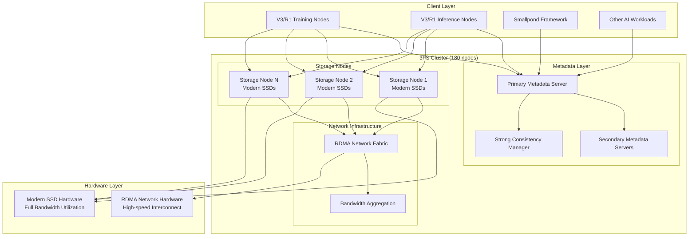
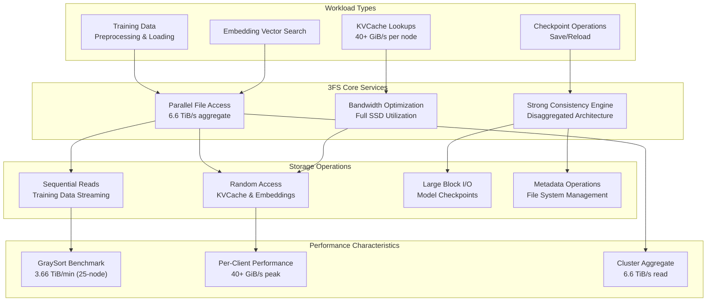
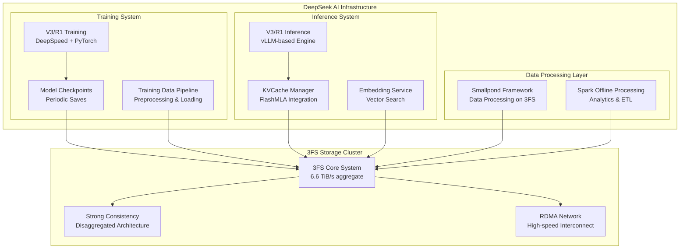

<!-- source: DeepWiki mcp.deepwiki.com · repo deepseek-ai/open-infra-index · extra page 3FS (Fire-Flyer File System) · fetched 2026-10-30 -->

# 3FS (Fire-Flyer File System)

Relevant source files

The following files were used as context for generating this wiki page:

- [README.md](README.md)

## Purpose and Scope

This document covers the Fire-Flyer File System (3FS), a high-performance parallel file system designed to support DeepSeek's AI training and inference workloads. 3FS provides disaggregated storage with strong consistency semantics, optimized for modern SSD and RDMA network hardware.

For information about the data processing framework that operates on top of 3FS, see [Smallpond](#2.3.2). For broader context on DeepSeek's storage and data processing infrastructure, see [Storage & Data Processing](#2.3).

Sources: [README.md:76-87]()

## System Overview

3FS is a parallel file system that serves as the primary storage backbone for DeepSeek's AI infrastructure. It achieves exceptional throughput by fully utilizing modern hardware capabilities, including high-speed SSDs and RDMA networking technologies.

### Key Characteristics

| Characteristic | Specification |
|---|---|
| **Aggregate Read Throughput** | 6.6 TiB/s (180-node cluster) |
| **GraySort Benchmark** | 3.66 TiB/min (25-node cluster) |
| **Per-Client Peak Throughput** | 40+ GiB/s for KVCache lookup |
| **Architecture** | Disaggregated with strong consistency |
| **Network Technology** | RDMA-optimized |
| **Storage Hardware** | Modern SSD utilization |

Sources: [README.md:80-83]()

## System Architecture

### 3FS Infrastructure Architecture

Sources: [README.md:78-84]()

### Data Flow and Access Patterns

Sources: [README.md:84-87]()

## Performance Characteristics

### Benchmark Results

3FS demonstrates exceptional performance across different workload patterns:

| Benchmark | Configuration | Performance |
|---|---|---|
| **Aggregate Read Throughput** | 180-node cluster | 6.6 TiB/s |
| **GraySort Benchmark** | 25-node cluster | 3.66 TiB/min |
| **KVCache Lookup** | Per-client node | 40+ GiB/s peak |

### Hardware Utilization

The system achieves high performance through:

- **Full SSD Bandwidth Utilization**: Maximizes the throughput potential of modern SSD hardware
- **RDMA Network Optimization**: Leverages high-speed RDMA interconnects for low-latency, high-bandwidth communication
- **Disaggregated Architecture**: Separates compute and storage for better resource utilization and scalability

Sources: [README.md:80-83]()

## Integration with DeepSeek Infrastructure

### AI Workload Support

3FS serves as the foundational storage layer for multiple DeepSeek AI workloads:

#### Training Workloads
- **Data Preprocessing**: High-throughput access to raw training datasets
- **Dataset Loading**: Efficient streaming of preprocessed training data to GPU clusters
- **Checkpoint Operations**: Fast save and reload of model checkpoints during training

#### Inference Workloads  
- **KVCache Storage**: High-performance storage and retrieval of key-value caches for attention mechanisms
- **Embedding Vector Search**: Fast access to embedding vectors for semantic search and retrieval operations

### System Integration Architecture

Sources: [README.md:84-87]()

## Use Cases and Applications

### Primary Use Cases

1. **Training Data Management**
   - Preprocessing large-scale training datasets
   - Streaming data to distributed training clusters
   - Managing dataset versions and transformations

2. **Model Lifecycle Management** 
   - Saving training checkpoints at regular intervals
   - Loading checkpoints for training resumption or fine-tuning
   - Managing multiple model versions and experiments

3. **Inference Optimization**
   - High-speed KVCache storage and retrieval for attention mechanisms
   - Supporting FlashMLA's paged KV cache requirements
   - Embedding vector storage for semantic search operations

4. **Data Processing Workflows**
   - Serving as the storage backend for Smallpond framework
   - Supporting Spark-based offline analytics and ETL operations
   - Enabling data-intensive AI research and experimentation

### Performance Requirements Met

- **High Throughput**: 6.6 TiB/s aggregate read performance supports massive parallel training workloads
- **Low Latency**: 40+ GiB/s per-client throughput enables real-time inference serving
- **Strong Consistency**: Disaggregated architecture ensures data integrity across distributed operations
- **Scalability**: 180-node cluster demonstrates horizontal scaling capabilities

Sources: [README.md:84-87]()

---

