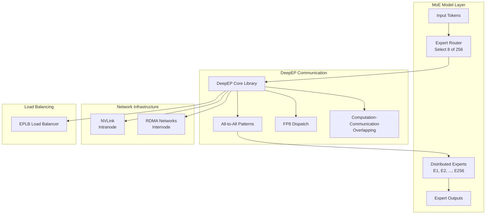
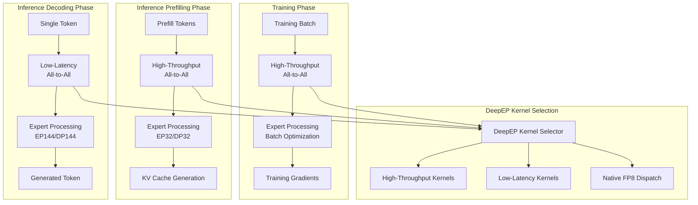
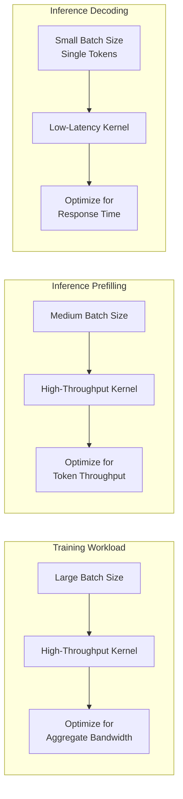
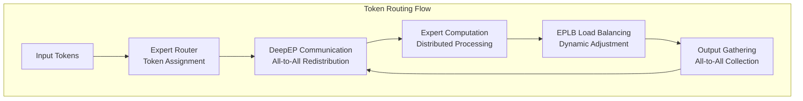

<!-- source: DeepWiki mcp.deepwiki.com · repo deepseek-ai/open-infra-index · extra page DeepEP · fetched 2026-10-30 -->

# DeepEP

Relevant source files

The following files were used as context for generating this wiki page:

- [README.md](README.md)

## Purpose and Scope

DeepEP is the expert parallel (EP) communication library designed specifically for efficient MoE (Mixture of Experts) model training and inference across multiple nodes. This component handles the complex all-to-all communication patterns required when distributing expert computations across GPU clusters, optimizing both high-throughput training scenarios and low-latency inference workloads.

DeepEP focuses exclusively on expert-level parallelization communication. For pipeline parallelism strategies, see [DualPipe](#2.2.2). For expert workload distribution and balancing, see [EPLB](#2.2.3).

## System Architecture

DeepEP serves as the communication backbone for MoE model architectures, particularly those with large numbers of experts like DeepSeek-V3's 256-expert configuration where only 8 experts are active per layer.

### High-Level Integration

Sources: [README.md:42-52]()

### Communication Pattern Architecture

Sources: [README.md:47-52]()

## Communication Patterns

### All-to-All Communication

DeepEP implements optimized all-to-all communication patterns that are fundamental to expert parallel processing in MoE architectures. When tokens are routed to different experts across multiple nodes, the system must efficiently redistribute data according to expert assignments.

| Communication Type | Optimization Target | Use Case | Parallelism Strategy |
|-------------------|-------------------|----------|---------------------|
| High-Throughput | Maximize data transfer rate | Training, Prefilling | EP32/DP32 (4 nodes) |
| Low-Latency | Minimize communication delay | Decoding | EP144/DP144 (18 nodes) |

### Network Layer Support

DeepEP provides native support for both intranode and internode communication:

- **NVLink**: High-bandwidth GPU-to-GPU communication within nodes
- **RDMA**: Low-latency inter-node communication across the cluster

The library automatically selects the appropriate communication path based on the source and destination GPU locations.

Sources: [README.md:48]()

## Performance Characteristics

### Kernel Optimization Strategies

DeepEP employs different kernel optimizations depending on the workload phase:

Sources: [README.md:49-50]()

### FP8 Support

DeepEP provides native FP8 dispatch support, enabling efficient mixed-precision communication patterns that align with the FP8 computations performed by expert layers. This reduces memory bandwidth requirements and improves overall system throughput.

Sources: [README.md:51]()

## Integration with System Components

### Expert Parallel Load Balancer Integration

DeepEP works closely with EPLB to ensure efficient expert utilization:

Sources: [README.md:42-52]()

### Computation-Communication Overlapping

DeepEP provides flexible GPU resource control that enables computation-communication overlapping strategies. This allows the system to hide communication latency by performing expert computations while data transfers are in progress.

The library supports dual-batch overlapping during prefilling phases and multi-stage pipeline overlapping during decoding phases, working in coordination with other system components like DualPipe.

Sources: [README.md:52]()

## Deployment Architecture

DeepEP operates across the distributed GPU infrastructure supporting DeepSeek-V3/R1 models:

### Node Configuration

| Phase | Expert Parallelism | Data Parallelism | Nodes per Unit |
|-------|------------------|-----------------|----------------|
| Prefilling | EP32 | DP32 | 4 |
| Decoding | EP144 | DP144 | 18 |

### Resource Management

DeepEP manages communication resources across the cluster, coordinating with the underlying RDMA network infrastructure and NVLink topology to optimize data movement patterns for the 256-expert MoE architecture where only 8 experts are active per layer.

Sources: [README.md:42-52]()

---

