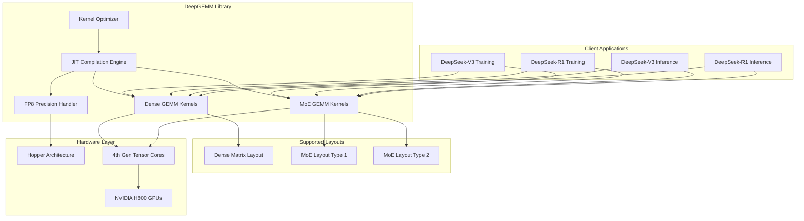
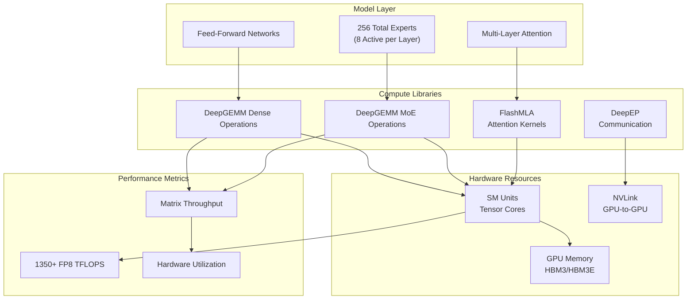
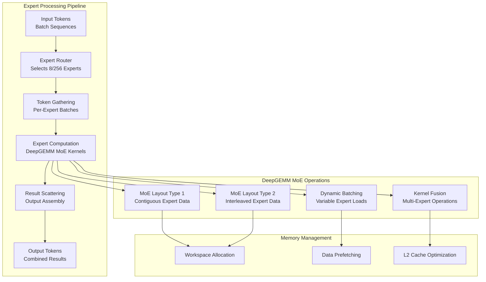

<!-- source: DeepWiki mcp.deepwiki.com · repo deepseek-ai/open-infra-index · extra page DeepGEMM · fetched 2026-10-30 -->

# DeepGEMM

Relevant source files

The following files were used as context for generating this wiki page:

- [README.md](README.md)

## Purpose and Scope

DeepGEMM is a high-performance FP8 General Matrix Multiply (GEMM) library designed specifically for AI workloads on NVIDIA Hopper GPUs. It serves as a core computational component in the DeepSeek infrastructure, providing optimized matrix multiplication operations for both dense neural network layers and Mixture of Experts (MoE) computations.

This document covers the technical architecture, performance characteristics, and integration patterns of DeepGEMM within the broader DeepSeek AI infrastructure. For information about attention mechanisms optimization, see [FlashMLA](#2.1.1). For expert parallelism communication patterns, see [DeepEP](#2.2.1).

## System Architecture

DeepGEMM implements a Just-In-Time (JIT) compilation approach to deliver optimal performance across diverse matrix sizes while maintaining minimal dependencies and clean code architecture.

### Core Architecture

**DeepGEMM Core Architecture**

The architecture centers around a JIT compilation engine that generates optimized kernels for specific matrix configurations at runtime. This approach allows DeepGEMM to adapt to diverse workloads while maintaining a compact codebase of approximately 300 lines for core logic.

Sources: [README.md:54-64]()

### Integration with DeepSeek Infrastructure

**DeepGEMM Integration in DeepSeek Infrastructure**

DeepGEMM operates as a foundational compute layer, providing optimized matrix operations for both the dense components of neural networks and the expert-specific computations in MoE architectures. The library interfaces directly with hardware Tensor Cores to achieve peak performance.

Sources: [README.md:54-64](), [README.md:96-99]()

## Performance Characteristics

DeepGEMM delivers exceptional computational performance through targeted optimizations for FP8 precision and Hopper GPU architecture.

### Performance Metrics

| Metric | Value | Description |
|--------|-------|-------------|
| Peak Performance | 1350+ FP8 TFLOPS | Maximum theoretical throughput on H800 GPUs |
| Precision Support | FP8 | Optimized for mixed-precision training and inference |
| Code Complexity | ~300 lines | Core logic implementation size |
| Compilation | JIT | Just-In-Time kernel generation |
| Dependencies | Minimal | Clean, tutorial-like implementation |

### Optimization Strategies

DeepGEMM employs several key optimization techniques:

1. **JIT Compilation**: Generates specialized kernels for specific matrix dimensions and layouts at runtime
2. **FP8 Precision**: Leverages Hopper's native FP8 support for maximum throughput
3. **Layout Optimization**: Supports multiple memory layouts optimized for different access patterns
4. **Kernel Fusion**: Combines operations to reduce memory bandwidth requirements

Sources: [README.md:59-63]()

## MoE-Specific Optimizations

DeepGEMM provides specialized support for MoE computations, which are critical for DeepSeek-V3's 256-expert architecture.

### MoE Layout Support

**MoE Processing with DeepGEMM**

The MoE-specific optimizations handle the complex memory access patterns and dynamic batching requirements of expert computations. Two distinct layout types accommodate different expert organization strategies used in DeepSeek-V3 training and inference.

Sources: [README.md:63]()

## Integration with Training and Inference

DeepGEMM serves both training and inference workloads across the DeepSeek model family, providing consistent performance across different operational modes.

### Operational Modes

| Mode | Models | Characteristics | DeepGEMM Usage |
|------|--------|----------------|----------------|
| Training | V3, R1 | Large batch sizes, backward pass | Dense + MoE kernels |
| Inference | V3, R1 | Variable sequence lengths | Optimized for throughput |
| Prefilling | V3, R1 | Parallel token processing | High-throughput mode |
| Decoding | V3, R1 | Sequential generation | Low-latency mode |

### Production Performance

In production environments, DeepGEMM contributes to the overall system performance metrics:

- **Input Token Processing**: 73.7k tokens per second per H800 node
- **Output Token Generation**: 14.8k tokens per second per H800 node
- **Cost Efficiency**: 545% profit margin through optimized compute utilization

Sources: [README.md:96-99]()

## Technical Implementation

DeepGEMM's implementation philosophy prioritizes simplicity and performance, achieving expert-level kernel performance with minimal code complexity.

### Key Implementation Features

1. **Minimal Dependencies**: Clean implementation without heavy external requirements
2. **JIT Compilation**: Runtime kernel specialization for optimal performance
3. **Cross-Platform**: Designed for NVIDIA Hopper architecture with forward compatibility
4. **Modular Design**: Separate handling of dense and MoE computation patterns

### Performance Comparison

The library consistently outperforms expert-tuned kernels across most matrix sizes while maintaining a significantly smaller codebase. This is achieved through intelligent kernel selection and JIT optimization strategies that adapt to specific workload characteristics.

Sources: [README.md:60-62]()

---

