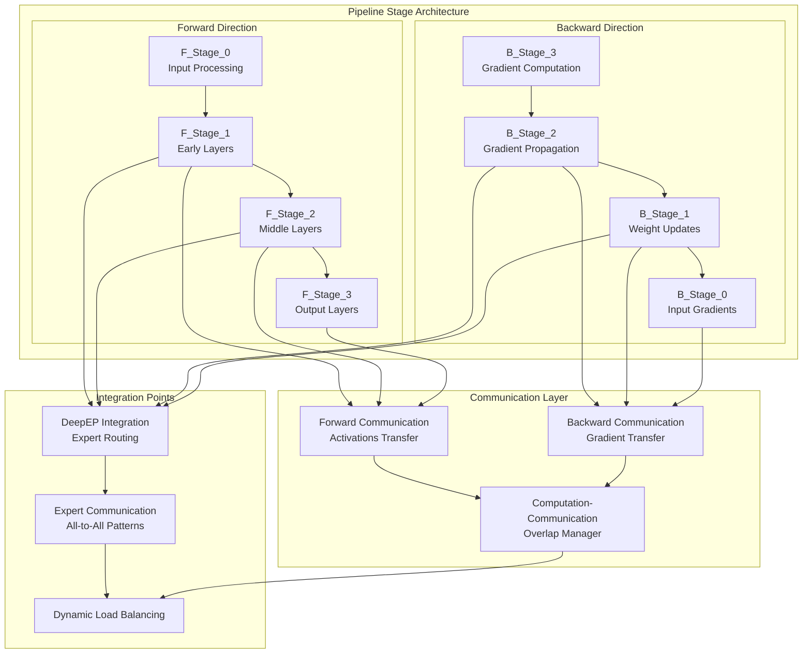
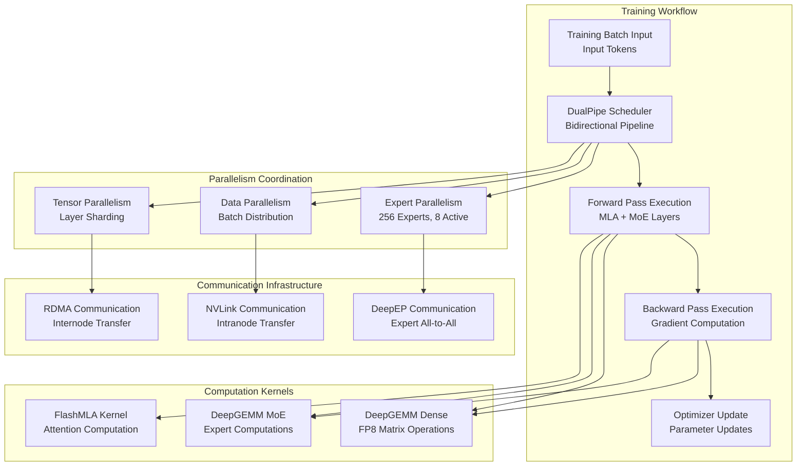

<!-- source: DeepWiki mcp.deepwiki.com · repo deepseek-ai/open-infra-index · extra page DualPipe · fetched 2026-10-30 -->

# DualPipe

Relevant source files

The following files were used as context for generating this wiki page:

- [README.md](README.md)

DualPipe is a bidirectional pipeline parallelism algorithm designed to optimize computation-communication overlap during DeepSeek V3 and R1 model training. It implements advanced pipeline scheduling strategies to maximize hardware utilization by enabling simultaneous forward and backward pass execution across multiple pipeline stages.

For information about expert-parallel load balancing, see [EPLB](#2.2.3). For details on expert-parallel communication primitives, see [DeepEP](#2.2.1).

## Overview

DualPipe addresses the fundamental challenge of pipeline parallelism in large language model training: minimizing pipeline bubble overhead while maintaining high throughput. Traditional unidirectional pipeline approaches suffer from significant idle time during pipeline startup and shutdown phases. DualPipe's bidirectional design enables continuous utilization of compute resources by overlapping forward and backward passes in both directions along the pipeline.

The algorithm is specifically optimized for the DeepSeek V3 and R1 model architectures, taking advantage of their MoE (Mixture of Experts) structure and Multi-Layer Attention mechanisms. DualPipe coordinates with other parallelism strategies including expert parallelism (via DeepEP) and data parallelism to create a comprehensive distributed training solution.

**Sources:** [README.md:67-68]()

## System Architecture

DualPipe operates as part of the broader parallelism infrastructure, integrating closely with the expert parallelism and communication optimization systems.

### DualPipe Pipeline Flow

**Sources:** [README.md:67-68](), [README.md:92-94]()

### Integration with V3/R1 Training Pipeline

DualPipe coordinates with the broader training infrastructure to optimize end-to-end performance:

**Sources:** [README.md:42-52](), [README.md:54-64](), [README.md:32-40]()

## Computation-Communication Overlap Strategy

DualPipe implements sophisticated overlap techniques to hide communication latency behind computation. The algorithm coordinates with the broader infrastructure to ensure maximum resource utilization during training.

### Overlap Patterns

| Phase | Forward Direction | Backward Direction | Communication Type |
|-------|------------------|-------------------|-------------------|
| Startup | Active Pipeline Fill | Idle | Activation Transfer |
| Steady State | Continuous Forward | Continuous Backward | Bidirectional Overlap |
| Shutdown | Pipeline Drain | Active Gradient Flow | Gradient Transfer |

The bidirectional approach ensures that while one direction is in startup/shutdown phase, the other direction maintains steady-state operation, minimizing overall pipeline bubbles.

### Performance Characteristics

DualPipe's effectiveness is measured through its integration with the V3/R1 training pipeline:

| Metric | Impact |
|--------|--------|
| Pipeline Utilization | Maximized through bidirectional scheduling |
| Communication Overlap | Achieved via coordinated forward/backward passes |
| Expert Load Balancing | Integrated with EPLB for dynamic distribution |
| Memory Efficiency | Optimized activation and gradient buffering |

**Sources:** [README.md:92-94](), [README.md:73-74]()

## Production Integration

DualPipe operates as a core component of the DeepSeek training infrastructure, contributing to the overall performance metrics achieved in V3 and R1 model training. The algorithm's bidirectional pipeline approach directly supports the high-throughput requirements of large-scale model training.

The system integrates with:
- **DeepEP** for expert-parallel communication coordination
- **EPLB** for dynamic load balancing across experts
- **DeepGEMM** for optimized matrix operations within pipeline stages
- **FlashMLA** for efficient attention computation

This integration enables the comprehensive parallelism strategy that supports DeepSeek's production training workloads, where computation-communication overlap is critical for maintaining training efficiency at scale.

**Sources:** [README.md:65-75](), [README.md:19-30]()

---

