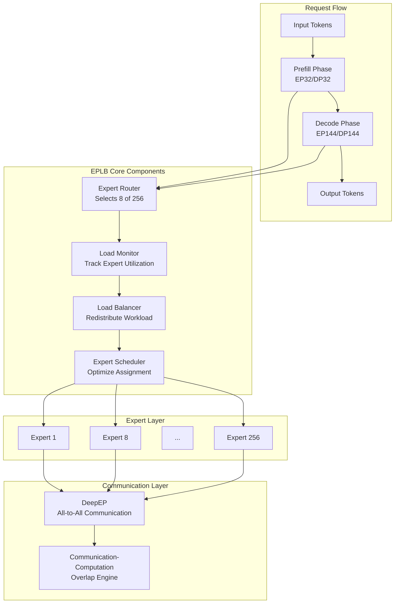
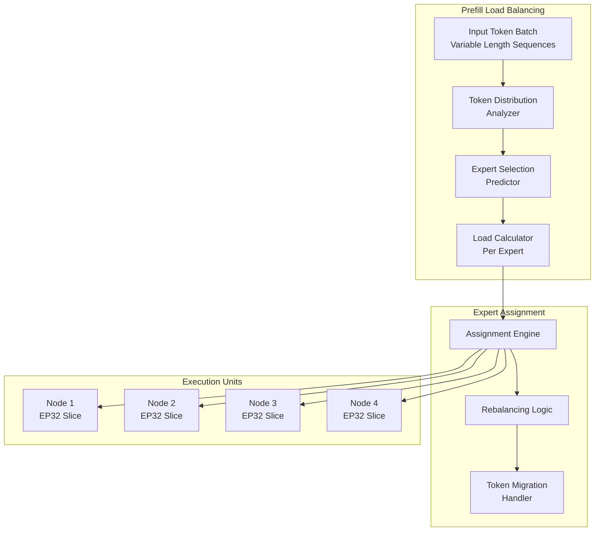
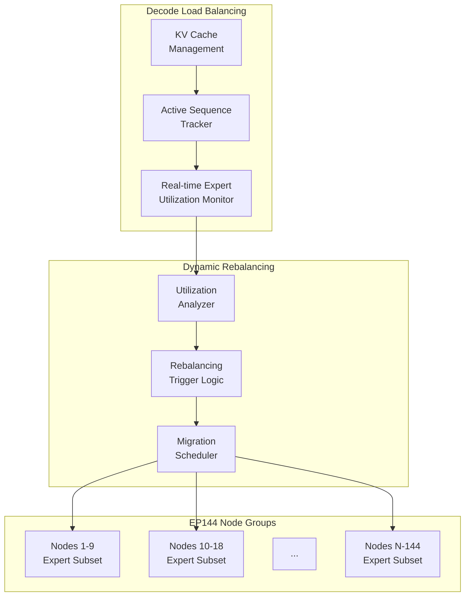
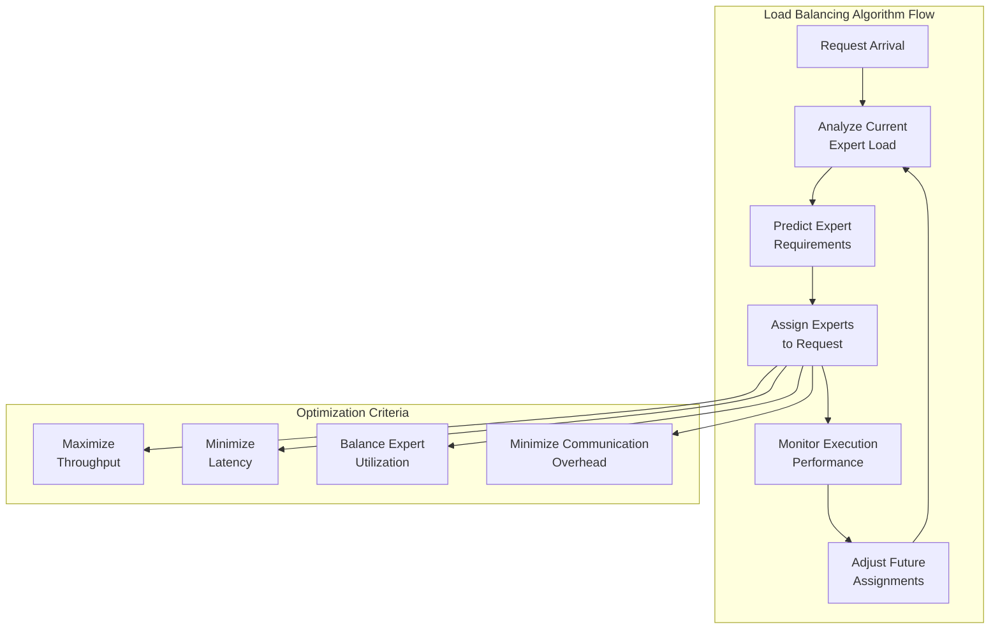
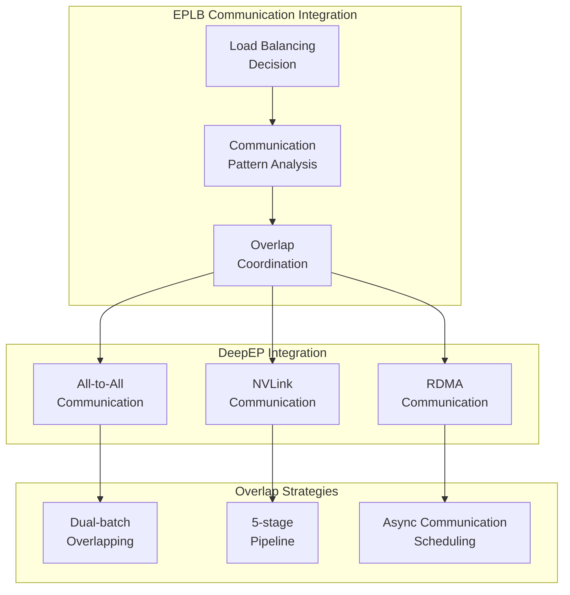

<!-- source: DeepWiki mcp.deepwiki.com · repo deepseek-ai/open-infra-index · extra page EPLB · fetched 2026-10-30 -->

# EPLB

Relevant source files

The following files were used as context for generating this wiki page:

- [README.md](README.md)

## Purpose and Scope

EPLB (Expert-Parallel Load Balancer) is a specialized load balancing system designed for Mixture of Experts (MoE) model architectures, specifically optimized for DeepSeek-V3 and R1 models. This document covers EPLB's role in managing workload distribution across expert-parallel configurations, its integration with the broader inference pipeline, and its optimization strategies for both prefill and decode phases.

For information about the underlying expert-parallel communication patterns, see [DeepEP](#2.2.1). For broader parallelism strategies, see [DualPipe](#2.2.2).

## Architecture Overview

EPLB operates within DeepSeek's MoE inference system, managing load distribution across 256 experts where only 8 are active per layer. The load balancer addresses the fundamental challenge of expert utilization imbalance that can occur during both training and inference phases.

### System Integration

Sources: [README.md:70-71](), [README.md:89-105]()

## Load Balancing Strategies

EPLB implements distinct load balancing strategies optimized for different phases of MoE model inference, addressing the varying computational and communication patterns between prefill and decode operations.

### Prefill Phase Balancing

During the prefill phase, EPLB manages load distribution across EP32/DP32 configurations with 4 nodes per processing unit. The primary focus is on token-level load balancing to ensure efficient parallel processing of input sequences.

Sources: [README.md:97](), [README.md:91-94]()

### Decode Phase Balancing

The decode phase operates under EP144/DP144 configurations with 18 nodes per processing unit, requiring different load balancing considerations due to the sequential nature of token generation and KV cache management.

Sources: [README.md:97](), [README.md:91-94]()

## Performance Metrics and Optimization

EPLB contributes to the overall system performance by maintaining high expert utilization and minimizing load imbalance penalties. The system achieves significant throughput improvements in production deployments.

### Key Performance Indicators

| Metric | Value | Description |
|--------|-------|-------------|
| Input Tokens/sec/node | 73.7k | Per H800 node throughput |
| Output Tokens/sec/node | 14.8k | Per H800 node generation rate |
| Expert Utilization | Variable | Balanced across 256 experts |
| Cost Efficiency | 545% profit margin | Production cost optimization |

### Load Balancing Algorithms

EPLB employs sophisticated algorithms to manage expert assignment and workload distribution:

Sources: [README.md:96-99](), [README.md:91-94]()

## Integration with Communication Systems

EPLB works closely with DeepEP to optimize communication patterns during expert-parallel execution. The integration focuses on minimizing all-to-all communication overhead while maintaining load balance.

### Communication-Computation Overlap

The load balancer coordinates with communication overlap strategies to hide latency during expert execution:

Sources: [README.md:47-52](), [README.md:73-74]()

## Production Deployment Considerations

EPLB is battle-tested in production environments serving DeepSeek V3 and R1 models. The system handles dynamic workload variations and maintains consistent performance under varying load conditions.

### Scalability and Resource Management

The load balancer adapts to different cluster configurations and resource availability:

- **Node-level scaling**: Automatically adjusts to available H800 nodes
- **Memory management**: Coordinates with KV cache systems for optimal memory utilization  
- **Network optimization**: Minimizes cross-node communication through intelligent expert placement
- **Fault tolerance**: Handles node failures and expert reassignment dynamically

### Monitoring and Observability

EPLB provides detailed metrics for system monitoring and performance analysis:

- Real-time expert utilization tracking
- Load imbalance detection and alerting
- Communication pattern analysis
- Performance degradation early warning systems

Sources: [README.md:96-99](), [README.md:89-105]()

---

