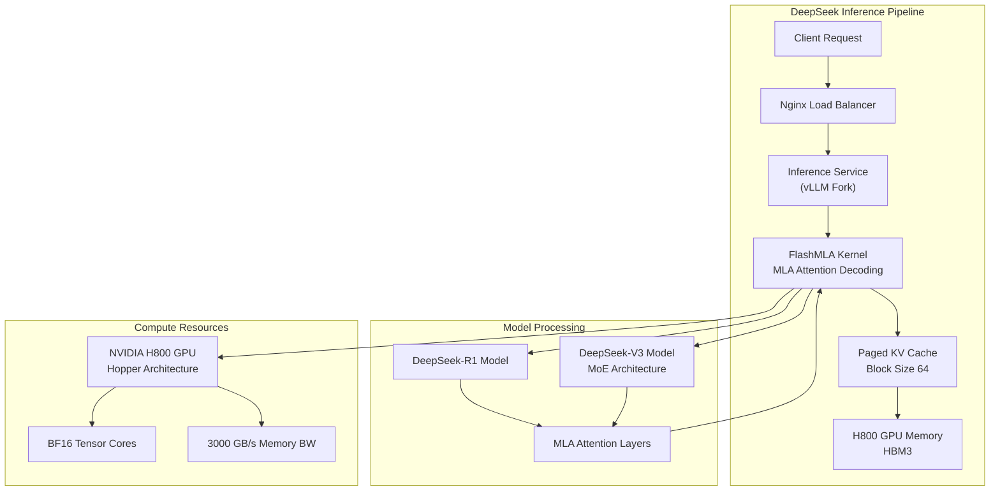
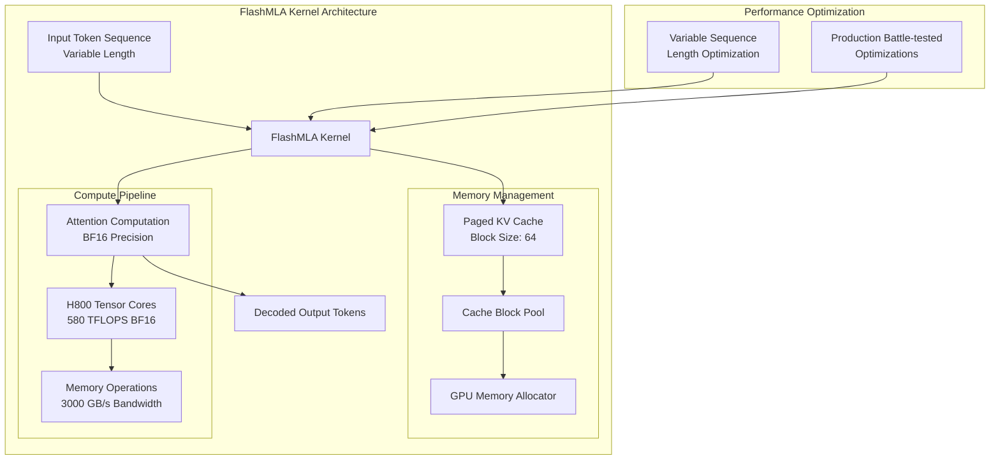
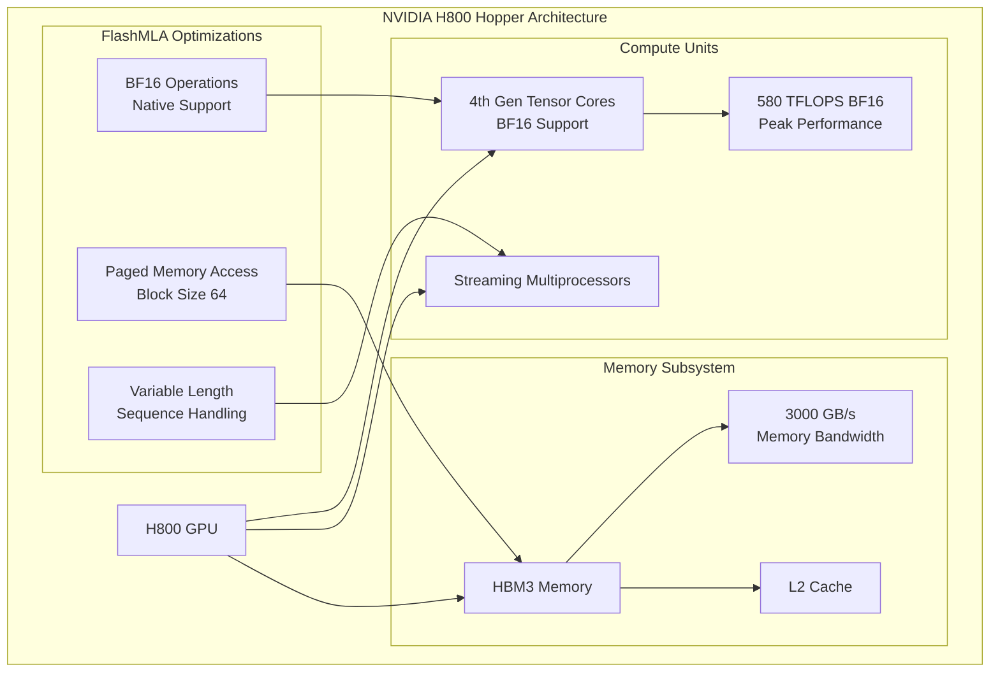
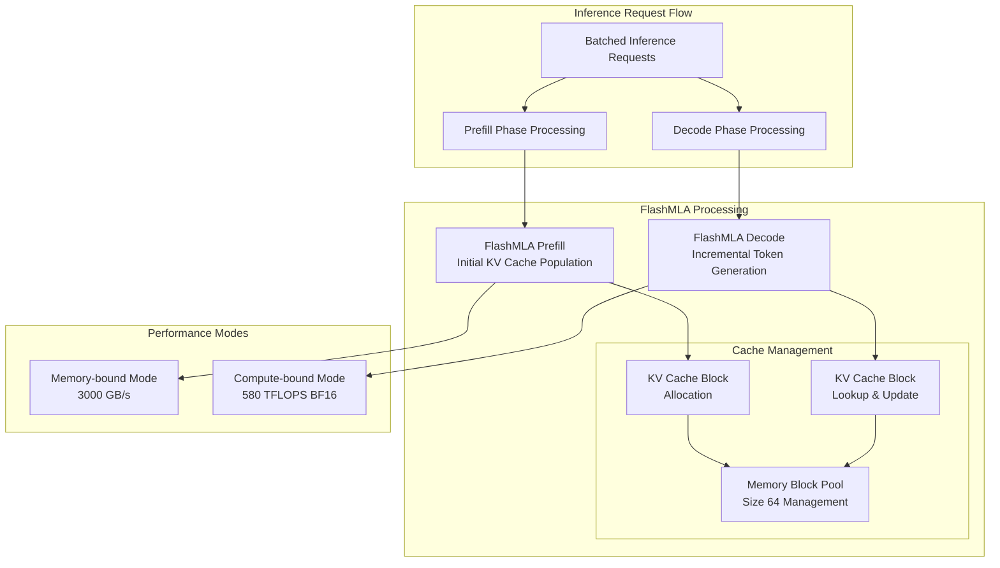

<!-- source: DeepWiki mcp.deepwiki.com · repo deepseek-ai/open-infra-index · extra page FlashMLA · fetched 2026-10-30 -->

# FlashMLA

Relevant source files

The following files were used as context for generating this wiki page:

- [README.md](README.md)

## Purpose and Scope

FlashMLA is an efficient Multi-Layer Attention (MLA) decoding kernel specifically optimized for NVIDIA Hopper GPUs. This component serves as a critical compute optimization layer within DeepSeek's inference system, handling attention computations for variable-length sequences in production environments. FlashMLA is designed to maximize both memory bandwidth utilization and computational throughput for the MLA architecture used in DeepSeek V3 and R1 models.

For information about general matrix operations optimization, see [DeepGEMM](#2.1.2). For distributed communication patterns in MoE architectures, see [DeepEP](#2.2.1). For the complete inference system architecture, see [Inference System Architecture](#3.1).

## Architecture Overview

### System Integration

Sources: [README.md:32-41]()

### FlashMLA Core Components

Sources: [README.md:32-41]()

## Performance Characteristics

### Computational Performance

FlashMLA achieves dual performance optimization modes depending on the computational characteristics of the workload:

| Performance Mode | Throughput | Hardware Utilization | Use Case |
|------------------|------------|---------------------|----------|
| Memory-bound | 3000 GB/s | Memory bandwidth limited | Large sequence lengths, sparse attention patterns |
| Compute-bound | 580 TFLOPS BF16 | Tensor core utilization | Dense attention computations, shorter sequences |

### Hardware Optimization

Sources: [README.md:38-40]()

## Technical Implementation

### Paged KV Cache Architecture

FlashMLA implements a paged KV cache system with a fixed block size of 64 tokens. This design enables efficient memory utilization for variable-length sequences while maintaining high-performance access patterns optimized for the Hopper architecture.

| Cache Parameter | Value | Purpose |
|-----------------|-------|---------|
| Block Size | 64 tokens | Optimal memory alignment for H800 |
| Precision | BF16 | Balance between precision and performance |
| Access Pattern | Paged | Efficient variable-length sequence handling |

### Integration with Inference System

Sources: [README.md:32-41]()

## Production Deployment

FlashMLA has been battle-tested in DeepSeek's production inference environment, serving as a core component for both DeepSeek V3 and R1 model inference. The kernel's optimization for variable-length sequences makes it particularly well-suited for real-world inference workloads where sequence lengths vary significantly across requests.

### Key Production Features

- **BF16 Native Support**: Full support for BF16 precision across all operations
- **Paged KV Cache**: Block-based cache management with 64-token blocks
- **Variable Sequence Optimization**: Efficient handling of varying input sequence lengths
- **Hopper Architecture Tuning**: Specifically optimized for NVIDIA H800 GPUs

The component integrates seamlessly with DeepSeek's broader inference infrastructure, working in conjunction with expert parallelism systems and load balancing mechanisms to deliver high-throughput, low-latency inference for production workloads.

Sources: [README.md:32-41]()

---

