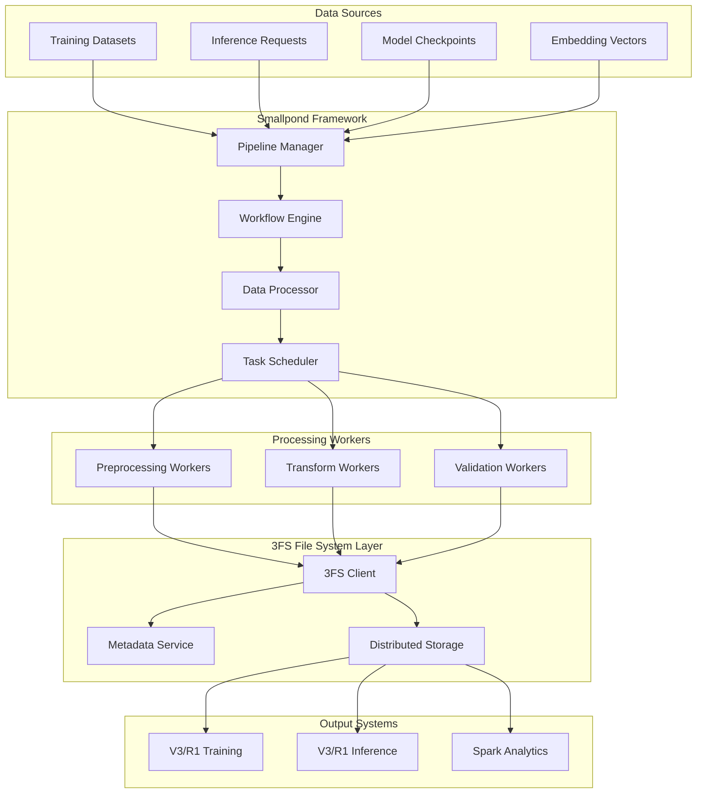
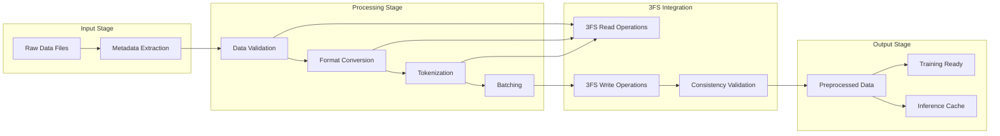
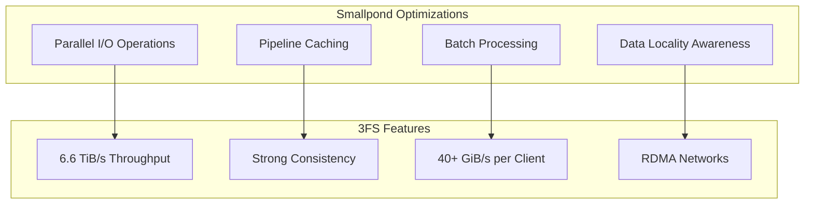
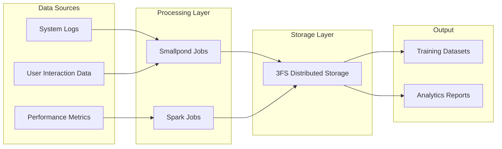

<!-- source: DeepWiki mcp.deepwiki.com · repo deepseek-ai/open-infra-index · extra page Smallpond · fetched 2026-10-30 -->

# Smallpond

Relevant source files

The following files were used as context for generating this wiki page:

- [README.md](README.md)

## Purpose and Scope

Smallpond is a data processing framework that operates on top of the 3FS (Fire-Flyer File System) to provide efficient data pipeline management for DeepSeek's AI infrastructure. This framework handles data preprocessing, transformation, and workflow orchestration tasks required for both training and inference workloads in the DeepSeek ecosystem.

For information about the underlying file system that Smallpond operates on, see [3FS (Fire-Flyer File System)](#2.3.1). For details about the broader inference system architecture, see [Inference System Architecture](#3.1).

## Architecture Overview

Smallpond is designed as a layer above 3FS that provides data processing abstractions while leveraging the high-performance characteristics of the underlying file system. The framework integrates with the broader DeepSeek infrastructure to support both offline batch processing and online inference data needs.

### System Architecture

Sources: [README.md:87]()

### Data Processing Pipeline

Sources: [README.md:84-87]()

## Core Components

### Pipeline Manager

The Pipeline Manager serves as the central orchestration component that coordinates data processing workflows. It manages the lifecycle of data processing jobs and ensures proper resource allocation across the 3FS cluster.

### Workflow Engine

The Workflow Engine handles the execution of complex data processing workflows, providing capabilities for:
- Task dependency management
- Error handling and retry logic
- Progress monitoring and reporting
- Resource scheduling optimization

### Data Processor

The Data Processor component implements the core data transformation logic, supporting various data formats and processing operations required for AI/ML workloads:
- Text preprocessing for language models
- Image processing for vision tasks
- Vector embedding operations
- Data format conversions

### Task Scheduler

The Task Scheduler manages the distribution of processing tasks across available worker nodes, optimizing for:
- Load balancing across the cluster
- Efficient utilization of 3FS bandwidth
- Minimization of data movement overhead

## Integration with 3FS

Smallpond is designed to leverage the high-performance characteristics of 3FS, including:

| 3FS Feature | Smallpond Utilization |
|-------------|----------------------|
| 6.6 TiB/s aggregate throughput | Parallel data processing workflows |
| Strong consistency semantics | Reliable pipeline state management |
| 40+ GiB/s per node performance | High-speed data transformation |
| Disaggregated architecture | Scalable worker deployment |

### Performance Optimization

Sources: [README.md:78-84]()

## Data Processing Workflows

### Training Data Preprocessing

Smallpond handles preprocessing of training datasets for DeepSeek V3 and R1 models, including:
- Dataset loading and validation
- Text tokenization and encoding
- Batch preparation and shuffling
- Checkpoint data management

### Inference Data Management

For inference workloads, Smallpond manages:
- KV cache data organization
- Embedding vector indexing
- Request preprocessing pipelines
- Response caching strategies

### Integration with Spark

Smallpond works alongside Spark for offline analytics and large-scale batch processing:

Sources: [README.md:84-87]()

## Performance Characteristics

Smallpond is designed to maximize utilization of the underlying 3FS infrastructure while providing efficient data processing capabilities:

- **Throughput**: Leverages 3FS's 6.6 TiB/s aggregate read throughput for large-scale data processing
- **Scalability**: Operates across 180-node clusters with disaggregated architecture
- **Consistency**: Maintains strong consistency semantics for reliable pipeline execution
- **Integration**: Seamlessly integrates with V3/R1 training and inference workflows

The framework supports the data requirements of DeepSeek's production services, handling training data preprocessing, dataset loading, checkpoint operations, and embedding vector search operations that power the V3 and R1 model deployments.

Sources: [README.md:78-87]()

---

