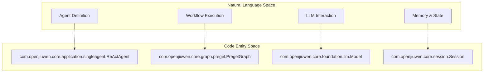
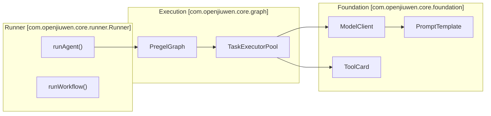

<!-- source: DeepWiki mcp.deepwiki.com · repo openJiuwen-ai/agent-core-java · page 1 Overview · fetched 2026-11-02 -->

# Overview

Relevant source files

The following files were used as context for generating this wiki page:

- [README.md](README.md)
- [README.zh.md](README.zh.md)
- [documents/zh/images/MyAgent.png](documents/zh/images/MyAgent.png)
- [documents/zh/images/ReActAgent.png](documents/zh/images/ReActAgent.png)
- [documents/zh/images/ReActWorkflowAgent.png](documents/zh/images/ReActWorkflowAgent.png)
- [documents/zh/images/WorkflowAgent.png](documents/zh/images/WorkflowAgent.png)
- [documents/zh/images/architecture.png](documents/zh/images/architecture.png)
- [documents/zh/images/high_performance_execution_engine.png](documents/zh/images/high_performance_execution_engine.png)
- [pom.xml](pom.xml)
- [src/main/java/com/openjiuwen/core/foundation/prompt/PromptTemplate.java](src/main/java/com/openjiuwen/core/foundation/prompt/PromptTemplate.java)
- [src/main/java/com/openjiuwen/dev_tools/tune/optimizer/adopt/AdoptOptimizer.java](src/main/java/com/openjiuwen/dev_tools/tune/optimizer/adopt/AdoptOptimizer.java)
- [src/test/java/com/openjiuwen/core/retrieval/indexing/processor/parser/PDFParserTest.java](src/test/java/com/openjiuwen/core/retrieval/indexing/processor/parser/PDFParserTest.java)

**openJiuwen Core Java** is a high-performance Java software development toolkit (SDK) designed for building, orchestrating, and executing Large Language Model (LLM) agents and workflows. It provides a robust runtime that supports asynchronous I/O, stream processing, and stateful execution, enabling developers to build complex multi-agent systems with persistence and interruption-resumption capabilities [[README.md:7-7]]().

The framework balances flexibility and stability, offering pre-built components for common tasks like intent recognition, multi-workflow transitions, and tool calling [[README.md:9-17]]().

## Architecture Layers

The framework is organized into three primary layers that separate the developer-facing API from the underlying execution logic and infrastructure.

### 1. SDK Interface Layer
This layer provides the high-level Java SDK for creating Agent instances, designing workflows, and managing prompt templates [[README.md:73-73]](). It includes the `com.openjiuwen.core.application` package which defines the core agent types [[README.zh.md:115-118]]().

### 2. Agent Engine
The Agent Engine manages the lifecycle and control logic for different agent paradigms. It handles task planning, tool selection, and the management of conversation history through a dedicated `ContextEngine` [[README.md:75-75]]() [[README.zh.md:126-127]]().

### 3. Pregel Graph Execution Engine
At the core of the framework is a high-performance execution engine based on the **Pregel model**. This engine enables asynchronous parallel execution of graph nodes, supports component concurrency, and manages state checkpoints for session persistence [[README.md:77-77]]() [[README.zh.md:95-99]]().

**Architecture Mapping: Natural Language to Code Entities**

Sources: [[README.zh.md:114-129]](), [[README.md:70-78]]()

---

## Key Capabilities

*   **Agent Orchestration**: Native support for `ReActAgent` (Reasoning + Action loop) and `WorkflowAgent` (predefined process automation) [[README.md:83-87]]().
*   **Flexible Execution**: Supports stream-batch integrated value passing, dynamic transitions, and state interruption/resumption [[README.md:95-95]]().
*   **Storage Abstraction**: Built-in support for vector databases (Milvus, PostgreSQL/pgvector), KV stores, and object storage [[README.md:101-106]]() [[pom.xml:118-136]]().
*   **Tooling & Evolution**: Includes `AdoptOptimizer` for decomposing feedback into prompt gradients, allowing agents to evolve their own instructions [[src/main/java/com/openjiuwen/dev_tools/tune/optimizer/adopt/AdoptOptimizer.java:38-43]]().

**System Component Interaction**

Sources: [[README.zh.md:114-129]](), [[README.md:70-78]](), [[src/main/java/com/openjiuwen/core/foundation/prompt/PromptTemplate.java:34-34]]()

---

## Wiki Navigation

This wiki is structured to guide you from initial setup to advanced agent optimization:

*   **[Getting Started](#1.1)**: Prerequisites, Maven installation, and running the first financial workflow example [[README.md:19-58]]().
*   **[Architecture Overview](#1.2)**: Deep dive into the Pregel model and the three-layer design.
*   **Agent Types**: Detailed guides on **[ReActAgent](#2.1)** and **[WorkflowAgent](#2.2)**, including how to define skills and controllers.
*   **[Graph Execution Engine](#3)**: Technical details on `NodeTask` execution, `BarrierChannel` synchronization, and `Checkpointer` persistence.
*   **[Foundation Layer](#4)**: Configuration of `ModelClient`, `McpClient` for tool integration, and `PromptTemplate` interpolation [[src/main/java/com/openjiuwen/core/foundation/prompt/PromptTemplate.java:86-93]]().
*   **[Retrieval and Knowledge Base](#5)**: Implementing RAG with `PDFParser` and managing long-term memory [[src/test/java/com/openjiuwen/core/retrieval/indexing/processor/parser/PDFParserTest.java:58-67]]().
*   **[Developer Tools and Agent Self-Evolution](#10)**: Using the `AdoptOptimizer` to automatically tune agent performance based on evaluation cases [[src/main/java/com/openjiuwen/dev_tools/tune/optimizer/adopt/AdoptOptimizer.java:87-103]]().

For a full list of terms and code pointers, refer to the **[Glossary](#12)**.

---

