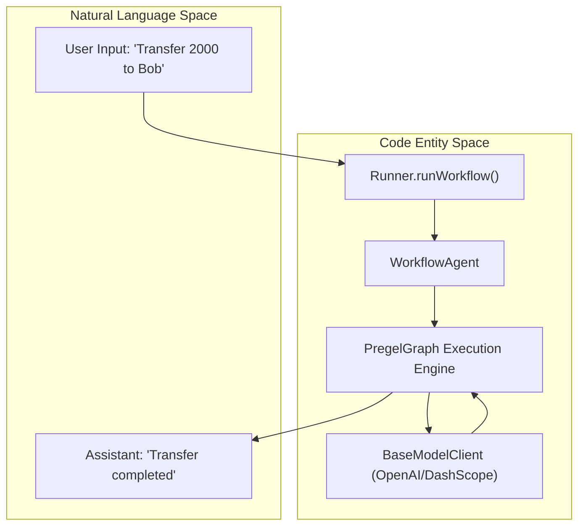
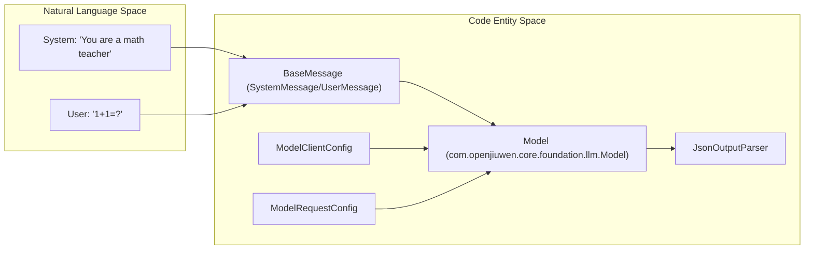

<!-- source: DeepWiki mcp.deepwiki.com · repo openJiuwen-ai/agent-core-java · page 1.1 Getting Started · fetched 2026-11-02 -->

# Getting Started

<details>
<summary>Relevant source files</summary>

The following files were used as context for generating this wiki page:

- [README.md](README.md)
- [README.zh.md](README.zh.md)
- [pom.xml](pom.xml)
- [src/main/java/com/openjiuwen/core/foundation/prompt/PromptTemplate.java](src/main/java/com/openjiuwen/core/foundation/prompt/PromptTemplate.java)
- [src/main/java/com/openjiuwen/dev_tools/tune/optimizer/adopt/AdoptOptimizer.java](src/main/java/com/openjiuwen/dev_tools/tune/optimizer/adopt/AdoptOptimizer.java)
- [src/test/java/com/openjiuwen/core/foundation/llm/LlmConnectionExample.java](src/test/java/com/openjiuwen/core/foundation/llm/LlmConnectionExample.java)
- [src/test/java/com/openjiuwen/core/foundation/llm/output_parsers/JsonOutputParserTest.java](src/test/java/com/openjiuwen/core/foundation/llm/output_parsers/JsonOutputParserTest.java)
- [src/test/java/com/openjiuwen/core/retrieval/indexing/processor/parser/PDFParserTest.java](src/test/java/com/openjiuwen/core/retrieval/indexing/processor/parser/PDFParserTest.java)

</details>


This page provides a comprehensive guide for setting up the **agent-core-java** framework, configuring essential API credentials, and running the provided canonical examples to verify the installation.

## Prerequisites

Before beginning, ensure your development environment meets the following requirements:

*   **Operating System**: Windows, Linux, or macOS [README.md:23-23]().
*   **Java Development Kit (JDK)**: Version 17 or higher [pom.xml:17-20](), [README.md:24-24]().
*   **Build Tool**: Apache Maven 3.9+ [README.md:25-25]().
*   **API Access**: An API key from an OpenAI-compatible LLM provider (e.g., OpenAI, SiliconFlow, DashScope) [src/test/java/com/openjiuwen/core/foundation/llm/LlmConnectionExample.java:67-68]().

## Installation and Build

The framework is managed via Maven. You can build the project from source using the following steps:

1.  **Clone the Repository**:
    ```bash
    git clone <repository-url>
    cd agent-core-java
    ```
2.  **Build with Maven**:
    Run the install command to compile the core library and install it into your local `.m2` repository.
    ```bash
    mvn clean install -DskipTests
    ```
    [README.md:31-35]()

3.  **Dependency Configuration**:
    Add the following dependency to your project's `pom.xml`:
    ```xml
    <dependency>
        <groupId>com.openjiuwen</groupId>
        <artifactId>agent-core-java</artifactId>
        <version>0.1.14</version>
    </dependency>
    ```
    [pom.xml:8-10](), [README.md:38-44]()

## Configuration (apiconfig.json)

The framework utilizes a centralized configuration file named `apiconfig.json` to manage LLM provider settings, API keys, and model parameters.

### Configuration Hierarchy
The system resolves configuration using the following priority (highest to lowest):
1.  **Command line arguments**: e.g., `--api-key=...`
2.  **Environment variables**: e.g., `API_KEY`, `API_BASE`
3.  **JVM System properties**: e.g., `-DAPI_KEY=...`
4.  **Configuration file**: `apiconfig.json` (path can be overridden via `-Dagent.config.path` or `AGENT_API_CONFIG` environment variable).
[src/test/java/com/openjiuwen/core/foundation/llm/LlmConnectionExample.java:40-46]()

### Example apiconfig.json
To set up the examples, copy `examples/apiconfig_example.json` to `src/main/resources/apiconfig.json` and update the values:

```json
{
  "client_provider": "OpenAI",
  "api_key": "your-api-key-here",
  "api_base": "https://api.openai.com/v1",
  "model_name": "gpt-4o",
  "temperature": 0.7,
  "timeout": 30.0
}
```
[src/test/java/com/openjiuwen/core/foundation/llm/LlmConnectionExample.java:91-102]()

**Sources:**
*   [README.md:21-44]()
*   [pom.xml:8-25]()
*   [src/test/java/com/openjiuwen/core/foundation/llm/LlmConnectionExample.java:40-102]()

---

## Running Canonical Examples

The project includes an `examples/` directory containing ready-to-run implementations of the two primary agent types: `ReActAgent` and `WorkflowAgent`.

### 1. ReAct Weather Agent
The ReAct (Reasoning + Action) agent follows a loop of **Thinking → Acting → Observing**. It is suitable for tasks requiring dynamic tool selection based on reasoning.

**Key Components:**
*   **Tool Registration**: Tools (like a weather API) are registered with the agent.
*   **ReAct Loop**: The agent uses the LLM to decide which tool to call and then processes the observation.

### 2. WorkflowAgent Financial Demo
The `WorkflowAgent` is designed for structured, multi-step tasks. The financial demo simulates a transfer service that handles intent detection and missing information retrieval.

**Execution Flow:**
1.  **Intent Detection**: Identifies that the user wants to "transfer money".
2.  **Task Execution**: Initiates the transfer workflow.
3.  **Interruption/Questioning**: If the amount is missing, the `QuestionerComponent` interrupts the flow to ask the user.
4.  **Resumption**: Once the user provides the amount, the workflow resumes and completes.

**Run Command:**
```java
// Located in examples/workflow_agent/WorkflowAgentExample.java
public class WorkflowAgentExample {
    public static void main(String[] args) throws Exception {
        WorkflowAgentExampleSupport.run(args);
    }
}
```
[README.md:52-59]()

### Example Data Flow
The following diagram illustrates how a user request flows from the SDK interface through the Agent Engine to the Execution Engine.

**Agent Execution Data Flow**


**LLM Connection and Message Processing**


**Sources:**
*   [README.md:46-69]()
*   [README.zh.md:83-90]()
*   [src/test/java/com/openjiuwen/core/foundation/llm/LlmConnectionExample.java:91-170]()
*   [src/main/java/com/openjiuwen/core/foundation/llm/output_parsers/JsonOutputParser.java:28-28]() (Reference to class)
*   [src/main/java/com/openjiuwen/core/foundation/prompt/PromptTemplate.java:34-34]() (Reference to class)

---

## Troubleshooting

| Issue | Potential Cause | Resolution |
| :--- | :--- | :--- |
| `Model creation failed` | Incorrect `api_key` or `api_base` | Check `apiconfig.json` or environment variables [src/test/java/com/openjiuwen/core/foundation/llm/LlmConnectionExample.java:84-88](). |
| `Maven build failure` | JDK version < 17 | Verify `java -version` matches requirements [pom.xml:17-20](). |
| `Connection Timeout` | Network or SSL issues | Set `verify_ssl: false` in `ModelClientConfig` for local testing [src/test/java/com/openjiuwen/core/foundation/llm/LlmConnectionExample.java:96-96](). |

**Sources:**
*   [README.md:21-26]()
*   [src/test/java/com/openjiuwen/core/foundation/llm/LlmConnectionExample.java:84-96]()

---

