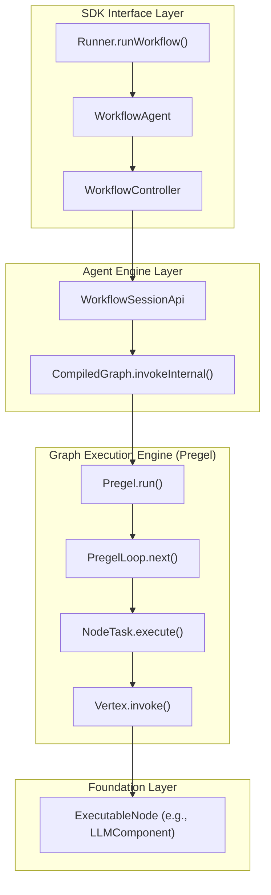
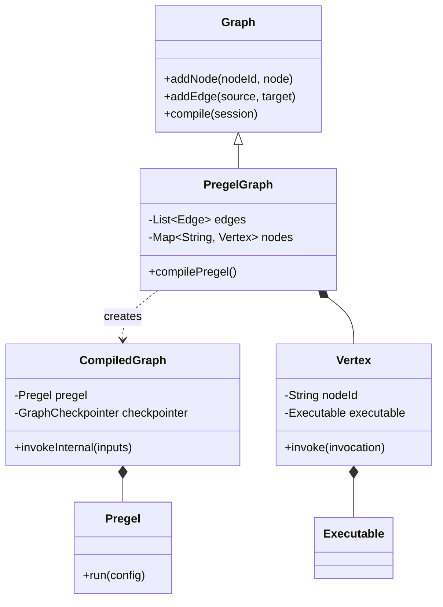

<!-- source: DeepWiki mcp.deepwiki.com · repo openJiuwen-ai/agent-core-java · page 1.2 Architecture Overview · fetched 2026-11-02 -->

# Architecture Overview

Relevant source files

The following files were used as context for generating this wiki page:

- [README.md](README.md)
- [README.zh.md](README.zh.md)
- [documents/zh/images/MyAgent.png](documents/zh/images/MyAgent.png)
- [documents/zh/images/ReActAgent.png](documents/zh/images/ReActAgent.png)
- [documents/zh/images/ReActWorkflowAgent.png](documents/zh/images/ReActWorkflowAgent.png)
- [documents/zh/images/WorkflowAgent.png](documents/zh/images/WorkflowAgent.png)
- [documents/zh/images/architecture.png](documents/zh/images/architecture.png)
- [documents/zh/images/high_performance_execution_engine.png](documents/zh/images/high_performance_execution_engine.png)
- [src/main/java/com/openjiuwen/core/graph/AtomicNode.java](src/main/java/com/openjiuwen/core/graph/AtomicNode.java)
- [src/main/java/com/openjiuwen/core/graph/CompiledGraph.java](src/main/java/com/openjiuwen/core/graph/CompiledGraph.java)
- [src/main/java/com/openjiuwen/core/graph/Executable.java](src/main/java/com/openjiuwen/core/graph/Executable.java)
- [src/main/java/com/openjiuwen/core/graph/ExecutableGraph.java](src/main/java/com/openjiuwen/core/graph/ExecutableGraph.java)
- [src/main/java/com/openjiuwen/core/graph/Graph.java](src/main/java/com/openjiuwen/core/graph/Graph.java)
- [src/main/java/com/openjiuwen/core/graph/GraphNodeState.java](src/main/java/com/openjiuwen/core/graph/GraphNodeState.java)
- [src/main/java/com/openjiuwen/core/graph/PregelGraph.java](src/main/java/com/openjiuwen/core/graph/PregelGraph.java)
- [src/main/java/com/openjiuwen/core/graph/Router.java](src/main/java/com/openjiuwen/core/graph/Router.java)
- [src/main/java/com/openjiuwen/core/graph/pregel/BarrierChannel.java](src/main/java/com/openjiuwen/core/graph/pregel/BarrierChannel.java)
- [src/main/java/com/openjiuwen/core/graph/pregel/BarrierMessage.java](src/main/java/com/openjiuwen/core/graph/pregel/BarrierMessage.java)

The **openJiuwen Core Java** framework is built on a modular three-layer architecture designed to provide high-performance execution for Large Language Model (LLM) agents. It bridges the gap between high-level agent reasoning and low-level asynchronous graph execution.

## 1. Three-Layer Architecture

The system is organized into three distinct layers that handle everything from developer-facing APIs to concurrent task execution.

| Layer | Responsibility | Key Code Entities |
| :--- | :--- | :--- |
| **SDK Interface** | Provides high-level APIs for agent creation, workflow orchestration, and prompt management. | `Runner`, `AgentCard`, `WorkflowAgent` |
| **Agent Engine** | Manages high-level reasoning loops (ReAct), multi-agent handoffs, and session-based state transitions. | `ReActAgent`, `WorkflowController`, `ContextEngine` |
| **Graph Execution Engine** | An asynchronous, Pregel-based engine that executes tasks as nodes in a directed graph. | `PregelGraph`, `CompiledGraph`, `PregelLoop` |

### System Data Flow and Entity Mapping
The following diagram illustrates how high-level agent requests are translated into executable graph tasks.

**Diagram: From Agent Request to Graph Execution**

**Sources:** [README.md:71-79](), [src/main/java/com/openjiuwen/core/graph/CompiledGraph.java:33-59](), [src/main/java/com/openjiuwen/core/graph/PregelGraph.java:143-173]()

---

## 2. The Pregel Graph Execution Engine

At the heart of the framework is the **Pregel Graph Execution Engine**. Inspired by the Pregel model for large-scale graph processing, it treats agent workflows as a series of super-steps where nodes execute in parallel and exchange messages.

### Core Execution Model
The execution follows a cyclic "Super-Step" pattern managed by `PregelLoop` [src/main/java/com/openjiuwen/core/graph/pregel/PregelLoop.java]().

1.  **Node Execution**: All active `Vertex` objects in the current step are executed concurrently using a `TaskExecutorPool`.
2.  **Message Routing**: Nodes produce outputs that are routed via `Edge` or `Branch` (conditional edges) to downstream nodes.
3.  **Synchronization**: The `BarrierChannel` [src/main/java/com/openjiuwen/core/graph/pregel/BarrierChannel.java]() ensures that nodes marked with `waitForAll` [src/main/java/com/openjiuwen/core/graph/PregelGraph.java:66-81]() only trigger once all upstream dependencies have completed.
4.  **State Persistence**: After each super-step, the `GraphCheckpointer` commits the current `WorkflowState` to ensure the agent can resume from interruptions [src/main/java/com/openjiuwen/core/graph/PregelGraph.java:151-159]().

### Graph Component Relationships
This diagram maps the logical graph concepts to the implementation classes in the `com.openjiuwen.core.graph` package.

**Diagram: Pregel Implementation Class Diagram**

**Sources:** [src/main/java/com/openjiuwen/core/graph/Graph.java:15-111](), [src/main/java/com/openjiuwen/core/graph/PregelGraph.java:36-45](), [src/main/java/com/openjiuwen/core/graph/CompiledGraph.java:22-30]()

---

## 3. Layer Interactions

### SDK to Engine
Developers interact with the `Runner` API to start agents. The `Runner` resolves resources (tools, prompts, models) and initializes a `BaseSession` [src/main/java/com/openjiuwen/core/graph/CompiledGraph.java:33-42]().

### Engine to Graph
The `Agent Engine` (e.g., `WorkflowAgent`) defines the topology of the graph. When `compile()` is called on a `PregelGraph`, it transforms the high-level workflow into a `CompiledGraph` containing a `Pregel` instance ready for execution [src/main/java/com/openjiuwen/core/graph/PregelGraph.java:143-173]().

### Graph to Foundation
During execution, the `Vertex` calls the `invoke` method of its underlying `Executable` component. These components (defined in the Application or Foundation layers) perform the actual work, such as:
*   Calling an LLM via `BaseModelClient`.
*   Executing a tool via `ToolCallOperator`.
*   Querying a `KnowledgeBase`.

**Sources:** [README.md:89-99](), [src/main/java/com/openjiuwen/core/graph/CompiledGraph.java:49-53]()

---

## 4. Key Subsystems

The architecture is supported by several cross-cutting subsystems:

*   **Session & State Management**: Managed via `GraphRuntimeSession`, providing `WorkflowState` for committing user inputs and `GraphCheckpointer` for persistence [src/main/java/com/openjiuwen/core/graph/CompiledGraph.java:132-166]().
*   **Context Engine**: Handles the `ModelContext` and `ContextWindow`, ensuring that LLM interactions stay within token limits.
*   **Storage Abstraction**: A unified `Store` interface that supports Vector DBs (Milvus, PGVector), KV stores (Redis), and Object storage [README.md:101-108]().

For further details on specific layers, refer to the following child pages:
*   [2. Agent Types and Application Layer]()
*   [3. Graph Execution Engine]()
*   [4. Foundation Layer]()

**Sources:** [README.md:113-135](), [src/main/java/com/openjiuwen/core/graph/CompiledGraph.java:132-140]()

---

