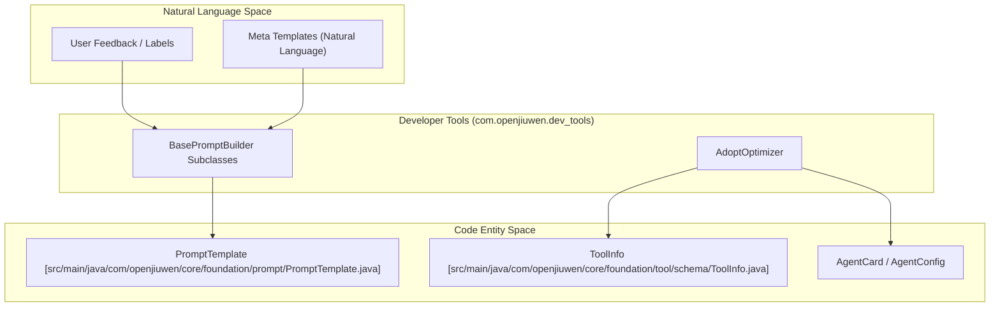
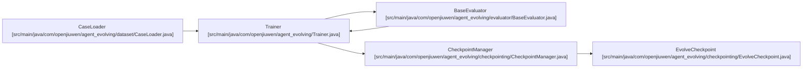

<!-- source: DeepWiki mcp.deepwiki.com · repo openJiuwen-ai/agent-core-java · page 10 Developer Tools and Agent Self-Evolution · fetched 2026-11-02 -->

# Developer Tools and Agent Self-Evolution

Relevant source files

The following files were used as context for generating this wiki page:

- [pom.xml](pom.xml)
- [src/main/java/com/openjiuwen/agent_evolving/TuneConstant.java](src/main/java/com/openjiuwen/agent_evolving/TuneConstant.java)
- [src/main/java/com/openjiuwen/agent_evolving/TuneUtils.java](src/main/java/com/openjiuwen/agent_evolving/TuneUtils.java)
- [src/main/java/com/openjiuwen/agent_evolving/checkpointing/CheckpointManager.java](src/main/java/com/openjiuwen/agent_evolving/checkpointing/CheckpointManager.java)
- [src/main/java/com/openjiuwen/agent_evolving/checkpointing/DefaultCheckpointManager.java](src/main/java/com/openjiuwen/agent_evolving/checkpointing/DefaultCheckpointManager.java)
- [src/main/java/com/openjiuwen/agent_evolving/checkpointing/EvolveCheckpoint.java](src/main/java/com/openjiuwen/agent_evolving/checkpointing/EvolveCheckpoint.java)
- [src/main/java/com/openjiuwen/agent_evolving/checkpointing/FileCheckpointStore.java](src/main/java/com/openjiuwen/agent_evolving/checkpointing/FileCheckpointStore.java)
- [src/main/java/com/openjiuwen/agent_evolving/dataset/Case.java](src/main/java/com/openjiuwen/agent_evolving/dataset/Case.java)
- [src/main/java/com/openjiuwen/agent_evolving/dataset/CaseLoader.java](src/main/java/com/openjiuwen/agent_evolving/dataset/CaseLoader.java)
- [src/main/java/com/openjiuwen/agent_evolving/dataset/EvaluatedCase.java](src/main/java/com/openjiuwen/agent_evolving/dataset/EvaluatedCase.java)
- [src/main/java/com/openjiuwen/agent_evolving/evaluator/BaseEvaluator.java](src/main/java/com/openjiuwen/agent_evolving/evaluator/BaseEvaluator.java)
- [src/main/java/com/openjiuwen/agent_evolving/evaluator/DefaultEvaluator.java](src/main/java/com/openjiuwen/agent_evolving/evaluator/DefaultEvaluator.java)
- [src/main/java/com/openjiuwen/core/foundation/prompt/PromptTemplate.java](src/main/java/com/openjiuwen/core/foundation/prompt/PromptTemplate.java)
- [src/main/java/com/openjiuwen/dev_tools/prompt_builder/BasePromptBuilder.java](src/main/java/com/openjiuwen/dev_tools/prompt_builder/BasePromptBuilder.java)
- [src/main/java/com/openjiuwen/dev_tools/prompt_builder/builder/BadCasePromptBuilder.java](src/main/java/com/openjiuwen/dev_tools/prompt_builder/builder/BadCasePromptBuilder.java)
- [src/main/java/com/openjiuwen/dev_tools/prompt_builder/builder/FeedbackPromptBuilder.java](src/main/java/com/openjiuwen/dev_tools/prompt_builder/builder/FeedbackPromptBuilder.java)
- [src/main/java/com/openjiuwen/dev_tools/prompt_builder/builder/MetaTemplateBuilder.java](src/main/java/com/openjiuwen/dev_tools/prompt_builder/builder/MetaTemplateBuilder.java)
- [src/main/java/com/openjiuwen/dev_tools/prompt_builder/builder/PromptTemplateUtils.java](src/main/java/com/openjiuwen/dev_tools/prompt_builder/builder/PromptTemplateUtils.java)
- [src/main/java/com/openjiuwen/dev_tools/prompt_builder/builder/PromptTemplatesEn.java](src/main/java/com/openjiuwen/dev_tools/prompt_builder/builder/PromptTemplatesEn.java)
- [src/main/java/com/openjiuwen/dev_tools/prompt_builder/builder/PromptTemplatesZh.java](src/main/java/com/openjiuwen/dev_tools/prompt_builder/builder/PromptTemplatesZh.java)
- [src/main/java/com/openjiuwen/dev_tools/prompt_builder/builder/UnwrappedCompletableFuture.java](src/main/java/com/openjiuwen/dev_tools/prompt_builder/builder/UnwrappedCompletableFuture.java)
- [src/main/java/com/openjiuwen/dev_tools/tune/Case.java](src/main/java/com/openjiuwen/dev_tools/tune/Case.java)
- [src/main/java/com/openjiuwen/dev_tools/tune/EvaluatedCase.java](src/main/java/com/openjiuwen/dev_tools/tune/EvaluatedCase.java)
- [src/main/java/com/openjiuwen/dev_tools/tune/optimizer/adopt/AdoptOptimizer.java](src/main/java/com/openjiuwen/dev_tools/tune/optimizer/adopt/AdoptOptimizer.java)
- [src/test/java/com/openjiuwen/core/retrieval/indexing/processor/parser/PDFParserTest.java](src/test/java/com/openjiuwen/core/retrieval/indexing/processor/parser/PDFParserTest.java)

This section provides an overview of the `dev_tools` and `agent_evolving` packages. These modules provide the infrastructure for optimizing agent performance through automated prompt engineering, parameter tuning via the ADOPT optimizer, and an end-to-end self-evolution training loop.

## Overview of Evolutionary Capabilities

The framework treats agent performance as a tunable system. It provides tools to analyze failures, generate better instructions, and iteratively update agent parameters (prompts, tool usage patterns, etc.) based on feedback and evaluation scores.

### System Interaction Diagram

The following diagram illustrates how the developer tools bridge the gap between high-level natural language instructions and the code-level execution entities.

**Sources:** [src/main/java/com/openjiuwen/dev_tools/prompt_builder/BasePromptBuilder.java:25-30](), [src/main/java/com/openjiuwen/core/foundation/prompt/PromptTemplate.java:34-41](), [src/main/java/com/openjiuwen/dev_tools/tune/optimizer/adopt/AdoptOptimizer.java]()

---

## Prompt Engineering Tools

The `com.openjiuwen.dev_tools.prompt_builder` package contains a suite of LLM-backed builders designed to automate the creation and refinement of prompts. These tools support localization in Chinese and English via `PromptTemplatesZh` and `PromptTemplatesEn`.

*   **MetaTemplateBuilder**: Asks an LLM to generate concrete, task-specific prompts from high-level "meta-templates" [src/main/java/com/openjiuwen/dev_tools/prompt_builder/builder/MetaTemplateBuilder.java:36-44]().
*   **FeedbackPromptBuilder**: Optimizes an existing prompt based on specific user feedback or instructions for improvement [src/main/java/com/openjiuwen/dev_tools/prompt_builder/builder/FeedbackPromptBuilder.java:38-42]().
*   **BadCasePromptBuilder**: Analyzes `EvaluatedCase` objects to identify failure patterns and generates optimized prompts to address those specific "bad cases" [src/main/java/com/openjiuwen/dev_tools/prompt_builder/builder/BadCasePromptBuilder.java:40-49]().

For implementation details and usage, see [Prompt Engineering Tools](#10.1).

**Sources:** [src/main/java/com/openjiuwen/dev_tools/prompt_builder/builder/PromptTemplateUtils.java:23-26](), [src/main/java/com/openjiuwen/dev_tools/tune/EvaluatedCase.java:21-26]()

---

## Agent Tuning and ADOPT Optimizer

The `com.openjiuwen.dev_tools.tune` package introduces the **ADOPT (Automated Decomposing of Prompt Tuning)** pipeline. This system treats prompts as "textual parameters" that can be optimized using a gradient-descent-like approach in natural language.

Key components include:
*   **AdoptOptimizer**: The core engine that performs `doBackward` (analyzing errors to find "gradients") and `doUpdate` (applying prompt modifications) [src/main/java/com/openjiuwen/dev_tools/tune/optimizer/adopt/AdoptOptimizer.java]().
*   **TraceNode**: Captures the execution path of an agent to identify which specific step or operator (LLM call, tool call, memory retrieval) led to a sub-optimal result.
*   **TextualParameter**: Represents a tunable string within the agent's configuration.

For a deep dive into the optimization math and operator abstractions, see [Agent Tuning and ADOPT Optimizer](#10.2).

**Sources:** [src/main/java/com/openjiuwen/dev_tools/tune/EvaluatedCase.java:21-52]()

---

## Agent Self-Evolution Training Loop

The `com.openjiuwen.agent_evolving` package provides the high-level orchestration for iterative agent improvement. It manages the lifecycle of "training" an agent on a dataset of cases.

### Evolution Loop Architecture

This diagram maps the training workflow to the specific management classes in the codebase.

*   **Data Management**: `CaseLoader` handles loading, splitting, and shuffling of `Case` data [src/main/java/com/openjiuwen/agent_evolving/dataset/CaseLoader.java]().
*   **Evaluation**: `DefaultEvaluator` uses "LLM-as-a-judge" patterns to score agent outputs against labels, producing `EvaluatedCase` results [src/main/java/com/openjiuwen/agent_evolving/evaluator/DefaultEvaluator.java](), [src/main/java/com/openjiuwen/agent_evolving/dataset/EvaluatedCase.java:20-30]().
*   **Persistence**: `CheckpointManager` and `FileCheckpointStore` save the state of the agent's parameters at various stages of evolution [src/main/java/com/openjiuwen/agent_evolving/checkpointing/CheckpointManager.java](), [src/main/java/com/openjiuwen/agent_evolving/checkpointing/FileCheckpointStore.java]().

For details on setting up a training run, see [Agent Self-Evolution Training Loop](#10.3).

**Sources:** [src/main/java/com/openjiuwen/agent_evolving/dataset/Case.java:23-32](), [src/main/java/com/openjiuwen/agent_evolving/checkpointing/EvolveCheckpoint.java]()

---

