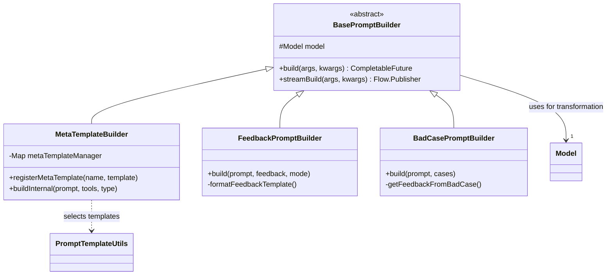
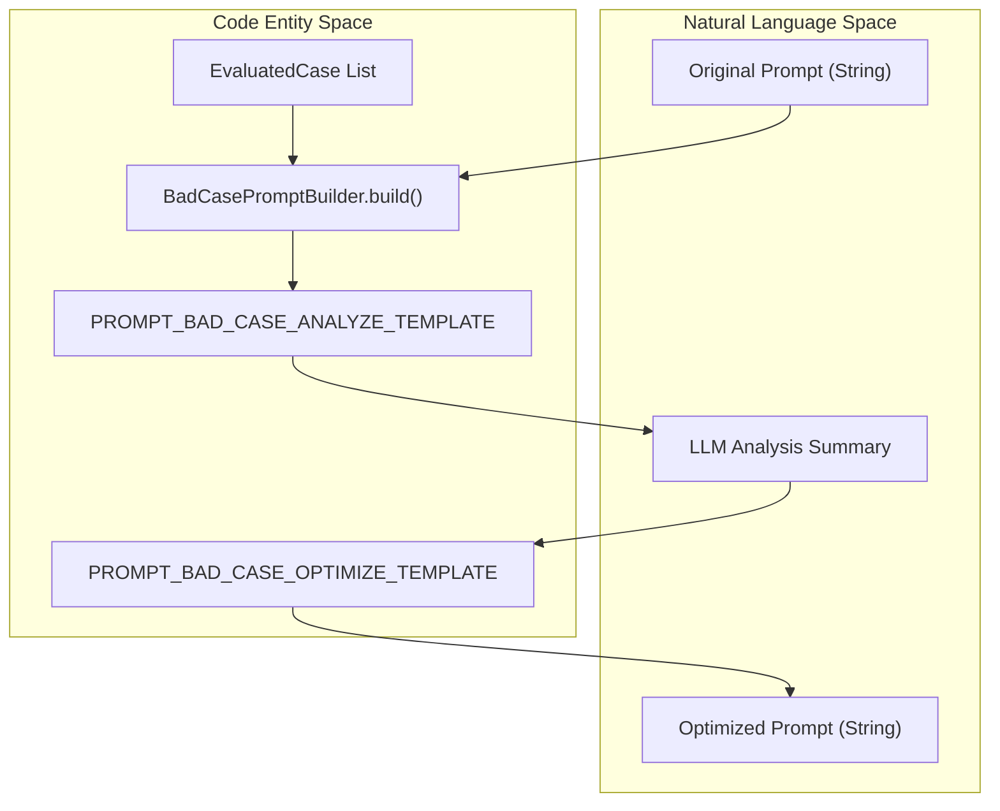

<!-- source: DeepWiki mcp.deepwiki.com · repo openJiuwen-ai/agent-core-java · page 10.1 Prompt Engineering Tools · fetched 2026-11-02 -->

# Prompt Engineering Tools

Relevant source files

The following files were used as context for generating this wiki page:

- [src/main/java/com/openjiuwen/dev_tools/prompt_builder/BasePromptBuilder.java](src/main/java/com/openjiuwen/dev_tools/prompt_builder/BasePromptBuilder.java)
- [src/main/java/com/openjiuwen/dev_tools/prompt_builder/builder/BadCasePromptBuilder.java](src/main/java/com/openjiuwen/dev_tools/prompt_builder/builder/BadCasePromptBuilder.java)
- [src/main/java/com/openjiuwen/dev_tools/prompt_builder/builder/FeedbackPromptBuilder.java](src/main/java/com/openjiuwen/dev_tools/prompt_builder/builder/FeedbackPromptBuilder.java)
- [src/main/java/com/openjiuwen/dev_tools/prompt_builder/builder/MetaTemplateBuilder.java](src/main/java/com/openjiuwen/dev_tools/prompt_builder/builder/MetaTemplateBuilder.java)
- [src/main/java/com/openjiuwen/dev_tools/prompt_builder/builder/PromptTemplateUtils.java](src/main/java/com/openjiuwen/dev_tools/prompt_builder/builder/PromptTemplateUtils.java)
- [src/main/java/com/openjiuwen/dev_tools/prompt_builder/builder/PromptTemplatesEn.java](src/main/java/com/openjiuwen/dev_tools/prompt_builder/builder/PromptTemplatesEn.java)
- [src/main/java/com/openjiuwen/dev_tools/prompt_builder/builder/PromptTemplatesZh.java](src/main/java/com/openjiuwen/dev_tools/prompt_builder/builder/PromptTemplatesZh.java)
- [src/main/java/com/openjiuwen/dev_tools/prompt_builder/builder/UnwrappedCompletableFuture.java](src/main/java/com/openjiuwen/dev_tools/prompt_builder/builder/UnwrappedCompletableFuture.java)
- [src/main/java/com/openjiuwen/dev_tools/tune/Case.java](src/main/java/com/openjiuwen/dev_tools/tune/Case.java)
- [src/main/java/com/openjiuwen/dev_tools/tune/EvaluatedCase.java](src/main/java/com/openjiuwen/dev_tools/tune/EvaluatedCase.java)

The `com.openjiuwen.dev_tools.prompt_builder` package provides a specialized toolchain for programmatically generating, refining, and optimizing LLM prompts. This system enables developers to move beyond static string templates by using LLMs to "build" prompts based on high-level goals (meta-templates), iterative user feedback, or automated analysis of failure cases (bad-cases).

### Prompt Builder Architecture

The toolchain is built upon a common abstraction, `BasePromptBuilder`, which integrates with the framework's core LLM `Model` to perform prompt-to-prompt transformations.

#### Core Class Hierarchy
- **`BasePromptBuilder`**: An abstract base class that encapsulates a `Model` instance (initialized via `ModelRequestConfig` and `ModelClientConfig`) and defines the contract for synchronous (`build`) and streaming (`streamBuild`) prompt generation [src/main/java/com/openjiuwen/dev_tools/prompt_builder/BasePromptBuilder.java:25-30]().
- **`PromptBuilderStreamResult`**: A specialized result type that implements both `CompletableFuture<String>` and `Flow.Publisher<String>`. It allows the toolchain to support legacy blocking code while providing modern reactive streams for real-time prompt generation [src/main/java/com/openjiuwen/dev_tools/prompt_builder/BasePromptBuilder.java:55-66]().

**Prompt Engineering Tool Relationship**

**Sources:** [src/main/java/com/openjiuwen/dev_tools/prompt_builder/BasePromptBuilder.java:25-56](), [src/main/java/com/openjiuwen/dev_tools/prompt_builder/builder/MetaTemplateBuilder.java:36-44](), [src/main/java/com/openjiuwen/dev_tools/prompt_builder/builder/FeedbackPromptBuilder.java:38-54](), [src/main/java/com/openjiuwen/dev_tools/prompt_builder/builder/BadCasePromptBuilder.java:40-49]().

---

### Meta-Template Generation

The `MetaTemplateBuilder` is designed to convert high-level "meta-prompts" into concrete, executable system prompts. It supports different template types, such as `general` for standard instructions and `plan` for reasoning-heavy tasks [src/main/java/com/openjiuwen/dev_tools/prompt_builder/builder/MetaTemplateBuilder.java:39-41]().

#### Key Features:
- **Template Registration**: Users can register custom meta-templates using `registerMetaTemplate`, which prefixes the name with `META_TEMPLATE_` [src/main/java/com/openjiuwen/dev_tools/prompt_builder/builder/MetaTemplateBuilder.java:64-75]().
- **Internal Processing**: The `buildInternal` method formats the meta-template (using system and user messages defined in `PromptTemplatesZh` or `PromptTemplatesEn`) and invokes the LLM to generate the final prompt text [src/main/java/com/openjiuwen/dev_tools/prompt_builder/builder/MetaTemplateBuilder.java:120-142]().

**Sources:** [src/main/java/com/openjiuwen/dev_tools/prompt_builder/builder/MetaTemplateBuilder.java:36-157]().

---

### Feedback-Driven Optimization

`FeedbackPromptBuilder` allows for iterative prompt refinement based on natural language feedback. It supports three distinct modes of interaction [src/main/java/com/openjiuwen/dev_tools/prompt_builder/builder/FeedbackPromptBuilder.java:40-42]():

| Mode | Description |
| :--- | :--- |
| `general` | Applies feedback to the prompt as a whole. |
| `select` | Optimizes a specific substring of the prompt defined by `startPos` and `endPos`. |
| `insert` | Injects new instructions at a specific location, often marked by `[用户要插入的位置]`. |

The builder uses `formatFeedbackTemplate` to construct a request for the LLM that includes the original prompt, the specific feedback, and the modification mode [src/main/java/com/openjiuwen/dev_tools/prompt_builder/builder/FeedbackPromptBuilder.java:124-126]().

**Sources:** [src/main/java/com/openjiuwen/dev_tools/prompt_builder/builder/FeedbackPromptBuilder.java:38-138]().

---

### Bad-Case Analysis and Optimization

`BadCasePromptBuilder` automates prompt engineering by analyzing instances where an agent failed. It takes a list of `EvaluatedCase` objects (which contain the input, the expected label, and the actual erroneous answer) and performs a two-step optimization [src/main/java/com/openjiuwen/dev_tools/prompt_builder/builder/BadCasePromptBuilder.java:67-91]().

1. **Analysis**: `getFeedbackFromBadCase` uses the `PROMPT_BAD_CASE_ANALYZE_TEMPLATE` to ask an LLM to identify why the current prompt failed for the provided cases [src/main/java/com/openjiuwen/dev_tools/prompt_builder/builder/BadCasePromptBuilder.java:150-161]().
2. **Optimization**: The resulting analysis (summary) is then passed to `PROMPT_BAD_CASE_OPTIMIZE_TEMPLATE` to generate a revised version of the original prompt [src/main/java/com/openjiuwen/dev_tools/prompt_builder/builder/BadCasePromptBuilder.java:140-148]().

**Bad-Case Data Flow**

**Sources:** [src/main/java/com/openjiuwen/dev_tools/prompt_builder/builder/BadCasePromptBuilder.java:140-161](), [src/main/java/com/openjiuwen/dev_tools/tune/EvaluatedCase.java:21-52]().

---

### Localization and Utilities

The toolchain relies on a set of utility classes to manage templates across different languages and handle complex prompt types.

#### PromptTemplateUtils
This utility provides a bridge between the Java implementation and the legacy Python-based prompt structures.
- **`selectTemplate(String language)`**: Returns either `PromptTemplatesZh.class` or `PromptTemplatesEn.class` based on the requested locale [src/main/java/com/openjiuwen/dev_tools/prompt_builder/builder/PromptTemplateUtils.java:31-36]().
- **`getStringPrompt(Object prompt)`**: A robust extractor that converts `String`, `PromptTemplate`, or `List<BaseMessage>` into a raw string for LLM processing [src/main/java/com/openjiuwen/dev_tools/prompt_builder/builder/PromptTemplateUtils.java:49-75]().

#### Localization Constants
Templates are stored in language-specific classes:
- **`PromptTemplatesZh`**: Contains Chinese constants like `PROMPT_BUILD_GENERAL_META_SYSTEM_TEMPLATE` [src/main/java/com/openjiuwen/dev_tools/prompt_builder/builder/PromptTemplatesZh.java:16-17]().
- **`PromptTemplatesEn`**: Contains English equivalents [src/main/java/com/openjiuwen/dev_tools/prompt_builder/builder/PromptTemplatesEn.java:16-17]().

**Sources:** [src/main/java/com/openjiuwen/dev_tools/prompt_builder/builder/PromptTemplateUtils.java:22-114](), [src/main/java/com/openjiuwen/dev_tools/prompt_builder/builder/PromptTemplatesZh.java:15-51](), [src/main/java/com/openjiuwen/dev_tools/prompt_builder/builder/PromptTemplatesEn.java:15-51]().

---

