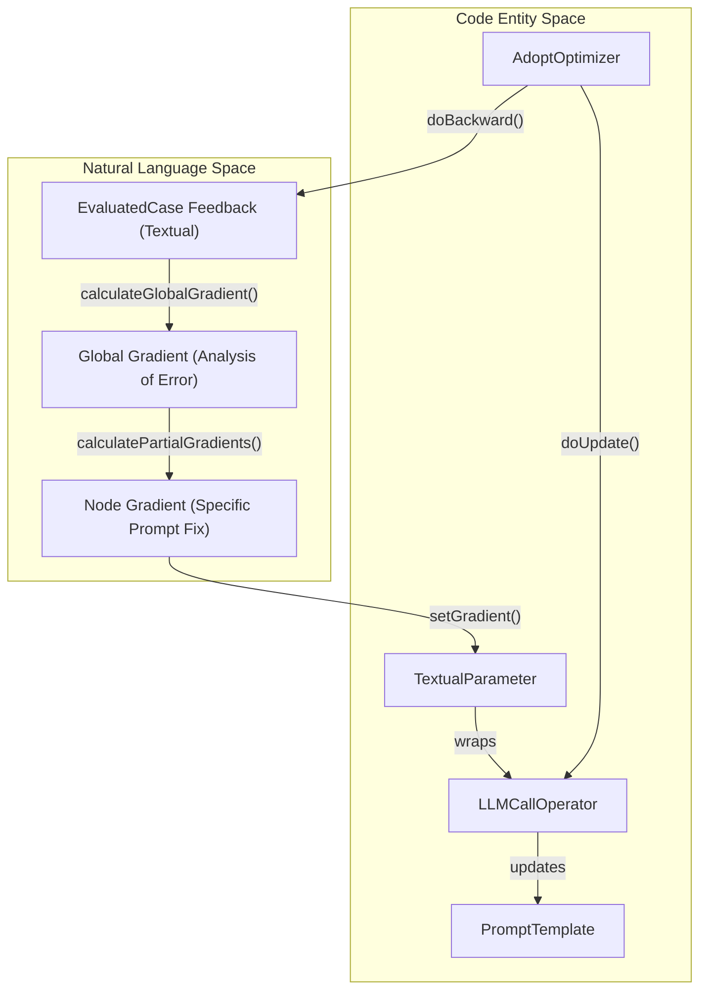
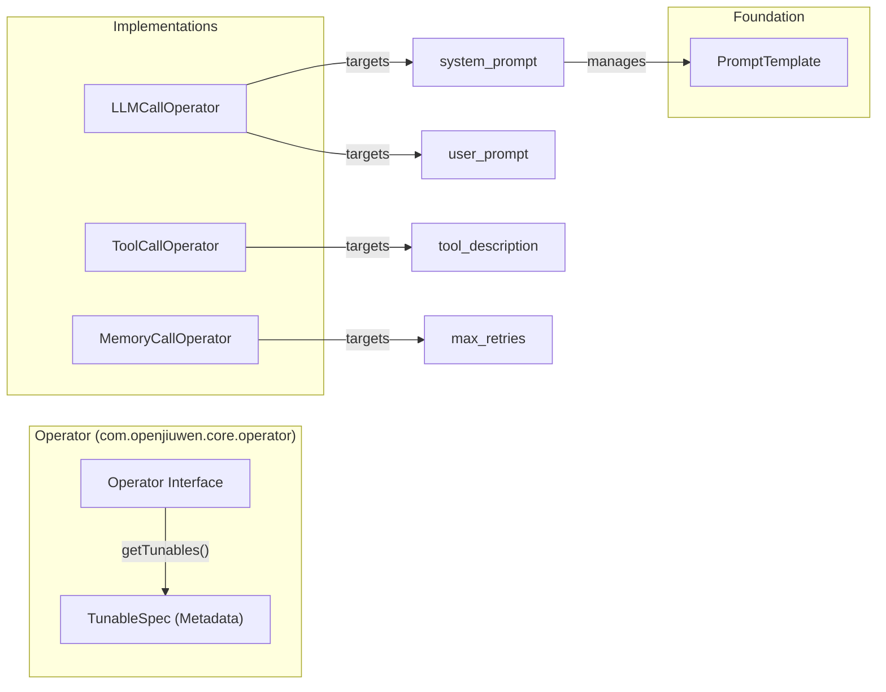

<!-- source: DeepWiki mcp.deepwiki.com · repo openJiuwen-ai/agent-core-java · page 10.2 Agent Tuning and ADOPT Optimizer · fetched 2026-11-02 -->

# Agent Tuning and ADOPT Optimizer

Relevant source files

The following files were used as context for generating this wiki page:

- [pom.xml](pom.xml)
- [src/main/java/com/openjiuwen/core/foundation/prompt/PromptTemplate.java](src/main/java/com/openjiuwen/core/foundation/prompt/PromptTemplate.java)
- [src/main/java/com/openjiuwen/core/operator/Operator.java](src/main/java/com/openjiuwen/core/operator/Operator.java)
- [src/main/java/com/openjiuwen/core/operator/OperatorStream.java](src/main/java/com/openjiuwen/core/operator/OperatorStream.java)
- [src/main/java/com/openjiuwen/core/operator/TunableSpec.java](src/main/java/com/openjiuwen/core/operator/TunableSpec.java)
- [src/main/java/com/openjiuwen/core/operator/legacy/llm_call/LLMCall.java](src/main/java/com/openjiuwen/core/operator/legacy/llm_call/LLMCall.java)
- [src/main/java/com/openjiuwen/core/operator/legacy/llm_call/LegacyOptimizerCallback.java](src/main/java/com/openjiuwen/core/operator/legacy/llm_call/LegacyOptimizerCallback.java)
- [src/main/java/com/openjiuwen/core/operator/llm_call/LLMCall.java](src/main/java/com/openjiuwen/core/operator/llm_call/LLMCall.java)
- [src/main/java/com/openjiuwen/core/operator/llm_call/LLMCallOperator.java](src/main/java/com/openjiuwen/core/operator/llm_call/LLMCallOperator.java)
- [src/main/java/com/openjiuwen/core/operator/memory_call/MemoryCallOperator.java](src/main/java/com/openjiuwen/core/operator/memory_call/MemoryCallOperator.java)
- [src/main/java/com/openjiuwen/core/operator/tool_call/ToolCallOperator.java](src/main/java/com/openjiuwen/core/operator/tool_call/ToolCallOperator.java)
- [src/main/java/com/openjiuwen/dev_tools/tune/optimizer/adopt/AdoptOptimizer.java](src/main/java/com/openjiuwen/dev_tools/tune/optimizer/adopt/AdoptOptimizer.java)
- [src/test/java/com/openjiuwen/core/retrieval/indexing/processor/parser/PDFParserTest.java](src/test/java/com/openjiuwen/core/retrieval/indexing/processor/parser/PDFParserTest.java)

The `agent-core-java` framework provides a sophisticated self-evolution pipeline centered around the **ADOPT (Automated Decomposing of Prompt Tuning)** algorithm. This system enables agents to automatically optimize their internal parameters—primarily LLM prompts—based on performance feedback from evaluated cases.

### ADOPT Pipeline Overview

The ADOPT pipeline decomposes high-level feedback (e.g., "the final answer was incorrect") into specific "gradients" for individual nodes within an agent's workflow. This mirrors the backpropagation process in neural networks but operates in the space of natural language prompts [src/main/java/com/openjiuwen/dev_tools/tune/optimizer/adopt/AdoptOptimizer.java:38-42]().

#### Key Concepts and Data Structures

| Class | Description |
| :--- | :--- |
| `AdoptOptimizer` | The primary engine that manages the backward pass (gradient calculation) and update pass (prompt refinement) [src/main/java/com/openjiuwen/dev_tools/tune/optimizer/adopt/AdoptOptimizer.java:43-55](). |
| `EvaluatedCase` | A single execution trace containing inputs, outputs, and a score/feedback from an evaluator [src/main/java/com/openjiuwen/dev_tools/tune/optimizer/adopt/AdoptOptimizer.java:17-17](). |
| `Gradient` | A textual description of how a parameter (like a system prompt) should be changed to improve performance [src/main/java/com/openjiuwen/dev_tools/tune/optimizer/adopt/AdoptOptimizer.java:87-103](). |
| `TraceNode` | Represents a node's execution context during a specific case, used to map global errors to local node behaviors [src/main/java/com/openjiuwen/dev_tools/tune/optimizer/adopt/AdoptOptimizer.java:21-21](). |
| `TextualParameter` | A wrapper for tunable parameters (e.g., `LLMCall`) that stores the current gradients for that parameter [src/main/java/com/openjiuwen/dev_tools/tune/optimizer/adopt/AdoptOptimizer.java:20-20](). |

**Sources:** [src/main/java/com/openjiuwen/dev_tools/tune/optimizer/adopt/AdoptOptimizer.java:1-114]()

---

### The Optimization Loop

The optimization process is split into two main phases: `doBackward` and `doUpdate`.

#### 1. Backward Pass (Gradient Decomposition)
In `doBackward`, the `AdoptOptimizer` performs the following steps:
1.  **Global Gradient Calculation**: Analyzes "bad cases" to determine the delta between expected and actual output using `analyzeOutputChange` and `analyzeDeepOutput` [src/main/java/com/openjiuwen/dev_tools/tune/optimizer/adopt/AdoptOptimizer.java:116-140]().
2.  **Partial Gradient Generation**: Distributes the global error across the `TraceNode` path. For each `LLMCallOperator`, it generates a specific textual gradient for the `system_prompt` and `user_prompt` [src/main/java/com/openjiuwen/dev_tools/tune/optimizer/adopt/AdoptOptimizer.java:142-165]().

#### 2. Update Pass (Prompt Refinement)
In `doUpdate`, the `PartialOptimizer` takes the accumulated gradients and uses an LLM to rewrite the prompts. It applies the suggested changes while respecting "freeze" flags (e.g., `freezeSystemPrompt`) [src/main/java/com/openjiuwen/dev_tools/tune/optimizer/adopt/AdoptOptimizer.java:106-114]().

**Sources:** [src/main/java/com/openjiuwen/dev_tools/tune/optimizer/adopt/AdoptOptimizer.java:87-114](), [src/main/java/com/openjiuwen/core/operator/llm_call/LLMCallOperator.java:77-86]()

---

### Operator Abstraction and Tunable Parameters

The framework uses an `Operator` abstraction to define components with tunable parameters. This allows the optimizer to interact with different types of agent behaviors (LLM calls, tool usage, memory access) through a unified interface.

#### Tunable Operators

*   **`LLMCallOperator`**: The most common tunable. It manages `systemPrompt` and `userPrompt` as `PromptTemplate` objects. It exposes these as tunables unless they are explicitly frozen [src/main/java/com/openjiuwen/core/operator/llm_call/LLMCallOperator.java:22-73]().
*   **`ToolCallOperator`**: Allows the optimizer to tune `tool_description` fields, helping the agent better understand when and how to invoke specific tools [src/main/java/com/openjiuwen/core/operator/tool_call/ToolCallOperator.java:18-61]().
*   **`MemoryCallOperator`**: Manages parameters like `enabled` and `max_retries` for memory retrieval operations [src/main/java/com/openjiuwen/core/operator/memory_call/MemoryCallOperator.java:18-59]().

#### Mapping Natural Language to Code Entities

The following diagrams illustrate how the ADOPT pipeline bridges the gap between high-level natural language feedback and the underlying code structures.

**Diagram 1: ADOPT Optimization Data Flow**

**Sources:** [src/main/java/com/openjiuwen/dev_tools/tune/optimizer/adopt/AdoptOptimizer.java:87-114](), [src/main/java/com/openjiuwen/core/operator/llm_call/LLMCallOperator.java:77-86](), [src/main/java/com/openjiuwen/core/foundation/prompt/PromptTemplate.java:34-46]()

**Diagram 2: Tunable Operator Structure**

**Sources:** [src/main/java/com/openjiuwen/core/operator/Operator.java:1-10](), [src/main/java/com/openjiuwen/core/operator/TunableSpec.java:18-23](), [src/main/java/com/openjiuwen/core/operator/llm_call/LLMCallOperator.java:57-73](), [src/main/java/com/openjiuwen/core/operator/tool_call/ToolCallOperator.java:48-61]()

---

### Implementation Details: LLMCall Evolution

The `LLMCallOperator` (and its legacy alias `LLMCall`) is the primary target for tuning. It handles the conversion of internal state to a format suitable for the optimizer.

*   **State Management**: The `getState()` and `loadState()` methods allow the optimizer to snapshot and restore prompt configurations [src/main/java/com/openjiuwen/core/operator/llm_call/LLMCallOperator.java:89-111]().
*   **Prompt Normalization**: Since the optimizer often operates using Python-based logic in its core analysis, `LLMCallOperator` includes `toPythonRepr` and `normalizePromptContent` to ensure compatibility when prompts contain complex structures like Maps or Lists [src/main/java/com/openjiuwen/core/operator/llm_call/LLMCallOperator.java:150-209]().
*   **Legacy Compatibility**: The `com.openjiuwen.core.operator.legacy.llm_call.LLMCall` class provides a `LegacyOptimizerCallback`. This allows older agent implementations to participate in the tuning loop by capturing inputs and responses during execution [src/main/java/com/openjiuwen/core/operator/legacy/llm_call/LLMCall.java:64-82]().

**Sources:** [src/main/java/com/openjiuwen/core/operator/llm_call/LLMCallOperator.java:1-210](), [src/main/java/com/openjiuwen/core/operator/legacy/llm_call/LLMCall.java:1-82]()

---

