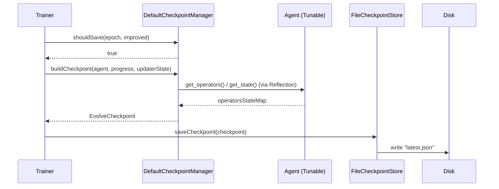

<!-- source: DeepWiki mcp.deepwiki.com · repo openJiuwen-ai/agent-core-java · page 10.3 Agent Self-Evolution Training Loop · fetched 2026-11-02 -->

# Agent Self-Evolution Training Loop

<details>
<summary>Relevant source files</summary>

The following files were used as context for generating this wiki page:

- [src/main/java/com/openjiuwen/agent_evolving/TuneConstant.java](src/main/java/com/openjiuwen/agent_evolving/TuneConstant.java)
- [src/main/java/com/openjiuwen/agent_evolving/TuneUtils.java](src/main/java/com/openjiuwen/agent_evolving/TuneUtils.java)
- [src/main/java/com/openjiuwen/agent_evolving/checkpointing/CheckpointManager.java](src/main/java/com/openjiuwen/agent_evolving/checkpointing/CheckpointManager.java)
- [src/main/java/com/openjiuwen/agent_evolving/checkpointing/DefaultCheckpointManager.java](src/main/java/com/openjiuwen/agent_evolving/checkpointing/DefaultCheckpointManager.java)
- [src/main/java/com/openjiuwen/agent_evolving/checkpointing/EvolveCheckpoint.java](src/main/java/com/openjiuwen/agent_evolving/checkpointing/EvolveCheckpoint.java)
- [src/main/java/com/openjiuwen/agent_evolving/checkpointing/FileCheckpointStore.java](src/main/java/com/openjiuwen/agent_evolving/checkpointing/FileCheckpointStore.java)
- [src/main/java/com/openjiuwen/agent_evolving/dataset/Case.java](src/main/java/com/openjiuwen/agent_evolving/dataset/Case.java)
- [src/main/java/com/openjiuwen/agent_evolving/dataset/CaseLoader.java](src/main/java/com/openjiuwen/agent_evolving/dataset/CaseLoader.java)
- [src/main/java/com/openjiuwen/agent_evolving/dataset/EvaluatedCase.java](src/main/java/com/openjiuwen/agent_evolving/dataset/EvaluatedCase.java)
- [src/main/java/com/openjiuwen/agent_evolving/evaluator/BaseEvaluator.java](src/main/java/com/openjiuwen/agent_evolving/evaluator/BaseEvaluator.java)
- [src/main/java/com/openjiuwen/agent_evolving/evaluator/DefaultEvaluator.java](src/main/java/com/openjiuwen/agent_evolving/evaluator/DefaultEvaluator.java)

</details>


The `agent_evolving` package provides a structured framework for the iterative optimization of agent performance. It implements a self-evolution loop that evaluates agent outputs against labeled datasets, analyzes failures, and optimizes instructions or parameters to improve future performance. This system is designed to mirror the capabilities of the ADOPT (Automated Decomposing of Prompt Tuning) pipeline in a Java-native environment.

## Data Structures and Dataset Management

The evolution process relies on two primary data structures to represent training samples and their evaluation results.

### Case and EvaluatedCase
A `Case` represents a single training or evaluation sample, containing inputs, expected labels, and optional tool definitions [src/main/java/com/openjiuwen/agent_evolving/dataset/Case.java:23-32](). Once a `Case` is processed by an agent and judged, it is encapsulated in an `EvaluatedCase`, which includes the model's answer, a numerical score (clamped between 0.0 and 1.0), and a natural language reason for the score [src/main/java/com/openjiuwen/agent_evolving/dataset/EvaluatedCase.java:20-46]().

### CaseLoader
The `CaseLoader` manages collections of cases, providing utilities for shuffling and splitting datasets into training and validation sets [src/main/java/com/openjiuwen/agent_evolving/dataset/CaseLoader.java:20-53](). It implements a custom `PythonRandom` generator to ensure deterministic shuffling behavior consistent with the framework's Python counterparts [src/main/java/com/openjiuwen/agent_evolving/dataset/CaseLoader.java:91-114]().

**Data Flow: Dataset Preparation**

```mermaid
graph TD
    subgraph "Data Space"
        JSON["Raw JSON/Map Data"]
    end

    subgraph "Code Entity Space: com.openjiuwen.agent_evolving.dataset"
        C["Case"]
        CL["CaseLoader"]
        CLS["CaseLoaderSplit"]
    end

    JSON -->|Constructor| C
    C -->|List<Case>| CL
    CL -->|split(ratio)| CLS
    CLS -->|left| TrainSet["CaseLoader (Train)"]
    CLS -->|right| ValSet["CaseLoader (Val)"]
```
Sources: [src/main/java/com/openjiuwen/agent_evolving/dataset/Case.java:34-43](), [src/main/java/com/openjiuwen/agent_evolving/dataset/CaseLoader.java:41-53]()

---

## Evaluation System (LLM-as-Judge)

The evaluation system uses LLMs to judge the quality of agent responses, especially when simple string matching is insufficient.

### BaseEvaluator and DefaultEvaluator
`BaseEvaluator` defines the contract for evaluation, supporting both single-case and parallelized batch evaluation using an `ExecutorService` [src/main/java/com/openjiuwen/agent_evolving/evaluator/BaseEvaluator.java:29-78]().

`DefaultEvaluator` implements the "LLM-as-judge" pattern. It uses a specific `metricTemplate` to prompt an LLM to compare the `model_answer` against the `expected_answer` [src/main/java/com/openjiuwen/agent_evolving/evaluator/DefaultEvaluator.java:54-74]().

Key logic in `DefaultEvaluator`:
1.  **Metric Formatting**: Converts the `Case` and prediction into a prompt [src/main/java/com/openjiuwen/agent_evolving/evaluator/DefaultEvaluator.java:114-120]().
2.  **JSON Extraction**: Uses `TuneUtils.parseJsonFromLlmResponse` to extract the judge's score and reasoning [src/main/java/com/openjiuwen/agent_evolving/evaluator/DefaultEvaluator.java:77-80]().
3.  **Retry Logic**: If the judge provides a non-standard response, a `LLM_METRIC_RETRY_TEMPLATE` is used to force a valid JSON format [src/main/java/com/openjiuwen/agent_evolving/evaluator/DefaultEvaluator.java:82-96]().

Sources: [src/main/java/com/openjiuwen/agent_evolving/evaluator/DefaultEvaluator.java:33-96](), [src/main/java/com/openjiuwen/agent_evolving/evaluator/BaseEvaluator.java:45-78]()

---

## Checkpointing and State Management

To ensure resilience and reproducibility during long-running training loops, the framework includes a comprehensive checkpointing system.

### EvolveCheckpoint
A serializable POJO that captures the complete state of an evolution run, including:
*   `step`: Current epoch and batch iteration [src/main/java/com/openjiuwen/agent_evolving/checkpointing/EvolveCheckpoint.java:22]().
*   `best`: The highest score achieved so far [src/main/java/com/openjiuwen/agent_evolving/checkpointing/EvolveCheckpoint.java:23]().
*   `operatorsState`: Snapshots of tunable parameters (e.g., prompts, tool descriptions) from the agent's internal operators [src/main/java/com/openjiuwen/agent_evolving/checkpointing/EvolveCheckpoint.java:26]().

### CheckpointManager and FileCheckpointStore
The `DefaultCheckpointManager` coordinates the snapshotting process. It uses reflection to invoke `get_operators` and `get_state` on the agent to gather current parameters [src/main/java/com/openjiuwen/agent_evolving/checkpointing/DefaultCheckpointManager.java:129-148](). The `FileCheckpointStore` handles the persistence of these checkpoints to local JSON files with snake_case naming conventions [src/main/java/com/openjiuwen/agent_evolving/checkpointing/FileCheckpointStore.java:26-59]().

**System Interaction: Checkpoint Save/Restore**


Sources: [src/main/java/com/openjiuwen/agent_evolving/checkpointing/DefaultCheckpointManager.java:53-85](), [src/main/java/com/openjiuwen/agent_evolving/checkpointing/FileCheckpointStore.java:45-59]()

---

## Training Workflow and Optimization

The end-to-end workflow (typically orchestrated by a `Trainer` or `Optimizer`) follows an iterative cycle governed by `TuneConstant` hyperparameters, such as `defaultIterationNum` (3) and `maxParallelNum` (20) [src/main/java/com/openjiuwen/agent_evolving/TuneConstant.java:15-25]().

### The Evolution Loop
1.  **Inference**: The agent processes the training `CaseLoader` batch.
2.  **Evaluation**: `BaseEvaluator` computes scores for the batch.
3.  **Analysis**: `TuneUtils` provides helper functions to identify failures, such as `inferSkillFromTexts` which determines which skill/tool was likely responsible for a specific output based on mentions and payloads [src/main/java/com/openjiuwen/agent_evolving/TuneUtils.java:53-91]().
4.  **Optimization**: The `InstructionOptimizer` (or `AdoptOptimizer`) generates "Gradients" (textual feedback) and updates the agent's parameters.
5.  **Checkpoint**: The `CheckpointManager` saves the state if the `best_score` improves [src/main/java/com/openjiuwen/agent_evolving/checkpointing/DefaultCheckpointManager.java:53-58]().

### Utility Helpers
`TuneUtils` contains critical logic for bridging the gap between raw LLM outputs and structured evolution data:
*   **JSON Parsing**: `parseJsonFromLlmResponse` uses regex (`JSON_BLOCK_RE`) to find and parse JSON blocks within conversational LLM responses [src/main/java/com/openjiuwen/agent_evolving/TuneUtils.java:47-49]().
*   **Skill Inference**: Maps unstructured text back to specific tools using `SKILLS_PATH_RE` and `INLINE_SKILL_TOOL_RE` [src/main/java/com/openjiuwen/agent_evolving/TuneUtils.java:42-46]().

Sources: [src/main/java/com/openjiuwen/agent_evolving/TuneUtils.java:37-176](), [src/main/java/com/openjiuwen/agent_evolving/TuneConstant.java:13-31]()

---

