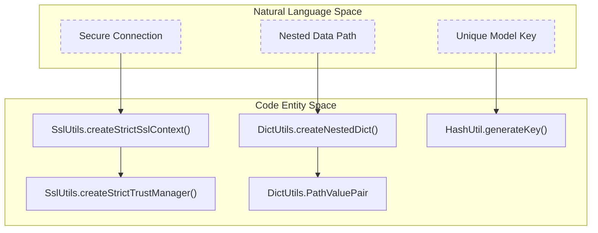
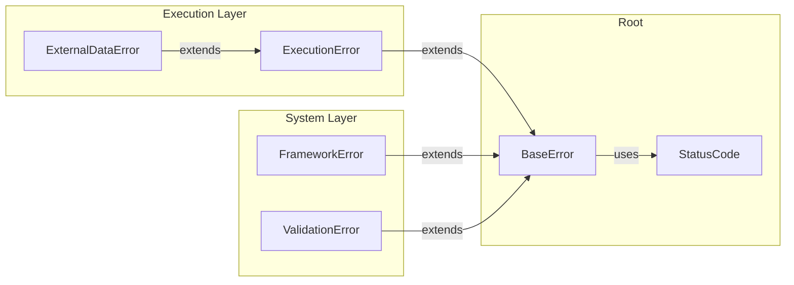

<!-- source: DeepWiki mcp.deepwiki.com · repo openJiuwen-ai/agent-core-java · page 11 Common Utilities and Infrastructure · fetched 2026-11-02 -->

# Common Utilities and Infrastructure

Relevant source files

The following files were used as context for generating this wiki page:

- [src/main/java/com/openjiuwen/core/common/exception/ApplicationError.java](src/main/java/com/openjiuwen/core/common/exception/ApplicationError.java)
- [src/main/java/com/openjiuwen/core/common/exception/BaseError.java](src/main/java/com/openjiuwen/core/common/exception/BaseError.java)
- [src/main/java/com/openjiuwen/core/common/exception/ConfigurationError.java](src/main/java/com/openjiuwen/core/common/exception/ConfigurationError.java)
- [src/main/java/com/openjiuwen/core/common/exception/ExecutionError.java](src/main/java/com/openjiuwen/core/common/exception/ExecutionError.java)
- [src/main/java/com/openjiuwen/core/common/exception/ExternalDataError.java](src/main/java/com/openjiuwen/core/common/exception/ExternalDataError.java)
- [src/main/java/com/openjiuwen/core/common/exception/ExternalServiceError.java](src/main/java/com/openjiuwen/core/common/exception/ExternalServiceError.java)
- [src/main/java/com/openjiuwen/core/common/exception/FrameworkError.java](src/main/java/com/openjiuwen/core/common/exception/FrameworkError.java)
- [src/main/java/com/openjiuwen/core/common/exception/Termination.java](src/main/java/com/openjiuwen/core/common/exception/Termination.java)
- [src/main/java/com/openjiuwen/core/common/exception/ValidationError.java](src/main/java/com/openjiuwen/core/common/exception/ValidationError.java)
- [src/main/java/com/openjiuwen/core/common/logging/LazyLogger.java](src/main/java/com/openjiuwen/core/common/logging/LazyLogger.java)
- [src/main/java/com/openjiuwen/core/common/logging/LogManager.java](src/main/java/com/openjiuwen/core/common/logging/LogManager.java)
- [src/main/java/com/openjiuwen/core/common/logging/defaults/DefaultLogger.java](src/main/java/com/openjiuwen/core/common/logging/defaults/DefaultLogger.java)
- [src/main/java/com/openjiuwen/core/common/security/SslUtils.java](src/main/java/com/openjiuwen/core/common/security/SslUtils.java)
- [src/main/java/com/openjiuwen/core/common/utils/DictUtils.java](src/main/java/com/openjiuwen/core/common/utils/DictUtils.java)
- [src/main/java/com/openjiuwen/core/common/utils/HashUtil.java](src/main/java/com/openjiuwen/core/common/utils/HashUtil.java)
- [src/test/java/com/openjiuwen/core/common/utils/DictUtilsTest.java](src/test/java/com/openjiuwen/core/common/utils/DictUtilsTest.java)
- [src/test/java/com/openjiuwen/core/common/utils/HashUtilTest.java](src/test/java/com/openjiuwen/core/common/utils/HashUtilTest.java)
- [src/test/java/com/openjiuwen/core/common/utils/IpUtilsTest.java](src/test/java/com/openjiuwen/core/common/utils/IpUtilsTest.java)
- [src/test/java/com/openjiuwen/core/common/utils/SingletonTest.java](src/test/java/com/openjiuwen/core/common/utils/SingletonTest.java)

The `agent-core-java` framework provides a robust foundation of shared utilities and cross-cutting infrastructure designed to support complex agentic workflows. This layer handles essential tasks such as structured logging, security, exception management, and data manipulation, ensuring consistency across the SDK and Engine layers.

### Infrastructure Overview

The infrastructure layer bridges high-level agent logic with low-level system operations. It provides the necessary tools for observability, data transformation, and environment-safe execution.

**Core Infrastructure Components**
| Component | Primary Role | Key Code Entities |
| :--- | :--- | :--- |
| **Logging** | Structured and lazy logging for agent execution. | `DefaultLogger`, `LazyLogger`, `LogManager` |
| **Security** | SSL/TLS management for secure API communications. | `SslUtils` |
| **Data Utils** | Deep-nested dictionary manipulation and pathing. | `DictUtils`, `HashUtil` |
| **Exceptions** | Standardized error hierarchy and status codes. | `BaseError`, `StatusCode`, `FrameworkError` |

---

### Logging and Observability

The logging system is designed for high-performance agentic environments, supporting structured event logging and lazy initialization to minimize startup overhead. It integrates with SLF4J while providing specialized capabilities for tracing agent spans and workflow nodes.

*   **Structured Logging**: `DefaultLogger` provides JSON-serialized events and MDC-based context injection (e.g., `trace_id`) [src/main/java/com/openjiuwen/core/common/logging/defaults/DefaultLogger.java:46-53]().
*   **Lazy Initialization**: `LazyLogger` allows for static logger definitions that only instantiate upon first use [src/main/java/com/openjiuwen/core/common/logging/LazyLogger.java:20-31]().
*   **Observability**: Infrastructure for full-link tracing across agent execution steps.

For detailed information on logging patterns, trace spans, and observability, see **[Logging and Observability](#11.1)**.

**Sources:**
- [src/main/java/com/openjiuwen/core/common/logging/defaults/DefaultLogger.java:46-188]()
- [src/main/java/com/openjiuwen/core/common/logging/LazyLogger.java:20-127]()

---

### Common Utilities

The framework includes a suite of utility classes that mirror the functional logic of the core Python implementation, ensuring cross-language compatibility for configuration and data handling.

*   **Dictionary & Pathing**: `DictUtils` provides advanced methods for flattening nested maps, extracting leaf nodes, and rebuilding structures from path-value pairs [src/main/java/com/openjiuwen/core/common/utils/DictUtils.java:17-118]().
*   **Hashing**: `HashUtil` generates consistent keys for API and model configurations using SHA-256 [src/main/java/com/openjiuwen/core/common/utils/HashUtil.java:17-36]().
*   **Networking**: `IpUtils` facilitates local IP discovery for distributed coordination [src/test/java/com/openjiuwen/core/common/utils/IpUtilsTest.java:16-25]().

For details on schema extraction, session path navigation, and general utilities, see **[Common Utilities](#11.2)**.

**Sources:**
- [src/main/java/com/openjiuwen/core/common/utils/DictUtils.java:17-189]()
- [src/main/java/com/openjiuwen/core/common/utils/HashUtil.java:17-37]()
- [src/test/java/com/openjiuwen/core/common/utils/DictUtilsTest.java:18-136]()

---

### Security and SSL Management

Security infrastructure is centralized in `SslUtils`, which manages `SSLContext` creation for both strict and insecure modes. It includes safeguards such as `SAFE_CERT_DIR` checks to ensure certificates are loaded from authorized paths [src/main/java/com/openjiuwen/core/common/security/SslUtils.java:34-95]().

**Utility to Code Entity Mapping: Data & Security**

**Sources:**
- [src/main/java/com/openjiuwen/core/common/security/SslUtils.java:34-187]()

---

### Error Handling Hierarchy

The framework utilizes a standardized exception hierarchy rooted in `BaseError`. Errors are categorized by their source and recoverability, allowing the Pregel engine to make informed decisions about task retries or workflow termination.

*   **Fatal Errors**: `FrameworkError` represents non-recoverable system issues [src/main/java/com/openjiuwen/core/common/exception/FrameworkError.java:13-21]().
*   **Validation Errors**: `ValidationError` handles schema and input mismatches [src/main/java/com/openjiuwen/core/common/exception/ValidationError.java:13-21]().
*   **Execution Errors**: `ExternalDataError` and `ExternalServiceError` track failures during tool calls or data retrieval [src/main/java/com/openjiuwen/core/common/exception/ExternalDataError.java:13-19]().

**Error Propagation Flow**

**Sources:**
- [src/main/java/com/openjiuwen/core/common/exception/BaseError.java:1-20]()
- [src/main/java/com/openjiuwen/core/common/exception/FrameworkError.java:13-21]()
- [src/main/java/com/openjiuwen/core/common/exception/ValidationError.java:13-21]()
- [src/main/java/com/openjiuwen/core/common/exception/ExternalDataError.java:13-19]()

---

