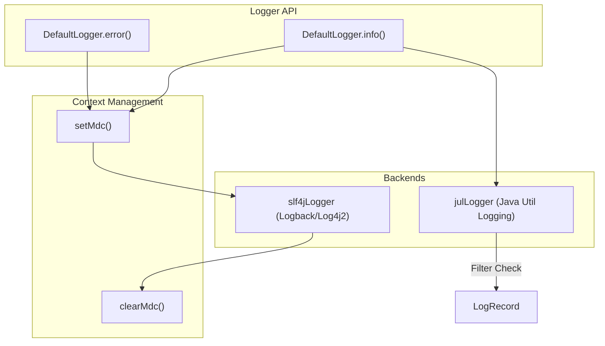
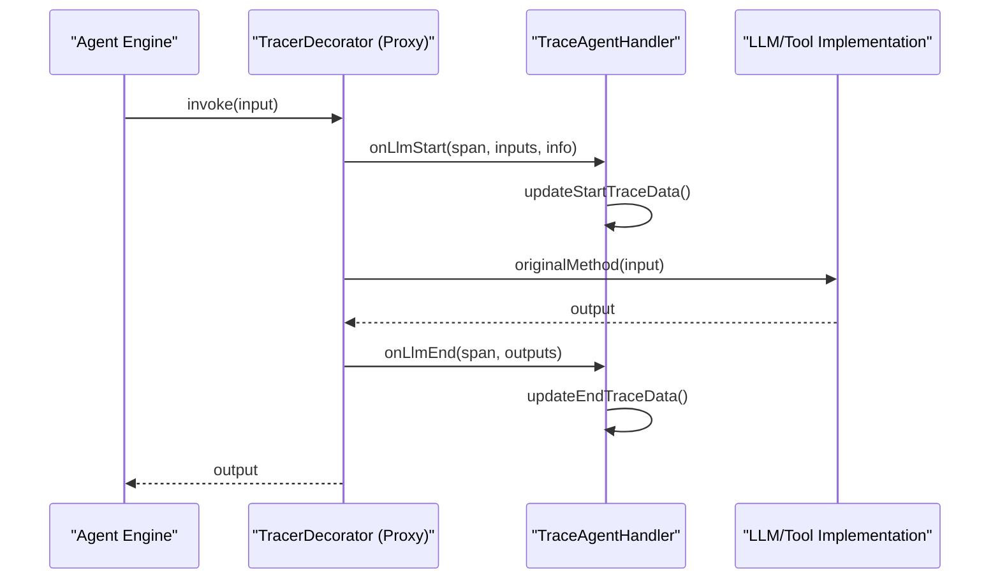

<!-- source: DeepWiki mcp.deepwiki.com · repo openJiuwen-ai/agent-core-java · page 11.1 Logging and Observability · fetched 2026-11-02 -->

# Logging and Observability

Relevant source files

The following files were used as context for generating this wiki page:

- [src/main/java/com/openjiuwen/core/common/logging/LazyLogger.java](src/main/java/com/openjiuwen/core/common/logging/LazyLogger.java)
- [src/main/java/com/openjiuwen/core/common/logging/defaults/DefaultLogger.java](src/main/java/com/openjiuwen/core/common/logging/defaults/DefaultLogger.java)
- [src/main/java/com/openjiuwen/core/common/security/SslUtils.java](src/main/java/com/openjiuwen/core/common/security/SslUtils.java)
- [src/main/java/com/openjiuwen/core/session/BaseSession.java](src/main/java/com/openjiuwen/core/session/BaseSession.java)
- [src/main/java/com/openjiuwen/core/session/checkpointer/CheckpointerConfig.java](src/main/java/com/openjiuwen/core/session/checkpointer/CheckpointerConfig.java)
- [src/main/java/com/openjiuwen/core/session/config/Config.java](src/main/java/com/openjiuwen/core/session/config/Config.java)
- [src/main/java/com/openjiuwen/core/session/internal/NodeSession.java](src/main/java/com/openjiuwen/core/session/internal/NodeSession.java)
- [src/main/java/com/openjiuwen/core/session/internal/SubWorkflowSession.java](src/main/java/com/openjiuwen/core/session/internal/SubWorkflowSession.java)
- [src/main/java/com/openjiuwen/core/session/state/WorkflowStateCollection.java](src/main/java/com/openjiuwen/core/session/state/WorkflowStateCollection.java)
- [src/main/java/com/openjiuwen/core/session/tracer/NodeStatus.java](src/main/java/com/openjiuwen/core/session/tracer/NodeStatus.java)
- [src/main/java/com/openjiuwen/core/session/tracer/Span.java](src/main/java/com/openjiuwen/core/session/tracer/Span.java)
- [src/main/java/com/openjiuwen/core/session/tracer/TraceAgentHandler.java](src/main/java/com/openjiuwen/core/session/tracer/TraceAgentHandler.java)
- [src/main/java/com/openjiuwen/core/session/tracer/TraceAgentSpan.java](src/main/java/com/openjiuwen/core/session/tracer/TraceAgentSpan.java)
- [src/main/java/com/openjiuwen/core/session/tracer/TraceBaseHandler.java](src/main/java/com/openjiuwen/core/session/tracer/TraceBaseHandler.java)
- [src/main/java/com/openjiuwen/core/session/tracer/TraceWorkflowHandler.java](src/main/java/com/openjiuwen/core/session/tracer/TraceWorkflowHandler.java)
- [src/main/java/com/openjiuwen/core/session/tracer/TraceWorkflowSpan.java](src/main/java/com/openjiuwen/core/session/tracer/TraceWorkflowSpan.java)
- [src/main/java/com/openjiuwen/core/session/tracer/TracerDecorator.java](src/main/java/com/openjiuwen/core/session/tracer/TracerDecorator.java)
- [src/main/java/com/openjiuwen/core/session/tracer/TracerWorkflowUtils.java](src/main/java/com/openjiuwen/core/session/tracer/TracerWorkflowUtils.java)
- [src/test/java/com/openjiuwen/core/session/tracer/TracerDecoratorTest.java](src/test/java/com/openjiuwen/core/session/tracer/TracerDecoratorTest.java)

The `agent-core-java` framework provides a multi-layered observability infrastructure designed for debugging complex agent executions, including tool calls, LLM interactions, and nested workflow graphs. It combines traditional structured logging with a sophisticated tracing system that captures full-link execution spans.

## Logging Infrastructure

The logging system is built on a provider-neutral abstraction, allowing it to bridge different logging backends while maintaining consistent structured output for agent events.

### DefaultLogger and LazyLogger
The `DefaultLogger` [src/main/java/com/openjiuwen/core/common/logging/defaults/DefaultLogger.java:46-46]() serves as the primary implementation of the `LoggerProtocol`. It mirrors the framework's Python implementation and utilizes SLF4J for standard output while maintaining a Java Util Logging (JUL) mirror for internal compatibility [src/main/java/com/openjiuwen/core/common/logging/defaults/DefaultLogger.java:33-45]().

Key features include:
*   **Structured Logging**: Events are serialized to JSON for machine readability [src/main/java/com/openjiuwen/core/common/logging/defaults/DefaultLogger.java:41-41]().
*   **MDC Context**: Injects `trace_id` and `log_type` into the Mapped Diagnostic Context for log correlation [src/main/java/com/openjiuwen/core/common/logging/defaults/DefaultLogger.java:42-42]().
*   **Sanitization**: Automatically handles control character sanitization to prevent log injection [src/main/java/com/openjiuwen/core/common/logging/defaults/DefaultLogger.java:43-43]().

For performance optimization, especially during system startup, the `LazyLogger` [src/main/java/com/openjiuwen/core/common/logging/LazyLogger.java:20-20]() wrapper defers actual logger initialization until the first log statement is executed [src/main/java/com/openjiuwen/core/common/logging/LazyLogger.java:17-18]().

### Logging Data Flow
The following diagram illustrates how log messages flow through the `DefaultLogger` to both SLF4J and JUL backends.

**Log Event Distribution**

**Sources:** [src/main/java/com/openjiuwen/core/common/logging/defaults/DefaultLogger.java:87-132]()

## Full-Link Observability (Tracing)

The framework implements a span-based tracing system to track the lifecycle of agent components (LLMs, Tools, and Workflows). This is primarily managed via the `TracerDecorator`.

### TracerDecorator
The `TracerDecorator` [src/main/java/com/openjiuwen/core/session/tracer/TracerDecorator.java:27-27]() uses Java Dynamic Proxies to wrap model, tool, and workflow instances [src/main/java/com/openjiuwen/core/session/tracer/TracerDecorator.java:96-107](). It intercepts method calls to trigger tracing events such as `on_llm_start`, `on_plugin_end`, or `on_workflow_error` [src/test/java/com/openjiuwen/core/session/tracer/TracerDecoratorTest.java:39-84]().

*   **Model Tracing**: Captures LLM request parameters and response outputs [src/test/java/com/openjiuwen/core/session/tracer/TracerDecoratorTest.java:70-85]().
*   **Tool Tracing**: Tracks tool execution time and status [src/test/java/com/openjiuwen/core/session/tracer/TracerDecoratorTest.java:32-44]().
*   **Workflow Tracing**: Captures metadata and stream outputs for graph nodes [src/test/java/com/openjiuwen/core/session/tracer/TracerDecoratorTest.java:47-67]().

### Trace Spans and Status
Observability data is encapsulated in `Span` objects.
*   **TraceAgentSpan**: Used for individual component invocations (LLM/Tool). It tracks `invokeType`, `elapsedTime`, and `metaData` [src/main/java/com/openjiuwen/core/session/tracer/TraceAgentSpan.java:17-28]().
*   **TraceWorkflowSpan**: Used for high-level workflow graph execution.
*   **NodeStatus**: Defines the state of a traced execution, such as `RUNNING`, `SUCCEEDED`, `FAILED`, or `INTERRUPTED` [src/main/java/com/openjiuwen/core/session/tracer/TraceAgentHandler.java:34-36]().

### Tracing Data Flow
The interaction between the session, the decorator, and the trace handlers is shown below.

**Tracing Proxy Architecture**

**Sources:** [src/main/java/com/openjiuwen/core/session/tracer/TracerDecorator.java:96-107](), [src/main/java/com/openjiuwen/core/session/tracer/TraceAgentHandler.java:103-116]()

## Session Context and Configuration

Observability relies on the `BaseSession` hierarchy to propagate trace IDs and configuration across the graph.

### Session Hierarchy
*   **NodeSession**: Provides a scoped context for a specific node in a graph, including its `nodeId`, `parentId`, and `executableId` [src/main/java/com/openjiuwen/core/session/internal/NodeSession.java:24-36]().
*   **SubWorkflowSession**: Handles nested workflow execution, incrementing the `workflowNestingDepth` [src/main/java/com/openjiuwen/core/session/internal/SubWorkflowSession.java:16-27]().

### Config and Checkpointing
The `Config` class [src/main/java/com/openjiuwen/core/session/config/Config.java:24-24]() manages environment variables and workflow-specific settings. For observability and reliability, the `CheckpointerConfig` [src/main/java/com/openjiuwen/core/session/checkpointer/CheckpointerConfig.java:19-19]() allows configuring how session state is persisted. It includes built-in redaction logic to ensure sensitive keys (like `api_key` or `password`) are not leaked into logs or trace spans [src/main/java/com/openjiuwen/core/session/checkpointer/CheckpointerConfig.java:91-132]().

## Security and SSL Utilities

The `SslUtils` [src/main/java/com/openjiuwen/core/common/security/SslUtils.java:34-34]() class provides infrastructure for secure communication, which is essential when the agent interacts with external APIs or sandboxes.

*   **Strict SSL**: Supports loading certificates from a `SAFE_CERT_DIR` to prevent path traversal attacks during certificate initialization [src/main/java/com/openjiuwen/core/common/security/SslUtils.java:68-84]().
*   **HttpClient Integration**: Provides `configureHttpClientSsl` to apply SSL contexts and host verification settings to `java.net.http.HttpClient` instances [src/main/java/com/openjiuwen/core/common/security/SslUtils.java:127-146]().

**Sources:**
* `src/main/java/com/openjiuwen/core/common/logging/defaults/DefaultLogger.java`
* `src/main/java/com/openjiuwen/core/common/logging/LazyLogger.java`
* `src/main/java/com/openjiuwen/core/session/tracer/TracerDecorator.java`
* `src/main/java/com/openjiuwen/core/session/tracer/TraceAgentHandler.java`
* `src/main/java/com/openjiuwen/core/session/tracer/TraceAgentSpan.java`
* `src/main/java/com/openjiuwen/core/session/internal/NodeSession.java`
* `src/main/java/com/openjiuwen/core/session/internal/SubWorkflowSession.java`
* `src/main/java/com/openjiuwen/core/common/security/SslUtils.java`
* `src/main/java/com/openjiuwen/core/session/checkpointer/CheckpointerConfig.java`
* `src/test/java/com/openjiuwen/core/session/tracer/TracerDecoratorTest.java`

---

