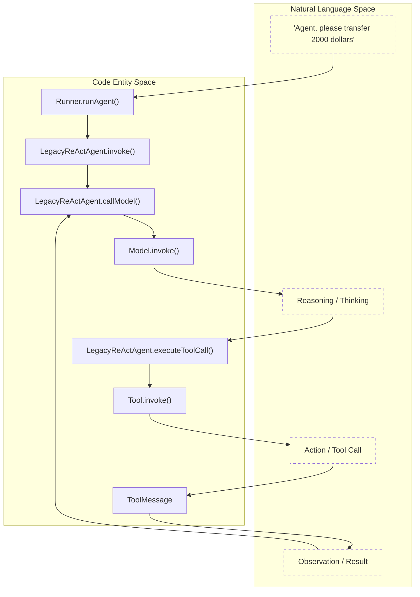
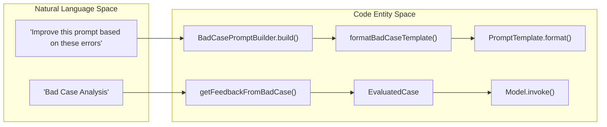

<!-- source: DeepWiki mcp.deepwiki.com · repo openJiuwen-ai/agent-core-java · page 12 Glossary · fetched 2026-11-02 -->

# Glossary

Relevant source files

The following files were used as context for generating this wiki page:

- [README.md](README.md)
- [README.zh.md](README.zh.md)
- [pom.xml](pom.xml)
- [src/main/java/com/openjiuwen/agent_evolving/TuneConstant.java](src/main/java/com/openjiuwen/agent_evolving/TuneConstant.java)
- [src/main/java/com/openjiuwen/agent_evolving/TuneUtils.java](src/main/java/com/openjiuwen/agent_evolving/TuneUtils.java)
- [src/main/java/com/openjiuwen/agent_evolving/checkpointing/CheckpointManager.java](src/main/java/com/openjiuwen/agent_evolving/checkpointing/CheckpointManager.java)
- [src/main/java/com/openjiuwen/agent_evolving/checkpointing/DefaultCheckpointManager.java](src/main/java/com/openjiuwen/agent_evolving/checkpointing/DefaultCheckpointManager.java)
- [src/main/java/com/openjiuwen/agent_evolving/checkpointing/EvolveCheckpoint.java](src/main/java/com/openjiuwen/agent_evolving/checkpointing/EvolveCheckpoint.java)
- [src/main/java/com/openjiuwen/agent_evolving/checkpointing/FileCheckpointStore.java](src/main/java/com/openjiuwen/agent_evolving/checkpointing/FileCheckpointStore.java)
- [src/main/java/com/openjiuwen/agent_evolving/dataset/Case.java](src/main/java/com/openjiuwen/agent_evolving/dataset/Case.java)
- [src/main/java/com/openjiuwen/agent_evolving/dataset/CaseLoader.java](src/main/java/com/openjiuwen/agent_evolving/dataset/CaseLoader.java)
- [src/main/java/com/openjiuwen/agent_evolving/dataset/EvaluatedCase.java](src/main/java/com/openjiuwen/agent_evolving/dataset/EvaluatedCase.java)
- [src/main/java/com/openjiuwen/agent_evolving/evaluator/BaseEvaluator.java](src/main/java/com/openjiuwen/agent_evolving/evaluator/BaseEvaluator.java)
- [src/main/java/com/openjiuwen/agent_evolving/evaluator/DefaultEvaluator.java](src/main/java/com/openjiuwen/agent_evolving/evaluator/DefaultEvaluator.java)
- [src/main/java/com/openjiuwen/core/application/llm/LlmAgent.java](src/main/java/com/openjiuwen/core/application/llm/LlmAgent.java)
- [src/main/java/com/openjiuwen/core/application/llm/LlmEventHandler.java](src/main/java/com/openjiuwen/core/application/llm/LlmEventHandler.java)
- [src/main/java/com/openjiuwen/core/application/llm/TaskInterruptionState.java](src/main/java/com/openjiuwen/core/application/llm/TaskInterruptionState.java)
- [src/main/java/com/openjiuwen/core/application/schema/AgentMemoryConfig.java](src/main/java/com/openjiuwen/core/application/schema/AgentMemoryConfig.java)
- [src/main/java/com/openjiuwen/core/application/schema/DefaultResponse.java](src/main/java/com/openjiuwen/core/application/schema/DefaultResponse.java)
- [src/main/java/com/openjiuwen/core/application/schema/LlmAgentConfig.java](src/main/java/com/openjiuwen/core/application/schema/LlmAgentConfig.java)
- [src/main/java/com/openjiuwen/core/application/schema/PluginSchema.java](src/main/java/com/openjiuwen/core/application/schema/PluginSchema.java)
- [src/main/java/com/openjiuwen/core/application/schema/WorkflowAgentConfig.java](src/main/java/com/openjiuwen/core/application/schema/WorkflowAgentConfig.java)
- [src/main/java/com/openjiuwen/core/application/schema/WorkflowSchema.java](src/main/java/com/openjiuwen/core/application/schema/WorkflowSchema.java)
- [src/main/java/com/openjiuwen/core/application/workflow/WorkflowAgent.java](src/main/java/com/openjiuwen/core/application/workflow/WorkflowAgent.java)
- [src/main/java/com/openjiuwen/core/application/workflow/WorkflowEventHandler.java](src/main/java/com/openjiuwen/core/application/workflow/WorkflowEventHandler.java)
- [src/main/java/com/openjiuwen/core/foundation/prompt/PromptTemplate.java](src/main/java/com/openjiuwen/core/foundation/prompt/PromptTemplate.java)
- [src/main/java/com/openjiuwen/core/graph/AtomicNode.java](src/main/java/com/openjiuwen/core/graph/AtomicNode.java)
- [src/main/java/com/openjiuwen/core/graph/CompiledGraph.java](src/main/java/com/openjiuwen/core/graph/CompiledGraph.java)
- [src/main/java/com/openjiuwen/core/graph/Executable.java](src/main/java/com/openjiuwen/core/graph/Executable.java)
- [src/main/java/com/openjiuwen/core/graph/ExecutableGraph.java](src/main/java/com/openjiuwen/core/graph/ExecutableGraph.java)
- [src/main/java/com/openjiuwen/core/graph/Graph.java](src/main/java/com/openjiuwen/core/graph/Graph.java)
- [src/main/java/com/openjiuwen/core/graph/GraphNodeState.java](src/main/java/com/openjiuwen/core/graph/GraphNodeState.java)
- [src/main/java/com/openjiuwen/core/graph/PregelGraph.java](src/main/java/com/openjiuwen/core/graph/PregelGraph.java)
- [src/main/java/com/openjiuwen/core/graph/Router.java](src/main/java/com/openjiuwen/core/graph/Router.java)
- [src/main/java/com/openjiuwen/core/graph/Vertex.java](src/main/java/com/openjiuwen/core/graph/Vertex.java)
- [src/main/java/com/openjiuwen/core/graph/pregel/BarrierChannel.java](src/main/java/com/openjiuwen/core/graph/pregel/BarrierChannel.java)
- [src/main/java/com/openjiuwen/core/graph/pregel/BarrierMessage.java](src/main/java/com/openjiuwen/core/graph/pregel/BarrierMessage.java)
- [src/main/java/com/openjiuwen/core/graph/pregel/NodeTask.java](src/main/java/com/openjiuwen/core/graph/pregel/NodeTask.java)
- [src/main/java/com/openjiuwen/core/operator/Operator.java](src/main/java/com/openjiuwen/core/operator/Operator.java)
- [src/main/java/com/openjiuwen/core/operator/OperatorStream.java](src/main/java/com/openjiuwen/core/operator/OperatorStream.java)
- [src/main/java/com/openjiuwen/core/operator/TunableSpec.java](src/main/java/com/openjiuwen/core/operator/TunableSpec.java)
- [src/main/java/com/openjiuwen/core/operator/legacy/llm_call/LLMCall.java](src/main/java/com/openjiuwen/core/operator/legacy/llm_call/LLMCall.java)
- [src/main/java/com/openjiuwen/core/operator/legacy/llm_call/LegacyOptimizerCallback.java](src/main/java/com/openjiuwen/core/operator/legacy/llm_call/LegacyOptimizerCallback.java)
- [src/main/java/com/openjiuwen/core/operator/llm_call/LLMCall.java](src/main/java/com/openjiuwen/core/operator/llm_call/LLMCall.java)
- [src/main/java/com/openjiuwen/core/operator/llm_call/LLMCallOperator.java](src/main/java/com/openjiuwen/core/operator/llm_call/LLMCallOperator.java)
- [src/main/java/com/openjiuwen/core/operator/memory_call/MemoryCallOperator.java](src/main/java/com/openjiuwen/core/operator/memory_call/MemoryCallOperator.java)
- [src/main/java/com/openjiuwen/core/operator/tool_call/ToolCallOperator.java](src/main/java/com/openjiuwen/core/operator/tool_call/ToolCallOperator.java)
- [src/main/java/com/openjiuwen/core/security/guardrail/BaseGuardrail.java](src/main/java/com/openjiuwen/core/security/guardrail/BaseGuardrail.java)
- [src/main/java/com/openjiuwen/core/security/guardrail/GuardrailBackend.java](src/main/java/com/openjiuwen/core/security/guardrail/GuardrailBackend.java)
- [src/main/java/com/openjiuwen/core/security/guardrail/GuardrailResult.java](src/main/java/com/openjiuwen/core/security/guardrail/GuardrailResult.java)
- [src/main/java/com/openjiuwen/core/security/guardrail/RiskAssessment.java](src/main/java/com/openjiuwen/core/security/guardrail/RiskAssessment.java)
- [src/main/java/com/openjiuwen/core/security/guardrail/RiskLevel.java](src/main/java/com/openjiuwen/core/security/guardrail/RiskLevel.java)
- [src/main/java/com/openjiuwen/core/security/guardrail/UserInputGuardrail.java](src/main/java/com/openjiuwen/core/security/guardrail/UserInputGuardrail.java)
- [src/main/java/com/openjiuwen/core/session/utils/SessionUtils.java](src/main/java/com/openjiuwen/core/session/utils/SessionUtils.java)
- [src/main/java/com/openjiuwen/core/singleagent/legacy/BaseAgent.java](src/main/java/com/openjiuwen/core/singleagent/legacy/BaseAgent.java)
- [src/main/java/com/openjiuwen/core/singleagent/legacy/LegacyApi.java](src/main/java/com/openjiuwen/core/singleagent/legacy/LegacyApi.java)
- [src/main/java/com/openjiuwen/core/singleagent/legacy/LegacyReActAgent.java](src/main/java/com/openjiuwen/core/singleagent/legacy/LegacyReActAgent.java)
- [src/main/java/com/openjiuwen/core/singleagent/legacy/TaskSession.java](src/main/java/com/openjiuwen/core/singleagent/legacy/TaskSession.java)
- [src/main/java/com/openjiuwen/core/singleagent/legacy/config/AgentConfig.java](src/main/java/com/openjiuwen/core/singleagent/legacy/config/AgentConfig.java)
- [src/main/java/com/openjiuwen/core/singleagent/legacy/config/LegacyReActAgentConfig.java](src/main/java/com/openjiuwen/core/singleagent/legacy/config/LegacyReActAgentConfig.java)
- [src/main/java/com/openjiuwen/core/singleagent/legacy/config/ReActAgentConfig.java](src/main/java/com/openjiuwen/core/singleagent/legacy/config/ReActAgentConfig.java)
- [src/main/java/com/openjiuwen/core/singleagent/rail/AgentRail.java](src/main/java/com/openjiuwen/core/singleagent/rail/AgentRail.java)
- [src/main/java/com/openjiuwen/core/singleagent/schema/AgentCard.java](src/main/java/com/openjiuwen/core/singleagent/schema/AgentCard.java)
- [src/main/java/com/openjiuwen/core/singleagent/skills/Skill.java](src/main/java/com/openjiuwen/core/singleagent/skills/Skill.java)
- [src/main/java/com/openjiuwen/core/singleagent/skills/SkillManager.java](src/main/java/com/openjiuwen/core/singleagent/skills/SkillManager.java)
- [src/main/java/com/openjiuwen/core/workflow/component/End.java](src/main/java/com/openjiuwen/core/workflow/component/End.java)
- [src/main/java/com/openjiuwen/core/workflow/component/loop/AdvancedLoopComponentImpl.java](src/main/java/com/openjiuwen/core/workflow/component/loop/AdvancedLoopComponentImpl.java)
- [src/main/java/com/openjiuwen/core/workflow/component/loop/LoopComponentImpl.java](src/main/java/com/openjiuwen/core/workflow/component/loop/LoopComponentImpl.java)
- [src/main/java/com/openjiuwen/core/workflow/component/loop/LoopInput.java](src/main/java/com/openjiuwen/core/workflow/component/loop/LoopInput.java)
- [src/main/java/com/openjiuwen/core/workflow/component/loop/LoopSetVariableComponent.java](src/main/java/com/openjiuwen/core/workflow/component/loop/LoopSetVariableComponent.java)
- [src/main/java/com/openjiuwen/core/workflow/component/loop/PostLoopBody.java](src/main/java/com/openjiuwen/core/workflow/component/loop/PostLoopBody.java)
- [src/main/java/com/openjiuwen/dev_tools/prompt_builder/BasePromptBuilder.java](src/main/java/com/openjiuwen/dev_tools/prompt_builder/BasePromptBuilder.java)
- [src/main/java/com/openjiuwen/dev_tools/prompt_builder/builder/BadCasePromptBuilder.java](src/main/java/com/openjiuwen/dev_tools/prompt_builder/builder/BadCasePromptBuilder.java)
- [src/main/java/com/openjiuwen/dev_tools/prompt_builder/builder/FeedbackPromptBuilder.java](src/main/java/com/openjiuwen/dev_tools/prompt_builder/builder/FeedbackPromptBuilder.java)
- [src/main/java/com/openjiuwen/dev_tools/prompt_builder/builder/MetaTemplateBuilder.java](src/main/java/com/openjiuwen/dev_tools/prompt_builder/builder/MetaTemplateBuilder.java)
- [src/main/java/com/openjiuwen/dev_tools/prompt_builder/builder/PromptTemplateUtils.java](src/main/java/com/openjiuwen/dev_tools/prompt_builder/builder/PromptTemplateUtils.java)
- [src/main/java/com/openjiuwen/dev_tools/prompt_builder/builder/PromptTemplatesEn.java](src/main/java/com/openjiuwen/dev_tools/prompt_builder/builder/PromptTemplatesEn.java)
- [src/main/java/com/openjiuwen/dev_tools/prompt_builder/builder/PromptTemplatesZh.java](src/main/java/com/openjiuwen/dev_tools/prompt_builder/builder/PromptTemplatesZh.java)
- [src/main/java/com/openjiuwen/dev_tools/prompt_builder/builder/UnwrappedCompletableFuture.java](src/main/java/com/openjiuwen/dev_tools/prompt_builder/builder/UnwrappedCompletableFuture.java)
- [src/main/java/com/openjiuwen/dev_tools/tune/Case.java](src/main/java/com/openjiuwen/dev_tools/tune/Case.java)
- [src/main/java/com/openjiuwen/dev_tools/tune/EvaluatedCase.java](src/main/java/com/openjiuwen/dev_tools/tune/EvaluatedCase.java)
- [src/main/java/com/openjiuwen/dev_tools/tune/optimizer/adopt/AdoptOptimizer.java](src/main/java/com/openjiuwen/dev_tools/tune/optimizer/adopt/AdoptOptimizer.java)
- [src/test/java/com/openjiuwen/core/retrieval/indexing/processor/parser/PDFParserTest.java](src/test/java/com/openjiuwen/core/retrieval/indexing/processor/parser/PDFParserTest.java)
- [src/test/java/com/openjiuwen/core/workflow/component/loop/LoopComponentImplTest.java](src/test/java/com/openjiuwen/core/workflow/component/loop/LoopComponentImplTest.java)

This page provides definitions for codebase-specific terms, abbreviations, and domain concepts used throughout the **agent-core-java** framework. It serves as a reference for onboarding engineers to understand the mapping between high-level agentic concepts and their specific implementations in the code.

---

## Core Agent Concepts

### ReAct (Reasoning + Action)
A prompting paradigm where the agent follows a loop of **Thinking → Acting → Observing**. In this framework, it is implemented primarily via the `ReActAgent` (or the compatibility `LegacyReActAgent`) which orchestrates LLM reasoning and tool execution.
*   **Implementation**: `LegacyReActAgent` handles the loop by calling the model for reasoning [src/main/java/com/openjiuwen/core/singleagent/legacy/LegacyReActAgent.java:107-147]() and executing identified tool calls [src/main/java/com/openjiuwen/core/singleagent/legacy/LegacyReActAgent.java:156-177]().
*   **Configuration**: Defined via `AgentCard` [src/main/java/com/openjiuwen/core/singleagent/schema/AgentCard.java]() or `LegacyReActAgentConfig` [src/main/java/com/openjiuwen/core/singleagent/legacy/config/LegacyReActAgentConfig.java]().

### WorkflowAgent
An agent type focused on executing pre-defined, multi-step tasks structured as a graph. Unlike the open-ended ReAct loop, it follows a `WorkflowSchema`.
*   **Implementation**: `WorkflowAgent` [src/main/java/com/openjiuwen/core/application/workflow/WorkflowAgent.java]() uses a `WorkflowController` and `WorkflowEventHandler` [src/main/java/com/openjiuwen/core/application/workflow/WorkflowEventHandler.java]() to manage state transitions.
*   **Data Flow**: Inputs are processed through the `PregelGraph` execution engine.

### AgentCard
A standardized manifest describing an agent's identity, capabilities, and requirements. It acts as the "ID card" for the agent within the system.
*   **Implementation**: `AgentCard` [src/main/java/com/openjiuwen/core/singleagent/schema/AgentCard.java]().
*   **Usage**: Used by the `AbilityManager` [src/main/java/com/openjiuwen/core/singleagent/AbilityManager.java]() to register and discover agent skills.

---

## Graph & Execution Terms

### Pregel Model
The framework's execution engine is based on the Pregel computing model, which uses a vertex-centric approach for parallel processing. In this context, nodes in a workflow are treated as vertices that communicate via messages.
*   **Key Entities**: `Vertex` [src/main/java/com/openjiuwen/core/graph/Vertex.java](), `NodeTask` [src/main/java/com/openjiuwen/core/graph/pregel/NodeTask.java]().
*   **Logic**: The `PregelLoop` manages the iterative execution of these tasks until the graph reaches a terminal state or `End` node [src/main/java/com/openjiuwen/core/workflow/component/End.java]().

### LoopComponent
A specialized workflow node that allows for iterative execution of a sub-graph (a `LoopGroup`).
*   **Implementation**: `LoopComponentImpl` [src/main/java/com/openjiuwen/core/workflow/component/loop/LoopComponentImpl.java:39-51]().
*   **Types**: Supports `ARRAY` (foreach), `NUMBER` (count-based), and `EXPRESSION` (while-loop) logic [src/main/java/com/openjiuwen/core/workflow/component/loop/LoopComponentImpl.java:141-161]().

### GraphInterrupt
An exception type used to signal that a graph execution must be paused (e.g., waiting for user input).
*   **Implementation**: `GraphInterrupt` [src/main/java/com/openjiuwen/core/graph/pregel/GraphInterrupt.java]().
*   **Usage**: Caught and handled by `LoopRuntime` to preserve state [src/main/java/com/openjiuwen/core/workflow/component/loop/LoopComponentImpl.java:119-122]().

---

## Prompt & Optimization Terms

### PromptTemplate
A structured string or list of messages containing placeholders (e.g., `{{input}}`) that are filled at runtime.
*   **Implementation**: `PromptTemplate` [src/main/java/com/openjiuwen/core/foundation/prompt/PromptTemplate.java]().
*   **Utilities**: `PromptTemplateUtils` provides helpers to extract string content from various template formats [src/main/java/com/openjiuwen/dev_tools/prompt_builder/builder/PromptTemplateUtils.java:49-75]().

### ADOPT (Automated Decomposing of Prompt Tuning)
An optimization framework for automatically improving agent prompts based on feedback or bad cases.
*   **Key Entity**: `AdoptOptimizer` [src/main/java/com/openjiuwen/dev_tools/tune/optimizer/adopt/AdoptOptimizer.java]().
*   **Process**: Uses `EvaluatedCase` [src/main/java/com/openjiuwen/dev_tools/tune/EvaluatedCase.java]() to identify failures and suggest prompt modifications.

### MetaTemplateBuilder
A tool that uses an LLM to generate concrete prompts from high-level "meta" descriptions.
*   **Implementation**: `MetaTemplateBuilder` [src/main/java/com/openjiuwen/dev_tools/prompt_builder/builder/MetaTemplateBuilder.java:36-46]().
*   **Workflow**: Registers templates with a `META_TEMPLATE_` prefix and invokes the model to "build" the final prompt [src/main/java/com/openjiuwen/dev_tools/prompt_builder/builder/MetaTemplateBuilder.java:64-75]().

---

## Session & State Management

### Session API
The interface for interacting with the current execution context, providing access to memory, variables, and stream outputs.
*   **Implementation**: `AgentSessionApi` [src/main/java/com/openjiuwen/core/session/AgentSessionApi.java]().
*   **Utilities**: `SessionUtils` provides dotted-path navigation (e.g., `user.profile.name`) for accessing nested data in the session [src/main/java/com/openjiuwen/core/session/utils/SessionUtils.java:187-193]().

### RefPath
A string syntax (e.g., `${key}`) used within schemas to reference values stored in the session.
*   **Logic**: Handled by `SessionUtils.getBySchema` to resolve dynamic values at runtime [src/main/java/com/openjiuwen/core/session/utils/SessionUtils.java:143-160]().

---

## Technical Mapping Diagrams

### Natural Language to Code Entity Mapping: Agent Execution
The following diagram maps high-level agent behaviors to the specific classes and functions that implement them.

**Agent Execution Flow**

**Sources**: [src/main/java/com/openjiuwen/core/singleagent/legacy/LegacyReActAgent.java:107-177](), [src/main/java/com/openjiuwen/core/application/llm/LlmAgent.java:86-95]()

### Natural Language to Code Entity Mapping: Prompt Optimization
Mapping the user's intent to optimize an agent to the underlying toolchain.

**Prompt Optimization Pipeline**

**Sources**: [src/main/java/com/openjiuwen/dev_tools/prompt_builder/builder/BadCasePromptBuilder.java:67-91](), [src/main/java/com/openjiuwen/dev_tools/prompt_builder/builder/BadCasePromptBuilder.java:140-161]()

---

## Key Class Summary Table

| Term | Class/Interface | Description |
| :--- | :--- | :--- |
| **Agent Logic** | `LegacyReActAgent` | Implements the reasoning-action loop for legacy compatibility. |
| **Workflow** | `WorkflowAgent` | Orchestrates structured graph execution. |
| **Node** | `Vertex` | The atomic unit of execution in a Pregel graph. |
| **Template** | `PromptTemplate` | Manages string interpolation and message formatting. |
| **Session** | `AgentSessionApi` | The primary interface for state and context management. |
| **Builder** | `BasePromptBuilder` | Abstract base for LLM-driven prompt generation. |
| **Evolution** | `AdoptOptimizer` | Automates prompt tuning via feedback loops. |
| **Safety** | `RiskLevel` | Enum defining severity of guardrail violations. |

**Sources**:
*   [src/main/java/com/openjiuwen/core/singleagent/legacy/LegacyReActAgent.java]()
*   [src/main/java/com/openjiuwen/core/application/workflow/WorkflowAgent.java]()
*   [src/main/java/com/openjiuwen/core/graph/Vertex.java]()
*   [src/main/java/com/openjiuwen/core/foundation/prompt/PromptTemplate.java]()
*   [src/main/java/com/openjiuwen/core/session/AgentSessionApi.java]()
*   [src/main/java/com/openjiuwen/dev_tools/prompt_builder/BasePromptBuilder.java]()
*   [src/main/java/com/openjiuwen/dev_tools/tune/optimizer/adopt/AdoptOptimizer.java]()
*   [src/main/java/com/openjiuwen/core/security/guardrail/RiskLevel.java]()