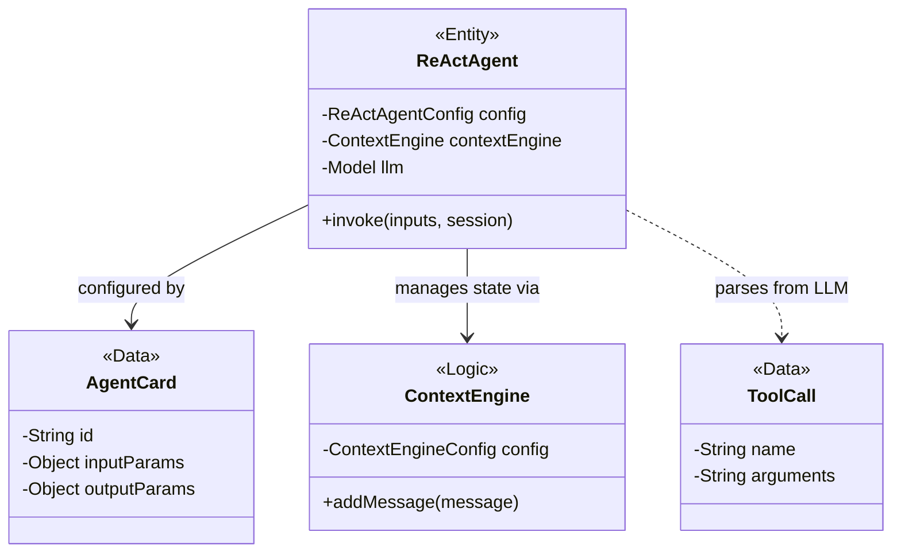
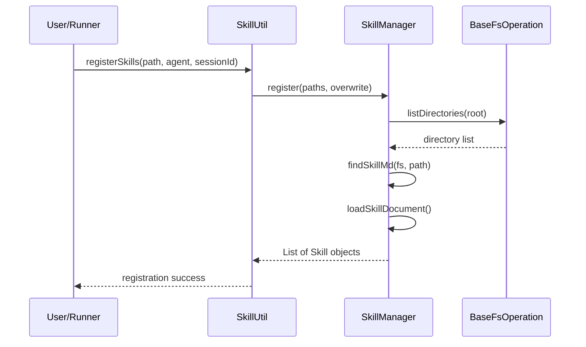

<!-- source: DeepWiki mcp.deepwiki.com · repo openJiuwen-ai/agent-core-java · page 2.1 ReActAgent · fetched 2026-11-02 -->

# ReActAgent

Relevant source files

The following files were used as context for generating this wiki page:

- [.gitignore](.gitignore)
- [src/main/java/com/openjiuwen/core/common/exception/StatusCode.java](src/main/java/com/openjiuwen/core/common/exception/StatusCode.java)
- [src/main/java/com/openjiuwen/core/singleagent/BaseAgent.java](src/main/java/com/openjiuwen/core/singleagent/BaseAgent.java)
- [src/main/java/com/openjiuwen/core/singleagent/agents/ReActAgent.java](src/main/java/com/openjiuwen/core/singleagent/agents/ReActAgent.java)
- [src/main/java/com/openjiuwen/core/singleagent/legacy/BaseAgent.java](src/main/java/com/openjiuwen/core/singleagent/legacy/BaseAgent.java)
- [src/main/java/com/openjiuwen/core/singleagent/legacy/LegacyApi.java](src/main/java/com/openjiuwen/core/singleagent/legacy/LegacyApi.java)
- [src/main/java/com/openjiuwen/core/singleagent/legacy/LegacyReActAgent.java](src/main/java/com/openjiuwen/core/singleagent/legacy/LegacyReActAgent.java)
- [src/main/java/com/openjiuwen/core/singleagent/legacy/TaskSession.java](src/main/java/com/openjiuwen/core/singleagent/legacy/TaskSession.java)
- [src/main/java/com/openjiuwen/core/singleagent/legacy/config/AgentConfig.java](src/main/java/com/openjiuwen/core/singleagent/legacy/config/AgentConfig.java)
- [src/main/java/com/openjiuwen/core/singleagent/legacy/config/LegacyReActAgentConfig.java](src/main/java/com/openjiuwen/core/singleagent/legacy/config/LegacyReActAgentConfig.java)
- [src/main/java/com/openjiuwen/core/singleagent/legacy/config/ReActAgentConfig.java](src/main/java/com/openjiuwen/core/singleagent/legacy/config/ReActAgentConfig.java)
- [src/main/java/com/openjiuwen/core/singleagent/rail/AgentCallback.java](src/main/java/com/openjiuwen/core/singleagent/rail/AgentCallback.java)
- [src/main/java/com/openjiuwen/core/singleagent/rail/AgentCallbackContext.java](src/main/java/com/openjiuwen/core/singleagent/rail/AgentCallbackContext.java)
- [src/main/java/com/openjiuwen/core/singleagent/rail/AgentRail.java](src/main/java/com/openjiuwen/core/singleagent/rail/AgentRail.java)
- [src/main/java/com/openjiuwen/core/singleagent/schema/AgentCard.java](src/main/java/com/openjiuwen/core/singleagent/schema/AgentCard.java)
- [src/main/java/com/openjiuwen/core/singleagent/skills/RemoteSkillUtil.java](src/main/java/com/openjiuwen/core/singleagent/skills/RemoteSkillUtil.java)
- [src/main/java/com/openjiuwen/core/singleagent/skills/Skill.java](src/main/java/com/openjiuwen/core/singleagent/skills/Skill.java)
- [src/main/java/com/openjiuwen/core/singleagent/skills/SkillManager.java](src/main/java/com/openjiuwen/core/singleagent/skills/SkillManager.java)
- [src/main/java/com/openjiuwen/core/singleagent/skills/SkillUtil.java](src/main/java/com/openjiuwen/core/singleagent/skills/SkillUtil.java)

The `ReActAgent` is a core implementation of the Reasoning + Action paradigm within the `agent-core-java` framework. It facilitates an iterative loop where the agent observes state, reasons about the next step, and executes actions (tools) until a final answer is produced or a constraint is met.

## ReAct Loop and Implementation

The `ReActAgent` extends `BaseAgent` and manages a stateful conversation through the `ContextEngine`. The execution flow typically involves reasoning via an LLM and subsequent tool execution.

### Execution Flow
1.  **Reasoning**: The agent calls the LLM with the current chat history and available tool definitions [src/main/java/com/openjiuwen/core/singleagent/legacy/LegacyReActAgent.java:107-147]().
2.  **Action**: If the LLM output contains tool calls, the agent executes them using `executeToolCall` [src/main/java/com/openjiuwen/core/singleagent/legacy/LegacyReActAgent.java:156-177]().
3.  **Observation**: The tool output is appended to the context as a `ToolMessage` [src/main/java/com/openjiuwen/core/singleagent/legacy/LegacyReActAgent.java:167-173]().
4.  **Loop**: The cycle repeats until the LLM provides a final response without further tool calls.

### Core Class Diagram
The following diagram maps the high-level ReAct concepts to their specific Java class entities.

**ReAct Entity Mapping**

**Sources:** [src/main/java/com/openjiuwen/core/singleagent/agents/ReActAgent.java:81-112](), [src/main/java/com/openjiuwen/core/singleagent/schema/AgentCard.java:21-32](), [src/main/java/com/openjiuwen/core/singleagent/legacy/LegacyReActAgent.java:156-160]()

## Configuration and Resources

### AgentCard and Config
Agents are defined using an `AgentCard`, which specifies metadata like `input_params` and `output_params` [src/main/java/com/openjiuwen/core/singleagent/schema/AgentCard.java:21-32](). The runtime behavior is controlled by `ReActAgentConfig` (or its legacy variant `LegacyReActAgentConfig`), which includes model settings, prompt templates, and constraints [src/main/java/com/openjiuwen/core/singleagent/legacy/config/LegacyReActAgentConfig.java:24-39]().

### Tool Registration
Tools are registered to the agent via `addTools(List<Tool> newTools)` [src/main/java/com/openjiuwen/core/singleagent/legacy/BaseAgent.java:179-190](). This process adds the tool to the agent's internal list and registers it with the global `Runner.resourceMgr()` so it can be resolved during execution [src/main/java/com/openjiuwen/core/singleagent/legacy/BaseAgent.java:185-188]().

**Sources:** [src/main/java/com/openjiuwen/core/singleagent/schema/AgentCard.java:21-32](), [src/main/java/com/openjiuwen/core/singleagent/legacy/config/LegacyReActAgentConfig.java:24-39](), [src/main/java/com/openjiuwen/core/singleagent/legacy/BaseAgent.java:179-190]()

## Skill Discovery via SkillManager

Skills are specialized workflows or knowledge sets defined in `SKILL.md` files. The `SkillManager` handles the discovery and registration of these files from local or remote filesystems [src/main/java/com/openjiuwen/core/singleagent/skills/SkillManager.java:38-60]().

*   **Discovery**: `SkillManager` scans directories for `SKILL.md` files [src/main/java/com/openjiuwen/core/singleagent/skills/SkillManager.java:137-169]().
*   **Prompt Injection**: `SkillUtil` generates a system prompt section that informs the LLM about its available skills and how to read them using the `read_file` tool [src/main/java/com/openjiuwen/core/singleagent/skills/SkillUtil.java:25-29]().

**Skill Registration Flow**

**Sources:** [src/main/java/com/openjiuwen/core/singleagent/skills/SkillManager.java:137-192](), [src/main/java/com/openjiuwen/core/singleagent/skills/SkillUtil.java:53-71]()

## AgentRail Lifecycle Hooks

`AgentRail` provides a mechanism to intercept and modify the agent's execution at various lifecycle stages. Developers can extend `AgentRail` to implement guardrails, logging, or custom logic without modifying the core ReAct loop [src/main/java/com/openjiuwen/core/singleagent/rail/AgentRail.java:20-82]().

| Hook | Purpose |
| :--- | :--- |
| `beforeInvoke` | Triggered before the agent starts processing a user request. |
| `beforeModelCall` | Triggered before the LLM is invoked for reasoning. |
| `afterModelCall` | Triggered after receiving reasoning from the LLM. |
| `beforeToolCall` | Triggered before a tool is executed. |
| `onToolException` | Triggered if a tool execution fails. |
| `afterTaskIteration`| Triggered after one complete ReAct loop (Reason + Act). |

**Sources:** [src/main/java/com/openjiuwen/core/singleagent/rail/AgentRail.java:29-82]()

## ReActAgentEvolve

The framework supports self-evolution through the `agent_evolving` package (referenced in context of `ReActAgent` optimization). This involves using the `AdoptOptimizer` and `Trainer` to refine prompt templates based on historical performance and feedback loops.

*   **Operator Abstraction**: Evolution utilizes `ToolCallOperator` and `LLMCallOperator` to treat agent steps as tunable parameters [src/main/java/com/openjiuwen/core/singleagent/agents/ReActAgent.java:20-25]().
*   **Feedback Loop**: The `Trainer` uses a split/shuffle `CaseLoader` and `DefaultEvaluator` (LLM-as-judge) to generate gradients for prompt optimization.

**Sources:** [src/main/java/com/openjiuwen/core/singleagent/agents/ReActAgent.java:81-112]() (General structure supporting evolution hooks).

---

