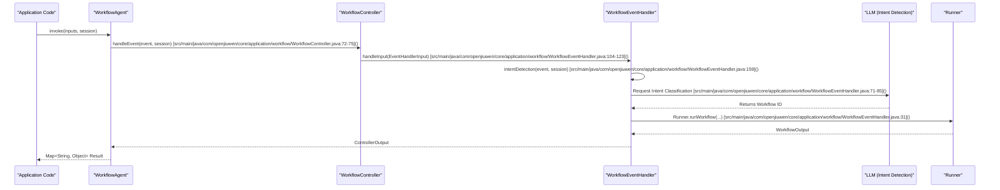
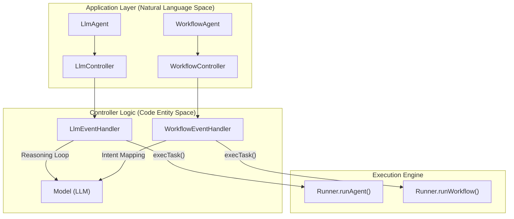

<!-- source: DeepWiki mcp.deepwiki.com · repo openJiuwen-ai/agent-core-java · page 2.2 WorkflowAgent · fetched 2026-11-02 -->

# WorkflowAgent

Relevant source files

The following files were used as context for generating this wiki page:

- [src/main/java/com/openjiuwen/core/application/llm/LlmAgent.java](src/main/java/com/openjiuwen/core/application/llm/LlmAgent.java)
- [src/main/java/com/openjiuwen/core/application/llm/LlmController.java](src/main/java/com/openjiuwen/core/application/llm/LlmController.java)
- [src/main/java/com/openjiuwen/core/application/llm/LlmEventHandler.java](src/main/java/com/openjiuwen/core/application/llm/LlmEventHandler.java)
- [src/main/java/com/openjiuwen/core/application/llm/TaskInterruptionState.java](src/main/java/com/openjiuwen/core/application/llm/TaskInterruptionState.java)
- [src/main/java/com/openjiuwen/core/application/schema/AgentMemoryConfig.java](src/main/java/com/openjiuwen/core/application/schema/AgentMemoryConfig.java)
- [src/main/java/com/openjiuwen/core/application/schema/ConstrainConfig.java](src/main/java/com/openjiuwen/core/application/schema/ConstrainConfig.java)
- [src/main/java/com/openjiuwen/core/application/schema/DefaultResponse.java](src/main/java/com/openjiuwen/core/application/schema/DefaultResponse.java)
- [src/main/java/com/openjiuwen/core/application/schema/LlmAgentConfig.java](src/main/java/com/openjiuwen/core/application/schema/LlmAgentConfig.java)
- [src/main/java/com/openjiuwen/core/application/schema/PluginSchema.java](src/main/java/com/openjiuwen/core/application/schema/PluginSchema.java)
- [src/main/java/com/openjiuwen/core/application/schema/ReActAgentConfig.java](src/main/java/com/openjiuwen/core/application/schema/ReActAgentConfig.java)
- [src/main/java/com/openjiuwen/core/application/schema/WorkflowAgentConfig.java](src/main/java/com/openjiuwen/core/application/schema/WorkflowAgentConfig.java)
- [src/main/java/com/openjiuwen/core/application/schema/WorkflowSchema.java](src/main/java/com/openjiuwen/core/application/schema/WorkflowSchema.java)
- [src/main/java/com/openjiuwen/core/application/workflow/WorkflowAgent.java](src/main/java/com/openjiuwen/core/application/workflow/WorkflowAgent.java)
- [src/main/java/com/openjiuwen/core/application/workflow/WorkflowController.java](src/main/java/com/openjiuwen/core/application/workflow/WorkflowController.java)
- [src/main/java/com/openjiuwen/core/application/workflow/WorkflowEventHandler.java](src/main/java/com/openjiuwen/core/application/workflow/WorkflowEventHandler.java)
- [src/main/java/com/openjiuwen/core/application/workflow/WorkflowIntent.java](src/main/java/com/openjiuwen/core/application/workflow/WorkflowIntent.java)
- [src/main/java/com/openjiuwen/core/multiagent/MultiAgentSessions.java](src/main/java/com/openjiuwen/core/multiagent/MultiAgentSessions.java)
- [src/main/java/com/openjiuwen/core/multiagent/Session.java](src/main/java/com/openjiuwen/core/multiagent/Session.java)
- [src/main/java/com/openjiuwen/core/multiagent/legacy/AgentGroupSession.java](src/main/java/com/openjiuwen/core/multiagent/legacy/AgentGroupSession.java)
- [src/main/java/com/openjiuwen/core/multiagent/legacy/BaseGroup.java](src/main/java/com/openjiuwen/core/multiagent/legacy/BaseGroup.java)

The `WorkflowAgent` and `LlmAgent` serve as high-level application facades within the `agent-core-java` framework. While the `ReActAgent` focuses on autonomous reasoning loops, the `WorkflowAgent` provides a structured approach to agentic behavior by orchestrating pre-defined workflows based on user intent. Both agent types utilize a controller-handler pattern to manage execution, state, and interaction.

## WorkflowAgent Architecture

The `WorkflowAgent` acts as a wrapper around the `WorkflowController`, which manages the lifecycle of workflow selection and execution [src/main/java/com/openjiuwen/core/application/workflow/WorkflowAgent.java:46-59](). It is designed for scenarios where agent behavior must follow specific business logic or complex multi-step graphs.

### Core Components

| Component | Role |
| :--- | :--- |
| `WorkflowAgent` | The entry point for application-layer calls. Handles session initialization and result normalization [src/main/java/com/openjiuwen/core/application/workflow/WorkflowAgent.java:84-98](). |
| `WorkflowController` | Coordinates between the agent and the event handler. Resolves which workflow to run based on task metadata [src/main/java/com/openjiuwen/core/application/workflow/WorkflowController.java:203-217](). |
| `WorkflowEventHandler` | Implements the core logic for intent detection, task execution, and interruption management [src/main/java/com/openjiuwen/core/application/workflow/WorkflowEventHandler.java:55-64](). |
| `AbilityManager` | Manages the tools and workflows available to the agent, providing a unified registry for discovery [src/main/java/com/openjiuwen/core/application/workflow/WorkflowAgent.java:51-58](). |

### Data Flow: User Input to Workflow Execution

The following diagram illustrates how a user request is transformed into a running workflow.

**Workflow Execution Sequence**

Sources: [src/main/java/com/openjiuwen/core/application/workflow/WorkflowAgent.java](), [src/main/java/com/openjiuwen/core/application/workflow/WorkflowEventHandler.java](), [src/main/java/com/openjiuwen/core/application/workflow/WorkflowController.java]()

## Intent Detection

`WorkflowEventHandler` uses an internal LLM call to classify user input into specific intents. This process maps a user's natural language query to a `WorkflowSchema` defined in the `WorkflowAgentConfig`.

*   **System Prompt**: The handler uses a structured prompt (`INTENT_SYSTEM_PROMPT`) to guide the LLM in selecting the correct category from the `category_list` [src/main/java/com/openjiuwen/core/application/workflow/WorkflowEventHandler.java:72-80]().
*   **Default Response**: If no intent is detected or the LLM fails to classify, the agent can fall back to a `DefaultResponse` defined in the configuration [src/main/java/com/openjiuwen/core/application/schema/WorkflowAgentConfig.java:85-87](), [src/main/java/com/openjiuwen/core/application/workflow/WorkflowEventHandler.java:166-176]().

Sources: [src/main/java/com/openjiuwen/core/application/workflow/WorkflowEventHandler.java](), [src/main/java/com/openjiuwen/core/application/schema/WorkflowAgentConfig.java]()

## Task Interruption and Resumption

One of the key features of the `WorkflowAgent` is its ability to handle long-running tasks that require human intervention (e.g., a `Questioner` component).

1.  **Interruption**: When a workflow hits a node requiring input (like a `Questioner`), the `WorkflowEventHandler` saves the `TaskInterruptionState` to the session [src/main/java/com/openjiuwen/core/application/workflow/WorkflowEventHandler.java:59]().
2.  **InteractiveInput**: The agent returns an `InteractionOutput` containing the question to the user [src/main/java/com/openjiuwen/core/application/workflow/WorkflowAgent.java:139-160]().
3.  **Resumption**: When the user provides the answer, it is wrapped in an `InteractiveInput`. The `WorkflowEventHandler` detects this resumption state and calls the `Runner` to resume the specific task instead of starting a new intent detection cycle [src/main/java/com/openjiuwen/core/application/workflow/WorkflowEventHandler.java:158-160]().

Sources: [src/main/java/com/openjiuwen/core/application/workflow/WorkflowEventHandler.java](), [src/main/java/com/openjiuwen/core/application/workflow/WorkflowAgent.java]()

## LlmAgent and LlmController

`LlmAgent` is a backward-compatible facade mirroring the ReAct-style logic. Unlike the `WorkflowAgent`, it relies on the `LlmEventHandler` to perform iterative reasoning [src/main/java/com/openjiuwen/core/application/llm/LlmAgent.java:47-58]().

### LlmEventHandler Loop
The `LlmEventHandler` implements the classic ReAct loop:
1.  **Reasoning**: Invokes the LLM to decide on the next action (tool call or workflow call) [src/main/java/com/openjiuwen/core/application/llm/LlmEventHandler.java:66]().
2.  **Action**: Executes the selected tool or workflow via the `Runner` [src/main/java/com/openjiuwen/core/application/llm/LlmEventHandler.java:67]().
3.  **Observation**: Feeds the result back into the LLM context and repeats until a final answer is reached [src/main/java/com/openjiuwen/core/application/llm/LlmEventHandler.java:68-69]().

**Entity Mapping: Application to Core**

Sources: [src/main/java/com/openjiuwen/core/application/llm/LlmAgent.java](), [src/main/java/com/openjiuwen/core/application/workflow/WorkflowAgent.java](), [src/main/java/com/openjiuwen/core/application/llm/LlmEventHandler.java](), [src/main/java/com/openjiuwen/core/application/workflow/WorkflowEventHandler.java]()

## Configuration Schemas

The agents are configured using specific POJOs that mirror the framework's JSON configuration structure.

### WorkflowAgentConfig
Defines the structure of a workflow-based agent.
*   `workflows`: A list of `WorkflowSchema` objects available for intent detection [src/main/java/com/openjiuwen/core/application/schema/WorkflowAgentConfig.java:51]().
*   `start_workflow` / `end_workflow`: Optional workflows to run at the beginning or end of a session [src/main/java/com/openjiuwen/core/application/schema/WorkflowAgentConfig.java:62-69]().
*   `global_variables`: Shared state accessible across different workflows in the same session [src/main/java/com/openjiuwen/core/application/schema/WorkflowAgentConfig.java:72-74]().

### LlmAgentConfig
Defines the structure for ReAct-style agents.
*   `prompt_template`: The base instructions for the LLM [src/main/java/com/openjiuwen/core/application/schema/LlmAgentConfig.java]().
*   `tools`: List of tool IDs the agent can invoke [src/main/java/com/openjiuwen/core/application/llm/LlmAgent.java:181]().
*   `constrain`: Execution limits such as `maxIteration` and `reservedMaxChatRounds` [src/main/java/com/openjiuwen/core/application/schema/ConstrainConfig.java:19-27]().

Sources: [src/main/java/com/openjiuwen/core/application/schema/WorkflowAgentConfig.java](), [src/main/java/com/openjiuwen/core/application/schema/ConstrainConfig.java](), [src/main/java/com/openjiuwen/core/application/schema/WorkflowSchema.java]()

---

