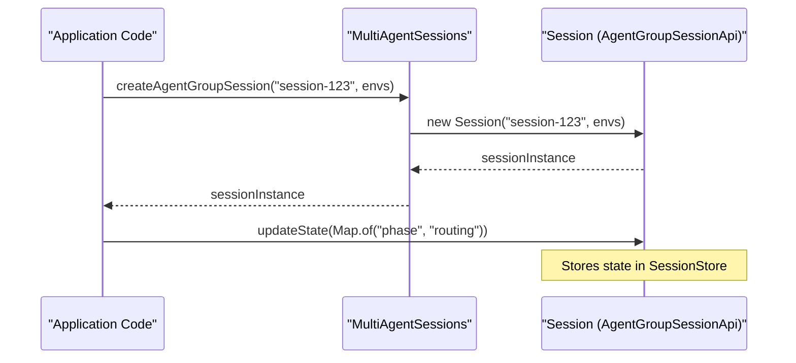
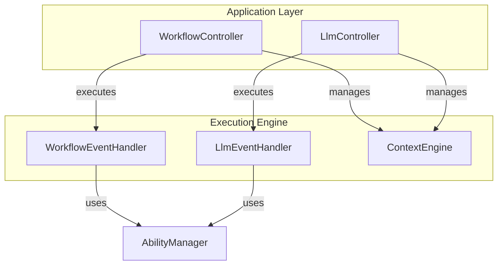

<!-- source: DeepWiki mcp.deepwiki.com · repo openJiuwen-ai/agent-core-java · page 2.3 Multi-Agent Systems · fetched 2026-11-02 -->

# Multi-Agent Systems

Relevant source files

The following files were used as context for generating this wiki page:

- [src/main/java/com/openjiuwen/core/application/llm/LlmController.java](src/main/java/com/openjiuwen/core/application/llm/LlmController.java)
- [src/main/java/com/openjiuwen/core/application/schema/ConstrainConfig.java](src/main/java/com/openjiuwen/core/application/schema/ConstrainConfig.java)
- [src/main/java/com/openjiuwen/core/application/schema/ReActAgentConfig.java](src/main/java/com/openjiuwen/core/application/schema/ReActAgentConfig.java)
- [src/main/java/com/openjiuwen/core/application/workflow/WorkflowController.java](src/main/java/com/openjiuwen/core/application/workflow/WorkflowController.java)
- [src/main/java/com/openjiuwen/core/application/workflow/WorkflowIntent.java](src/main/java/com/openjiuwen/core/application/workflow/WorkflowIntent.java)
- [src/main/java/com/openjiuwen/core/multiagent/MultiAgentSessions.java](src/main/java/com/openjiuwen/core/multiagent/MultiAgentSessions.java)
- [src/main/java/com/openjiuwen/core/multiagent/Session.java](src/main/java/com/openjiuwen/core/multiagent/Session.java)
- [src/main/java/com/openjiuwen/core/multiagent/legacy/AgentGroupSession.java](src/main/java/com/openjiuwen/core/multiagent/legacy/AgentGroupSession.java)
- [src/main/java/com/openjiuwen/core/multiagent/legacy/BaseGroup.java](src/main/java/com/openjiuwen/core/multiagent/legacy/BaseGroup.java)
- [src/test/java/com/openjiuwen/core/multiagent/MultiAgentFacadeTest.java](src/test/java/com/openjiuwen/core/multiagent/MultiAgentFacadeTest.java)
- [src/test/java/com/openjiuwen/core/multiagent/legacy/LegacyCompatibilityAliasTest.java](src/test/java/com/openjiuwen/core/multiagent/legacy/LegacyCompatibilityAliasTest.java)

The `agent-core-java` framework provides a robust infrastructure for orchestrating multiple agents to solve complex tasks. It supports various collaboration patterns, including hierarchical teams, event-driven groups, and remote agent-to-agent (A2A) communication. The system is designed around the concept of a shared session state and a unified runtime for agent interaction.

## Core Multi-Agent Architecture

Multi-agent coordination in this framework is managed through groups and teams that wrap individual `CommunicableAgent` instances. The architecture leverages a shared session API to maintain state across agent boundaries.

### Multi-Agent Session Management
Multi-agent interactions are governed by the `Session` class, which provides a specialized interface for group-level state and environment management.

| Class | Purpose | Source |
| :--- | :--- | :--- |
| `Session` | A package-level alias for `AgentGroupSessionApi`, used for managing multi-agent session state. | [src/main/java/com/openjiuwen/core/multiagent/Session.java:20-20]() |
| `MultiAgentSessions` | A facade for creating and initializing group sessions with specific environments. | [src/main/java/com/openjiuwen/core/multiagent/MultiAgentSessions.java:18-18]() |
| `AgentGroupSessionApi` | The base implementation providing `updateState` and `getState` capabilities for agent groups. | [src/main/java/com/openjiuwen/core/session/AgentGroupSessionApi.java:7-7]() |

### Code Entity Space: Session Lifecycle
The following diagram illustrates how sessions are instantiated via the facade and used within the multi-agent context.

**Diagram: Session Initialization Flow**

Sources: [src/main/java/com/openjiuwen/core/multiagent/MultiAgentSessions.java:35-37](), [src/main/java/com/openjiuwen/core/multiagent/Session.java:28-30]()

---

## Agent Teams and Collaboration Patterns

The framework facilitates agent collaboration through structured teams and handoff mechanisms. While individual agents (like `ReActAgent` or `WorkflowAgent`) handle specific tasks, the `BaseTeam` and `TeamRuntime` orchestrate their collective behavior.

### Handoff and Hierarchical Patterns
Agents can delegate tasks to one another using two primary patterns:
1.  **AgentAsTool**: An agent is wrapped as a tool and registered to another agent's `ToolCard`. The supervisor agent calls the subordinate agent as if it were a function.
2.  **Direct Handoff**: A `WorkflowAgent` can transition execution to another agent via a `SubWorkflowComponent` or a specific handoff event.

### Legacy Group Coordination
For backward compatibility with earlier iterations of the framework, the `BaseGroup` provides an abstraction for event-driven agent clusters.

*   **BaseGroup**: An abstract class that requires implementation of `invoke` and `stream` methods for processing messages within a group context [src/main/java/com/openjiuwen/core/multiagent/legacy/BaseGroup.java:17-49]().
*   **LegacyGroupCard**: Defines the metadata for a group, including its `topic` for message routing [src/test/java/com/openjiuwen/core/multiagent/legacy/LegacyCompatibilityAliasTest.java:36-40]().
*   **LegacyEventDrivenGroupCard**: Extends the basic card to include `subscriptions`, mapping worker agents to specific task types [src/test/java/com/openjiuwen/core/multiagent/legacy/LegacyCompatibilityAliasTest.java:41-46]().

---

## Multi-Agent Controllers

Multi-agent logic often involves complex state transitions managed by controllers. These controllers bridge the gap between user input and agent execution.

### Workflow and LLM Controllers
The framework provides facades to manage the lifecycle of complex agents within a multi-agent environment.

*   **WorkflowController**: Manages `WorkflowAgent` execution, including intent detection and task interruption/resumption [src/main/java/com/openjiuwen/core/application/workflow/WorkflowController.java:26-26]().
*   **LlmController**: A facade for `LlmAgent` (and legacy `ReActAgent`), handling event processing and prompt template management [src/main/java/com/openjiuwen/core/application/llm/LlmController.java:32-32]().

**Entity Mapping: Controller to Engine**
The controllers act as the interface between the application layer and the underlying execution engines.

Sources: [src/main/java/com/openjiuwen/core/application/workflow/WorkflowController.java:178-183](), [src/main/java/com/openjiuwen/core/application/llm/LlmController.java:118-124]()

---

## Configuration and Constraints

Multi-agent systems require strict execution limits to prevent infinite loops or excessive resource consumption.

### ConstrainConfig
The `ConstrainConfig` class defines the operational boundaries for agents within a team or group. It is backward-compatible with legacy agent configurations.

| Parameter | Description | Source |
| :--- | :--- | :--- |
| `reservedMaxChatRounds` | The maximum number of conversational turns allowed in a session. | [src/main/java/com/openjiuwen/core/application/schema/ConstrainConfig.java:22-22]() |
| `maxIteration` | The maximum number of internal reasoning/action loops (ReAct iterations) allowed. | [src/main/java/com/openjiuwen/core/application/schema/ConstrainConfig.java:25-25]() |

### Agent-Specific Configurations
Different agent types within a team use specialized configuration schemas:
*   **ReActAgentConfig**: An alias for `LlmAgentConfig`, used for reasoning-action agents [src/main/java/com/openjiuwen/core/application/schema/ReActAgentConfig.java:20-20]().
*   **WorkflowAgentConfig**: Contains the `WorkflowSchema` and definitions for multiple workflows assigned to a single agent [src/main/java/com/openjiuwen/core/application/workflow/WorkflowController.java:209-215]().

---

## Remote Agent Communication (A2A)

The framework supports the **A2A (Agent-to-Agent)** protocol, allowing agents to communicate across network boundaries. This is typically implemented via a `DistributedRunner` and a message queue (e.g., Pulsar or ZeroMQ).

1.  **Message Normalization**: The `createMessage` method in controllers ensures that various input formats (e.g., `content` vs `query`) are normalized into a standard `InputEvent` [src/main/java/com/openjiuwen/core/application/workflow/WorkflowController.java:128-138]().
2.  **Intent Resolution**: Before execution, the `WorkflowIntent` determines if a message should trigger a new task, resume an existing one, or provide a default response [src/main/java/com/openjiuwen/core/application/workflow/WorkflowIntent.java:18-27]().

Sources:
- [src/main/java/com/openjiuwen/core/multiagent/Session.java]()
- [src/main/java/com/openjiuwen/core/multiagent/MultiAgentSessions.java]()
- [src/main/java/com/openjiuwen/core/application/workflow/WorkflowController.java]()
- [src/main/java/com/openjiuwen/core/application/llm/LlmController.java]()
- [src/main/java/com/openjiuwen/core/application/schema/ConstrainConfig.java]()
- [src/main/java/com/openjiuwen/core/multiagent/legacy/BaseGroup.java]()

---

