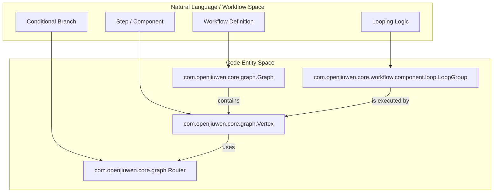
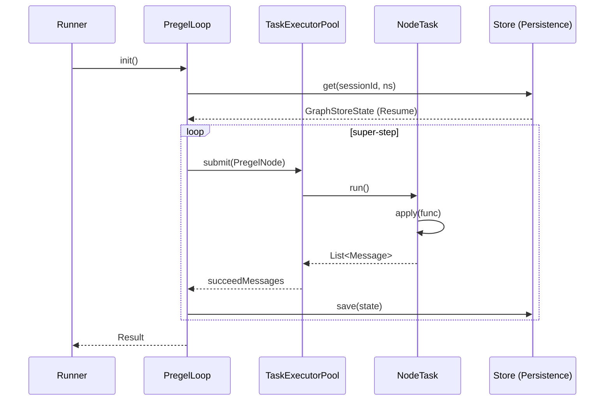

<!-- source: DeepWiki mcp.deepwiki.com · repo openJiuwen-ai/agent-core-java · page 3 Graph Execution Engine · fetched 2026-11-02 -->

# Graph Execution Engine

Relevant source files

The following files were used as context for generating this wiki page:

- [src/main/java/com/openjiuwen/core/graph/AtomicNode.java](src/main/java/com/openjiuwen/core/graph/AtomicNode.java)
- [src/main/java/com/openjiuwen/core/graph/CompiledGraph.java](src/main/java/com/openjiuwen/core/graph/CompiledGraph.java)
- [src/main/java/com/openjiuwen/core/graph/Executable.java](src/main/java/com/openjiuwen/core/graph/Executable.java)
- [src/main/java/com/openjiuwen/core/graph/ExecutableGraph.java](src/main/java/com/openjiuwen/core/graph/ExecutableGraph.java)
- [src/main/java/com/openjiuwen/core/graph/Graph.java](src/main/java/com/openjiuwen/core/graph/Graph.java)
- [src/main/java/com/openjiuwen/core/graph/GraphNodeState.java](src/main/java/com/openjiuwen/core/graph/GraphNodeState.java)
- [src/main/java/com/openjiuwen/core/graph/PregelGraph.java](src/main/java/com/openjiuwen/core/graph/PregelGraph.java)
- [src/main/java/com/openjiuwen/core/graph/Router.java](src/main/java/com/openjiuwen/core/graph/Router.java)
- [src/main/java/com/openjiuwen/core/graph/Vertex.java](src/main/java/com/openjiuwen/core/graph/Vertex.java)
- [src/main/java/com/openjiuwen/core/graph/pregel/BarrierChannel.java](src/main/java/com/openjiuwen/core/graph/pregel/BarrierChannel.java)
- [src/main/java/com/openjiuwen/core/graph/pregel/BarrierMessage.java](src/main/java/com/openjiuwen/core/graph/pregel/BarrierMessage.java)
- [src/main/java/com/openjiuwen/core/graph/pregel/NodeTask.java](src/main/java/com/openjiuwen/core/graph/pregel/NodeTask.java)
- [src/main/java/com/openjiuwen/core/graph/pregel/Pregel.java](src/main/java/com/openjiuwen/core/graph/pregel/Pregel.java)
- [src/main/java/com/openjiuwen/core/graph/pregel/PregelLoop.java](src/main/java/com/openjiuwen/core/graph/pregel/PregelLoop.java)
- [src/main/java/com/openjiuwen/core/graph/pregel/TaskExecutorPool.java](src/main/java/com/openjiuwen/core/graph/pregel/TaskExecutorPool.java)
- [src/main/java/com/openjiuwen/core/graph/stream_actor/ActorManager.java](src/main/java/com/openjiuwen/core/graph/stream_actor/ActorManager.java)
- [src/main/java/com/openjiuwen/core/graph/stream_actor/StreamActor.java](src/main/java/com/openjiuwen/core/graph/stream_actor/StreamActor.java)
- [src/main/java/com/openjiuwen/core/session/utils/SessionUtils.java](src/main/java/com/openjiuwen/core/session/utils/SessionUtils.java)
- [src/main/java/com/openjiuwen/core/workflow/component/End.java](src/main/java/com/openjiuwen/core/workflow/component/End.java)
- [src/main/java/com/openjiuwen/core/workflow/component/loop/AdvancedLoopComponentImpl.java](src/main/java/com/openjiuwen/core/workflow/component/loop/AdvancedLoopComponentImpl.java)
- [src/main/java/com/openjiuwen/core/workflow/component/loop/LoopComponentImpl.java](src/main/java/com/openjiuwen/core/workflow/component/loop/LoopComponentImpl.java)
- [src/main/java/com/openjiuwen/core/workflow/component/loop/LoopInput.java](src/main/java/com/openjiuwen/core/workflow/component/loop/LoopInput.java)
- [src/main/java/com/openjiuwen/core/workflow/component/loop/LoopSetVariableComponent.java](src/main/java/com/openjiuwen/core/workflow/component/loop/LoopSetVariableComponent.java)
- [src/main/java/com/openjiuwen/core/workflow/component/loop/PostLoopBody.java](src/main/java/com/openjiuwen/core/workflow/component/loop/PostLoopBody.java)
- [src/test/java/com/openjiuwen/core/workflow/component/loop/LoopComponentImplTest.java](src/test/java/com/openjiuwen/core/workflow/component/loop/LoopComponentImplTest.java)

The **Graph Execution Engine** is the core runtime of the `agent-core-java` framework. It utilizes a **Pregel-based execution model** to manage complex, stateful, and concurrent agent behaviors. Every agent type—from simple ReAct loops to sophisticated multi-agent workflows—is ultimately compiled into a graph and executed by this engine.

### Core Architecture

The engine operates by treating every functional unit as a `Vertex` in a directed graph [src/main/java/com/openjiuwen/core/graph/Vertex.java:57-70](). These vertices are orchestrated by the `PregelLoop`, which manages execution in "super-steps" [src/main/java/com/openjiuwen/core/graph/pregel/PregelLoop.java:24-36](). This model allows for massive parallelism, where multiple nodes can execute simultaneously as long as their input dependencies (messages) are met.

#### From Logic to Execution
The following diagram illustrates how high-level workflow concepts map to the underlying graph engine entities.

**Conceptual Mapping: Workflow to Graph Engine**

Sources: [src/main/java/com/openjiuwen/core/graph/Vertex.java:57-70](), [src/main/java/com/openjiuwen/core/graph/Graph.java](), [src/main/java/com/openjiuwen/core/workflow/component/loop/LoopGroup.java]()

---

### Key Subsystems

#### 1. Pregel Graph Model
The execution is driven by the `Pregel` engine, which implements a bulk-synchronous parallel (BSP) model.
*   **Super-steps**: The `PregelLoop` runs steps iteratively [src/main/java/com/openjiuwen/core/graph/pregel/PregelLoop.java:83-94]().
*   **Concurrency**: The `TaskExecutorPool` leverages virtual threads to run `NodeTask` instances concurrently [src/main/java/com/openjiuwen/core/graph/pregel/TaskExecutorPool.java:26-37]().
*   **Messaging**: Communication between nodes is handled via `Message` passing and `BarrierChannel` synchronization.

For detailed information on the execution internals, see **[Pregel Graph Model](#3.1)**.

#### 2. Workflow Components
The framework provides a library of pre-built `WorkflowComponent` classes that serve as the building blocks for agents.
*   **Flow Control**: Includes `Start` [src/main/java/com/openjiuwen/core/workflow/component/Start.java](), `End` [src/main/java/com/openjiuwen/core/workflow/component/End.java:34-46](), and `BranchRouter`.
*   **Iteration**: Complex looping is supported via `LoopComponentImpl` [src/main/java/com/openjiuwen/core/workflow/component/loop/LoopComponentImpl.java:39-51]() and `AdvancedLoopComponentImpl`.
*   **Interaction**: Components like the `Questioner` handle human-in-the-loop interruptions.

For a catalog of available components and their configuration, see **[Workflow Components](#3.2)**.

#### 3. Session and State Management
State is persisted across super-steps and even system restarts.
*   **Hierarchy**: Execution context is scoped through `AgentSessionApi`, `WorkflowSessionApi`, and `NodeSessionApi` [src/main/java/com/openjiuwen/core/session/NodeSessionApi.java]().
*   **Checkpointing**: The `Store` interface allows the `PregelLoop` to save the `GraphStoreState` upon interrupts or errors [src/main/java/com/openjiuwen/core/graph/pregel/PregelLoop.java:183-207]().
*   **Data Access**: `SessionUtils` provides powerful path-based navigation (e.g., `${node.output.key}`) to extract data from the session [src/main/java/com/openjiuwen/core/session/utils/SessionUtils.java:25-34]().

For details on state persistence and data manipulation, see **[Session and State Management](#3.3)**.

---

### Execution Lifecycle
The engine coordinates the lifecycle of a task from submission to completion, ensuring that state is committed and streams are flushed.

**Runtime Entity Interaction**

Sources: [src/main/java/com/openjiuwen/core/graph/pregel/PregelLoop.java:47-75](), [src/main/java/com/openjiuwen/core/graph/pregel/TaskExecutorPool.java:45-54](), [src/main/java/com/openjiuwen/core/graph/pregel/NodeTask.java:50-71]()

### Summary Table

| Entity | Role | Key Class/File |
| :--- | :--- | :--- |
| **Graph Container** | Holds the compiled structure of nodes and edges. | `CompiledGraph` |
| **Execution Loop** | Orchestrates super-steps and state recovery. | `PregelLoop` [src/main/java/com/openjiuwen/core/graph/pregel/PregelLoop.java]() |
| **Task Runner** | Manages thread pools for concurrent node execution. | `TaskExecutorPool` [src/main/java/com/openjiuwen/core/graph/pregel/TaskExecutorPool.java]() |
| **Atomic Unit** | The executable wrapper for a component. | `Vertex` [src/main/java/com/openjiuwen/core/graph/Vertex.java]() |
| **Persistence** | Handles saving and loading graph snapshots. | `Store` [src/main/java/com/openjiuwen/core/graph/store/Store.java]() |

---

