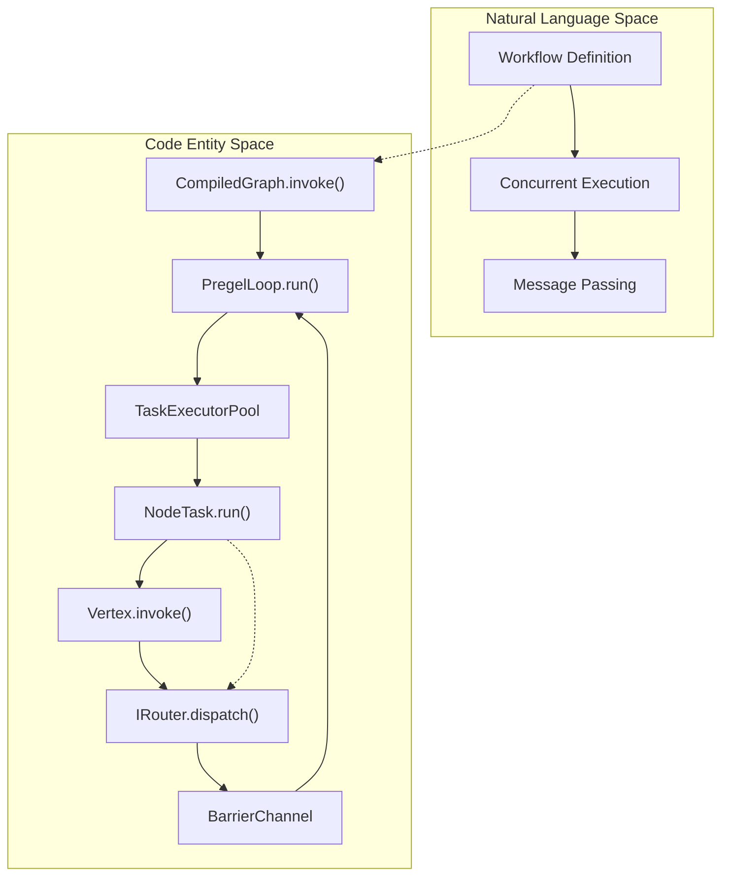
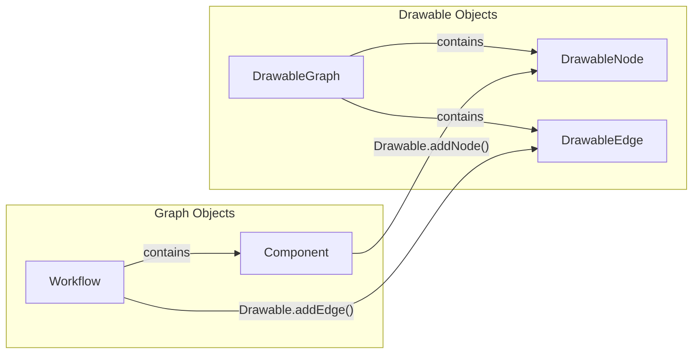

<!-- source: DeepWiki mcp.deepwiki.com · repo openJiuwen-ai/agent-core-java · page 3.1 Pregel Graph Model · fetched 2026-11-02 -->

# Pregel Graph Model

Relevant source files

The following files were used as context for generating this wiki page:

- [src/main/java/com/openjiuwen/core/graph/AtomicNode.java](src/main/java/com/openjiuwen/core/graph/AtomicNode.java)
- [src/main/java/com/openjiuwen/core/graph/CompiledGraph.java](src/main/java/com/openjiuwen/core/graph/CompiledGraph.java)
- [src/main/java/com/openjiuwen/core/graph/Executable.java](src/main/java/com/openjiuwen/core/graph/Executable.java)
- [src/main/java/com/openjiuwen/core/graph/ExecutableGraph.java](src/main/java/com/openjiuwen/core/graph/ExecutableGraph.java)
- [src/main/java/com/openjiuwen/core/graph/Graph.java](src/main/java/com/openjiuwen/core/graph/Graph.java)
- [src/main/java/com/openjiuwen/core/graph/GraphNodeState.java](src/main/java/com/openjiuwen/core/graph/GraphNodeState.java)
- [src/main/java/com/openjiuwen/core/graph/PregelGraph.java](src/main/java/com/openjiuwen/core/graph/PregelGraph.java)
- [src/main/java/com/openjiuwen/core/graph/Router.java](src/main/java/com/openjiuwen/core/graph/Router.java)
- [src/main/java/com/openjiuwen/core/graph/Vertex.java](src/main/java/com/openjiuwen/core/graph/Vertex.java)
- [src/main/java/com/openjiuwen/core/graph/pregel/BarrierChannel.java](src/main/java/com/openjiuwen/core/graph/pregel/BarrierChannel.java)
- [src/main/java/com/openjiuwen/core/graph/pregel/BarrierMessage.java](src/main/java/com/openjiuwen/core/graph/pregel/BarrierMessage.java)
- [src/main/java/com/openjiuwen/core/graph/pregel/NodeTask.java](src/main/java/com/openjiuwen/core/graph/pregel/NodeTask.java)
- [src/main/java/com/openjiuwen/core/graph/pregel/Pregel.java](src/main/java/com/openjiuwen/core/graph/pregel/Pregel.java)
- [src/main/java/com/openjiuwen/core/graph/pregel/PregelLoop.java](src/main/java/com/openjiuwen/core/graph/pregel/PregelLoop.java)
- [src/main/java/com/openjiuwen/core/graph/pregel/TaskExecutorPool.java](src/main/java/com/openjiuwen/core/graph/pregel/TaskExecutorPool.java)
- [src/main/java/com/openjiuwen/core/graph/stream_actor/ActorManager.java](src/main/java/com/openjiuwen/core/graph/stream_actor/ActorManager.java)
- [src/main/java/com/openjiuwen/core/graph/stream_actor/StreamActor.java](src/main/java/com/openjiuwen/core/graph/stream_actor/StreamActor.java)
- [src/main/java/com/openjiuwen/core/graph/visualization/Drawable.java](src/main/java/com/openjiuwen/core/graph/visualization/Drawable.java)
- [src/main/java/com/openjiuwen/core/graph/visualization/DrawableBranchRouter.java](src/main/java/com/openjiuwen/core/graph/visualization/DrawableBranchRouter.java)
- [src/main/java/com/openjiuwen/core/graph/visualization/DrawableEdge.java](src/main/java/com/openjiuwen/core/graph/visualization/DrawableEdge.java)
- [src/main/java/com/openjiuwen/core/graph/visualization/DrawableGraph.java](src/main/java/com/openjiuwen/core/graph/visualization/DrawableGraph.java)
- [src/main/java/com/openjiuwen/core/graph/visualization/DrawableNode.java](src/main/java/com/openjiuwen/core/graph/visualization/DrawableNode.java)
- [src/main/java/com/openjiuwen/core/graph/visualization/DrawableSubgraphNode.java](src/main/java/com/openjiuwen/core/graph/visualization/DrawableSubgraphNode.java)
- [src/main/java/com/openjiuwen/core/session/utils/SessionUtils.java](src/main/java/com/openjiuwen/core/session/utils/SessionUtils.java)
- [src/main/java/com/openjiuwen/core/workflow/component/End.java](src/main/java/com/openjiuwen/core/workflow/component/End.java)
- [src/main/java/com/openjiuwen/core/workflow/component/loop/AdvancedLoopComponentImpl.java](src/main/java/com/openjiuwen/core/workflow/component/loop/AdvancedLoopComponentImpl.java)
- [src/main/java/com/openjiuwen/core/workflow/component/loop/LoopComponentImpl.java](src/main/java/com/openjiuwen/core/workflow/component/loop/LoopComponentImpl.java)
- [src/main/java/com/openjiuwen/core/workflow/component/loop/LoopInput.java](src/main/java/com/openjiuwen/core/workflow/component/loop/LoopInput.java)
- [src/main/java/com/openjiuwen/core/workflow/component/loop/LoopSetVariableComponent.java](src/main/java/com/openjiuwen/core/workflow/component/loop/LoopSetVariableComponent.java)
- [src/main/java/com/openjiuwen/core/workflow/component/loop/PostLoopBody.java](src/main/java/com/openjiuwen/core/workflow/component/loop/PostLoopBody.java)
- [src/test/java/com/openjiuwen/core/workflow/component/loop/LoopComponentImplTest.java](src/test/java/com/openjiuwen/core/workflow/component/loop/LoopComponentImplTest.java)

The **Pregel Graph Model** is the core execution engine of `agent-core-java`. It implements a message-passing synchronization model where nodes (vertices) execute concurrently and communicate via directed edges. This model allows for complex, non-linear agent workflows, including loops, conditional branching, and streaming data processing.

## Graph Architecture

The framework represents workflows as directed graphs where each `Vertex` represents a computational step.

### Key Graph Entities

| Class | Description |
| :--- | :--- |
| `Graph` | The base definition of a workflow graph, containing nodes and their connections. |
| `PregelGraph` | A graph implementation that utilizes the Pregel execution model for message passing. |
| `CompiledGraph` | A finalized, optimized version of the graph ready for execution. |
| `Vertex` | A node in the graph that wraps an `Executable` component. It handles session management and execution logic [src/main/java/com/openjiuwen/core/graph/Vertex.java:57-78](). |
| `Executable` | The functional interface implemented by workflow components (e.g., `Start`, `End`, `LLMComponent`) [src/main/java/com/openjiuwen/core/graph/Executable.java:1-20](). |

### Pregel to Code Mapping
The following diagram bridges the conceptual Pregel model to the specific Java classes and methods responsible for execution.

**Pregel Execution Flow**

**Sources:** [src/main/java/com/openjiuwen/core/graph/CompiledGraph.java:10-50](), [src/main/java/com/openjiuwen/core/graph/pregel/PregelLoop.java:20-60](), [src/main/java/com/openjiuwen/core/graph/pregel/NodeTask.java:50-71]().

## Pregel Execution Model

Execution is managed by `PregelLoop`, which orchestrates "supersteps." In each superstep, active nodes process incoming messages and produce outgoing messages for the next step.

### NodeTask and Concurrency
Each node's execution is encapsulated in a `NodeTask` [src/main/java/com/openjiuwen/core/graph/pregel/NodeTask.java:21-35](). 
- **Concurrent Execution**: The `TaskExecutorPool` manages a thread pool (often using Virtual Threads via `VirtualThreadSupport`) to run multiple `NodeTask` instances in parallel.
- **Message Routing**: After a node finishes, `NodeTask` calls `IRouter.dispatch()` to determine which downstream nodes should receive messages [src/main/java/com/openjiuwen/core/graph/pregel/NodeTask.java:57-62]().
- **State Propagation**: Messages are routed via the `BarrierChannel`, which ensures that a node only triggers when its synchronization requirements (barriers) are met.

### Graph Interrupts
Workflows can be paused or interrupted using `GraphInterrupt` [src/main/java/com/openjiuwen/core/graph/pregel/GraphInterrupt.java:1-15](). This is typically used for:
- **Interactive Input**: Waiting for a user response via `QuestionerComponent`.
- **Breakpoints**: Stopping execution for debugging or manual approval.
- **Loop Termination**: Signals from a `LoopBreakComponent` [src/main/java/com/openjiuwen/core/workflow/component/loop/AdvancedLoopComponentImpl.java:89-96]().

**Sources:** [src/main/java/com/openjiuwen/core/graph/pregel/NodeTask.java:50-71](), [src/main/java/com/openjiuwen/core/graph/pregel/PregelLoop.java:100-150](), [src/main/java/com/openjiuwen/core/graph/Vertex.java:143-160]().

## Message Routing and Data Flow

Data travels between nodes through a structured mapping process managed by `SessionUtils`.

### Routing Logic
1. **Input Mapping**: When a node is triggered, its inputs are resolved from the `GraphState` using reference paths (e.g., `${node_id.output_key}`) [src/main/java/com/openjiuwen/core/session/utils/SessionUtils.java:143-160]().
2. **Vertex Invocation**: The `Vertex` executes its underlying `Executable` with the resolved inputs [src/main/java/com/openjiuwen/core/graph/Vertex.java:147-152]().
3. **Output Commitment**: Results are stored in the session state. If the node is part of a loop, `LoopSetVariableComponent` may be used to map internal loop results back to the parent workflow session [src/main/java/com/openjiuwen/core/workflow/component/loop/LoopSetVariableComponent.java:42-75]().

### Stream Subsystem
For long-running or generative tasks (like LLM calls), the `stream_actor` subsystem provides asynchronous data delivery.
- **StreamEmitter**: Nodes emit partial results (chunks) through a `StreamEmitter` [src/main/java/com/openjiuwen/core/graph/Vertex.java:22]().
- **ActorManager**: Coordinates the lifecycle of stream actors, ensuring messages are delivered to the client in the correct order [src/main/java/com/openjiuwen/core/graph/stream_actor/ActorManager.java:5-30]().

**Sources:** [src/main/java/com/openjiuwen/core/session/utils/SessionUtils.java:129-184](), [src/main/java/com/openjiuwen/core/workflow/component/loop/LoopSetVariableComponent.java:93-109](), [src/main/java/com/openjiuwen/core/graph/Vertex.java:123-140]().

## Visualization and Drawable Graph

The framework provides a `Drawable` utility to convert the Pregel graph into a visualizable format (e.g., for UI rendering or Mermaid generation).

**Drawable Entity Mapping**

- **DrawableGraph**: A container for nodes and edges formatted for visualization [src/main/java/com/openjiuwen/core/graph/visualization/DrawableGraph.java:10-30]().
- **DrawableNode**: Represents a `Vertex` in the UI, including metadata about whether it is a `Start`, `End`, or `SubWorkflow` node [src/main/java/com/openjiuwen/core/graph/visualization/Drawable.java:65-87]().
- **DrawableEdge**: Represents the `IRouter` connections, including whether the edge is conditional or streaming [src/main/java/com/openjiuwen/core/graph/visualization/DrawableEdge.java:11-29]().

**Sources:** [src/main/java/com/openjiuwen/core/graph/visualization/Drawable.java:40-87](), [src/main/java/com/openjiuwen/core/graph/visualization/DrawableEdge.java:11-29]().

---

