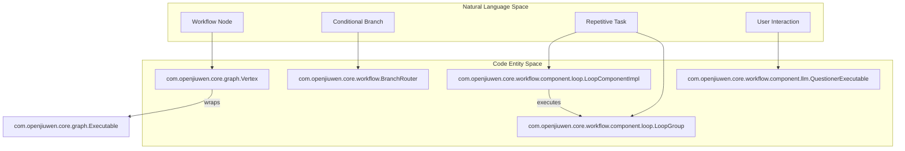
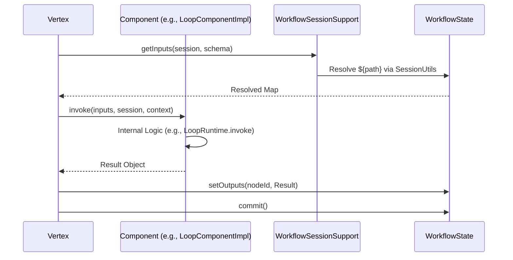

<!-- source: DeepWiki mcp.deepwiki.com · repo openJiuwen-ai/agent-core-java · page 3.2 Workflow Components · fetched 2026-11-02 -->

# Workflow Components

<details>
<summary>Relevant source files</summary>

The following files were used as context for generating this wiki page:

- [src/main/java/com/openjiuwen/core/graph/Vertex.java](src/main/java/com/openjiuwen/core/graph/Vertex.java)
- [src/main/java/com/openjiuwen/core/graph/pregel/NodeTask.java](src/main/java/com/openjiuwen/core/graph/pregel/NodeTask.java)
- [src/main/java/com/openjiuwen/core/session/utils/SessionUtils.java](src/main/java/com/openjiuwen/core/session/utils/SessionUtils.java)
- [src/main/java/com/openjiuwen/core/workflow/BaseWorkflow.java](src/main/java/com/openjiuwen/core/workflow/BaseWorkflow.java)
- [src/main/java/com/openjiuwen/core/workflow/BranchRouter.java](src/main/java/com/openjiuwen/core/workflow/BranchRouter.java)
- [src/main/java/com/openjiuwen/core/workflow/Workflow.java](src/main/java/com/openjiuwen/core/workflow/Workflow.java)
- [src/main/java/com/openjiuwen/core/workflow/component/End.java](src/main/java/com/openjiuwen/core/workflow/component/End.java)
- [src/main/java/com/openjiuwen/core/workflow/component/SubWorkflowComponentImpl.java](src/main/java/com/openjiuwen/core/workflow/component/SubWorkflowComponentImpl.java)
- [src/main/java/com/openjiuwen/core/workflow/component/llm/QuestionerExecutable.java](src/main/java/com/openjiuwen/core/workflow/component/llm/QuestionerExecutable.java)
- [src/main/java/com/openjiuwen/core/workflow/component/llm/QuestionerState.java](src/main/java/com/openjiuwen/core/workflow/component/llm/QuestionerState.java)
- [src/main/java/com/openjiuwen/core/workflow/component/loop/AdvancedLoopComponentImpl.java](src/main/java/com/openjiuwen/core/workflow/component/loop/AdvancedLoopComponentImpl.java)
- [src/main/java/com/openjiuwen/core/workflow/component/loop/LoopComponentImpl.java](src/main/java/com/openjiuwen/core/workflow/component/loop/LoopComponentImpl.java)
- [src/main/java/com/openjiuwen/core/workflow/component/loop/LoopInput.java](src/main/java/com/openjiuwen/core/workflow/component/loop/LoopInput.java)
- [src/main/java/com/openjiuwen/core/workflow/component/loop/LoopSetVariableComponent.java](src/main/java/com/openjiuwen/core/workflow/component/loop/LoopSetVariableComponent.java)
- [src/main/java/com/openjiuwen/core/workflow/component/loop/PostLoopBody.java](src/main/java/com/openjiuwen/core/workflow/component/loop/PostLoopBody.java)
- [src/main/java/com/openjiuwen/core/workflow/components/flow/BranchComponent.java](src/main/java/com/openjiuwen/core/workflow/components/flow/BranchComponent.java)
- [src/main/java/com/openjiuwen/core/workflow/components/flow/EndComponent.java](src/main/java/com/openjiuwen/core/workflow/components/flow/EndComponent.java)
- [src/main/java/com/openjiuwen/core/workflow/components/flow/SubWorkflowComponent.java](src/main/java/com/openjiuwen/core/workflow/components/flow/SubWorkflowComponent.java)
- [src/main/java/com/openjiuwen/core/workflow/components/flow/loop/LoopComponent.java](src/main/java/com/openjiuwen/core/workflow/components/flow/loop/LoopComponent.java)
- [src/main/java/com/openjiuwen/core/workflow/components/flow/loop/LoopGroup.java](src/main/java/com/openjiuwen/core/workflow/components/flow/loop/LoopGroup.java)
- [src/main/java/com/openjiuwen/core/workflow/components/llm/FieldInfo.java](src/main/java/com/openjiuwen/core/workflow/components/llm/FieldInfo.java)
- [src/main/java/com/openjiuwen/core/workflow/components/llm/IntentDetectionCompConfig.java](src/main/java/com/openjiuwen/core/workflow/components/llm/IntentDetectionCompConfig.java)
- [src/main/java/com/openjiuwen/core/workflow/components/llm/IntentDetectionComponent.java](src/main/java/com/openjiuwen/core/workflow/components/llm/IntentDetectionComponent.java)
- [src/main/java/com/openjiuwen/core/workflow/components/llm/LLMCompConfig.java](src/main/java/com/openjiuwen/core/workflow/components/llm/LLMCompConfig.java)
- [src/main/java/com/openjiuwen/core/workflow/condition/ExpressionCondition.java](src/main/java/com/openjiuwen/core/workflow/condition/ExpressionCondition.java)
- [src/test/java/com/openjiuwen/core/session/checkpointer/InMemoryCheckpointerTest.java](src/test/java/com/openjiuwen/core/session/checkpointer/InMemoryCheckpointerTest.java)
- [src/test/java/com/openjiuwen/core/systemtest/WorkflowVisualizationSystemTest.java](src/test/java/com/openjiuwen/core/systemtest/WorkflowVisualizationSystemTest.java)
- [src/test/java/com/openjiuwen/core/workflow/component/loop/LoopComponentImplTest.java](src/test/java/com/openjiuwen/core/workflow/component/loop/LoopComponentImplTest.java)

</details>


Workflow components are the fundamental building blocks of an agentic workflow in `agent-core-java`. Each component represents a node in a directed graph, capable of processing data, making decisions, or interacting with external models and tools. The framework provides a set of built-in components that manage control flow (loops, branches), data lifecycle (start, end), and specialized AI tasks (intent detection, question-answering).

## Component Lifecycle and Execution

All workflow components implement or wrap `ComponentComposable` and are executed within the Pregel graph engine as `Vertex` nodes [src/main/java/com/openjiuwen/core/graph/Vertex.java:57-76](). Components can support multiple execution modes, primarily `invoke` for standard execution and `stream` for token-by-token or frame-by-frame output [src/main/java/com/openjiuwen/core/graph/Vertex.java:121-127]().

### Data Mapping and Schemas
Components use `inputsSchema` and `outputsSchema` to define their data interface. At runtime, `SessionUtils.getBySchema` is used to resolve nested paths (e.g., `${node_id.output_key}`) against the session state [src/main/java/com/openjiuwen/core/session/utils/SessionUtils.java:129-143]().

## Control Flow Components

### Start and End
*   **Start**: Acts as the entry point, defining the initial schema for the workflow [src/main/java/com/openjiuwen/core/workflow/Workflow.java:140-149]().
*   **End**: The exit point. It supports optional response template rendering using `{{variable}}` syntax [src/main/java/com/openjiuwen/core/workflow/component/End.java:29-41](). It can operate in "mixed mode" to handle concurrent data sources [src/main/java/com/openjiuwen/core/workflow/component/End.java:86-93]().

### BranchRouter
`BranchRouter` implements conditional logic. It evaluates a list of conditions and routes the workflow to the first target node whose condition is met [src/main/java/com/openjiuwen/core/workflow/BranchRouter.java:1]().

### Loop Components
The framework provides two primary loop implementations:
1.  **LoopComponentImpl**: A standard loop that iterates based on a count, an array, or a boolean expression [src/main/java/com/openjiuwen/core/workflow/component/loop/LoopComponentImpl.java:141-161](). It uses `LoopGroup` to define the internal subgraph of nodes to be repeated [src/main/java/com/openjiuwen/core/workflow/component/loop/LoopComponentImpl.java:41-51]().
2.  **AdvancedLoopComponentImpl**: Supports manual control, including `breakLoop()` functionality via `LoopBreakComponent` [src/main/java/com/openjiuwen/core/workflow/component/loop/AdvancedLoopComponentImpl.java:30-58]().

**Loop State Management:**
The `LoopSetVariableComponent` allows a loop iteration to persist data back to the parent workflow session, enabling state accumulation across iterations [src/main/java/com/openjiuwen/core/workflow/component/loop/LoopSetVariableComponent.java:42-75]().

### SubWorkflowComponent
Allows nesting workflows. A `SubWorkflowComponent` wraps another `Workflow` instance, executing it as a single node within the parent graph [src/main/java/com/openjiuwen/core/workflow/component/SubWorkflowComponentImpl.java:1]().

## AI and Interactive Components

### IntentDetectionComponent
Specialized for routing based on natural language. It uses an LLM to categorize user input into predefined intents, which then drives branching logic [src/main/java/com/openjiuwen/core/workflow/components/llm/IntentDetectionComponent.java:1]().

### QuestionerComponent
Handles interactive tasks where the agent needs to ask the user for missing information.
*   It utilizes `QuestionerExecutable` to manage the interaction state [src/main/java/com/openjiuwen/core/workflow/component/llm/QuestionerExecutable.java:1]().
*   If required information is missing, it triggers a `GraphInterrupt` to pause execution and wait for `InteractiveInput` [src/main/java/com/openjiuwen/core/session/checkpointer/InMemoryCheckpointerTest.java:82-97]().

## Structural Diagram: Component to Code Mapping

The following diagram bridges the logical workflow concepts to their specific Java implementation classes.

**Component Entity Mapping**

**Sources:** [src/main/java/com/openjiuwen/core/graph/Vertex.java:75-76](), [src/main/java/com/openjiuwen/core/workflow/component/loop/LoopComponentImpl.java:39-41](), [src/main/java/com/openjiuwen/core/workflow/component/llm/QuestionerExecutable.java:1]()

## Data Flow and Resolution

When a component executes, it does not access the raw session directly for its inputs. Instead, the `Vertex` prepares an invocation map.

| Stage | Logic | Source |
| :--- | :--- | :--- |
| **Input Resolution** | Uses `${node_id.key}` syntax to pull data from `WorkflowState`. | [src/main/java/com/openjiuwen/core/session/utils/SessionUtils.java:154-160]() |
| **Execution** | The `invoke` or `stream` method of the component is called. | [src/main/java/com/openjiuwen/core/graph/Vertex.java:143-152]() |
| **Output Commitment** | Results are written to the `WorkflowCommitState` and committed to the checkpointer. | [src/main/java/com/openjiuwen/core/workflow/component/loop/LoopSetVariableComponent.java:94-105]() |

**Component Execution Flow**

**Sources:** [src/main/java/com/openjiuwen/core/graph/Vertex.java:143-160](), [src/main/java/com/openjiuwen/core/workflow/internal/WorkflowSessionSupport.java:1](), [src/main/java/com/openjiuwen/core/workflow/component/loop/LoopComponentImpl.java:109-115]()

## Configuration and Composition

Workflows are composed by adding components to a `Workflow` instance and defining connections.

```java
// Example: Adding a Loop Component
// [src/test/java/com/openjiuwen/core/workflow/component/loop/LoopComponentImplTest.java:56-82]
Workflow flow = new Workflow();
flow.setStartComp("start", new Start(), Map.of("num", "${num}"));

LoopGroup loopGroup = new LoopGroup();
loopGroup.addWorkflowComp("task_1", new MyNode(), true, Map.of("in", "${loop.index}"), null, null, null, null);
loopGroup.startNodes(List.of("task_1"));

LoopComponentImpl loop = new LoopComponentImpl(loopGroup, Map.of("out", "${task_1.result}"));
flow.addWorkflowComp("loop_node", loop, Map.of("loop_type", "number", "loop_number", 5), null);

flow.addConnection("start", "loop_node");
```

**Sources:** [src/main/java/com/openjiuwen/core/workflow/Workflow.java:140-176](), [src/test/java/com/openjiuwen/core/workflow/component/loop/LoopComponentImplTest.java:56-82]()

---

