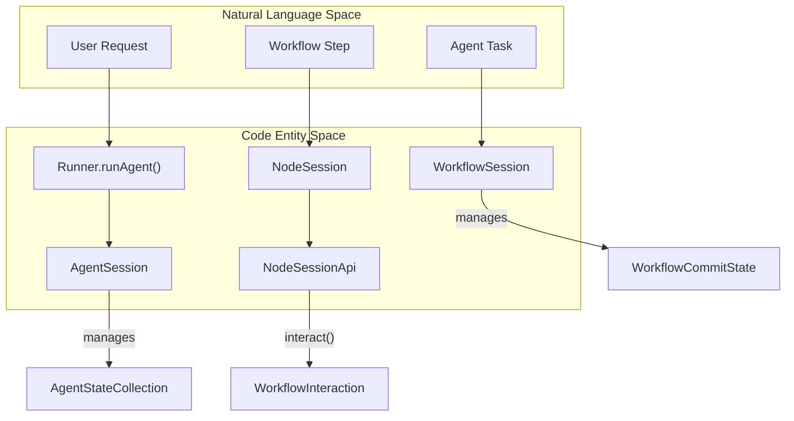
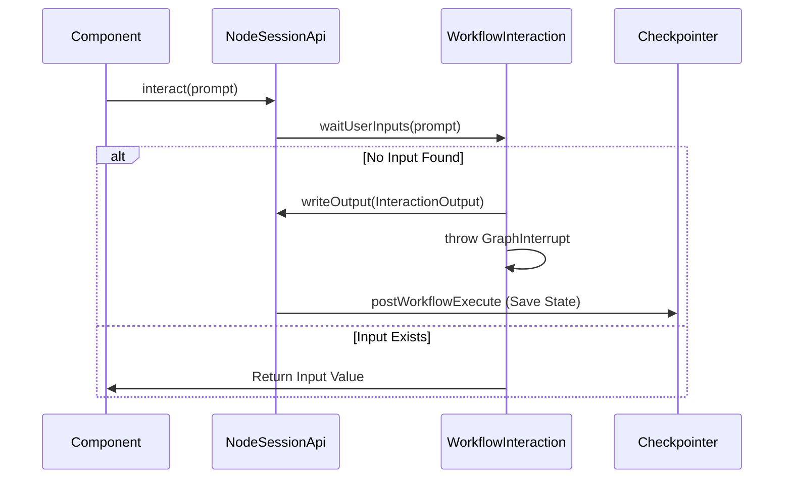

<!-- source: DeepWiki mcp.deepwiki.com · repo openJiuwen-ai/agent-core-java · page 3.3 Session and State Management · fetched 2026-11-02 -->

# Session and State Management

Relevant source files

The following files were used as context for generating this wiki page:

- [src/main/java/com/openjiuwen/core/foundation/llm/model_clients/BaseModelClient.java](src/main/java/com/openjiuwen/core/foundation/llm/model_clients/BaseModelClient.java)
- [src/main/java/com/openjiuwen/core/foundation/llm/schema/BaseModelInfo.java](src/main/java/com/openjiuwen/core/foundation/llm/schema/BaseModelInfo.java)
- [src/main/java/com/openjiuwen/core/foundation/tool/service_api/RestfulApi.java](src/main/java/com/openjiuwen/core/foundation/tool/service_api/RestfulApi.java)
- [src/main/java/com/openjiuwen/core/session/BaseSession.java](src/main/java/com/openjiuwen/core/session/BaseSession.java)
- [src/main/java/com/openjiuwen/core/session/NodeSessionApi.java](src/main/java/com/openjiuwen/core/session/NodeSessionApi.java)
- [src/main/java/com/openjiuwen/core/session/ProxySession.java](src/main/java/com/openjiuwen/core/session/ProxySession.java)
- [src/main/java/com/openjiuwen/core/session/Session.java](src/main/java/com/openjiuwen/core/session/Session.java)
- [src/main/java/com/openjiuwen/core/session/WorkflowSessionApi.java](src/main/java/com/openjiuwen/core/session/WorkflowSessionApi.java)
- [src/main/java/com/openjiuwen/core/session/callback/BaseHandler.java](src/main/java/com/openjiuwen/core/session/callback/BaseHandler.java)
- [src/main/java/com/openjiuwen/core/session/callback/CallbackManager.java](src/main/java/com/openjiuwen/core/session/callback/CallbackManager.java)
- [src/main/java/com/openjiuwen/core/session/callback/TriggerEvent.java](src/main/java/com/openjiuwen/core/session/callback/TriggerEvent.java)
- [src/main/java/com/openjiuwen/core/session/checkpointer/Checkpointer.java](src/main/java/com/openjiuwen/core/session/checkpointer/Checkpointer.java)
- [src/main/java/com/openjiuwen/core/session/checkpointer/CheckpointerConfig.java](src/main/java/com/openjiuwen/core/session/checkpointer/CheckpointerConfig.java)
- [src/main/java/com/openjiuwen/core/session/checkpointer/InMemoryCheckpointer.java](src/main/java/com/openjiuwen/core/session/checkpointer/InMemoryCheckpointer.java)
- [src/main/java/com/openjiuwen/core/session/checkpointer/PersistenceCheckpointer.java](src/main/java/com/openjiuwen/core/session/checkpointer/PersistenceCheckpointer.java)
- [src/main/java/com/openjiuwen/core/session/config/Config.java](src/main/java/com/openjiuwen/core/session/config/Config.java)
- [src/main/java/com/openjiuwen/core/session/interaction/BaseInteraction.java](src/main/java/com/openjiuwen/core/session/interaction/BaseInteraction.java)
- [src/main/java/com/openjiuwen/core/session/interaction/InteractionOutput.java](src/main/java/com/openjiuwen/core/session/interaction/InteractionOutput.java)
- [src/main/java/com/openjiuwen/core/session/interaction/WorkflowInteraction.java](src/main/java/com/openjiuwen/core/session/interaction/WorkflowInteraction.java)
- [src/main/java/com/openjiuwen/core/session/internal/AgentSession.java](src/main/java/com/openjiuwen/core/session/internal/AgentSession.java)
- [src/main/java/com/openjiuwen/core/session/internal/NodeSession.java](src/main/java/com/openjiuwen/core/session/internal/NodeSession.java)
- [src/main/java/com/openjiuwen/core/session/internal/SubWorkflowSession.java](src/main/java/com/openjiuwen/core/session/internal/SubWorkflowSession.java)
- [src/main/java/com/openjiuwen/core/session/internal/WorkflowSession.java](src/main/java/com/openjiuwen/core/session/internal/WorkflowSession.java)
- [src/main/java/com/openjiuwen/core/session/state/WorkflowStateCollection.java](src/main/java/com/openjiuwen/core/session/state/WorkflowStateCollection.java)
- [src/main/java/com/openjiuwen/core/session/stream/OutputSchema.java](src/main/java/com/openjiuwen/core/session/stream/OutputSchema.java)
- [src/main/java/com/openjiuwen/core/session/stream/StreamWriterManager.java](src/main/java/com/openjiuwen/core/session/stream/StreamWriterManager.java)
- [src/main/java/com/openjiuwen/core/session/tracer/NodeStatus.java](src/main/java/com/openjiuwen/core/session/tracer/NodeStatus.java)
- [src/main/java/com/openjiuwen/core/session/tracer/Span.java](src/main/java/com/openjiuwen/core/session/tracer/Span.java)
- [src/main/java/com/openjiuwen/core/session/tracer/TraceAgentHandler.java](src/main/java/com/openjiuwen/core/session/tracer/TraceAgentHandler.java)
- [src/main/java/com/openjiuwen/core/session/tracer/TraceAgentSpan.java](src/main/java/com/openjiuwen/core/session/tracer/TraceAgentSpan.java)
- [src/main/java/com/openjiuwen/core/session/tracer/TraceBaseHandler.java](src/main/java/com/openjiuwen/core/session/tracer/TraceBaseHandler.java)
- [src/main/java/com/openjiuwen/core/session/tracer/TraceWorkflowHandler.java](src/main/java/com/openjiuwen/core/session/tracer/TraceWorkflowHandler.java)
- [src/main/java/com/openjiuwen/core/session/tracer/TraceWorkflowSpan.java](src/main/java/com/openjiuwen/core/session/tracer/TraceWorkflowSpan.java)
- [src/main/java/com/openjiuwen/core/session/tracer/TracerDecorator.java](src/main/java/com/openjiuwen/core/session/tracer/TracerDecorator.java)
- [src/main/java/com/openjiuwen/core/session/tracer/TracerWorkflowUtils.java](src/main/java/com/openjiuwen/core/session/tracer/TracerWorkflowUtils.java)
- [src/main/java/com/openjiuwen/core/workflow/WorkflowCard.java](src/main/java/com/openjiuwen/core/workflow/WorkflowCard.java)
- [src/main/java/com/openjiuwen/core/workflow/component/llm/IntentDetectionComponentImpl.java](src/main/java/com/openjiuwen/core/workflow/component/llm/IntentDetectionComponentImpl.java)
- [src/main/java/com/openjiuwen/core/workflow/component/llm/QuestionerDirectReplyHandler.java](src/main/java/com/openjiuwen/core/workflow/component/llm/QuestionerDirectReplyHandler.java)
- [src/test/java/com/openjiuwen/core/foundation/llm/ModelClientConfigTest.java](src/test/java/com/openjiuwen/core/foundation/llm/ModelClientConfigTest.java)

This page details the session hierarchy, state persistence, and observability mechanisms within the `agent-core-java` framework. The system provides a unified way to manage agent memory, workflow variables, and execution traces across distributed or local environments.

## Session Hierarchy

The framework uses a hierarchical session model to manage context at different execution granularities. Every execution starts with a root `Session` and branches into specialized internal sessions.

### Key Session Classes

| Class | Level | Description |
| :--- | :--- | :--- |
| `BaseSession` | Abstract | The root base class providing access to `state()`, `tracer()`, and `checkpointer()` [src/main/java/com/openjiuwen/core/session/BaseSession.java:32-100](). |
| `AgentSession` | Agent | Internal session for single-agent execution. Manages the `AgentStateCollection` and `TraceAgentSpan` [src/main/java/com/openjiuwen/core/session/internal/AgentSession.java:32-63](). |
| `WorkflowSession` | Workflow | Manages workflow-level variables and state commits via `WorkflowCommitState` [src/main/java/com/openjiuwen/core/session/internal/WorkflowSession.java:32-50](). |
| `NodeSession` | Component | The finest granularity, representing the context of a single node/component execution [src/main/java/com/openjiuwen/core/session/internal/NodeSession.java:22-40](). |

### Public API Facades
To prevent exposing internal engine logic to component developers, the framework provides API facades:
*   **`NodeSessionApi`**: Used by workflow components to interact with state and stream outputs [src/main/java/com/openjiuwen/core/session/NodeSessionApi.java:29-54]().
*   **`WorkflowSessionApi`**: Provides a high-level interface for workflow-wide operations [src/main/java/com/openjiuwen/core/session/WorkflowSessionApi.java:20-30]().

### Session Data Flow Diagram
This diagram illustrates how a user request flows through the session hierarchy and maps to specific code entities.

**Session Entity Mapping**

Sources: [src/main/java/com/openjiuwen/core/session/internal/AgentSession.java:32-63](), [src/main/java/com/openjiuwen/core/session/NodeSessionApi.java:95-111](), [src/main/java/com/openjiuwen/core/session/interaction/WorkflowInteraction.java:31-47]().

---

## Checkpointing and Persistence

The `Checkpointer` system allows agents and workflows to save their state, enabling recovery after interruptions (e.g., waiting for user input or system restarts).

### Implementations
1.  **`InMemoryCheckpointer`**: Stores session data in concurrent maps. Ideal for short-lived or single-node deployments [src/main/java/com/openjiuwen/core/session/checkpointer/InMemoryCheckpointer.java:37-44]().
2.  **`PersistenceCheckpointer`**: Backed by a `BaseKVStore`, supporting SQLite, Redis, or other database backends [src/main/java/com/openjiuwen/core/session/checkpointer/PersistenceCheckpointer.java:53-67]().

### Lifecycle Hooks
The checkpointer is triggered at specific lifecycle events:
*   **`preAgentExecute`**: Recovers state before an agent starts [src/main/java/com/openjiuwen/core/session/checkpointer/InMemoryCheckpointer.java:46-53]().
*   **`postWorkflowExecute`**: Saves state if a `GraphInterrupt` occurs, or clears it if the workflow completes [src/main/java/com/openjiuwen/core/session/checkpointer/InMemoryCheckpointer.java:127-171]().
*   **`interruptAgentExecute`**: Explicitly saves state when an agent is paused [src/main/java/com/openjiuwen/core/session/checkpointer/InMemoryCheckpointer.java:66-80]().

Sources: [src/main/java/com/openjiuwen/core/session/checkpointer/Checkpointer.java:18-50](), [src/main/java/com/openjiuwen/core/session/checkpointer/InMemoryCheckpointer.java:37-171](), [src/main/java/com/openjiuwen/core/session/checkpointer/PersistenceCheckpointer.java:53-171]().

---

## Stream Output and Interaction

The framework supports real-time streaming of outputs and interactive "Human-in-the-loop" patterns.

### StreamWriterManager
Managed by the session, the `StreamWriterManager` coordinates different output modes [src/main/java/com/openjiuwen/core/session/stream/StreamWriterManager.java:27-45]():
*   **`StreamMode.OUTPUT`**: Standard component results [src/main/java/com/openjiuwen/core/session/stream/StreamWriterManager.java:152-154]().
*   **`StreamMode.TRACE`**: Observability and debugging data [src/main/java/com/openjiuwen/core/session/stream/StreamWriterManager.java:156-158]().
*   **`StreamMode.CUSTOM`**: User-defined payloads [src/main/java/com/openjiuwen/core/session/stream/StreamWriterManager.java:160-162]().

### Interaction Logic
When a component calls `session.interact(value)`, the following occurs:
1.  A `WorkflowInteraction` object is created [src/main/java/com/openjiuwen/core/session/NodeSessionApi.java:103-105]().
2.  The system checks for existing `interactiveInputs` in the state [src/main/java/com/openjiuwen/core/session/interaction/BaseInteraction.java:40-56]().
3.  If no input is available, it throws a `GraphInterrupt` containing an `OutputSchema` payload, signaling the engine to pause and wait for external input [src/main/java/com/openjiuwen/core/session/interaction/WorkflowInteraction.java:49-63]().

**Interaction Data Flow**

Sources: [src/main/java/com/openjiuwen/core/session/NodeSessionApi.java:95-111](), [src/main/java/com/openjiuwen/core/session/interaction/WorkflowInteraction.java:49-63](), [src/main/java/com/openjiuwen/core/session/checkpointer/InMemoryCheckpointer.java:127-171]().

---

## Tracing and Observability

Observability is implemented via a decorator pattern and specialized span managers.

### TracerDecorator
The `TracerDecorator` uses Java Dynamic Proxies to wrap LLM clients, tools, and workflows. It automatically triggers trace events before and after method execution [src/main/java/com/openjiuwen/core/session/tracer/TracerDecorator.java:27-72]().

*   **`decorateModelWithTrace`**: Wraps LLM calls [src/main/java/com/openjiuwen/core/session/tracer/TracerDecorator.java:35-44]().
*   **`decorateToolWithTrace`**: Wraps tool/plugin invocations [src/main/java/com/openjiuwen/core/session/tracer/TracerDecorator.java:47-56]().

### Trace Spans
*   **`TraceAgentSpan`**: Tracks the lifecycle of a single agent run, including costs and status [src/main/java/com/openjiuwen/core/session/tracer/TraceAgentSpan.java:15-30]().
*   **`TraceWorkflowSpan`**: Tracks the execution of nodes within a workflow graph [src/main/java/com/openjiuwen/core/session/tracer/TraceWorkflowSpan.java:15-25]().

Sources: [src/main/java/com/openjiuwen/core/session/tracer/TracerDecorator.java:27-107](), [src/main/java/com/openjiuwen/core/session/internal/AgentSession.java:60-62]().

---

## State Manipulation Utilities

`SessionUtils` and the `State` classes provide methods for navigating and modifying complex state objects.

### State Scopes
*   **Local State**: Variables private to the current node or workflow [src/main/java/com/openjiuwen/core/session/state/WorkflowCommitState.java:40-55]().
*   **Global State**: Shared across the entire agent session [src/main/java/com/openjiuwen/core/session/state/AgentStateCollection.java:37-50]().

### Key Functions in NodeSessionApi
Components typically use these methods to manage their logic:
*   `updateState(Map<String, Object> data)`: Merges data into the local state [src/main/java/com/openjiuwen/core/session/NodeSessionApi.java:131-135]().
*   `getGlobalState(Object key)`: Retrieves shared session data [src/main/java/com/openjiuwen/core/session/NodeSessionApi.java:152-154]().
*   `writeStream(Object data)`: Sends data to the primary output stream [src/main/java/com/openjiuwen/core/session/NodeSessionApi.java:160-167]().

Sources: [src/main/java/com/openjiuwen/core/session/NodeSessionApi.java:121-181](), [src/main/java/com/openjiuwen/core/session/internal/AgentSession.java:104-115]().

---

