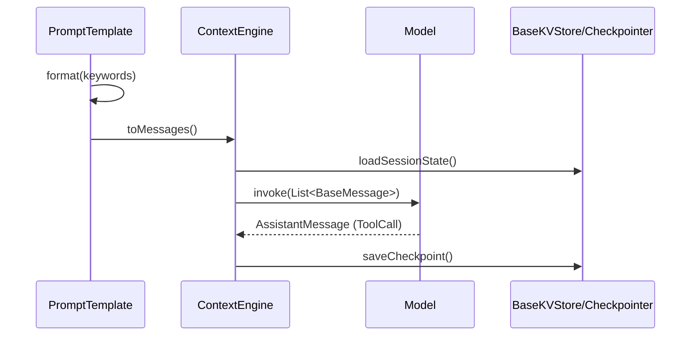

<!-- source: DeepWiki mcp.deepwiki.com · repo openJiuwen-ai/agent-core-java · page 4 Foundation Layer · fetched 2026-11-02 -->

# Foundation Layer

<details>
<summary>Relevant source files</summary>

The following files were used as context for generating this wiki page:

- [pom.xml](pom.xml)
- [src/main/java/com/openjiuwen/core/context/schema/ContextEngineConfig.java](src/main/java/com/openjiuwen/core/context/schema/ContextEngineConfig.java)
- [src/main/java/com/openjiuwen/core/foundation/llm/Model.java](src/main/java/com/openjiuwen/core/foundation/llm/Model.java)
- [src/main/java/com/openjiuwen/core/foundation/llm/schema/ModelClientConfig.java](src/main/java/com/openjiuwen/core/foundation/llm/schema/ModelClientConfig.java)
- [src/main/java/com/openjiuwen/core/foundation/llm/schema/ModelRequestConfig.java](src/main/java/com/openjiuwen/core/foundation/llm/schema/ModelRequestConfig.java)
- [src/main/java/com/openjiuwen/core/foundation/prompt/PromptTemplate.java](src/main/java/com/openjiuwen/core/foundation/prompt/PromptTemplate.java)
- [src/main/java/com/openjiuwen/core/session/checkpointer/CheckpointerFactory.java](src/main/java/com/openjiuwen/core/session/checkpointer/CheckpointerFactory.java)
- [src/main/java/com/openjiuwen/core/session/checkpointer/PersistenceCheckpointerProvider.java](src/main/java/com/openjiuwen/core/session/checkpointer/PersistenceCheckpointerProvider.java)
- [src/main/java/com/openjiuwen/core/singleagent/AbilityManager.java](src/main/java/com/openjiuwen/core/singleagent/AbilityManager.java)
- [src/main/java/com/openjiuwen/core/workflow/components/flow/StartComponent.java](src/main/java/com/openjiuwen/core/workflow/components/flow/StartComponent.java)
- [src/main/java/com/openjiuwen/dev_tools/tune/optimizer/adopt/AdoptOptimizer.java](src/main/java/com/openjiuwen/dev_tools/tune/optimizer/adopt/AdoptOptimizer.java)
- [src/test/java/com/openjiuwen/core/retrieval/indexing/processor/parser/PDFParserTest.java](src/test/java/com/openjiuwen/core/retrieval/indexing/processor/parser/PDFParserTest.java)
- [src/test/java/com/openjiuwen/core/systemtest/ContextEngineSystemTest.java](src/test/java/com/openjiuwen/core/systemtest/ContextEngineSystemTest.java)
- [src/test/java/com/openjiuwen/core/systemtest/SessionSystemTest.java](src/test/java/com/openjiuwen/core/systemtest/SessionSystemTest.java)
- [src/test/java/com/openjiuwen/core/systemtest/SysOpSystemTest.java](src/test/java/com/openjiuwen/core/systemtest/SysOpSystemTest.java)
- [src/test/java/com/openjiuwen/core/systemtest/ToolSystemTest.java](src/test/java/com/openjiuwen/core/systemtest/ToolSystemTest.java)
- [src/test/java/com/openjiuwen/core/systemtest/WorkflowSystemTest.java](src/test/java/com/openjiuwen/core/systemtest/WorkflowSystemTest.java)

</details>


The Foundation Layer provides the essential building blocks for the `agent-core-java` framework. It encapsulates the low-level abstractions required for Large Language Model (LLM) interaction, tool execution, prompt engineering, and persistent storage. By decoupling these core utilities from the higher-level agent logic, the framework ensures extensibility across different model providers and storage backends.

## Architecture Overview

The foundation layer acts as the bridge between the **Natural Language Space** (prompts, messages) and the **Code Entity Space** (clients, tool implementations, database drivers).

### Foundation Subsystems to Code Mapping
The following diagram illustrates how conceptual foundation components map to specific Java classes within the `com.openjiuwen.core.foundation` package.

```mermaid
graph TD
    subgraph "Natural Language Space"
        [PromptTemplate] --> [BaseMessage]
        [BaseMessage] --> [UserMessage]
        [BaseMessage] --> [AssistantMessage]
    end

    subgraph "Code Entity Space"
        [Model] -- "uses" --> [BaseModelClient]
        [BaseModelClient] -- "configures" --> [ModelClientConfig]
        [AbilityManager] -- "executes" --> [Tool]
        [Tool] -- "defined by" --> [ToolCard]
        [StoreFactory] -- "creates" --> [BaseKVStore]
        [StoreFactory] -- "creates" --> [BaseVectorStore]
    end

    [BaseMessage] -. "Input to" .-> [Model]
    [Tool] -. "Invoked by" .-> [AssistantMessage]
```
**Sources:** [src/main/java/com/openjiuwen/core/foundation/llm/Model.java:45-168](), [src/main/java/com/openjiuwen/core/singleagent/AbilityManager.java:39-173](), [src/main/java/com/openjiuwen/core/foundation/prompt/PromptTemplate.java:34-78]()

---

## Subsystems

### LLM Clients and Model Abstraction
The `Model` class serves as the unified entry point for all LLM invocations [src/main/java/com/openjiuwen/core/foundation/llm/Model.java:45-52](). It delegates requests to provider-specific implementations of `BaseModelClient`. The system supports a wide range of providers including OpenAI-compatible APIs, DashScope, and SiliconFlow through `ModelClientConfig` [src/main/java/com/openjiuwen/core/foundation/llm/schema/ModelClientConfig.java:35-73]().

Messages are structured using a schema hierarchy starting from `BaseMessage`, which includes specialized types like `UserMessage`, `SystemMessage`, `AssistantMessage`, and `ToolMessage` [src/main/java/com/openjiuwen/core/foundation/prompt/PromptTemplate.java:129-177]().

For details, see [LLM Clients and Model Abstraction](#4.1).

### Tool System and MCP Integration
The `AbilityManager` acts as a central registry for tools, workflows, and external agents [src/main/java/com/openjiuwen/core/singleagent/AbilityManager.java:39-48](). Tools are defined via `ToolCard` and can be local Java methods or remote services. The framework also supports the **Model Context Protocol (MCP)**, allowing seamless integration with MCP servers through `McpServerConfig` [src/main/java/com/openjiuwen/core/singleagent/AbilityManager.java:85-87]().

For details, see [Tool System and MCP Integration](#4.2).

### Prompt Templates
Prompts are managed using `PromptTemplate`, which supports `{{key}}` placeholder interpolation via the `PromptAssembler` [src/main/java/com/openjiuwen/core/foundation/prompt/PromptTemplate.java:34-53](). This system allows for dynamic prompt generation and conversion into structured `BaseMessage` lists [src/main/java/com/openjiuwen/core/foundation/prompt/PromptTemplate.java:60-78](). The `ContextEngine` further manages these prompts by maintaining conversation history and optimizing context windows [src/main/java/com/openjiuwen/core/context/schema/ContextEngineConfig.java:16-45]().

For details, see [Prompt Templates](#4.3).

### Storage Backends
The framework provides a pluggable storage architecture managed by a `StoreFactory`. It supports multiple backend types:
*   **KV Stores:** Used for session state and checkpointing (e.g., Redis, SQLite) [src/main/java/com/openjiuwen/core/session/checkpointer/PersistenceCheckpointerProvider.java:28-61]().
*   **Vector Stores:** Used for RAG and long-term memory (e.g., Milvus, PGVector) [pom.xml:118-131]().
*   **Checkpointers:** Managed by `CheckpointerFactory` to handle agent state persistence [src/main/java/com/openjiuwen/core/session/checkpointer/CheckpointerFactory.java:18-52]().

For details, see [Storage Backends](#4.4).

---

## Foundation Layer Interactions
The following diagram shows how the foundation entities interact during a typical LLM call lifecycle.


**Sources:** [src/main/java/com/openjiuwen/core/foundation/prompt/PromptTemplate.java:86-112](), [src/main/java/com/openjiuwen/core/session/checkpointer/CheckpointerFactory.java:41-52](), [src/main/java/com/openjiuwen/core/foundation/llm/Model.java:88-99]()

---

