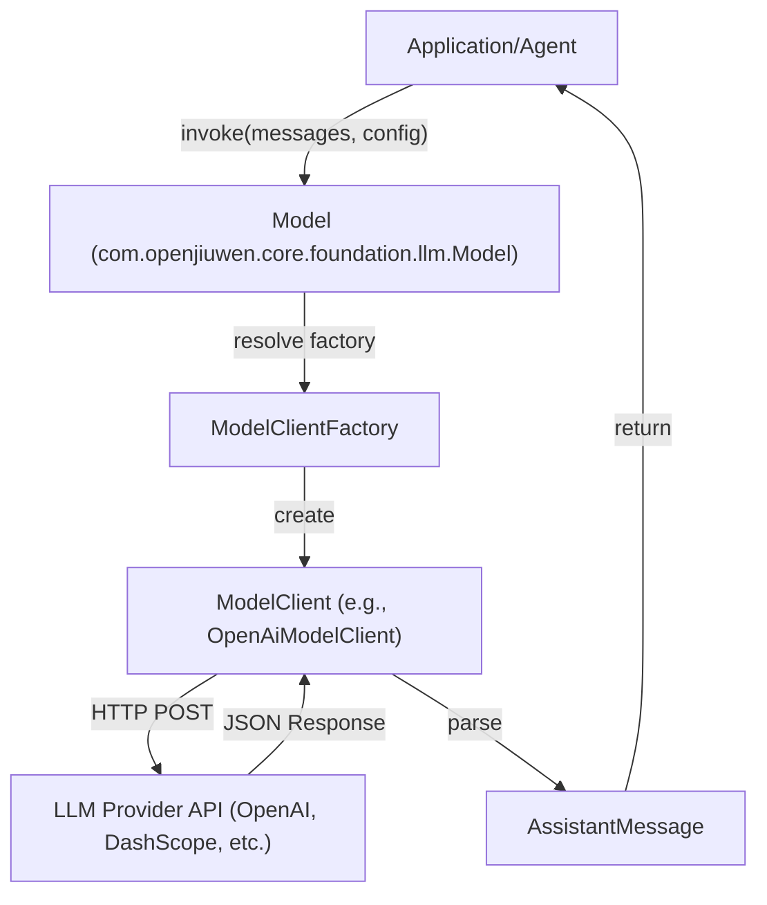
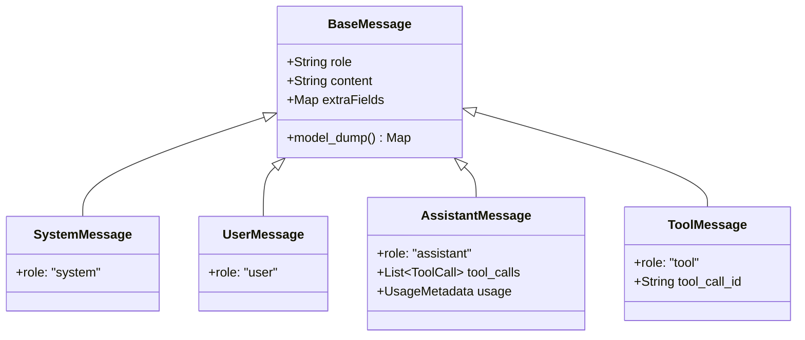

<!-- source: DeepWiki mcp.deepwiki.com · repo openJiuwen-ai/agent-core-java · page 4.1 LLM Clients and Model Abstraction · fetched 2026-11-02 -->

# LLM Clients and Model Abstraction

<details>
<summary>Relevant source files</summary>

The following files were used as context for generating this wiki page:

- [src/main/java/com/openjiuwen/core/common/exception/ErrorHelper.java](src/main/java/com/openjiuwen/core/common/exception/ErrorHelper.java)
- [src/main/java/com/openjiuwen/core/context/schema/ContextEngineConfig.java](src/main/java/com/openjiuwen/core/context/schema/ContextEngineConfig.java)
- [src/main/java/com/openjiuwen/core/foundation/llm/Model.java](src/main/java/com/openjiuwen/core/foundation/llm/Model.java)
- [src/main/java/com/openjiuwen/core/foundation/llm/model_clients/DashScopeModelClientFactory.java](src/main/java/com/openjiuwen/core/foundation/llm/model_clients/DashScopeModelClientFactory.java)
- [src/main/java/com/openjiuwen/core/foundation/llm/model_clients/OpenAiModelClientFactory.java](src/main/java/com/openjiuwen/core/foundation/llm/model_clients/OpenAiModelClientFactory.java)
- [src/main/java/com/openjiuwen/core/foundation/llm/model_clients/OpenRouterModelClientFactory.java](src/main/java/com/openjiuwen/core/foundation/llm/model_clients/OpenRouterModelClientFactory.java)
- [src/main/java/com/openjiuwen/core/foundation/llm/model_clients/SiliconFlowModelClientFactory.java](src/main/java/com/openjiuwen/core/foundation/llm/model_clients/SiliconFlowModelClientFactory.java)
- [src/main/java/com/openjiuwen/core/foundation/llm/output_parsers/BaseOutputParser.java](src/main/java/com/openjiuwen/core/foundation/llm/output_parsers/BaseOutputParser.java)
- [src/main/java/com/openjiuwen/core/foundation/llm/output_parsers/JsonOutputParser.java](src/main/java/com/openjiuwen/core/foundation/llm/output_parsers/JsonOutputParser.java)
- [src/main/java/com/openjiuwen/core/foundation/llm/schema/AssistantMessage.java](src/main/java/com/openjiuwen/core/foundation/llm/schema/AssistantMessage.java)
- [src/main/java/com/openjiuwen/core/foundation/llm/schema/ModelClientConfig.java](src/main/java/com/openjiuwen/core/foundation/llm/schema/ModelClientConfig.java)
- [src/main/java/com/openjiuwen/core/foundation/llm/schema/ModelRequestConfig.java](src/main/java/com/openjiuwen/core/foundation/llm/schema/ModelRequestConfig.java)
- [src/main/java/com/openjiuwen/core/foundation/llm/schema/ProviderType.java](src/main/java/com/openjiuwen/core/foundation/llm/schema/ProviderType.java)
- [src/main/java/com/openjiuwen/core/foundation/llm/schema/SystemMessage.java](src/main/java/com/openjiuwen/core/foundation/llm/schema/SystemMessage.java)
- [src/main/java/com/openjiuwen/core/foundation/llm/schema/ToolMessage.java](src/main/java/com/openjiuwen/core/foundation/llm/schema/ToolMessage.java)
- [src/main/java/com/openjiuwen/core/foundation/llm/schema/UserMessage.java](src/main/java/com/openjiuwen/core/foundation/llm/schema/UserMessage.java)
- [src/main/java/com/openjiuwen/core/session/checkpointer/CheckpointerFactory.java](src/main/java/com/openjiuwen/core/session/checkpointer/CheckpointerFactory.java)
- [src/main/java/com/openjiuwen/core/session/checkpointer/PersistenceCheckpointerProvider.java](src/main/java/com/openjiuwen/core/session/checkpointer/PersistenceCheckpointerProvider.java)
- [src/main/java/com/openjiuwen/core/singleagent/AbilityManager.java](src/main/java/com/openjiuwen/core/singleagent/AbilityManager.java)
- [src/main/java/com/openjiuwen/core/workflow/components/flow/StartComponent.java](src/main/java/com/openjiuwen/core/workflow/components/flow/StartComponent.java)
- [src/test/java/com/openjiuwen/core/foundation/llm/LlmConnectionExample.java](src/test/java/com/openjiuwen/core/foundation/llm/LlmConnectionExample.java)
- [src/test/java/com/openjiuwen/core/foundation/llm/output_parsers/JsonOutputParserTest.java](src/test/java/com/openjiuwen/core/foundation/llm/output_parsers/JsonOutputParserTest.java)
- [src/test/java/com/openjiuwen/core/systemtest/ContextEngineSystemTest.java](src/test/java/com/openjiuwen/core/systemtest/ContextEngineSystemTest.java)
- [src/test/java/com/openjiuwen/core/systemtest/SessionSystemTest.java](src/test/java/com/openjiuwen/core/systemtest/SessionSystemTest.java)
- [src/test/java/com/openjiuwen/core/systemtest/SysOpSystemTest.java](src/test/java/com/openjiuwen/core/systemtest/SysOpSystemTest.java)
- [src/test/java/com/openjiuwen/core/systemtest/ToolSystemTest.java](src/test/java/com/openjiuwen/core/systemtest/ToolSystemTest.java)
- [src/test/java/com/openjiuwen/core/systemtest/WorkflowSystemTest.java](src/test/java/com/openjiuwen/core/systemtest/WorkflowSystemTest.java)

</details>


The `agent-core-java` framework provides a unified abstraction layer for interacting with Large Language Models (LLMs). This layer decouples the agent logic from specific provider implementations, allowing developers to switch between providers like OpenAI, DashScope, and SiliconFlow through configuration changes rather than code modifications.

### Architecture Overview

The LLM abstraction is built around the `Model` class, which serves as the entry point for all LLM operations. It delegates actual network communication to provider-specific implementations of the `ModelClient` interface.

**Model Abstraction Data Flow**

Sources: [src/main/java/com/openjiuwen/core/foundation/llm/Model.java:45-125](), [src/main/java/com/openjiuwen/core/foundation/llm/Model.java:166-175]()

---

### Core Components

#### 1. The Model Facade
The `Model` class is the primary interface for agents. It handles client lifecycle, callback decoration, and unified invocation for text generation, image generation, and streaming [src/main/java/com/openjiuwen/core/foundation/llm/Model.java:45-46]().

Key methods:
* `invoke()`: Synchronous call to generate a response [src/main/java/com/openjiuwen/core/foundation/llm/Model.java:231-240]().
* `stream()`: Returns an `Iterator<AssistantMessageChunk>` for real-time output [src/main/java/com/openjiuwen/core/foundation/llm/Model.java:310-315]().
* `generateImage()` / `generateSpeech()`: Support for multi-modal capabilities [src/main/java/com/openjiuwen/core/foundation/llm/Model.java:105-118]().

#### 2. Model Configuration
Configuration is split into two distinct classes:
* **`ModelClientConfig`**: Defines connection settings like `api_key`, `api_base`, `timeout`, and `max_retries` [src/main/java/com/openjiuwen/core/foundation/llm/schema/ModelClientConfig.java:35-73]().
* **`ModelRequestConfig`**: Defines generation parameters like `model_name`, `temperature`, `top_p`, and `max_tokens` [src/main/java/com/openjiuwen/core/foundation/llm/schema/ModelRequestConfig.java:30-53]().

#### 3. Supported Providers
The framework supports several providers out-of-the-box via the `ProviderType` enum and specialized factories:
* **OpenAI**: Standard compatible client [src/main/java/com/openjiuwen/core/foundation/llm/model_clients/OpenAiModelClientFactory.java:1-10]().
* **DashScope**: Alibaba Cloud Qwen models.
* **SiliconFlow**: High-performance inference platform.
* **OpenRouter**: Unified API for multiple open-source models.
* **InferenceAffinity**: Specialized inference service.

Sources: [src/main/java/com/openjiuwen/core/foundation/llm/schema/ModelClientConfig.java:188-217](), [src/test/java/com/openjiuwen/core/foundation/llm/LlmConnectionExample.java:91-102]()

---

### Message Schemas

The framework uses a structured message system to maintain conversation history and tool interactions. All messages inherit from `BaseMessage` [src/main/java/com/openjiuwen/core/foundation/llm/schema/BaseMessage.java:1-20]().

| Class | Role | Purpose |
| :--- | :--- | :--- |
| `SystemMessage` | `system` | High-level instructions for the model [src/main/java/com/openjiuwen/core/foundation/llm/schema/SystemMessage.java:20-35](). |
| `UserMessage` | `user` | Input from the end-user [src/main/java/com/openjiuwen/core/foundation/llm/schema/UserMessage.java:20-35](). |
| `AssistantMessage` | `assistant` | Model-generated response, may contain `ToolCall` objects [src/main/java/com/openjiuwen/core/foundation/llm/schema/AssistantMessage.java:1-20](). |
| `ToolMessage` | `tool` | Result of a tool execution, linked via `tool_call_id` [src/main/java/com/openjiuwen/core/foundation/llm/schema/ToolMessage.java:27-35](). |

**Message Hierarchy and Serialization**

Sources: [src/main/java/com/openjiuwen/core/foundation/llm/schema/UserMessage.java:20-36](), [src/main/java/com/openjiuwen/core/foundation/llm/schema/ToolMessage.java:27-62](), [src/main/java/com/openjiuwen/core/foundation/llm/schema/SystemMessage.java:20-36]()

---

### Output Parsers and Metadata

#### Output Parsers
To convert raw string responses into structured Java objects, the framework uses `BaseOutputParser`.
* **`JsonOutputParser`**: Extracts and parses JSON blocks from the LLM's text output, useful for structured reasoning or tool parameters [src/main/java/com/openjiuwen/core/foundation/llm/output_parsers/JsonOutputParser.java:1-20]().

#### Usage Metadata
Every `AssistantMessage` contains a `UsageMetadata` object, providing visibility into token consumption:
* `inputTokens`: Tokens in the prompt.
* `outputTokens`: Tokens in the completion.
* `totalTokens`: Sum of input and output.

Sources: [src/test/java/com/openjiuwen/core/foundation/llm/LlmConnectionExample.java:133-138](), [src/main/java/com/openjiuwen/core/foundation/llm/schema/UsageMetadata.java:1-20]()

---

### Implementation Example: Simple Invocation

The following logic demonstrates how to configure and call a model using the `Model` facade.

```java
// 1. Setup Configuration
ModelClientConfig clientConfig = ModelClientConfig.builder()
        .clientProvider("OpenAI")
        .apiKey("sk-...")
        .apiBase("https://api.openai.com/v1")
        .build();

ModelRequestConfig requestConfig = ModelRequestConfig.builder()
        .modelName("gpt-4o")
        .temperature(0.7)
        .build();

// 2. Initialize Model
Model model = new Model(clientConfig, requestConfig);

// 3. Prepare Messages
List<BaseMessage> messages = List.of(
        new SystemMessage("You are a helpful assistant."),
        new UserMessage("What is the capital of France?")
);

// 4. Execute
AssistantMessage response = model.invoke(messages);
System.out.println(response.getContentAsString());
```
Sources: [src/test/java/com/openjiuwen/core/foundation/llm/LlmConnectionExample.java:91-132](), [src/main/java/com/openjiuwen/core/foundation/llm/Model.java:166-180]()

---

