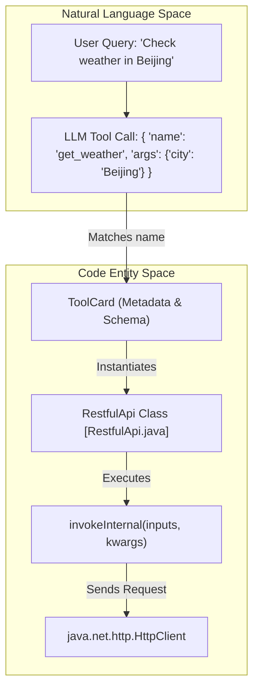
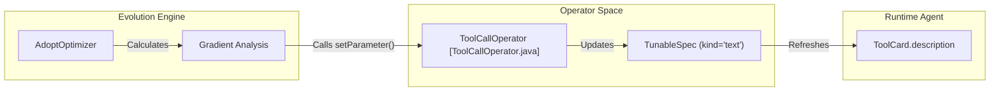

<!-- source: DeepWiki mcp.deepwiki.com · repo openJiuwen-ai/agent-core-java · page 4.2 Tool System and MCP Integration · fetched 2026-11-02 -->

# Tool System and MCP Integration

Relevant source files

The following files were used as context for generating this wiki page:

- [src/main/java/com/openjiuwen/core/foundation/llm/model_clients/BaseModelClient.java](src/main/java/com/openjiuwen/core/foundation/llm/model_clients/BaseModelClient.java)
- [src/main/java/com/openjiuwen/core/foundation/llm/schema/BaseModelInfo.java](src/main/java/com/openjiuwen/core/foundation/llm/schema/BaseModelInfo.java)
- [src/main/java/com/openjiuwen/core/foundation/tool/service_api/RestfulApi.java](src/main/java/com/openjiuwen/core/foundation/tool/service_api/RestfulApi.java)
- [src/main/java/com/openjiuwen/core/operator/Operator.java](src/main/java/com/openjiuwen/core/operator/Operator.java)
- [src/main/java/com/openjiuwen/core/operator/OperatorStream.java](src/main/java/com/openjiuwen/core/operator/OperatorStream.java)
- [src/main/java/com/openjiuwen/core/operator/TunableSpec.java](src/main/java/com/openjiuwen/core/operator/TunableSpec.java)
- [src/main/java/com/openjiuwen/core/operator/legacy/llm_call/LLMCall.java](src/main/java/com/openjiuwen/core/operator/legacy/llm_call/LLMCall.java)
- [src/main/java/com/openjiuwen/core/operator/legacy/llm_call/LegacyOptimizerCallback.java](src/main/java/com/openjiuwen/core/operator/legacy/llm_call/LegacyOptimizerCallback.java)
- [src/main/java/com/openjiuwen/core/operator/llm_call/LLMCall.java](src/main/java/com/openjiuwen/core/operator/llm_call/LLMCall.java)
- [src/main/java/com/openjiuwen/core/operator/llm_call/LLMCallOperator.java](src/main/java/com/openjiuwen/core/operator/llm_call/LLMCallOperator.java)
- [src/main/java/com/openjiuwen/core/operator/memory_call/MemoryCallOperator.java](src/main/java/com/openjiuwen/core/operator/memory_call/MemoryCallOperator.java)
- [src/main/java/com/openjiuwen/core/operator/tool_call/ToolCallOperator.java](src/main/java/com/openjiuwen/core/operator/tool_call/ToolCallOperator.java)
- [src/main/java/com/openjiuwen/core/operator/tool_call/ToolExecutor.java](src/main/java/com/openjiuwen/core/operator/tool_call/ToolExecutor.java)
- [src/main/java/com/openjiuwen/core/operator/tool_call/ToolRegistry.java](src/main/java/com/openjiuwen/core/operator/tool_call/ToolRegistry.java)
- [src/main/java/com/openjiuwen/core/session/checkpointer/InMemoryCheckpointer.java](src/main/java/com/openjiuwen/core/session/checkpointer/InMemoryCheckpointer.java)
- [src/main/java/com/openjiuwen/core/session/interaction/BaseInteraction.java](src/main/java/com/openjiuwen/core/session/interaction/BaseInteraction.java)
- [src/main/java/com/openjiuwen/core/session/interaction/WorkflowInteraction.java](src/main/java/com/openjiuwen/core/session/interaction/WorkflowInteraction.java)
- [src/test/java/com/openjiuwen/core/foundation/llm/ModelClientConfigTest.java](src/test/java/com/openjiuwen/core/foundation/llm/ModelClientConfigTest.java)

The Tool System provides a unified abstraction for extending Agent capabilities through external functions, RESTful APIs, and the Model Context Protocol (MCP). It bridges the gap between the LLM's reasoning and real-world execution by providing structured interfaces, schema validation, and self-evolution capabilities.

## Tool Abstraction and Configuration

All tools in the framework extend the base `Tool` class and are defined using a `ToolCard`. The `ToolCard` contains the metadata (name, description, input schema) required by LLMs to understand how to invoke the tool.

### Key Classes
- **`Tool`**: The abstract base class for all tool implementations. It handles common logic such as input validation against schemas and callback triggering `[src/main/java/com/openjiuwen/core/foundation/tool/service_api/RestfulApi.java:54-70]()`.
- **`ToolCard`**: A configuration object defining the tool's identity and its interface.
- **`RestfulApi`**: A specialized tool for executing HTTP requests based on a `RestfulApiCard` `[src/main/java/com/openjiuwen/core/foundation/tool/service_api/RestfulApi.java:54-83]()`.

### Data Flow: Natural Language to Tool Execution
The following diagram illustrates how a natural language request is transformed into a concrete code execution via the Tool system.

**Tool Execution Bridge**

*Sources: [src/main/java/com/openjiuwen/core/foundation/tool/service_api/RestfulApi.java:146-165]()*

## RESTful API Integration

The `RestfulApi` class allows agents to interact with external services via standard HTTP methods (GET, POST, etc.). It supports complex parameter mapping where inputs from the LLM are mapped to URL paths, query strings, headers, or request bodies `[src/main/java/com/openjiuwen/core/foundation/tool/service_api/RestfulApi.java:77-82]()`.

### Features
- **Schema Validation**: Uses `SchemaUtils.formatWithSchema` to ensure LLM-generated inputs match the expected API types `[src/main/java/com/openjiuwen/core/foundation/tool/service_api/RestfulApi.java:154-159]()`.
- **Parameter Mapping**: The `ApiParamMapper` organizes inputs into `path`, `query`, `header`, `body`, or `form` locations `[src/main/java/com/openjiuwen/core/foundation/tool/service_api/RestfulApi.java:109-143]()`.
- **Connection Pooling**: Utilizes `ConnectorPoolManager` for efficient HTTP client management `[src/main/java/com/openjiuwen/core/foundation/tool/service_api/RestfulApi.java:9-10]()`.

## Model Context Protocol (MCP) Integration

The framework supports the Model Context Protocol (MCP), allowing agents to connect to MCP servers to discover and execute tools dynamically. This allows for a standardized way to integrate local resources (like filesystems or databases) and remote services.

### MCP Components
- **`McpClient`**: Manages the connection to an MCP server, handles lifecycle events, and performs tool discovery.
- **`McpServerConfig`**: Defines connection parameters (e.g., transport type, server URL, credentials).
- **`McpTool`**: A specialized `Tool` implementation that wraps an MCP tool definition, delegating execution to the MCP server.

## Self-Evolution and Operators

The tool system is integrated with the agent self-evolution subsystem through the `Operator` pattern. This allows the agent to "tune" its own tool usage over time.

### ToolCallOperator
The `ToolCallOperator` manages the tunable parameters of a tool, specifically the descriptions provided to the LLM `[src/main/java/com/openjiuwen/core/operator/tool_call/ToolCallOperator.java:18-20]()`. By adjusting these descriptions, the framework can optimize how the LLM perceives and selects tools during the reasoning phase.

**Operator Tuning Flow**

*Sources: [src/main/java/com/openjiuwen/core/operator/tool_call/ToolCallOperator.java:48-61](), [src/main/java/com/openjiuwen/core/operator/TunableSpec.java:18-23]()*

### Related Operators
- **`LLMCallOperator`**: Manages system and user prompt templates, allowing for prompt optimization `[src/main/java/com/openjiuwen/core/operator/llm_call/LLMCallOperator.java:22-49]()`.
- **`MemoryCallOperator`**: Manages retries and enablement of memory retrieval during tool execution `[src/main/java/com/openjiuwen/core/operator/memory_call/MemoryCallOperator.java:18-24]()`.

## Interaction and Wait States

Tools often require human-in-the-loop confirmation or additional inputs. The `WorkflowInteraction` class facilitates this by interrupting the execution graph and persisting state until the user provides the required data `[src/main/java/com/openjiuwen/core/session/interaction/WorkflowInteraction.java:31-46]()`.

- **`waitUserInputs`**: Suspends execution and writes an `OutputSchema` with a `Constant.INTERACTION` type `[src/main/java/com/openjiuwen/core/session/interaction/WorkflowInteraction.java:49-63]()`.
- **`InMemoryCheckpointer`**: Ensures that tool states and interaction history are saved across these interruptions `[src/main/java/com/openjiuwen/core/session/checkpointer/InMemoryCheckpointer.java:66-80]()`.

Sources:
- `src/main/java/com/openjiuwen/core/foundation/tool/service_api/RestfulApi.java`
- `src/main/java/com/openjiuwen/core/operator/tool_call/ToolCallOperator.java`
- `src/main/java/com/openjiuwen/core/operator/llm_call/LLMCallOperator.java`
- `src/main/java/com/openjiuwen/core/operator/memory_call/MemoryCallOperator.java`
- `src/main/java/com/openjiuwen/core/session/interaction/WorkflowInteraction.java`
- `src/main/java/com/openjiuwen/core/session/checkpointer/InMemoryCheckpointer.java`
- `src/main/java/com/openjiuwen/core/operator/TunableSpec.java`

---

