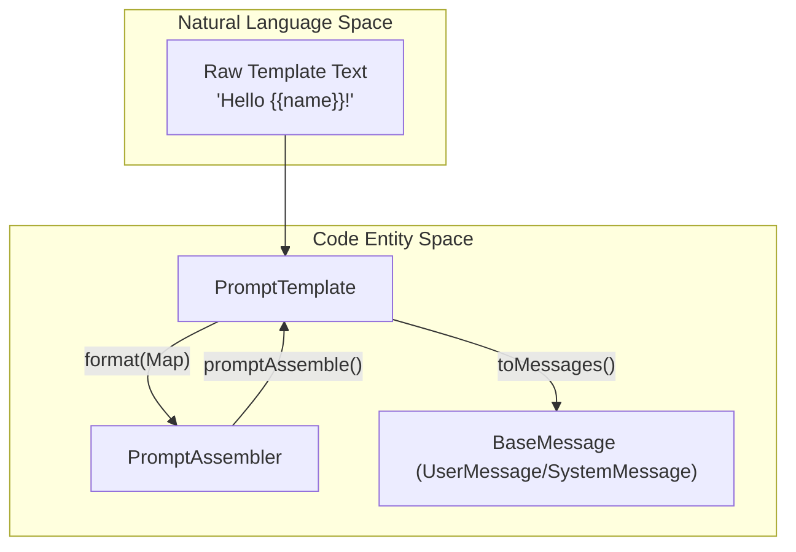
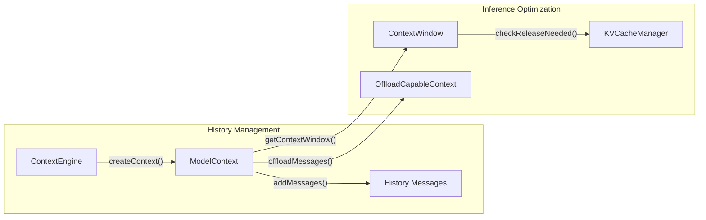

<!-- source: DeepWiki mcp.deepwiki.com · repo openJiuwen-ai/agent-core-java · page 4.3 Prompt Templates · fetched 2026-11-02 -->

# Prompt Templates

Relevant source files

The following files were used as context for generating this wiki page:

- [pom.xml](pom.xml)
- [src/main/java/com/openjiuwen/core/context/ContextEngine.java](src/main/java/com/openjiuwen/core/context/ContextEngine.java)
- [src/main/java/com/openjiuwen/core/context/ContextStats.java](src/main/java/com/openjiuwen/core/context/ContextStats.java)
- [src/main/java/com/openjiuwen/core/context/ContextWindow.java](src/main/java/com/openjiuwen/core/context/ContextWindow.java)
- [src/main/java/com/openjiuwen/core/context/ModelContext.java](src/main/java/com/openjiuwen/core/context/ModelContext.java)
- [src/main/java/com/openjiuwen/core/context/OffloadCapableContext.java](src/main/java/com/openjiuwen/core/context/OffloadCapableContext.java)
- [src/main/java/com/openjiuwen/core/context/StatefulContext.java](src/main/java/com/openjiuwen/core/context/StatefulContext.java)
- [src/main/java/com/openjiuwen/core/context/context/ContextMessageBuffer.java](src/main/java/com/openjiuwen/core/context/context/ContextMessageBuffer.java)
- [src/main/java/com/openjiuwen/core/context/context/ContextUtils.java](src/main/java/com/openjiuwen/core/context/context/ContextUtils.java)
- [src/main/java/com/openjiuwen/core/context/context/KVCacheManager.java](src/main/java/com/openjiuwen/core/context/context/KVCacheManager.java)
- [src/main/java/com/openjiuwen/core/context/context/OffloadMessageBuffer.java](src/main/java/com/openjiuwen/core/context/context/OffloadMessageBuffer.java)
- [src/main/java/com/openjiuwen/core/context/context/SessionModelContext.java](src/main/java/com/openjiuwen/core/context/context/SessionModelContext.java)
- [src/main/java/com/openjiuwen/core/foundation/prompt/PromptTemplate.java](src/main/java/com/openjiuwen/core/foundation/prompt/PromptTemplate.java)
- [src/main/java/com/openjiuwen/dev_tools/tune/optimizer/adopt/AdoptOptimizer.java](src/main/java/com/openjiuwen/dev_tools/tune/optimizer/adopt/AdoptOptimizer.java)
- [src/test/java/com/openjiuwen/core/retrieval/indexing/processor/parser/PDFParserTest.java](src/test/java/com/openjiuwen/core/retrieval/indexing/processor/parser/PDFParserTest.java)
- [src/test/resources/memory/prompt/ut_plain_template.md](src/test/resources/memory/prompt/ut_plain_template.md)
- [src/test/resources/memory/prompt/ut_prompt_template.md](src/test/resources/memory/prompt/ut_prompt_template.md)

Prompt templates provide a structured mechanism for defining, interpolating, and managing the natural language instructions sent to Large Language Models (LLMs). The framework supports dynamic placeholder replacement, localization, and a sophisticated context management system to handle ongoing conversations within token constraints.

## PromptTemplate and Interpolation

The `PromptTemplate` class represents interpolatable text with configurable placeholders. By default, it uses double curly braces `{{key}}` as delimiters for variables [src/main/java/com/openjiuwen/core/foundation/prompt/PromptTemplate.java:34-46]().

### Key Architecture
The template system bridges raw string content and structured message objects required by LLM clients.

| Component | Role |
| :--- | :--- |
| `PromptTemplate` | Data container for the template string or list of messages [src/main/java/com/openjiuwen/core/foundation/prompt/PromptTemplate.java:32-41](). |
| `PromptAssembler` | Logic engine that performs the actual `{{key}}` interpolation using a provided Map [src/main/java/com/openjiuwen/core/foundation/prompt/PromptTemplate.java:97-105](). |
| `toMessages()` | Converts template content into a `List<BaseMessage>` (e.g., `UserMessage`, `SystemMessage`) [src/main/java/com/openjiuwen/core/foundation/prompt/PromptTemplate.java:60-78](). |

### Data Flow: Template to LLM Messages

The diagram below shows how `PromptTemplate` processes raw text into structured API requests.

**Title: Prompt Interpolation and Conversion Flow**

**Sources:** [src/main/java/com/openjiuwen/core/foundation/prompt/PromptTemplate.java:60-112]()

## Context Management

The `ContextEngine` manages the conversation history, state persistence, and token windowing logic. It ensures that the context sent to the LLM remains within model limits while preserving essential information.

### Core Components
*   **ContextEngine**: A facade for creating and retrieving `ModelContext` instances associated with specific sessions [src/main/java/com/openjiuwen/core/context/ContextEngine.java:25-30]().
*   **ModelContext**: A container for the message history of a specific conversation [src/main/java/com/openjiuwen/core/context/ModelContext.java:20-44]().
*   **ContextWindow**: A snapshot of the context (messages + tool definitions) optimized for a single LLM inference call [src/main/java/com/openjiuwen/core/context/ModelContext.java:116-120]().
*   **KVCacheManager**: Optimized for `InferenceAffinityModel` instances; it detects changes in the context window to signal the inference server to release stale Key-Value caches [src/main/java/com/openjiuwen/core/context/context/KVCacheManager.java:28-54]().

### Context Lifecycle and Optimization

**Title: Context Optimization and Inference Preparation**

**Sources:** [src/main/java/com/openjiuwen/core/context/ContextEngine.java:52-71](), [src/main/java/com/openjiuwen/core/context/ModelContext.java:90-120](), [src/main/java/com/openjiuwen/core/context/context/KVCacheManager.java:96-134](), [src/main/java/com/openjiuwen/core/context/OffloadCapableContext.java:20-29]()

## Implementation Details

### Message Conversion Rules
`PromptTemplate.toMessages()` follows specific wrapping rules [src/main/java/com/openjiuwen/core/foundation/prompt/PromptTemplate.java:60-78]():
1.  If content is a `String`, it is wrapped in a `UserMessage`.
2.  If content is a `List`, every item must be a `BaseMessage` subtype.
3.  Empty content returns an empty list.

### Context Persistence
The framework supports `StatefulContext`, allowing context data to be saved to or loaded from external stores (e.g., Redis, Database) via the `saveState()` and `loadState(Map<String, Object>)` methods [src/main/java/com/openjiuwen/core/context/StatefulContext.java:18-34]().

### Context Statistics
The `ContextStats` object provides a breakdown of token usage and message counts, categorized by role (System, User, Assistant, Tool) [src/main/java/com/openjiuwen/core/context/ContextStats.java:19-64]().

**Sources:** [src/main/java/com/openjiuwen/core/foundation/prompt/PromptTemplate.java:60-78](), [src/main/java/com/openjiuwen/core/context/StatefulContext.java:18-34](), [src/main/java/com/openjiuwen/core/context/ContextStats.java:19-64]()

---

