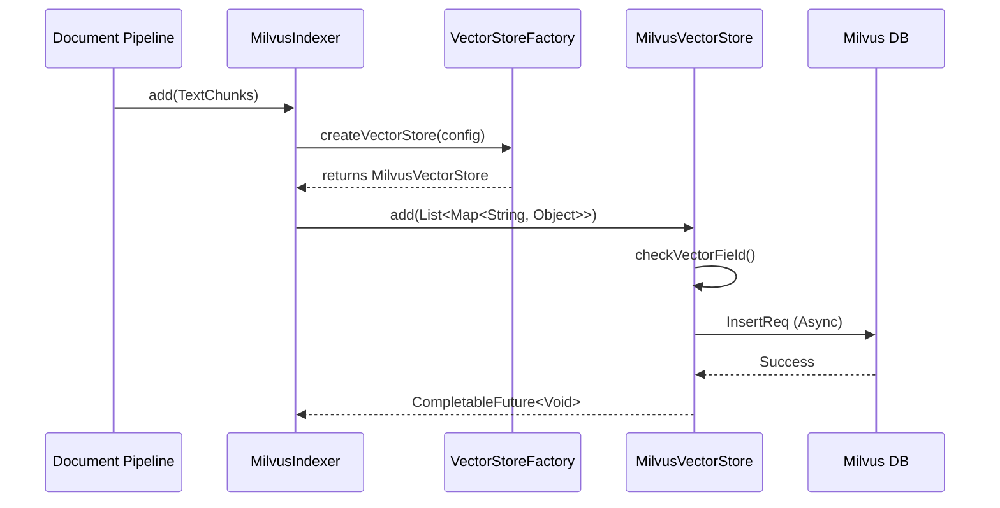

<!-- source: DeepWiki mcp.deepwiki.com · repo openJiuwen-ai/agent-core-java · page 4.4 Storage Backends · fetched 2026-11-02 -->

# Storage Backends

<details>
<summary>Relevant source files</summary>

The following files were used as context for generating this wiki page:

- [src/main/java/com/openjiuwen/core/foundation/store/vector/AbstractRetrievalVectorStoreAdapter.java](src/main/java/com/openjiuwen/core/foundation/store/vector/AbstractRetrievalVectorStoreAdapter.java)
- [src/main/java/com/openjiuwen/core/foundation/store/vector/PGVectorStore.java](src/main/java/com/openjiuwen/core/foundation/store/vector/PGVectorStore.java)
- [src/main/java/com/openjiuwen/core/foundation/store/vector_fields/PGVectorField.java](src/main/java/com/openjiuwen/core/foundation/store/vector_fields/PGVectorField.java)
- [src/main/java/com/openjiuwen/core/memory/manage/mem_model/SemanticStore.java](src/main/java/com/openjiuwen/core/memory/manage/mem_model/SemanticStore.java)
- [src/main/java/com/openjiuwen/core/retrieval/indexing/indexer/IndexerFactory.java](src/main/java/com/openjiuwen/core/retrieval/indexing/indexer/IndexerFactory.java)
- [src/main/java/com/openjiuwen/core/retrieval/indexing/indexer/MilvusIndexer.java](src/main/java/com/openjiuwen/core/retrieval/indexing/indexer/MilvusIndexer.java)
- [src/main/java/com/openjiuwen/core/retrieval/vector_store/InMemoryVectorStore.java](src/main/java/com/openjiuwen/core/retrieval/vector_store/InMemoryVectorStore.java)
- [src/main/java/com/openjiuwen/core/retrieval/vector_store/MilvusVectorStore.java](src/main/java/com/openjiuwen/core/retrieval/vector_store/MilvusVectorStore.java)
- [src/main/java/com/openjiuwen/core/retrieval/vector_store/PGVectorStore.java](src/main/java/com/openjiuwen/core/retrieval/vector_store/PGVectorStore.java)
- [src/main/java/com/openjiuwen/core/retrieval/vector_store/SchemaMutableVectorStore.java](src/main/java/com/openjiuwen/core/retrieval/vector_store/SchemaMutableVectorStore.java)
- [src/main/java/com/openjiuwen/core/retrieval/vector_store/VectorStore.java](src/main/java/com/openjiuwen/core/retrieval/vector_store/VectorStore.java)
- [src/main/java/com/openjiuwen/core/retrieval/vector_store/VectorStoreFactory.java](src/main/java/com/openjiuwen/core/retrieval/vector_store/VectorStoreFactory.java)
- [src/test/java/com/openjiuwen/core/retrieval/vector_store/PGVectorStoreTest.java](src/test/java/com/openjiuwen/core/retrieval/vector_store/PGVectorStoreTest.java)
- [src/test/java/com/openjiuwen/core/retrieval/vector_store/VectorStoreFactoryTest.java](src/test/java/com/openjiuwen/core/retrieval/vector_store/VectorStoreFactoryTest.java)

</details>


The storage layer in `agent-core-java` provides a unified abstraction for various data persistence needs, ranging from high-dimensional vector embeddings used in RAG (Retrieval-Augmented Generation) to structured key-value stores for session and memory management. The architecture is designed to be provider-agnostic, allowing agents to switch between local in-memory stores and distributed databases like Milvus, Redis, or PostgreSQL with minimal configuration changes.

## Vector Store Abstraction

The core of the retrieval system is the `VectorStore` interface [src/main/java/com/openjiuwen/core/retrieval/vector_store/VectorStore.java:25-25](). It defines a contract for adding, searching, and deleting high-dimensional data.

### Key Operations
*   **`add`**: Batched insertion of document maps containing text, vectors, and metadata [src/main/java/com/openjiuwen/core/retrieval/vector_store/VectorStore.java:60-68]().
*   **`search`**: Dense vector similarity search [src/main/java/com/openjiuwen/core/retrieval/vector_store/VectorStore.java:70-73]().
*   **`sparseSearch`**: Keyword-based search using sparse vectors [src/main/java/com/openjiuwen/core/retrieval/vector_store/VectorStore.java:75-78]().
*   **`hybridSearch`**: Combines dense and sparse results using fusion algorithms (e.g., RRF) [src/main/java/com/openjiuwen/core/retrieval/vector_store/VectorStore.java:80-85]().

### Implementation Mapping: Code to Logic
The following diagram illustrates how the `VectorStore` interface bridges high-level retrieval requests to specific backend implementations.

**Vector Store Entity Mapping**
```mermaid
graph TD
    subgraph "Natural Language Space"
        Q["'Find documents about Java agents'"]
    end

    subgraph "Code Entity Space (com.openjiuwen.core.retrieval.vector_store)"
        VS["<<interface>> VectorStore"]
        MVS["MilvusVectorStore"]
        PGVS["PGVectorStore"]
        IMVS["InMemoryVectorStore"]
        VSF["VectorStoreFactory"]
    end

    Q -->|queryVector| VS
    VSF -->|createVectorStore| VS
    VS <|-- MVS
    VS <|-- PGVS
    VS <|-- IMVS
    
    MVS -->|uses| MC["MilvusClientV2"]
    PGVS -->|uses| DS["javax.sql.DataSource"]
```
**Sources:** [src/main/java/com/openjiuwen/core/retrieval/vector_store/VectorStore.java:25-158](), [src/main/java/com/openjiuwen/core/retrieval/vector_store/VectorStoreFactory.java:24-60]().

---

## Supported Backends

### 1. Milvus Store
`MilvusVectorStore` provides a high-performance implementation using the Milvus Java SDK. It supports complex features like `HybridSearchReq` [src/main/java/com/openjiuwen/core/retrieval/vector_store/MilvusVectorStore.java:38](), Reciprocal Rank Fusion (RRF) [src/main/java/com/openjiuwen/core/retrieval/vector_store/MilvusVectorStore.java:43](), and dynamic field mapping for metadata [src/main/java/com/openjiuwen/core/retrieval/vector_store/MilvusVectorStore.java:85]().

*   **Configuration**: Uses `VectorStoreConfig` with `StoreType.MILVUS` [src/main/java/com/openjiuwen/core/retrieval/vector_store/VectorStoreFactory.java:37-38]().
*   **Concurrency**: Utilizes a virtual thread executor `milvus-retrieval-vector-store-io` for non-blocking I/O [src/main/java/com/openjiuwen/core/retrieval/vector_store/MilvusVectorStore.java:70]().

### 2. PGVector Store
`PGVectorStore` leverages PostgreSQL with the `pgvector` extension. It handles table bootstrapping (e.g., `CREATE EXTENSION IF NOT EXISTS vector`) and supports both HNSW and IVFFlat index types [src/main/java/com/openjiuwen/core/foundation/store/vector_fields/PGVectorField.java:35-39]().

*   **Distance Metrics**: Supports `cosine`, `l2`, and `inner_product`, which are mapped to SQL operators like `<=>`, `<->`, and `<#>` [src/main/java/com/openjiuwen/core/retrieval/vector_store/PGVectorStore.java:123]().
*   **Metadata**: Stores metadata as `JSONB` for flexible filtering [src/main/java/com/openjiuwen/core/retrieval/vector_store/PGVectorStore.java:120]().

### 3. In-Memory Store
`InMemoryVectorStore` is a lightweight, zero-dependency implementation used for unit testing or ephemeral sessions. It simulates vector search using cosine similarity calculations in Java and provides a BM25-based sparse search [src/main/java/com/openjiuwen/core/retrieval/vector_store/InMemoryVectorStore.java:43-45]().

**Sources:** [src/main/java/com/openjiuwen/core/retrieval/vector_store/MilvusVectorStore.java:65-94](), [src/main/java/com/openjiuwen/core/retrieval/vector_store/PGVectorStore.java:42-127](), [src/main/java/com/openjiuwen/core/retrieval/vector_store/InMemoryVectorStore.java:41-78]().

---

## The StoreFactory and Adapter Pattern

The `VectorStoreFactory` acts as the central entry point for creating store instances based on `VectorStoreConfig` [src/main/java/com/openjiuwen/core/retrieval/vector_store/VectorStoreFactory.java:29-60]().

To ensure compatibility between the retrieval-focused `VectorStore` and the foundation-layer `BaseVectorStore`, the framework uses the `AbstractRetrievalVectorStoreAdapter` [src/main/java/com/openjiuwen/core/foundation/store/vector/AbstractRetrievalVectorStoreAdapter.java:29](). This adapter translates foundation-level calls into retrieval-specific operations.

**Data Flow: Document Indexing to Storage**

**Sources:** [src/main/java/com/openjiuwen/core/retrieval/indexing/indexer/MilvusIndexer.java:59-81](), [src/main/java/com/openjiuwen/core/foundation/store/vector/AbstractRetrievalVectorStoreAdapter.java:75-83]().

---

## Memory and Semantic Storage

Agents use these backends primarily through the `SemanticStore` [src/main/java/com/openjiuwen/core/memory/manage/mem_model/SemanticStore.java:34](). This class bridges the gap between raw text memory and vector representations.

*   **Memory Ingestion**: When `addDocs` is called, the `SemanticStore` first uses an `Embedding` model to generate vectors [src/main/java/com/openjiuwen/core/memory/manage/mem_model/SemanticStore.java:85](), then persists them via the configured `BaseVectorStore` [src/main/java/com/openjiuwen/core/memory/manage/mem_model/SemanticStore.java:108]().
*   **Semantic Retrieval**: The `search` method embeds the user query and performs a similarity search against the memory collection, returning a ranked list of memory IDs and scores [src/main/java/com/openjiuwen/core/memory/manage/mem_model/SemanticStore.java:149-171]().

| Feature | Milvus | PGVector | InMemory |
| :--- | :--- | :--- | :--- |
| **Primary Use** | Production RAG | Relational Data + Vectors | Testing / Fallback |
| **Index Types** | HNSW, IVF, SCANN | HNSW, IVFFlat | N/A (Linear Scan) |
| **Hybrid Search** | Supported (Native) | Supported (SQL Fusion) | Supported (BM25 + Cosine) |
| **Persistence** | Remote Server | SQL Database | None (RAM) |

**Sources:** [src/main/java/com/openjiuwen/core/memory/manage/mem_model/SemanticStore.java:55-120](), [src/main/java/com/openjiuwen/core/retrieval/vector_store/VectorStoreFactory.java:33-60]().

---

