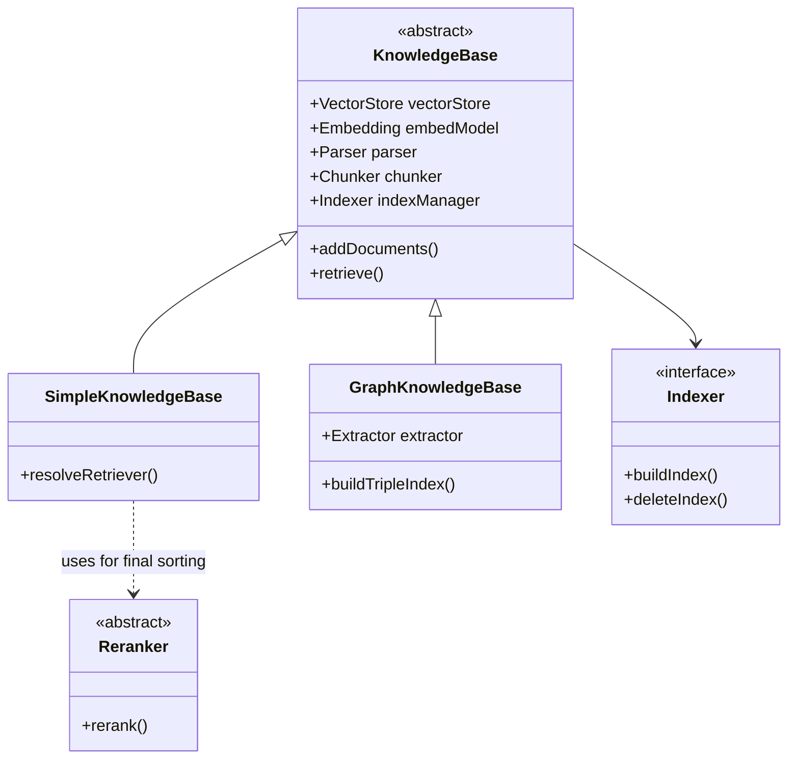

<!-- source: DeepWiki mcp.deepwiki.com · repo openJiuwen-ai/agent-core-java · page 5 Retrieval and Knowledge Base · fetched 2026-11-02 -->

# Retrieval and Knowledge Base

<details>
<summary>Relevant source files</summary>

The following files were used as context for generating this wiki page:

- [src/main/java/com/openjiuwen/core/retrieval/GraphKnowledgeBase.java](src/main/java/com/openjiuwen/core/retrieval/GraphKnowledgeBase.java)
- [src/main/java/com/openjiuwen/core/retrieval/KnowledgeBase.java](src/main/java/com/openjiuwen/core/retrieval/KnowledgeBase.java)
- [src/main/java/com/openjiuwen/core/retrieval/SimpleKnowledgeBase.java](src/main/java/com/openjiuwen/core/retrieval/SimpleKnowledgeBase.java)
- [src/main/java/com/openjiuwen/core/retrieval/indexing/processor/chunker/CharSplitterText.java](src/main/java/com/openjiuwen/core/retrieval/indexing/processor/chunker/CharSplitterText.java)
- [src/main/java/com/openjiuwen/core/retrieval/indexing/processor/chunker/ChunkerRegistry.java](src/main/java/com/openjiuwen/core/retrieval/indexing/processor/chunker/ChunkerRegistry.java)
- [src/main/java/com/openjiuwen/core/retrieval/indexing/processor/chunker/IndexSentenceSplitter.java](src/main/java/com/openjiuwen/core/retrieval/indexing/processor/chunker/IndexSentenceSplitter.java)
- [src/main/java/com/openjiuwen/core/retrieval/indexing/processor/chunker/TextSplitter.java](src/main/java/com/openjiuwen/core/retrieval/indexing/processor/chunker/TextSplitter.java)
- [src/main/java/com/openjiuwen/core/retrieval/indexing/processor/parser/AutoFileParser.java](src/main/java/com/openjiuwen/core/retrieval/indexing/processor/parser/AutoFileParser.java)
- [src/main/java/com/openjiuwen/core/retrieval/reranker/Reranker.java](src/main/java/com/openjiuwen/core/retrieval/reranker/Reranker.java)
- [src/main/java/com/openjiuwen/core/retrieval/reranker/StandardReranker.java](src/main/java/com/openjiuwen/core/retrieval/reranker/StandardReranker.java)
- [src/main/java/com/openjiuwen/core/retrieval/utils/ApiRequestUtils.java](src/main/java/com/openjiuwen/core/retrieval/utils/ApiRequestUtils.java)
- [src/main/java/com/openjiuwen/core/singleagent/ReActAgent.java](src/main/java/com/openjiuwen/core/singleagent/ReActAgent.java)
- [src/main/java/com/openjiuwen/core/singleagent/ReActAgentEvolve.java](src/main/java/com/openjiuwen/core/singleagent/ReActAgentEvolve.java)

</details>


The Retrieval and Knowledge Base subsystem provides a comprehensive framework for managing, indexing, and retrieving unstructured and semi-structured data. It bridges the gap between raw document storage and the Agent's reasoning capabilities by transforming text, PDFs, and web content into searchable vector or graph-based representations.

This subsystem is composed of two primary phases: **Indexing** (converting files into searchable chunks) and **Retrieval** (finding the most relevant information for a given query).

## Knowledge Base Types

The framework defines a base `KnowledgeBase` abstraction that coordinates various components: a `VectorStore`, an `Embedding` model, a `Parser`, a `Chunker`, and an `Indexer`. [src/main/java/com/openjiuwen/core/retrieval/KnowledgeBase.java:39-61]().

There are two primary implementations:

| Type | Description | Key Classes |
| :--- | :--- | :--- |
| **Simple Knowledge Base** | Standard RAG implementation using vector similarity search. Supports `VectorRetriever`, `SparseRetriever`, and `HybridRetriever`. | `SimpleKnowledgeBase` |
| **Graph Knowledge Base** | Enhances retrieval by extracting entity-relation triples from text, enabling multi-hop reasoning over a knowledge graph. | `GraphKnowledgeBase` |

*   **SimpleKnowledgeBase**: Handles basic document addition, deletion, and retrieval using vector-based retrievers. [src/main/java/com/openjiuwen/core/retrieval/SimpleKnowledgeBase.java:46-128]().
*   **GraphKnowledgeBase**: Extends the pipeline by using an `Extractor` to build a triple index alongside the standard chunk index. [src/main/java/com/openjiuwen/core/retrieval/GraphKnowledgeBase.java:45-129]().

**Sources:**
* [src/main/java/com/openjiuwen/core/retrieval/KnowledgeBase.java:39-61]()
* [src/main/java/com/openjiuwen/core/retrieval/SimpleKnowledgeBase.java:46-147]()
* [src/main/java/com/openjiuwen/core/retrieval/GraphKnowledgeBase.java:45-129]()

## Document Ingestion Pipeline

The ingestion pipeline transforms raw files into indexed `TextChunk` objects. This process is managed by the `Indexer` and configured via `KnowledgeBaseConfig`.

1.  **Parsing**: `AutoFileParser` detects file types and delegates to specific parsers (PDF, Word, Excel, etc.). [src/main/java/com/openjiuwen/core/retrieval/indexing/processor/parser/AutoFileParser.java:28-40]().
2.  **Chunking**: Documents are split into smaller segments using strategies like `CharSplitterText` (fixed length) or `IndexSentenceSplitter` (tokenizer-aware sentence boundaries). [src/main/java/com/openjiuwen/core/retrieval/indexing/processor/chunker/CharSplitterText.java:21-75](); [src/main/java/com/openjiuwen/core/retrieval/indexing/processor/chunker/IndexSentenceSplitter.java:26-53]().
3.  **Indexing**: The `Indexer` (e.g., `MilvusIndexer`) takes these chunks, generates embeddings, and persists them to the `VectorStore`. [src/main/java/com/openjiuwen/core/retrieval/SimpleKnowledgeBase.java:112-128]().

For details on file formats and chunking algorithms, see **[Document Indexing Pipeline](#5.1)**.

**Sources:**
* [src/main/java/com/openjiuwen/core/retrieval/indexing/processor/parser/AutoFileParser.java:28-61]()
* [src/main/java/com/openjiuwen/core/retrieval/indexing/processor/chunker/CharSplitterText.java:21-75]()
* [src/main/java/com/openjiuwen/core/retrieval/indexing/processor/chunker/IndexSentenceSplitter.java:26-53]()

## Retrieval and Reranking Pipeline

When a query is received, the system executes a retrieval pipeline designed to maximize relevance:

### Entity-to-Code Map: Retrieval Flow
```mermaid
graph TD
    subgraph "Natural Language Space"
        "User Query"
        "Relevant Context"
    end

    subgraph "Code Entity Space"
        QW["Query Rewriter (LLM)"]
        RT["Retriever (Vector/Hybrid)"]
        EM["Embedding (OpenAI/API)"]
        RR["StandardReranker"]
        VS["VectorStore (Milvus/PG)"]
    end

    "User Query" --> QW
    QW -- "Optimized Query" --> EM
    EM -- "Vector" --> RT
    RT -- "Search" --> VS
    VS -- "Candidate Documents" --> RR
    RR -- "Sorted Results" --> "Relevant Context"
```
**Sources:**
* [src/main/java/com/openjiuwen/core/retrieval/SimpleKnowledgeBase.java:131-147]()
* [src/main/java/com/openjiuwen/core/retrieval/reranker/StandardReranker.java:37-101]()

### Key Components
*   **Embedding**: Converts text to vectors via `Embedding` implementations like `OpenAIEmbedding` or `APIEmbedding`.
*   **Retriever**: Classes like `VectorRetriever` or `HybridRetriever` fetch candidates from the store. [src/main/java/com/openjiuwen/core/retrieval/SimpleKnowledgeBase.java:23-28]().
*   **Reranking**: The `StandardReranker` validates and sorts candidates using cross-encoder models to ensure the most relevant documents appear first. [src/main/java/com/openjiuwen/core/retrieval/reranker/StandardReranker.java:84-101](). It communicates with external reranking services (like vLLM) via `ApiRequestUtils`. [src/main/java/com/openjiuwen/core/retrieval/utils/ApiRequestUtils.java:74-128]().

For details on query rewriting and specific reranker configurations, see **[Retrieval, Embedding, and Reranking](#5.2)**.

**Sources:**
* [src/main/java/com/openjiuwen/core/retrieval/SimpleKnowledgeBase.java:131-147]()
* [src/main/java/com/openjiuwen/core/retrieval/reranker/StandardReranker.java:37-55]()
* [src/main/java/com/openjiuwen/core/retrieval/utils/ApiRequestUtils.java:74-128]()

## System Integration

The retrieval system is utilized by agents to ground their responses in factual data.

### Entity-to-Code Map: Knowledge Base Components

**Sources:**
* [src/main/java/com/openjiuwen/core/retrieval/KnowledgeBase.java:39-62]()
* [src/main/java/com/openjiuwen/core/retrieval/SimpleKnowledgeBase.java:46-66]()
* [src/main/java/com/openjiuwen/core/retrieval/GraphKnowledgeBase.java:45-73]()
* [src/main/java/com/openjiuwen/core/retrieval/reranker/StandardReranker.java:37-41]()

---

