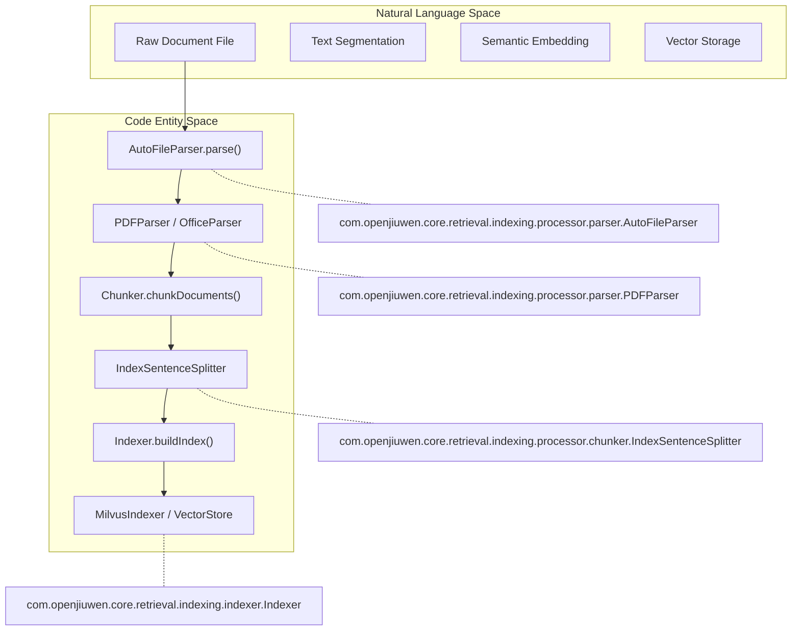
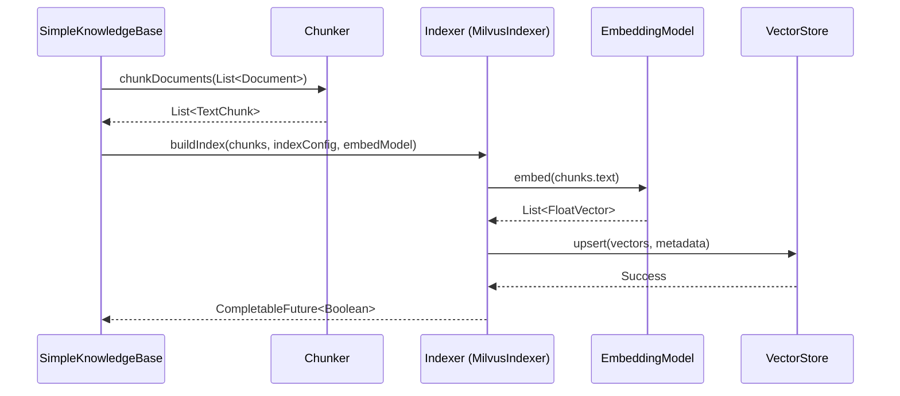

<!-- source: DeepWiki mcp.deepwiki.com · repo openJiuwen-ai/agent-core-java · page 5.1 Document Indexing Pipeline · fetched 2026-11-02 -->

# Document Indexing Pipeline

Relevant source files

The following files were used as context for generating this wiki page:

- [pom.xml](pom.xml)
- [src/main/java/com/openjiuwen/core/foundation/prompt/PromptTemplate.java](src/main/java/com/openjiuwen/core/foundation/prompt/PromptTemplate.java)
- [src/main/java/com/openjiuwen/core/retrieval/GraphKnowledgeBase.java](src/main/java/com/openjiuwen/core/retrieval/GraphKnowledgeBase.java)
- [src/main/java/com/openjiuwen/core/retrieval/KnowledgeBase.java](src/main/java/com/openjiuwen/core/retrieval/KnowledgeBase.java)
- [src/main/java/com/openjiuwen/core/retrieval/SimpleKnowledgeBase.java](src/main/java/com/openjiuwen/core/retrieval/SimpleKnowledgeBase.java)
- [src/main/java/com/openjiuwen/core/retrieval/common/BaseCallback.java](src/main/java/com/openjiuwen/core/retrieval/common/BaseCallback.java)
- [src/main/java/com/openjiuwen/core/retrieval/common/BaseRankConfig.java](src/main/java/com/openjiuwen/core/retrieval/common/BaseRankConfig.java)
- [src/main/java/com/openjiuwen/core/retrieval/common/Document.java](src/main/java/com/openjiuwen/core/retrieval/common/Document.java)
- [src/main/java/com/openjiuwen/core/retrieval/common/IndexConfig.java](src/main/java/com/openjiuwen/core/retrieval/common/IndexConfig.java)
- [src/main/java/com/openjiuwen/core/retrieval/common/KnowledgeBaseConfig.java](src/main/java/com/openjiuwen/core/retrieval/common/KnowledgeBaseConfig.java)
- [src/main/java/com/openjiuwen/core/retrieval/common/LoggingCallback.java](src/main/java/com/openjiuwen/core/retrieval/common/LoggingCallback.java)
- [src/main/java/com/openjiuwen/core/retrieval/common/MultiKBRetrievalResult.java](src/main/java/com/openjiuwen/core/retrieval/common/MultiKBRetrievalResult.java)
- [src/main/java/com/openjiuwen/core/retrieval/indexing/processor/chunker/CharSplitterText.java](src/main/java/com/openjiuwen/core/retrieval/indexing/processor/chunker/CharSplitterText.java)
- [src/main/java/com/openjiuwen/core/retrieval/indexing/processor/chunker/ChunkerRegistry.java](src/main/java/com/openjiuwen/core/retrieval/indexing/processor/chunker/ChunkerRegistry.java)
- [src/main/java/com/openjiuwen/core/retrieval/indexing/processor/chunker/IndexSentenceSplitter.java](src/main/java/com/openjiuwen/core/retrieval/indexing/processor/chunker/IndexSentenceSplitter.java)
- [src/main/java/com/openjiuwen/core/retrieval/indexing/processor/chunker/TextSplitter.java](src/main/java/com/openjiuwen/core/retrieval/indexing/processor/chunker/TextSplitter.java)
- [src/main/java/com/openjiuwen/core/retrieval/indexing/processor/parser/AutoFileParser.java](src/main/java/com/openjiuwen/core/retrieval/indexing/processor/parser/AutoFileParser.java)
- [src/main/java/com/openjiuwen/core/retrieval/indexing/processor/parser/ImageCaptioner.java](src/main/java/com/openjiuwen/core/retrieval/indexing/processor/parser/ImageCaptioner.java)
- [src/main/java/com/openjiuwen/core/retrieval/reranker/Reranker.java](src/main/java/com/openjiuwen/core/retrieval/reranker/Reranker.java)
- [src/main/java/com/openjiuwen/core/retrieval/utils/ApiRequestUtils.java](src/main/java/com/openjiuwen/core/retrieval/utils/ApiRequestUtils.java)
- [src/main/java/com/openjiuwen/dev_tools/tune/optimizer/adopt/AdoptOptimizer.java](src/main/java/com/openjiuwen/dev_tools/tune/optimizer/adopt/AdoptOptimizer.java)
- [src/test/java/com/openjiuwen/core/common/logging/LogManagerTest.java](src/test/java/com/openjiuwen/core/common/logging/LogManagerTest.java)
- [src/test/java/com/openjiuwen/core/memory/manage/mem_model/DbModelTest.java](src/test/java/com/openjiuwen/core/memory/manage/mem_model/DbModelTest.java)
- [src/test/java/com/openjiuwen/core/retrieval/indexing/processor/parser/PDFParserTest.java](src/test/java/com/openjiuwen/core/retrieval/indexing/processor/parser/PDFParserTest.java)
- [src/test/java/com/openjiuwen/core/sysop/SysOperationToolAdapterTest.java](src/test/java/com/openjiuwen/core/sysop/SysOperationToolAdapterTest.java)
- [src/test/java/com/openjiuwen/extensions/store/kv/RedisStoreTest.java](src/test/java/com/openjiuwen/extensions/store/kv/RedisStoreTest.java)

The Document Indexing Pipeline is responsible for transforming raw data (files, web pages, or raw text) into searchable vector representations within a `KnowledgeBase`. This process involves parsing file formats, chunking text into manageable segments, generating embeddings, and persisting them into a vector store.

## Overview and Data Flow

The pipeline follows a sequential flow from raw input to indexed vectors. The entry point is typically a `KnowledgeBase` implementation (e.g., `SimpleKnowledgeBase` or `GraphKnowledgeBase`), which orchestrates the `Parser`, `Chunker`, and `Indexer` components.

### Natural Language to Code Entity Mapping

The following diagram illustrates how high-level ingestion concepts map to specific classes and methods within the `com.openjiuwen.core.retrieval` package.

**Ingestion Pipeline Mapping**

**Sources:** [src/main/java/com/openjiuwen/core/retrieval/KnowledgeBase.java:53-62](), [src/main/java/com/openjiuwen/core/retrieval/SimpleKnowledgeBase.java:82-128]()

---

## Document Parsing

The parsing stage converts various file formats into standard `Document` objects.

### AutoFileParser
The `AutoFileParser` acts as a dispatcher that selects the appropriate parser based on the file extension. It automatically enriches document metadata with fields such as `file_ext`, `file_path`, and `doc_id`.
**Sources:** [src/test/java/com/openjiuwen/core/retrieval/indexing/processor/parser/PDFParserTest.java:150-162]()

### PDFParser and ImageCaptioner
The `PDFParser` handles PDF ingestion. It can extract both text and images.
*   **Image Captioning:** If configured, the `PDFParser` uses `ImageCaptioner` to describe images within the PDF using a Vision-Language Model (VLM) like `gpt-4o` or `qwen-vl`.
*   **VLM Integration:** `ImageCaptioner` performs an asynchronous LLM call (`llmCallAsync`) to generate a qualitative description of charts, diagrams, and layout, which is then appended to the document text for semantic retrieval.

**Sources:** [src/main/java/com/openjiuwen/core/retrieval/indexing/processor/parser/ImageCaptioner.java:37-54](), [src/main/java/com/openjiuwen/core/retrieval/indexing/processor/parser/ImageCaptioner.java:112-136](), [src/test/java/com/openjiuwen/core/retrieval/indexing/processor/parser/PDFParserTest.java:128-137]()

---

## Text Chunking and Splitting

Once a document is parsed into text, it must be broken into smaller `TextChunk` objects. This is handled by the `Chunker` interface.

### IndexSentenceSplitter
`IndexSentenceSplitter` is a specialized splitter that attempts to maintain semantic coherence by splitting text at sentence boundaries while respecting a maximum token/character limit.

### CharSplitter
A basic splitter that divides text based on a fixed character count with a configurable overlap to ensure context is preserved across chunk boundaries.

| Component | Class Name | Responsibility |
| :--- | :--- | :--- |
| **Chunker** | `Chunker` | Orchestrates the splitting of multiple `Document` objects into `TextChunk` lists. |
| **Sentence Splitter** | `IndexSentenceSplitter` | Splits text by sentences, ensuring chunks do not break mid-sentence unless necessary. |
| **Character Splitter** | `CharSplitterText` | Splits text by a raw character count. |

**Sources:** [src/main/java/com/openjiuwen/core/retrieval/SimpleKnowledgeBase.java:108-108](), [src/main/java/com/openjiuwen/core/retrieval/KnowledgeBase.java:57-57]()

---

## Indexing and Vector Storage

The final stage of the pipeline involves embedding the chunks and storing them in a vector database.

### The Indexing Workflow
The `Indexer.buildIndex()` method is the primary execution point for this stage.

**Vectorization and Storage Flow**

**Sources:** [src/main/java/com/openjiuwen/core/retrieval/SimpleKnowledgeBase.java:108-127](), [src/main/java/com/openjiuwen/core/retrieval/KnowledgeBase.java:59-59]()

### Indexer Implementations
*   **MilvusIndexer:** Communicates with a Milvus server to create collections and insert vector data. It utilizes `IndexConfig` to determine parameters like `index_type` and `distance_metric`.
*   **VectorStore:** The underlying abstraction for the physical database (Milvus, PGVector, or InMemory). The `KnowledgeBase` validates that the `VectorStore` configuration matches the `Indexer` configuration before operations proceed.

**Sources:** [src/main/java/com/openjiuwen/core/retrieval/KnowledgeBase.java:211-220](), [src/main/java/com/openjiuwen/core/retrieval/common/IndexConfig.java:1-20]()

### Graph Indexing (GraphKnowledgeBase)
In addition to standard vector indexing, `GraphKnowledgeBase` supports a triple-based indexing pipeline:
1.  **Extraction:** Uses an `Extractor` to identify `Triple` (Subject-Predicate-Object) relations from text chunks.
2.  **Triple Indexing:** Calls `buildTripleIndex` to store these relations in a specialized graph structure or a dedicated vector index for triples.

**Sources:** [src/main/java/com/openjiuwen/core/retrieval/GraphKnowledgeBase.java:121-127]()

---

## Configuration and Validation

The pipeline behavior is controlled by `KnowledgeBaseConfig` and `IndexConfig`.

*   **KnowledgeBaseConfig:** Defines high-level settings such as `indexType`, `useGraph`, and `useCaptionForImages`.
*   **Strict Validation:** When `strictValidation` is enabled in `KnowledgeBase`, the system verifies that the `database_name`, `text_field`, and `vector_field` match between the `VectorStore` and the `Indexer` before adding or deleting documents.

**Sources:** [src/main/java/com/openjiuwen/core/retrieval/KnowledgeBase.java:120-131](), [src/main/java/com/openjiuwen/core/retrieval/KnowledgeBase.java:211-225](), [src/main/java/com/openjiuwen/core/retrieval/common/KnowledgeBaseConfig.java:1-30]()

---

