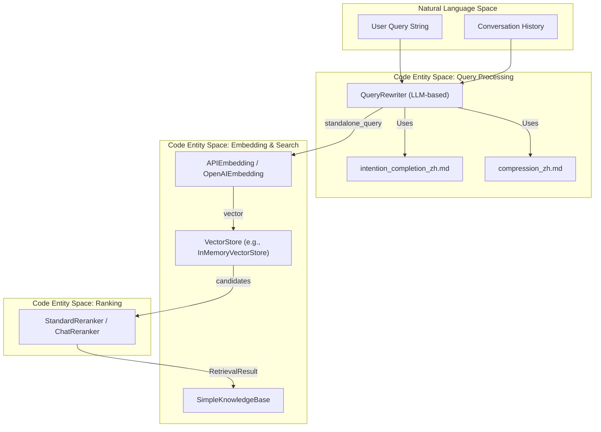
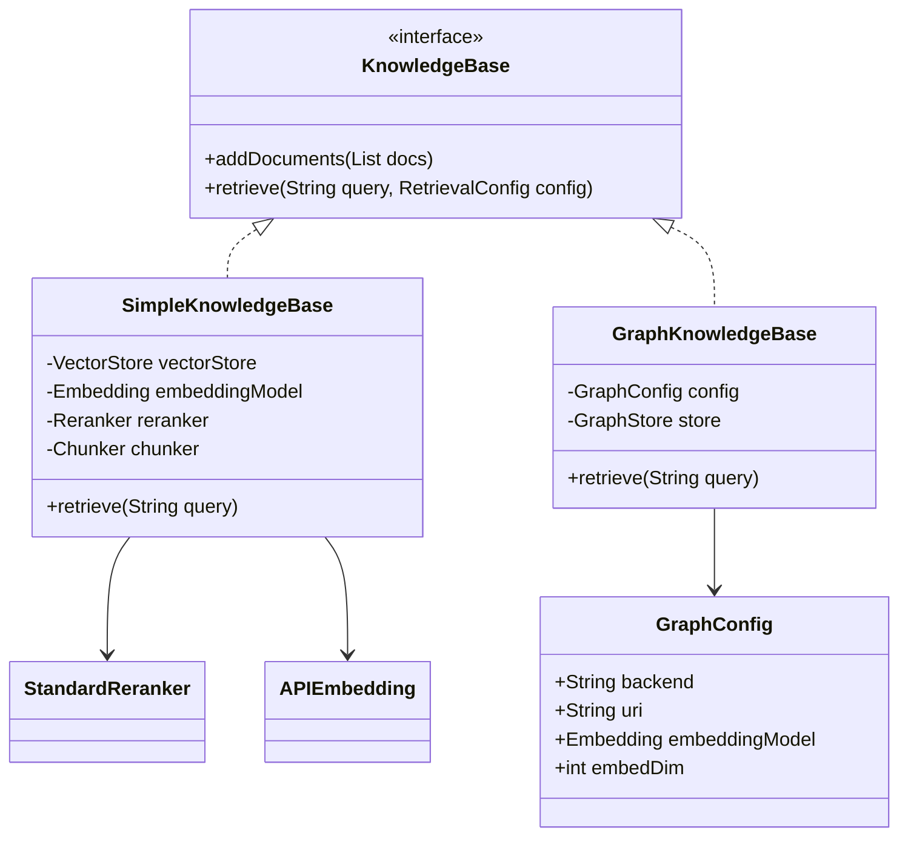

<!-- source: DeepWiki mcp.deepwiki.com · repo openJiuwen-ai/agent-core-java · page 5.2 Retrieval, Embedding, and Reranking · fetched 2026-11-02 -->

# Retrieval, Embedding, and Reranking

Relevant source files

The following files were used as context for generating this wiki page:

- [src/main/java/com/openjiuwen/core/common/utils/AppconfigUtils.java](src/main/java/com/openjiuwen/core/common/utils/AppconfigUtils.java)
- [src/main/java/com/openjiuwen/core/common/utils/IpUtils.java](src/main/java/com/openjiuwen/core/common/utils/IpUtils.java)
- [src/main/java/com/openjiuwen/core/controller/modules/TaskScheduler.java](src/main/java/com/openjiuwen/core/controller/modules/TaskScheduler.java)
- [src/main/java/com/openjiuwen/core/foundation/llm/model_clients/DashScopeModelClient.java](src/main/java/com/openjiuwen/core/foundation/llm/model_clients/DashScopeModelClient.java)
- [src/main/java/com/openjiuwen/core/foundation/llm/model_clients/InferenceAffinityModelClient.java](src/main/java/com/openjiuwen/core/foundation/llm/model_clients/InferenceAffinityModelClient.java)
- [src/main/java/com/openjiuwen/core/foundation/store/graph/GraphConfig.java](src/main/java/com/openjiuwen/core/foundation/store/graph/GraphConfig.java)
- [src/main/java/com/openjiuwen/core/retrieval/common/EmbeddingConfig.java](src/main/java/com/openjiuwen/core/retrieval/common/EmbeddingConfig.java)
- [src/main/java/com/openjiuwen/core/retrieval/embedding/APIEmbedding.java](src/main/java/com/openjiuwen/core/retrieval/embedding/APIEmbedding.java)
- [src/main/java/com/openjiuwen/core/retrieval/embedding/OpenAIEmbedding.java](src/main/java/com/openjiuwen/core/retrieval/embedding/OpenAIEmbedding.java)
- [src/main/java/com/openjiuwen/core/retrieval/reranker/ChatReranker.java](src/main/java/com/openjiuwen/core/retrieval/reranker/ChatReranker.java)
- [src/main/java/com/openjiuwen/core/retrieval/reranker/StandardReranker.java](src/main/java/com/openjiuwen/core/retrieval/reranker/StandardReranker.java)
- [src/main/java/com/openjiuwen/core/singleagent/ReActAgent.java](src/main/java/com/openjiuwen/core/singleagent/ReActAgent.java)
- [src/main/java/com/openjiuwen/core/singleagent/ReActAgentEvolve.java](src/main/java/com/openjiuwen/core/singleagent/ReActAgentEvolve.java)
- [src/main/resources/com/openjiuwen/core/retrieval/query_rewriter/prompts/compression_en.md](src/main/resources/com/openjiuwen/core/retrieval/query_rewriter/prompts/compression_en.md)
- [src/main/resources/com/openjiuwen/core/retrieval/query_rewriter/prompts/compression_zh.md](src/main/resources/com/openjiuwen/core/retrieval/query_rewriter/prompts/compression_zh.md)
- [src/main/resources/com/openjiuwen/core/retrieval/query_rewriter/prompts/intention_completion_en.md](src/main/resources/com/openjiuwen/core/retrieval/query_rewriter/prompts/intention_completion_en.md)
- [src/main/resources/com/openjiuwen/core/retrieval/query_rewriter/prompts/intention_completion_zh.md](src/main/resources/com/openjiuwen/core/retrieval/query_rewriter/prompts/intention_completion_zh.md)
- [src/main/resources/memory/prompt/fragment_memory_prompt.md](src/main/resources/memory/prompt/fragment_memory_prompt.md)
- [src/test/java/com/openjiuwen/core/systemtest/RetrievalSystemTest.java](src/test/java/com/openjiuwen/core/systemtest/RetrievalSystemTest.java)

The retrieval subsystem in `agent-core-java` provides a high-performance pipeline for converting natural language queries into actionable knowledge. It encompasses embedding generation, multi-stage reranking, and query rewriting to ensure that the context provided to agents is both relevant and concise.

## Retrieval Pipeline Overview

The retrieval process follows a structured data flow from raw user input to a ranked list of relevant document fragments.

1.  **Query Rewriting**: The raw query is processed to resolve coreferences and complete intentions based on conversation history.
2.  **Embedding**: The rewritten query is converted into a high-dimensional vector.
3.  **Vector Retrieval**: A coarse-grained search is performed against a vector store (e.g., `InMemoryVectorStore` or `Milvus`).
4.  **Reranking**: Candidate documents are re-scored using sophisticated models (Standard or Chat-based) to improve precision.

### Code-to-Entity Mapping: Retrieval Flow

The following diagram maps the logical retrieval steps to the specific Java classes and configurations that execute them.

"Retrieval Flow Mapping"

**Sources:** [src/main/java/com/openjiuwen/core/retrieval/SimpleKnowledgeBase.java:151-170](), [src/main/resources/com/openjiuwen/core/retrieval/query_rewriter/prompts/intention_completion_zh.md:5-9](), [src/test/java/com/openjiuwen/core/systemtest/RetrievalSystemTest.java:146-167]()

---

## Embedding Models

The framework supports multiple embedding strategies through the `Embedding` abstraction.

### APIEmbedding
`APIEmbedding` is the primary implementation for remote embedding services. It supports batching, concurrency control via semaphores, and automatic retries.

*   **Concurrency Control**: Uses a `Semaphore` named `limiter` initialized with `maxConcurrent` to prevent overloading remote endpoints [src/main/java/com/openjiuwen/core/retrieval/embedding/APIEmbedding.java:99-108]().
*   **Batching**: Automatically splits large document lists into chunks based on `maxBatchSize` [src/main/java/com/openjiuwen/core/retrieval/embedding/APIEmbedding.java:135-145]().
*   **Implementation**: Extends `Embedding` and implements `AutoCloseable` for resource cleanup [src/main/java/com/openjiuwen/core/retrieval/embedding/APIEmbedding.java:42]().

### OpenAIEmbedding
A specialized client for OpenAI's embedding API, providing pre-configured defaults for models like `text-embedding-3-small`.

**Sources:** [src/main/java/com/openjiuwen/core/retrieval/embedding/APIEmbedding.java:42-110](), [src/main/java/com/openjiuwen/core/retrieval/common/EmbeddingConfig.java:1-20]()

---

## Query Rewriting and Intent Completion

To improve retrieval accuracy, the system rewrites queries using LLM-based prompts located in `src/main/resources/com/openjiuwen/core/retrieval/query_rewriter/prompts/`.

| Component | Prompt File | Purpose |
| :--- | :--- | :--- |
| **Intention Completion** | `intention_completion_zh.md` | Generates a `standalone_query` by resolving pronouns (e.g., "it", "that") and fixing typos [src/main/resources/com/openjiuwen/core/retrieval/query_rewriter/prompts/intention_completion_zh.md:5-9](). |
| **History Compression** | `compression_zh.md` | Performs lossless compression of conversation history into a `summary` snapshot to fit within context windows [src/main/resources/com/openjiuwen/core/retrieval/query_rewriter/prompts/compression_zh.md:7-10](). |

**Sources:** [src/main/resources/com/openjiuwen/core/retrieval/query_rewriter/prompts/intention_completion_zh.md:1-83](), [src/main/resources/com/openjiuwen/core/retrieval/query_rewriter/prompts/compression_zh.md:1-54]()

---

## Reranking Strategies

Rerankers refine the results from the vector store by calculating a more precise relevance score between the query and the candidate documents.

### StandardReranker
A client for vLLM-compatible `/rerank` endpoints.
*   **Function**: `rerankSync(String query, List<Object> doc, ...)` [src/main/java/com/openjiuwen/core/retrieval/reranker/StandardReranker.java:92-101]().
*   **Data Flow**: Extracts document IDs, sends them to the API, and maps the returned `relevance_score` back to the original documents [src/main/java/com/openjiuwen/core/retrieval/reranker/StandardReranker.java:142-163]().

### ChatReranker
An experimental reranker that uses a Chat Completion model's `logprobs` to determine relevance.
*   **Mechanism**: It prompts the model to judge if a document meets the query requirements with a "Yes" or "No" [src/main/java/com/openjiuwen/core/retrieval/reranker/ChatReranker.java:49-51]().
*   **Scoring**: It extracts `logprobs` for tokens starting with "yes" and "no", calculating a probability-based score [src/main/java/com/openjiuwen/core/retrieval/reranker/ChatReranker.java:147-164]().

**Sources:** [src/main/java/com/openjiuwen/core/retrieval/reranker/StandardReranker.java:37-163](), [src/main/java/com/openjiuwen/core/retrieval/reranker/ChatReranker.java:37-164]()

---

## Knowledge Base Implementations

The `KnowledgeBase` interface serves as the entry point for agents to interact with stored information.

### SimpleKnowledgeBase
A standard implementation that orchestrates the chunking, indexing, and retrieval flow.
*   **Indexing**: Uses an `Indexer` (e.g., `MilvusIndexer` or `InMemoryIndexer`) to store document fragments [src/test/java/com/openjiuwen/core/systemtest/RetrievalSystemTest.java:149-152]().
*   **Retrieval**: Combines `VectorStore` search with an optional `Reranker` to return a list of `RetrievalResult` objects [src/test/java/com/openjiuwen/core/systemtest/RetrievalSystemTest.java:164-170]().

### GraphKnowledgeBase
A specialized knowledge base that utilizes graph stores for relationship-aware retrieval.
*   **Configuration**: Defined via `GraphConfig`, which specifies the backend (e.g., `milvus`), `uri`, and `embedDim` [src/main/java/com/openjiuwen/core/foundation/store/graph/GraphConfig.java:26-42]().
*   **Storage**: Uses `GraphStoreStorageConfig` and `GraphStoreIndexConfig` to manage how nodes and edges are indexed [src/main/java/com/openjiuwen/core/foundation/store/graph/GraphConfig.java:74-75]().

"Knowledge Base Class Relationships"

**Sources:** [src/main/java/com/openjiuwen/core/retrieval/SimpleKnowledgeBase.java:151-170](), [src/main/java/com/openjiuwen/core/foundation/store/graph/GraphConfig.java:26-78](), [src/test/java/com/openjiuwen/core/systemtest/RetrievalSystemTest.java:141-170]()

---

