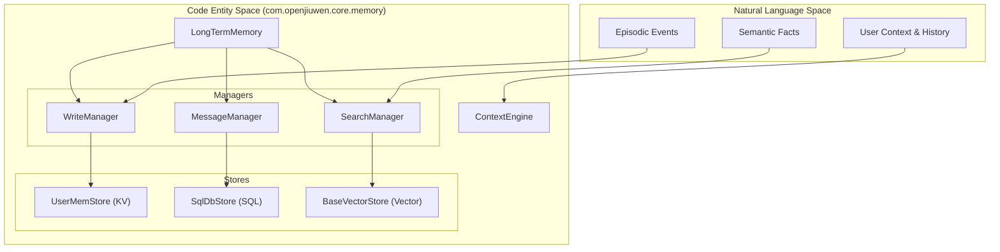
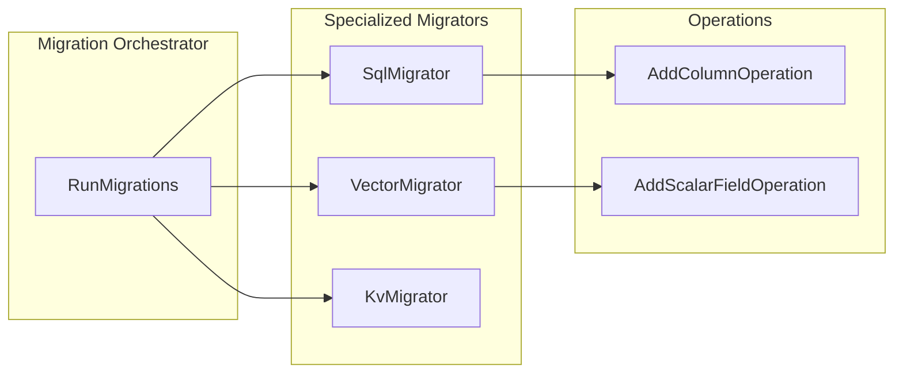

<!-- source: DeepWiki mcp.deepwiki.com · repo openJiuwen-ai/agent-core-java · page 6 Memory System · fetched 2026-11-02 -->

# Memory System

Relevant source files

The following files were used as context for generating this wiki page:

- [src/main/java/com/openjiuwen/core/memory/LongTermMemory.java](src/main/java/com/openjiuwen/core/memory/LongTermMemory.java)
- [src/main/java/com/openjiuwen/core/memory/MemInfo.java](src/main/java/com/openjiuwen/core/memory/MemInfo.java)
- [src/main/java/com/openjiuwen/core/memory/MemResult.java](src/main/java/com/openjiuwen/core/memory/MemResult.java)
- [src/main/java/com/openjiuwen/core/memory/common/DistributedLock.java](src/main/java/com/openjiuwen/core/memory/common/DistributedLock.java)
- [src/main/java/com/openjiuwen/core/memory/common/KvPrefixRegistry.java](src/main/java/com/openjiuwen/core/memory/common/KvPrefixRegistry.java)
- [src/main/java/com/openjiuwen/core/memory/common/MemoryUtils.java](src/main/java/com/openjiuwen/core/memory/common/MemoryUtils.java)
- [src/main/java/com/openjiuwen/core/memory/config/AgentMemoryConfig.java](src/main/java/com/openjiuwen/core/memory/config/AgentMemoryConfig.java)
- [src/main/java/com/openjiuwen/core/memory/config/MemoryEngineConfig.java](src/main/java/com/openjiuwen/core/memory/config/MemoryEngineConfig.java)
- [src/main/java/com/openjiuwen/core/memory/config/MemoryScopeConfig.java](src/main/java/com/openjiuwen/core/memory/config/MemoryScopeConfig.java)
- [src/main/java/com/openjiuwen/core/memory/manage/index/BaseMemoryManager.java](src/main/java/com/openjiuwen/core/memory/manage/index/BaseMemoryManager.java)
- [src/main/java/com/openjiuwen/core/memory/manage/mem_model/MemoryMeta.java](src/main/java/com/openjiuwen/core/memory/manage/mem_model/MemoryMeta.java)
- [src/main/java/com/openjiuwen/core/memory/manage/mem_model/ScopeUserMapping.java](src/main/java/com/openjiuwen/core/memory/manage/mem_model/ScopeUserMapping.java)
- [src/main/java/com/openjiuwen/core/memory/manage/mem_model/SqlDbStore.java](src/main/java/com/openjiuwen/core/memory/manage/mem_model/SqlDbStore.java)
- [src/main/java/com/openjiuwen/core/memory/manage/mem_model/UserMemStore.java](src/main/java/com/openjiuwen/core/memory/manage/mem_model/UserMemStore.java)
- [src/main/java/com/openjiuwen/core/memory/manage/mem_model/UserMessage.java](src/main/java/com/openjiuwen/core/memory/manage/mem_model/UserMessage.java)
- [src/main/java/com/openjiuwen/core/memory/migration/RunMigrations.java](src/main/java/com/openjiuwen/core/memory/migration/RunMigrations.java)
- [src/main/java/com/openjiuwen/core/memory/migration/migrator/SqlMigrator.java](src/main/java/com/openjiuwen/core/memory/migration/migrator/SqlMigrator.java)
- [src/main/java/com/openjiuwen/core/memory/migration/migrator/VectorMigrator.java](src/main/java/com/openjiuwen/core/memory/migration/migrator/VectorMigrator.java)
- [src/main/java/com/openjiuwen/core/memory/migration/operation/AddColumnOperation.java](src/main/java/com/openjiuwen/core/memory/migration/operation/AddColumnOperation.java)
- [src/main/java/com/openjiuwen/core/memory/migration/operation/AddScalarFieldOperation.java](src/main/java/com/openjiuwen/core/memory/migration/operation/AddScalarFieldOperation.java)

The **Memory System** in `agent-core-java` provides a robust infrastructure for both short-term conversational context and long-term persistent storage. It enables agents to maintain state across sessions, retrieve relevant historical information via semantic search, and manage complex data relationships using a variety of storage backends.

The system is primarily divided into two functional areas:
1.  **Long-Term Memory (LTM):** Persistent storage for user profiles, episodic events, and semantic facts.
2.  **Context Engine:** Management of active conversation windows, message pruning, and token-limited context enrichment for LLM calls.

### Core Memory Components

The memory subsystem is orchestrated by the `LongTermMemory` class [src/main/java/com/openjiuwen/core/memory/LongTermMemory.java:83](), which serves as the central engine for managing specialized managers like `SearchManager`, `WriteManager`, and `MessageManager` [src/main/java/com/openjiuwen/core/memory/LongTermMemory.java:104-110]().

#### System Architecture Overview

The following diagram illustrates the relationship between the high-level memory concepts and the underlying code entities.

**Memory System Architecture**

**Sources:** [src/main/java/com/openjiuwen/core/memory/LongTermMemory.java:96-110](), [src/main/java/com/openjiuwen/core/memory/manage/mem_model/UserMemStore.java:29-48](), [src/main/java/com/openjiuwen/core/memory/manage/mem_model/SqlDbStore.java:36-47]()

### Memory Management Models

The framework supports multiple storage models to handle different data access patterns:

*   **Semantic Store:** Utilizes `BaseVectorStore` for similarity-based retrieval of embeddings [src/main/java/com/openjiuwen/core/memory/LongTermMemory.java:97]().
*   **SQL Store:** Managed via `SqlDbStore`, it handles structured data such as message history (`UserMessage`) and metadata (`MemoryMeta`) [src/main/java/com/openjiuwen/core/memory/manage/mem_model/SqlDbStore.java:36](), [src/main/java/com/openjiuwen/core/memory/manage/mem_model/UserMessage.java:13-15]().
*   **KV Store:** Managed by `UserMemStore`, used for rapid access to user profiles and memory ID mappings using prefixes like `UMD` [src/main/java/com/openjiuwen/core/memory/manage/mem_model/UserMemStore.java:38-48]().

For details on how these are configured via `AgentMemoryConfig` and `MemoryScopeConfig`, see [Memory Architecture and Configuration](#6.1).

### Memory Migration

As the agent's memory schema evolves, the system provides a migration suite to update underlying stores without data loss. The `RunMigrations` utility coordinates this process across different store types [src/main/java/com/openjiuwen/core/memory/migration/RunMigrations.java:34-77]().

**Migration Workflow**

**Sources:** [src/main/java/com/openjiuwen/core/memory/migration/RunMigrations.java:39-71](), [src/main/java/com/openjiuwen/core/memory/migration/migrator/SqlMigrator.java:33](), [src/main/java/com/openjiuwen/core/memory/migration/migrator/VectorMigrator.java:23](), [src/main/java/com/openjiuwen/core/memory/migration/operation/AddColumnOperation.java:11](), [src/main/java/com/openjiuwen/core/memory/migration/operation/AddScalarFieldOperation.java:11]()

### Context Enrichment

Agents use the memory system to enrich their prompt context. The `ContextEngine` manages the `ModelContext`, ensuring that conversation history is pruned to fit within the `ContextWindow` of the LLM while maintaining the most relevant messages.

| Component | Role | Code Pointer |
| :--- | :--- | :--- |
| `ContextEngine` | Main entry point for context management. | `com.openjiuwen.core.foundation.prompt.ContextEngine` |
| `ModelContext` | Container for messages and variables. | `com.openjiuwen.core.foundation.prompt.ModelContext` |
| `KVCacheManager` | Optimizes context by caching frequent segments. | `com.openjiuwen.core.foundation.prompt.KVCacheManager` |

For details on context pruning and session management, see [Context Engine](#6.2).

### Child Pages

*   [Memory Architecture and Configuration](#6.1) — Detailed look at `AgentMemoryConfig`, scoping by user/session, and the implementation of `UserMemStore` and `SqlDbStore`.
*   [Context Engine](#6.2) — Technical deep-dive into `ContextEngine`, `ModelContext` lifecycle, and token-based pruning strategies.

---

