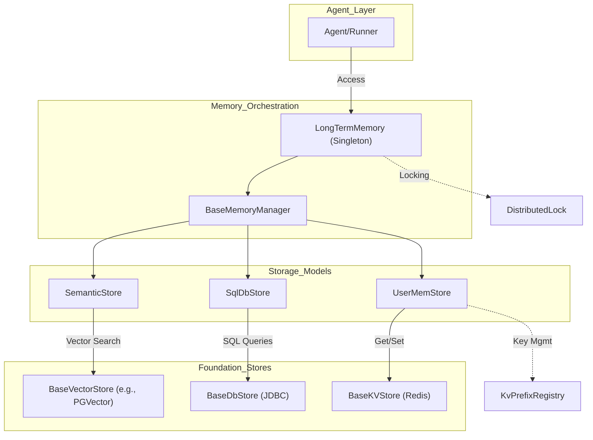
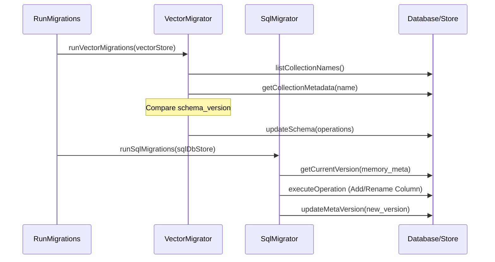

<!-- source: DeepWiki mcp.deepwiki.com · repo openJiuwen-ai/agent-core-java · page 6.1 Memory Architecture and Configuration · fetched 2026-11-02 -->

# Memory Architecture and Configuration

Relevant source files

The following files were used as context for generating this wiki page:

- [src/main/java/com/openjiuwen/core/memory/LongTermMemory.java](src/main/java/com/openjiuwen/core/memory/LongTermMemory.java)
- [src/main/java/com/openjiuwen/core/memory/MemInfo.java](src/main/java/com/openjiuwen/core/memory/MemInfo.java)
- [src/main/java/com/openjiuwen/core/memory/MemResult.java](src/main/java/com/openjiuwen/core/memory/MemResult.java)
- [src/main/java/com/openjiuwen/core/memory/common/DistributedLock.java](src/main/java/com/openjiuwen/core/memory/common/DistributedLock.java)
- [src/main/java/com/openjiuwen/core/memory/common/KvPrefixRegistry.java](src/main/java/com/openjiuwen/core/memory/common/KvPrefixRegistry.java)
- [src/main/java/com/openjiuwen/core/memory/common/MemoryUtils.java](src/main/java/com/openjiuwen/core/memory/common/MemoryUtils.java)
- [src/main/java/com/openjiuwen/core/memory/config/AgentMemoryConfig.java](src/main/java/com/openjiuwen/core/memory/config/AgentMemoryConfig.java)
- [src/main/java/com/openjiuwen/core/memory/config/MemoryEngineConfig.java](src/main/java/com/openjiuwen/core/memory/config/MemoryEngineConfig.java)
- [src/main/java/com/openjiuwen/core/memory/config/MemoryScopeConfig.java](src/main/java/com/openjiuwen/core/memory/config/MemoryScopeConfig.java)
- [src/main/java/com/openjiuwen/core/memory/manage/index/BaseMemoryManager.java](src/main/java/com/openjiuwen/core/memory/manage/index/BaseMemoryManager.java)
- [src/main/java/com/openjiuwen/core/memory/manage/mem_model/MemoryMeta.java](src/main/java/com/openjiuwen/core/memory/manage/mem_model/MemoryMeta.java)
- [src/main/java/com/openjiuwen/core/memory/manage/mem_model/ScopeUserMapping.java](src/main/java/com/openjiuwen/core/memory/manage/mem_model/ScopeUserMapping.java)
- [src/main/java/com/openjiuwen/core/memory/manage/mem_model/SqlDbStore.java](src/main/java/com/openjiuwen/core/memory/manage/mem_model/SqlDbStore.java)
- [src/main/java/com/openjiuwen/core/memory/manage/mem_model/UserMemStore.java](src/main/java/com/openjiuwen/core/memory/manage/mem_model/UserMemStore.java)
- [src/main/java/com/openjiuwen/core/memory/manage/mem_model/UserMessage.java](src/main/java/com/openjiuwen/core/memory/manage/mem_model/UserMessage.java)
- [src/main/java/com/openjiuwen/core/memory/migration/RunMigrations.java](src/main/java/com/openjiuwen/core/memory/migration/RunMigrations.java)
- [src/main/java/com/openjiuwen/core/memory/migration/migrator/SqlMigrator.java](src/main/java/com/openjiuwen/core/memory/migration/migrator/SqlMigrator.java)
- [src/main/java/com/openjiuwen/core/memory/migration/migrator/VectorMigrator.java](src/main/java/com/openjiuwen/core/memory/migration/migrator/VectorMigrator.java)
- [src/main/java/com/openjiuwen/core/memory/migration/operation/AddColumnOperation.java](src/main/java/com/openjiuwen/core/memory/migration/operation/AddColumnOperation.java)
- [src/main/java/com/openjiuwen/core/memory/migration/operation/AddScalarFieldOperation.java](src/main/java/com/openjiuwen/core/memory/migration/operation/AddScalarFieldOperation.java)
- [src/test/java/com/openjiuwen/core/memory/manage/mem_model/SemanticStorePGVectorTest.java](src/test/java/com/openjiuwen/core/memory/manage/mem_model/SemanticStorePGVectorTest.java)

The Memory System in `agent-core-java` provides a multi-tiered persistence layer designed to store, retrieve, and manage agent knowledge across different scopes (user, session, and global). It abstracts complex storage operations into high-level models like `SemanticStore`, `SqlDbStore`, and `UserMemStore`, supported by a robust migration framework to ensure data schema consistency.

## Core Configuration

The memory system is configured through three primary classes that define how data is stored, scoped, and accessed.

### AgentMemoryConfig
`AgentMemoryConfig` is the top-level configuration object for an agent's memory capabilities. It aggregates scope settings and engine-level parameters.
*   **Sources**: [src/main/java/com/openjiuwen/core/memory/config/AgentMemoryConfig.java:1-30]()

### MemoryScopeConfig
Defines the boundaries of memory visibility. It maps memory to specific entities such as `userId` or `scopeId` (session).
*   **Sources**: [src/main/java/com/openjiuwen/core/memory/config/MemoryScopeConfig.java:1-30]()

### MemoryEngineConfig
Contains low-level technical settings for the storage backends, including connection strings for KV stores, Vector databases, and SQL databases.
*   **Sources**: [src/main/java/com/openjiuwen/core/memory/config/MemoryEngineConfig.java:1-30]()

---

## Memory Architecture Overview

The architecture bridges high-level agent requests to low-level storage implementations via the `LongTermMemory` coordinator.

### Natural Language to Code Entity Mapping

| Natural Language Concept | Code Entity / Class | Responsibility |
| :--- | :--- | :--- |
| **Memory Coordinator** | `LongTermMemory` | Singleton engine managing all stores and managers. |
| **Key-Value Store** | `BaseKVStore` | Interface for Redis or local KV persistence. |
| **Vector Database** | `BaseVectorStore` | Interface for Milvus, PGVector, etc. |
| **SQL Database** | `SqlDbStore` | Wrapper for structured relational data. |
| **User Memory** | `UserMemStore` | Manages per-user/per-scope KV data with prefixing. |
| **Prefix Registry** | `KvPrefixRegistry` | Ensures unique keys in shared KV environments. |

### Memory Data Flow Diagram

This diagram illustrates how `LongTermMemory` coordinates between different storage models and the underlying foundation stores.

*   **Sources**: [src/main/java/com/openjiuwen/core/memory/LongTermMemory.java:83-117](), [src/main/java/com/openjiuwen/core/memory/manage/mem_model/UserMemStore.java:48-65](), [src/main/java/com/openjiuwen/core/memory/manage/mem_model/SqlDbStore.java:45-48]()

---

## Memory Storage Models

### SemanticStore
The `SemanticStore` manages unstructured memory fragments that require vector-based retrieval. It uses an `Embedding` model to transform text into vectors and stores them in a `BaseVectorStore`.
*   **Implementation**: It handles the creation of collections and document batching [src/test/java/com/openjiuwen/core/memory/manage/mem_model/SemanticStorePGVectorTest.java:48-51]().
*   **Bootstrap**: Automatically creates tables/collections (e.g., `CREATE TABLE IF NOT EXISTS`) during the first write operation [src/test/java/com/openjiuwen/core/memory/manage/mem_model/SemanticStorePGVectorTest.java:54-56]().

### SqlDbStore
A wrapper for relational database operations. It provides high-level methods like `write`, `getWithSort`, and `exist` while handling SQL dialect differences.
*   **Table Info**: Caches table metadata to avoid redundant schema lookups [src/main/java/com/openjiuwen/core/memory/manage/mem_model/SqlDbStore.java:43-46]().
*   **Key Functions**:
    *   `write(String table, Map<String, Object> data)`: Inserts structured records [src/main/java/com/openjiuwen/core/memory/manage/mem_model/SqlDbStore.java:49-65]().
    *   `getWithSort(...)`: Supports filtered retrieval with `LIMIT` and `ORDER BY` [src/main/java/com/openjiuwen/core/memory/manage/mem_model/SqlDbStore.java:99-123]().

### UserMemStore
Manages private memory for specific users. It leverages a `BaseKVStore` and applies a hierarchical key structure.
*   **Key Structure**: Uses `userId` and `scopeId` to isolate data. The `KvPrefixRegistry` is used to register prefixes like `UMD` to prevent collisions [src/main/java/com/openjiuwen/core/memory/manage/mem_model/UserMemStore.java:38-65]().
*   **Memory Types**: Supports types like `USER_PROFILE`, `SEMANTIC_MEMORY`, and `EPISODIC_MEMORY` [src/main/java/com/openjiuwen/core/memory/manage/mem_model/UserMemStore.java:41-45]().

---

## Infrastructure and Utilities

### DistributedLock
Used by `LongTermMemory` to ensure thread-safety and consistency across distributed instances when performing memory updates or migrations.
*   **Sources**: [src/main/java/com/openjiuwen/core/memory/common/DistributedLock.java:1-20]()

### KvPrefixRegistry
A registry for managing KV store key prefixes. It tracks `current` and `legacy` prefixes to support backward compatibility during memory access.
*   **Sources**: [src/main/java/com/openjiuwen/core/memory/common/KvPrefixRegistry.java:1-20]()

---

## Memory Migration System

The framework includes a comprehensive migration engine to handle schema changes across all storage types.

### Migration Logic
Migrations are orchestrated by `RunMigrations`, which iterates through an `OperationRegistry` to apply pending operations.

### Key Migration Classes
*   **SqlMigrator**: Manages SQL schema changes such as `AddColumnOperation` or `UpdateColumnTypeOperation` [src/main/java/com/openjiuwen/core/memory/migration/migrator/SqlMigrator.java:33-43]().
*   **VectorMigrator**: Handles metadata and schema versioning for vector collections [src/main/java/com/openjiuwen/core/memory/migration/migrator/VectorMigrator.java:23-31]().
*   **MemoryMeta**: A special SQL table (`memory_meta`) used to track the current version of every memory table [src/main/java/com/openjiuwen/core/memory/manage/mem_model/MemoryMeta.java:13-16]().

*   **Sources**: [src/main/java/com/openjiuwen/core/memory/migration/RunMigrations.java:34-61](), [src/main/java/com/openjiuwen/core/memory/migration/migrator/SqlMigrator.java:74-115](), [src/main/java/com/openjiuwen/core/memory/migration/migrator/VectorMigrator.java:58-79]()

---

