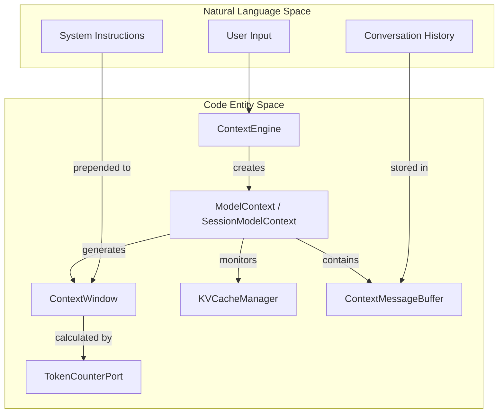
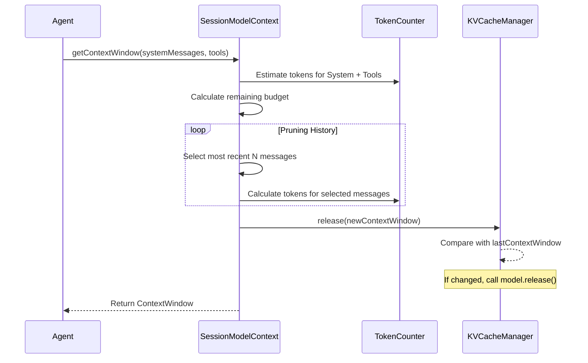

<!-- source: DeepWiki mcp.deepwiki.com · repo openJiuwen-ai/agent-core-java · page 6.2 Context Engine · fetched 2026-11-02 -->

# Context Engine

Relevant source files

The following files were used as context for generating this wiki page:

- [src/main/java/com/openjiuwen/core/context/ContextEngine.java](src/main/java/com/openjiuwen/core/context/ContextEngine.java)
- [src/main/java/com/openjiuwen/core/context/ContextStats.java](src/main/java/com/openjiuwen/core/context/ContextStats.java)
- [src/main/java/com/openjiuwen/core/context/ContextWindow.java](src/main/java/com/openjiuwen/core/context/ContextWindow.java)
- [src/main/java/com/openjiuwen/core/context/ModelContext.java](src/main/java/com/openjiuwen/core/context/ModelContext.java)
- [src/main/java/com/openjiuwen/core/context/OffloadCapableContext.java](src/main/java/com/openjiuwen/core/context/OffloadCapableContext.java)
- [src/main/java/com/openjiuwen/core/context/StatefulContext.java](src/main/java/com/openjiuwen/core/context/StatefulContext.java)
- [src/main/java/com/openjiuwen/core/context/context/ContextMessageBuffer.java](src/main/java/com/openjiuwen/core/context/context/ContextMessageBuffer.java)
- [src/main/java/com/openjiuwen/core/context/context/ContextUtils.java](src/main/java/com/openjiuwen/core/context/context/ContextUtils.java)
- [src/main/java/com/openjiuwen/core/context/context/KVCacheManager.java](src/main/java/com/openjiuwen/core/context/context/KVCacheManager.java)
- [src/main/java/com/openjiuwen/core/context/context/OffloadMessageBuffer.java](src/main/java/com/openjiuwen/core/context/context/OffloadMessageBuffer.java)
- [src/main/java/com/openjiuwen/core/context/context/SessionModelContext.java](src/main/java/com/openjiuwen/core/context/context/SessionModelContext.java)
- [src/main/java/com/openjiuwen/core/context/schema/ContextEngineConfig.java](src/main/java/com/openjiuwen/core/context/schema/ContextEngineConfig.java)
- [src/main/java/com/openjiuwen/core/foundation/llm/schema/ModelClientConfig.java](src/main/java/com/openjiuwen/core/foundation/llm/schema/ModelClientConfig.java)
- [src/main/java/com/openjiuwen/core/foundation/llm/schema/ModelRequestConfig.java](src/main/java/com/openjiuwen/core/foundation/llm/schema/ModelRequestConfig.java)
- [src/main/java/com/openjiuwen/core/session/checkpointer/CheckpointerFactory.java](src/main/java/com/openjiuwen/core/session/checkpointer/CheckpointerFactory.java)
- [src/main/java/com/openjiuwen/core/session/checkpointer/PersistenceCheckpointerProvider.java](src/main/java/com/openjiuwen/core/session/checkpointer/PersistenceCheckpointerProvider.java)
- [src/main/java/com/openjiuwen/core/singleagent/AbilityManager.java](src/main/java/com/openjiuwen/core/singleagent/AbilityManager.java)
- [src/main/java/com/openjiuwen/core/workflow/components/flow/StartComponent.java](src/main/java/com/openjiuwen/core/workflow/components/flow/StartComponent.java)

The **Context Engine** is the core subsystem responsible for managing conversation history, token counting, and context window optimization. It ensures that LLM interactions stay within token limits by pruning, compressing, or offloading messages, while maintaining the necessary state for multi-turn dialogues.

## Core Architecture

The Context Engine operates as a factory and manager for `ModelContext` instances. It abstracts the complexity of message buffering and token estimation, providing a unified interface for agents to retrieve the "optimal" window of messages for a given LLM request.

### Component Relationship Diagram

This diagram bridges the high-level Context Engine concepts to their specific implementation classes in the `com.openjiuwen.core.context` and `com.openjiuwen.core.context_engine` packages.

**Sources:** [src/main/java/com/openjiuwen/core/context/ContextEngine.java:25-50](), [src/main/java/com/openjiuwen/core/context/ModelContext.java:20-40](), [src/main/java/com/openjiuwen/core/context/context/KVCacheManager.java:28-40]()

## Key Classes and Interfaces

### ContextEngine
The entry point for context management. It handles the creation, retrieval, and persistence of contexts across different sessions [src/main/java/com/openjiuwen/core/context/ContextEngine.java:25-30]().
- `createContext(contextId, session)`: Initializes a new stateful context for a specific session [src/main/java/com/openjiuwen/core/context/ContextEngine.java:56-62]().
- `saveContexts(session, contextIds)`: Serializes context states for storage [src/main/java/com/openjiuwen/core/context/ContextEngine.java:144-146]().

### ModelContext
A container for a specific conversation's state. It manages the message list and provides methods to manipulate history [src/main/java/com/openjiuwen/core/context/ModelContext.java:42-100]().
- `getMessages(size, withHistory)`: Retrieves messages, optionally including historical ones [src/main/java/com/openjiuwen/core/context/ModelContext.java:52-54]().
- `getContextWindow(...)`: The primary method used by agents to get a pruned list of messages that fit within a specific token limit [src/main/java/com/openjiuwen/core/context/ModelContext.java:116-120]().

### ContextWindow
A read-only snapshot of the context at a specific point in time, optimized for a single LLM call. It includes the messages, available tools, and usage statistics (`ContextStats`) [src/main/java/com/openjiuwen/core/context/ContextStats.java:23-32]().

### KVCacheManager
Optimizes performance for `InferenceAffinityModel` providers. It tracks changes in the `ContextWindow` (like message pruning or tool updates) and triggers a release of stale KV cache entries on the inference server to save resources [src/main/java/com/openjiuwen/core/context/context/KVCacheManager.java:28-87]().

## Context Configuration

The behavior of the engine is governed by `ContextEngineConfig`.

| Property | Description |
| :--- | :--- |
| `maxContextMessageNum` | Maximum number of messages to keep in memory before offloading [src/main/java/com/openjiuwen/core/context/schema/ContextEngineConfig.java:68-69](). |
| `contextWindowTokens` | The hard limit for tokens in a single LLM request [src/main/java/com/openjiuwen/core/context/schema/ContextEngineConfig.java:74-75](). |
| `enableKvCacheRelease` | Whether to trigger KV cache cleanup on model servers [src/main/java/com/openjiuwen/core/context/schema/ContextEngineConfig.java:71-72](). |
| `enableTiktokenCounter` | Enables precise token counting using the Tiktoken library [src/main/java/com/openjiuwen/core/context/schema/ContextEngineConfig.java:73-74](). |

**Sources:** [src/main/java/com/openjiuwen/core/context/schema/ContextEngineConfig.java:20-45]()

## Data Flow: Context Retrieval

When an agent needs to generate a response, it requests a `ContextWindow`. The following sequence describes how the engine prunes history to fit the model's constraints.

**Sources:** [src/main/java/com/openjiuwen/core/context/ModelContext.java:116-120](), [src/main/java/com/openjiuwen/core/context/context/KVCacheManager.java:64-87](), [src/main/java/com/openjiuwen/core/context/schema/ContextEngineConfig.java:28-33]()

## Advanced Capabilities

### Offloading and Persistence
The system supports offloading large histories to external storage to keep memory usage low.
- **`OffloadCapableContext`**: An interface that allows `ModelContext` implementations to move messages to an `OffloadMessageBuffer` [src/main/java/com/openjiuwen/core/context/OffloadCapableContext.java:20-29]().
- **`StatefulContext`**: Enables saving and loading the entire context state (including metadata and counters) to a persistent store via `saveState` and `loadState` [src/main/java/com/openjiuwen/core/context/StatefulContext.java:18-34]().

### Context Compression
For very long conversations, the `SessionModelContext` can trigger a compression routine. This typically involves using an LLM to summarize previous dialogue rounds into a single "summary" message, effectively resetting the token count while preserving semantic meaning [src/main/java/com/openjiuwen/core/context/ModelContext.java:103-109]().

**Sources:** [src/main/java/com/openjiuwen/core/context/ModelContext.java:103-109](), [src/main/java/com/openjiuwen/core/context/StatefulContext.java:25-33](), [src/main/java/com/openjiuwen/core/context/OffloadCapableContext.java:28-29]()

---

