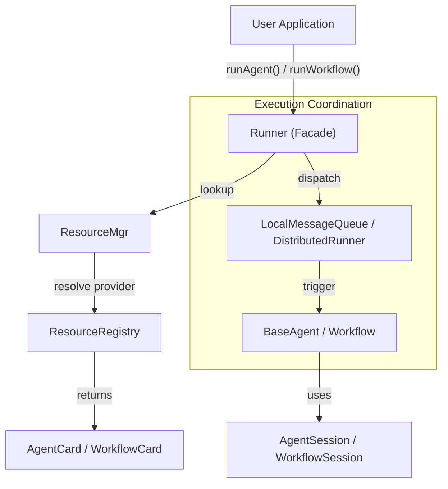

<!-- source: DeepWiki mcp.deepwiki.com · repo openJiuwen-ai/agent-core-java · page 7 Runner and Resource Management · fetched 2026-11-02 -->

# Runner and Resource Management

Relevant source files

The following files were used as context for generating this wiki page:

- [src/main/java/com/openjiuwen/core/runner/DistributedConfig.java](src/main/java/com/openjiuwen/core/runner/DistributedConfig.java)
- [src/main/java/com/openjiuwen/core/runner/MessageQueueConfig.java](src/main/java/com/openjiuwen/core/runner/MessageQueueConfig.java)
- [src/main/java/com/openjiuwen/core/runner/MessageQueueType.java](src/main/java/com/openjiuwen/core/runner/MessageQueueType.java)
- [src/main/java/com/openjiuwen/core/runner/PulsarConfig.java](src/main/java/com/openjiuwen/core/runner/PulsarConfig.java)
- [src/main/java/com/openjiuwen/core/runner/Runner.java](src/main/java/com/openjiuwen/core/runner/Runner.java)
- [src/main/java/com/openjiuwen/core/runner/RunnerConfig.java](src/main/java/com/openjiuwen/core/runner/RunnerConfig.java)
- [src/main/java/com/openjiuwen/core/runner/RunnerImpl.java](src/main/java/com/openjiuwen/core/runner/RunnerImpl.java)
- [src/main/java/com/openjiuwen/core/runner/base/AgentProvider.java](src/main/java/com/openjiuwen/core/runner/base/AgentProvider.java)
- [src/main/java/com/openjiuwen/core/runner/base/Error.java](src/main/java/com/openjiuwen/core/runner/base/Error.java)
- [src/main/java/com/openjiuwen/core/runner/callback/CallbackFramework.java](src/main/java/com/openjiuwen/core/runner/callback/CallbackFramework.java)
- [src/main/java/com/openjiuwen/core/runner/drunner/DistributedRunner.java](src/main/java/com/openjiuwen/core/runner/drunner/DistributedRunner.java)
- [src/main/java/com/openjiuwen/core/runner/drunner/dmessage_queue/FakeMessageQueue.java](src/main/java/com/openjiuwen/core/runner/drunner/dmessage_queue/FakeMessageQueue.java)
- [src/main/java/com/openjiuwen/core/runner/drunner/dmessage_queue/MessageQueueFactory.java](src/main/java/com/openjiuwen/core/runner/drunner/dmessage_queue/MessageQueueFactory.java)
- [src/main/java/com/openjiuwen/core/runner/drunner/dmessage_queue/MessageSerializer.java](src/main/java/com/openjiuwen/core/runner/drunner/dmessage_queue/MessageSerializer.java)
- [src/main/java/com/openjiuwen/core/runner/drunner/dmessage_queue/dsubscription/ResponseCollector.java](src/main/java/com/openjiuwen/core/runner/drunner/dmessage_queue/dsubscription/ResponseCollector.java)
- [src/main/java/com/openjiuwen/core/runner/drunner/dmessage_queue/message/DMessageType.java](src/main/java/com/openjiuwen/core/runner/drunner/dmessage_queue/message/DMessageType.java)
- [src/main/java/com/openjiuwen/core/runner/drunner/dmessage_queue/message/DmqMessage.java](src/main/java/com/openjiuwen/core/runner/drunner/dmessage_queue/message/DmqMessage.java)
- [src/main/java/com/openjiuwen/core/runner/drunner/dmessage_queue/message/DmqRequestMessage.java](src/main/java/com/openjiuwen/core/runner/drunner/dmessage_queue/message/DmqRequestMessage.java)
- [src/main/java/com/openjiuwen/core/runner/drunner/dmessage_queue/message/DmqResponseMessage.java](src/main/java/com/openjiuwen/core/runner/drunner/dmessage_queue/message/DmqResponseMessage.java)
- [src/main/java/com/openjiuwen/core/runner/resourcemanager/AbstractManager.java](src/main/java/com/openjiuwen/core/runner/resourcemanager/AbstractManager.java)
- [src/main/java/com/openjiuwen/core/runner/resourcemanager/PromptMgr.java](src/main/java/com/openjiuwen/core/runner/resourcemanager/PromptMgr.java)
- [src/main/java/com/openjiuwen/core/runner/resourcemanager/ResourceMgr.java](src/main/java/com/openjiuwen/core/runner/resourcemanager/ResourceMgr.java)
- [src/main/java/com/openjiuwen/core/runner/resourcemanager/ResourceRegistry.java](src/main/java/com/openjiuwen/core/runner/resourcemanager/ResourceRegistry.java)
- [src/main/java/com/openjiuwen/core/runner/resourcemanager/SysOperationMgr.java](src/main/java/com/openjiuwen/core/runner/resourcemanager/SysOperationMgr.java)
- [src/main/java/com/openjiuwen/core/runner/resourcemanager/TagMgr.java](src/main/java/com/openjiuwen/core/runner/resourcemanager/TagMgr.java)
- [src/test/java/com/openjiuwen/core/runner/RunnerTest.java](src/test/java/com/openjiuwen/core/runner/RunnerTest.java)

The **Runner** serves as the top-level execution coordinator for the `agent-core-java` framework. It provides a unified entry point for launching agents, executing workflows, and managing the lifecycle of all system resources. Whether running in a local process or a distributed environment, the Runner abstracts the underlying message queues and resource discovery mechanisms.

### Runner Architecture

The system uses a singleton facade, `Runner`, which delegates operations to a `RunnerImpl` instance [src/main/java/com/openjiuwen/core/runner/Runner.java:75-82](). It coordinates three primary subsystems:
1.  **ResourceMgr**: Handles the registration and retrieval of agents, tools, workflows, and prompts.
2.  **Message Queue (PubSub)**: Manages communication between execution components.
3.  **Callback Framework**: Handles asynchronous events and hooks during execution.

#### Runner Execution Flow
The following diagram illustrates how the `Runner` bridges the request to the underlying execution entities.

Sources: [src/main/java/com/openjiuwen/core/runner/Runner.java:138-185](), [src/main/java/com/openjiuwen/core/runner/resourcemanager/ResourceMgr.java:46-63](), [src/main/java/com/openjiuwen/core/runner/RunnerImpl.java:25-45]()

---

### Resource Management

The `ResourceMgr` is an aggregate facade that mirrors the resource management capabilities of the framework [src/main/java/com/openjiuwen/core/runner/resourcemanager/ResourceMgr.java:41-46](). It manages a `ResourceRegistry` which contains specialized managers for different entity types:

| Manager | Resource Type | Description |
| :--- | :--- | :--- |
| `AgentManager` | `AgentCard` | Manages single agent definitions and providers [src/main/java/com/openjiuwen/core/runner/resourcemanager/ResourceRegistry.java:106-108](). |
| `WorkflowManager` | `WorkflowCard` | Manages Pregel-based workflows [src/main/java/com/openjiuwen/core/runner/resourcemanager/ResourceRegistry.java:94-96](). |
| `ToolMgr` | `ToolCard` | Handles registration of local tools and MCP tools [src/main/java/com/openjiuwen/core/runner/resourcemanager/ResourceRegistry.java:90-92](). |
| `PromptMgr` | `PromptTemplate` | Manages reusable prompt templates [src/main/java/com/openjiuwen/core/runner/resourcemanager/ResourceRegistry.java:98-100](). |
| `TagMgr` | `Tags` | Provides metadata-based discovery for all resources [src/main/java/com/openjiuwen/core/runner/resourcemanager/TagMgr.java:19-20](). |

For details on how to register and resolve these resources at runtime, see **[Runner API and Resource Manager](#7.1)**.

Sources: [src/main/java/com/openjiuwen/core/runner/resourcemanager/ResourceRegistry.java:14-21](), [src/main/java/com/openjiuwen/core/runner/resourcemanager/ResourceMgr.java:48-60]()

---

### Distributed Execution and Messaging

The framework supports both local and distributed execution modes, toggled via `RunnerConfig` [src/main/java/com/openjiuwen/core/runner/RunnerConfig.java:40-45](). 

*   **Local Mode**: Uses `LocalMessageQueue` for in-process communication [src/main/java/com/openjiuwen/core/runner/mq/LocalMessageQueue.java:8-10]().
*   **Distributed Mode**: Utilizes the `DistributedRunner` and external message brokers (e.g., Pulsar, ZeroMQ) to coordinate agents across different network nodes [src/main/java/com/openjiuwen/core/runner/DistributedConfig.java:10-15]().

#### Distributed Message Schema
Communication in distributed mode relies on standardized message envelopes:
*   `DmqRequestMessage`: Contains the `replyTopic`, `receiverId`, and `enableStream` flags [src/main/java/com/openjiuwen/core/runner/drunner/dmessage_queue/message/DmqRequestMessage.java:18-27]().
*   `DmqResponseMessage`: Carries execution results, status updates, or stream chunks back to the requester [src/main/java/com/openjiuwen/core/runner/drunner/dmessage_queue/message/DmqResponseMessage.java:18-28]().

For details on distributed deployment, message queue providers, and remote agent communication, see **[Distributed Runner and Message Queue](#7.2)**.

Sources: [src/main/java/com/openjiuwen/core/runner/Runner.java:102-108](), [src/main/java/com/openjiuwen/core/runner/drunner/dmessage_queue/message/DmqMessage.java:5-10]()

---

### Child Pages
- **[Runner API and Resource Manager](#7.1)**: Detailed guide on `Runner.runAgent()`, `RunnerConfig` parameters, and using `ResourceMgr` for tool and agent registration.
- **[Distributed Runner and Message Queue](#7.2)**: Deep dive into `DistributedRunner` architecture, `MessageQueueFactory`, and configuring Pulsar or ZeroMQ backends.

---

