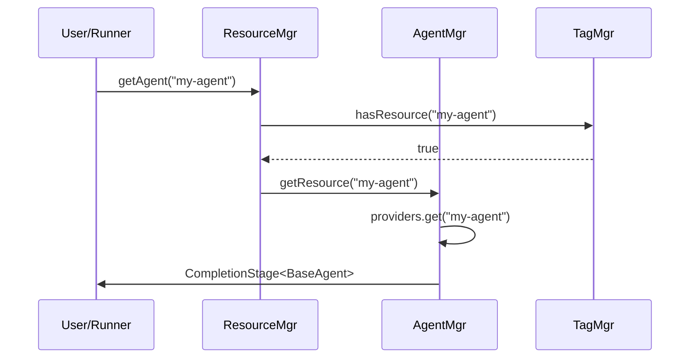

<!-- source: DeepWiki mcp.deepwiki.com · repo openJiuwen-ai/agent-core-java · page 7.1 Runner API and Resource Manager · fetched 2026-11-02 -->

# Runner API and Resource Manager

<details>
<summary>Relevant source files</summary>

The following files were used as context for generating this wiki page:

- [src/main/java/com/openjiuwen/core/common/schema/BaseCard.java](src/main/java/com/openjiuwen/core/common/schema/BaseCard.java)
- [src/main/java/com/openjiuwen/core/runner/DistributedConfig.java](src/main/java/com/openjiuwen/core/runner/DistributedConfig.java)
- [src/main/java/com/openjiuwen/core/runner/MessageQueueConfig.java](src/main/java/com/openjiuwen/core/runner/MessageQueueConfig.java)
- [src/main/java/com/openjiuwen/core/runner/MessageQueueType.java](src/main/java/com/openjiuwen/core/runner/MessageQueueType.java)
- [src/main/java/com/openjiuwen/core/runner/PulsarConfig.java](src/main/java/com/openjiuwen/core/runner/PulsarConfig.java)
- [src/main/java/com/openjiuwen/core/runner/Runner.java](src/main/java/com/openjiuwen/core/runner/Runner.java)
- [src/main/java/com/openjiuwen/core/runner/RunnerConfig.java](src/main/java/com/openjiuwen/core/runner/RunnerConfig.java)
- [src/main/java/com/openjiuwen/core/runner/RunnerImpl.java](src/main/java/com/openjiuwen/core/runner/RunnerImpl.java)
- [src/main/java/com/openjiuwen/core/runner/base/AgentProvider.java](src/main/java/com/openjiuwen/core/runner/base/AgentProvider.java)
- [src/main/java/com/openjiuwen/core/runner/base/Error.java](src/main/java/com/openjiuwen/core/runner/base/Error.java)
- [src/main/java/com/openjiuwen/core/runner/resourcemanager/AbstractManager.java](src/main/java/com/openjiuwen/core/runner/resourcemanager/AbstractManager.java)
- [src/main/java/com/openjiuwen/core/runner/resourcemanager/PromptMgr.java](src/main/java/com/openjiuwen/core/runner/resourcemanager/PromptMgr.java)
- [src/main/java/com/openjiuwen/core/runner/resourcemanager/ResourceMgr.java](src/main/java/com/openjiuwen/core/runner/resourcemanager/ResourceMgr.java)
- [src/main/java/com/openjiuwen/core/runner/resourcemanager/ResourceRegistry.java](src/main/java/com/openjiuwen/core/runner/resourcemanager/ResourceRegistry.java)
- [src/main/java/com/openjiuwen/core/runner/resourcemanager/SysOperationMgr.java](src/main/java/com/openjiuwen/core/runner/resourcemanager/SysOperationMgr.java)
- [src/main/java/com/openjiuwen/core/runner/resourcemanager/TagMgr.java](src/main/java/com/openjiuwen/core/runner/resourcemanager/TagMgr.java)
- [src/test/java/com/openjiuwen/core/runner/RunnerTest.java](src/test/java/com/openjiuwen/core/runner/RunnerTest.java)

</details>


The **Runner** system serves as the primary entry point for executing agents and workflows within the `agent-core-java` framework. It provides a singleton facade for high-level operations, manages the lifecycle of the execution environment, and coordinates the registration and resolution of resources via the **Resource Manager**.

## Runner API

The `Runner` class [src/main/java/com/openjiuwen/core/runner/Runner.java:75-77]() is a singleton facade that delegates execution to an internal `RunnerImpl` [src/main/java/com/openjiuwen/core/runner/Runner.java:77-78](). It abstracts the complexity of session initialization, message queue management, and resource resolution.

### Key Execution Methods

The Runner provides several overloads for running agents and workflows, supporting both synchronous and asynchronous (via `CompletionStage`) execution.

| Method | Description |
| :--- | :--- |
| `runAgent(...)` | Executes a single agent. Supports `String` IDs, `BaseAgent` instances, or `RemoteAgent` for distributed calls. [src/main/java/com/openjiuwen/core/runner/Runner.java:175-185]() |
| `runWorkflow(...)` | Executes a Pregel-based workflow. Supports `String` IDs or `Workflow` instances. [src/main/java/com/openjiuwen/core/runner/Runner.java:138-163]() |
| `runWorkflowStreaming(...)` | Executes a workflow and returns an `Iterator<WorkflowChunk>` for real-time output processing. [src/main/java/com/openjiuwen/core/runner/Runner.java:165-173]() |
| `runAgentGroup(...)` | Executes a multi-agent team or group. [src/main/java/com/openjiuwen/core/runner/Runner.java:214-222]() |

### Lifecycle Management

*   **`start()`**: Initializes the execution environment, including the `LocalMessageQueue` and, if configured, the `DistributedRunner` [src/main/java/com/openjiuwen/core/runner/Runner.java:130-132]().
*   **`stop()`**: Gracefully shuts down message queues and releases all registered resources via `ResourceMgr.release()` [src/main/java/com/openjiuwen/core/runner/Runner.java:134-136]().

**Sources:** [src/main/java/com/openjiuwen/core/runner/Runner.java:75-222](), [src/main/java/com/openjiuwen/core/runner/RunnerImpl.java:22-72]()

## Runner Configuration

Execution behavior is governed by `RunnerConfig` [src/main/java/com/openjiuwen/core/runner/RunnerConfig.java](). This configuration can be set globally via `Runner.setConfig(RunnerConfig)` [src/main/java/com/openjiuwen/core/runner/Runner.java:122-124]().

### Configuration Properties

*   **`distributedMode`**: A boolean flag determining if the runner operates locally or connects to a distributed message queue (e.g., Pulsar) [src/main/java/com/openjiuwen/core/runner/RunnerConfig.java:45-47]().
*   **`checkpointerConfig`**: Defines how agent states are persisted (e.g., `InMemoryCheckpointer` or a database-backed store) [src/main/java/com/openjiuwen/core/runner/RunnerConfig.java:51-53]().
*   **`envPrefix`**: A string prefix used for resource isolation in multi-tenant or multi-environment deployments [src/main/java/com/openjiuwen/core/runner/RunnerConfig.java:36-38]().

**Sources:** [src/main/java/com/openjiuwen/core/runner/RunnerConfig.java:1-60](), [src/main/java/com/openjiuwen/core/runner/DistributedConfig.java:25-45]()

## Resource Manager (ResourceMgr)

The `ResourceMgr` [src/main/java/com/openjiuwen/core/runner/resourcemanager/ResourceMgr.java:46]() is the central hub for registering and resolving all entities required by the framework. It utilizes a set of specialized sub-managers to handle different resource types.

### Logical Resource Mapping
The following diagram bridges the high-level resource concepts to their specific manager implementations and card types.

**Diagram: Resource Entity Mapping**
```mermaid
graph TD
    subgraph "Natural Language Space"
        R["Resource"]
        T["Tool"]
        W["Workflow"]
        A["Agent"]
        P["Prompt"]
        S["SysOp"]
    end

    subgraph "Code Entity Space"
        RM["ResourceMgr"]
        TR["ToolMgr"]
        WM["WorkflowMgr"]
        AM["AgentMgr"]
        PM["PromptMgr"]
        SM["SysOperationMgr"]
        
        BC["BaseCard"]
        TC["ToolCard"]
        WC["WorkflowCard"]
        AC["AgentCard"]
        SC["SysOperationCard"]
    end

    R --> RM
    T --> TR
    W --> WM
    A --> AM
    P --> PM
    S --> SM

    TR -.-> TC
    WM -.-> WC
    AM -.-> AC
    SM -.-> SC
    TC --|> BC
    WC --|> BC
    AC --|> BC
    SC --|> BC
```
**Sources:** [src/main/java/com/openjiuwen/core/runner/resourcemanager/ResourceMgr.java:46-60](), [src/main/java/com/openjiuwen/core/runner/resourcemanager/ResourceRegistry.java:13-21](), [src/main/java/com/openjiuwen/core/common/schema/BaseCard.java:9-13]()

### Registration Workflow

Resources are registered using a **Card** (metadata) and a **Provider** (a functional interface or supplier that yields the instance).

1.  **Validation**: The `ResourceMgr` validates the card ID and resource kind [src/main/java/com/openjiuwen/core/runner/resourcemanager/ResourceMgr.java:71-74]().
2.  **Storage**: Metadata is stored in `idToCard`, and the provider is stored in the corresponding `AbstractManager` [src/main/java/com/openjiuwen/core/runner/resourcemanager/AbstractManager.java:24-29]().
3.  **Tagging**: Optional tags are associated with the resource via `TagMgr` [src/main/java/com/openjiuwen/core/runner/resourcemanager/ResourceMgr.java:75-76]().

### Resource Resolution and Data Flow
When `Runner.runAgent("my-agent", ...)` is called, the system resolves the resource as follows:

**Diagram: Resource Resolution Flow**

**Sources:** [src/main/java/com/openjiuwen/core/runner/resourcemanager/ResourceMgr.java:98-104](), [src/main/java/com/openjiuwen/core/runner/resourcemanager/AbstractManager.java:32-42]()

## Specialized Managers

### Tag Manager (TagMgr)
`TagMgr` [src/main/java/com/openjiuwen/core/runner/resourcemanager/TagMgr.java:19]() manages metadata labels. It supports:
*   **Tagging**: `tagResource(resourceId, tags)` [src/main/java/com/openjiuwen/core/runner/resourcemanager/TagMgr.java:21]().
*   **Discovery**: `findResourcesByTags(tags, strategy, ...)` using `ANY` or `ALL` strategies [src/main/java/com/openjiuwen/core/runner/resourcemanager/TagMgr.java:36-41]().

### Prompt Manager (PromptMgr)
Handles the registration of `PromptTemplate` instances. This allows agents to resolve prompts by ID at runtime, facilitating dynamic prompt updates without code changes [src/main/java/com/openjiuwen/core/runner/resourcemanager/PromptMgr.java:13-18]().

### SysOperation Manager (SysOperationMgr)
Manages `SysOperation` resources, which define capabilities for shell execution, filesystem access, and code sandboxing [src/main/java/com/openjiuwen/core/runner/resourcemanager/SysOperationMgr.java:13-18]().

### AgentProvider
The `AgentProvider<T>` is a functional interface [src/main/java/com/openjiuwen/core/runner/base/AgentProvider.java:17]() used to lazily instantiate agents. This ensures that agents are only created when needed during a `Runner` execution call.

**Sources:** [src/main/java/com/openjiuwen/core/runner/resourcemanager/TagMgr.java:19-56](), [src/main/java/com/openjiuwen/core/runner/resourcemanager/PromptMgr.java:13-18](), [src/main/java/com/openjiuwen/core/runner/base/AgentProvider.java:17-25]()

---

