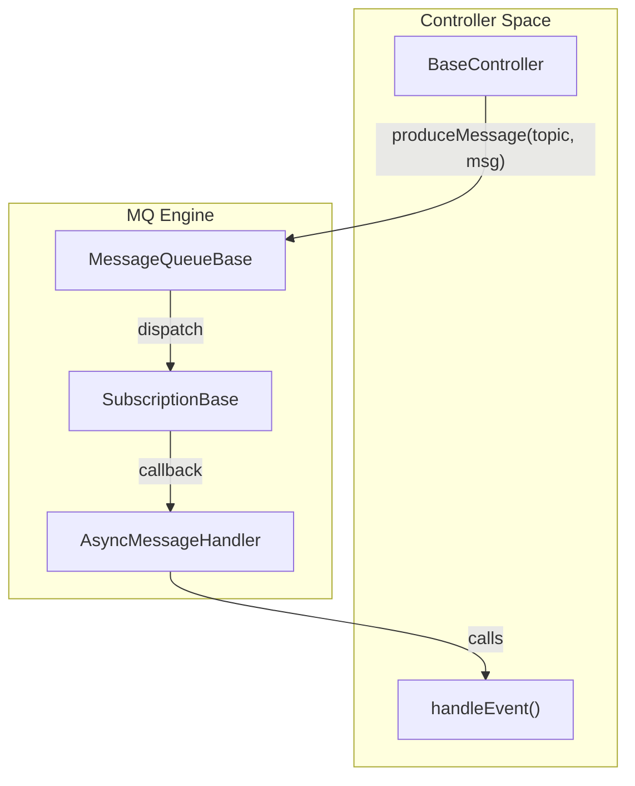
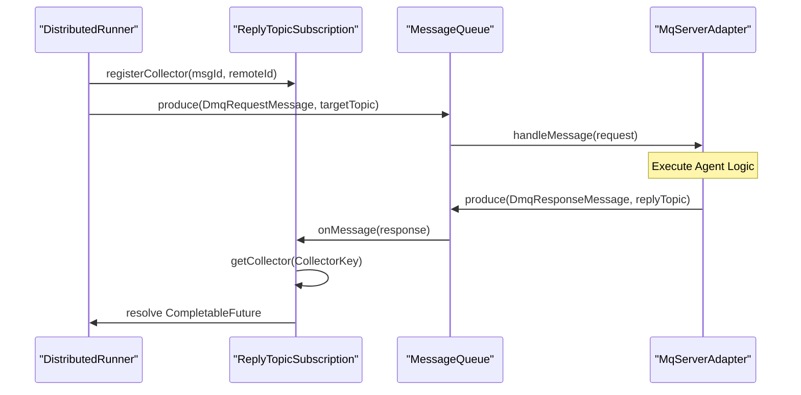

<!-- source: DeepWiki mcp.deepwiki.com · repo openJiuwen-ai/agent-core-java · page 7.2 Distributed Runner and Message Queue · fetched 2026-11-02 -->

# Distributed Runner and Message Queue

Relevant source files

The following files were used as context for generating this wiki page:

- [src/main/java/com/openjiuwen/core/controller/legacy/BaseController.java](src/main/java/com/openjiuwen/core/controller/legacy/BaseController.java)
- [src/main/java/com/openjiuwen/core/foundation/tool/Tool.java](src/main/java/com/openjiuwen/core/foundation/tool/Tool.java)
- [src/main/java/com/openjiuwen/core/multiagent/legacy/BaseGroupController.java](src/main/java/com/openjiuwen/core/multiagent/legacy/BaseGroupController.java)
- [src/main/java/com/openjiuwen/core/runner/RunnerImpl.java](src/main/java/com/openjiuwen/core/runner/RunnerImpl.java)
- [src/main/java/com/openjiuwen/core/runner/callback/CallbackFramework.java](src/main/java/com/openjiuwen/core/runner/callback/CallbackFramework.java)
- [src/main/java/com/openjiuwen/core/runner/drunner/DistributedRunner.java](src/main/java/com/openjiuwen/core/runner/drunner/DistributedRunner.java)
- [src/main/java/com/openjiuwen/core/runner/drunner/dmessage_queue/FakeMessageQueue.java](src/main/java/com/openjiuwen/core/runner/drunner/dmessage_queue/FakeMessageQueue.java)
- [src/main/java/com/openjiuwen/core/runner/drunner/dmessage_queue/MessageQueueFactory.java](src/main/java/com/openjiuwen/core/runner/drunner/dmessage_queue/MessageQueueFactory.java)
- [src/main/java/com/openjiuwen/core/runner/drunner/dmessage_queue/MessageSerializer.java](src/main/java/com/openjiuwen/core/runner/drunner/dmessage_queue/MessageSerializer.java)
- [src/main/java/com/openjiuwen/core/runner/drunner/dmessage_queue/dsubscription/ReplyTopicSubscription.java](src/main/java/com/openjiuwen/core/runner/drunner/dmessage_queue/dsubscription/ReplyTopicSubscription.java)
- [src/main/java/com/openjiuwen/core/runner/drunner/dmessage_queue/dsubscription/ResponseCollector.java](src/main/java/com/openjiuwen/core/runner/drunner/dmessage_queue/dsubscription/ResponseCollector.java)
- [src/main/java/com/openjiuwen/core/runner/drunner/dmessage_queue/message/DMessageType.java](src/main/java/com/openjiuwen/core/runner/drunner/dmessage_queue/message/DMessageType.java)
- [src/main/java/com/openjiuwen/core/runner/drunner/dmessage_queue/message/DmqMessage.java](src/main/java/com/openjiuwen/core/runner/drunner/dmessage_queue/message/DmqMessage.java)
- [src/main/java/com/openjiuwen/core/runner/drunner/dmessage_queue/message/DmqRequestMessage.java](src/main/java/com/openjiuwen/core/runner/drunner/dmessage_queue/message/DmqRequestMessage.java)
- [src/main/java/com/openjiuwen/core/runner/drunner/dmessage_queue/message/DmqResponseMessage.java](src/main/java/com/openjiuwen/core/runner/drunner/dmessage_queue/message/DmqResponseMessage.java)
- [src/main/java/com/openjiuwen/core/runner/drunner/server_adapter/MqServerAdapter.java](src/main/java/com/openjiuwen/core/runner/drunner/server_adapter/MqServerAdapter.java)
- [src/main/java/com/openjiuwen/core/runner/mq/AsyncMessageHandler.java](src/main/java/com/openjiuwen/core/runner/mq/AsyncMessageHandler.java)
- [src/main/java/com/openjiuwen/core/runner/mq/SubscriptionBase.java](src/main/java/com/openjiuwen/core/runner/mq/SubscriptionBase.java)
- [src/main/java/com/openjiuwen/core/runner/mq/SubscriptionInMemory.java](src/main/java/com/openjiuwen/core/runner/mq/SubscriptionInMemory.java)
- [src/main/java/com/openjiuwen/core/runner/resourcemanager/AbstractManager.java](src/main/java/com/openjiuwen/core/runner/resourcemanager/AbstractManager.java)
- [src/main/java/com/openjiuwen/core/runner/resourcemanager/PromptMgr.java](src/main/java/com/openjiuwen/core/runner/resourcemanager/PromptMgr.java)
- [src/main/java/com/openjiuwen/core/runner/resourcemanager/ResourceMgr.java](src/main/java/com/openjiuwen/core/runner/resourcemanager/ResourceMgr.java)
- [src/main/java/com/openjiuwen/core/runner/resourcemanager/ResourceRegistry.java](src/main/java/com/openjiuwen/core/runner/resourcemanager/ResourceRegistry.java)
- [src/main/java/com/openjiuwen/core/runner/resourcemanager/SysOperationMgr.java](src/main/java/com/openjiuwen/core/runner/resourcemanager/SysOperationMgr.java)
- [src/main/java/com/openjiuwen/core/runner/resourcemanager/TagMgr.java](src/main/java/com/openjiuwen/core/runner/resourcemanager/TagMgr.java)
- [src/test/java/com/openjiuwen/core/runner/mq/MessageQueueInMemoryTest.java](src/test/java/com/openjiuwen/core/runner/mq/MessageQueueInMemoryTest.java)

The **Distributed Runner** and its underlying **Message Queue** abstraction provide the infrastructure for cross-process agent communication, remote agent invocation, and scalable deployment within the `agent-core-java` framework. This subsystem allows agents to operate as distributed services, communicating via structured messages over various transport protocols like local memory, ZeroMQ, or Pulsar.

## Message Queue Abstraction

The framework decouples the execution logic from the transport layer through `MessageQueueBase`. This allows the same agent code to run locally in a single JVM or distributed across a cluster.

### Key Classes and Roles

| Class | Responsibility |
| :--- | :--- |
| `MessageQueueBase` | Abstract base class defining `produceMessage`, `subscribe`, and `unsubscribe` contracts [src/main/java/com/openjiuwen/core/controller/legacy/BaseController.java:13-15](). |
| `LocalMessageQueue` | A thread-safe, in-memory message queue implementation for single-process deployments [src/main/java/com/openjiuwen/core/runner/RunnerImpl.java:27-37](). |
| `MessageQueueInMemory` | Provides bounded queues and background consumers for asynchronous message routing [src/main/java/com/openjiuwen/core/runner/mq/MessageQueueInMemory.java:32-61](). |
| `SubscriptionBase` | Represents an active listener on a specific topic [src/main/java/com/openjiuwen/core/runner/mq/SubscriptionBase.java:13-27](). |
| `AsyncMessageHandler` | A functional interface for non-blocking message processing [src/main/java/com/openjiuwen/core/runner/mq/AsyncMessageHandler.java:18-22](). |

### Logical to Physical Message Flow
The following diagram illustrates how the `BaseController` interacts with the `MessageQueueBase` to route events.

**Message Routing Architecture**

**Sources:** [src/main/java/com/openjiuwen/core/controller/legacy/BaseController.java:34-100](), [src/main/java/com/openjiuwen/core/runner/mq/SubscriptionInMemory.java:107-128]().

---

## Distributed Messaging Protocol

In a distributed setup, the `DistributedRunner` utilizes a specialized message schema to handle requests across network boundaries.

### Request and Response Schema

Communication is primarily handled via two message types:
1.  **`DmqRequestMessage`**: Carries the invocation payload, `replyTopic`, and expiration metadata [src/main/java/com/openjiuwen/core/runner/drunner/dmessage_queue/message/DmqRequestMessage.java:16]().
2.  **`DmqResponseMessage`**: Returns results (batch or stream) to the caller's `replyTopic` [src/main/java/com/openjiuwen/core/runner/drunner/dmessage_queue/message/DmqResponseMessage.java:7]().

### DMessageType
Messages are categorized by `DMessageType` to handle different lifecycles [src/main/java/com/openjiuwen/core/runner/drunner/dmessage_queue/message/DMessageType.java:15]():
- `INVOKE`: Standard synchronous call.
- `STREAM`: Incremental result streaming.
- `STOP`: Signal to terminate a running task [src/main/java/com/openjiuwen/core/runner/drunner/server_adapter/MqServerAdapter.java:141-144]().

**Sources:** [src/main/java/com/openjiuwen/core/runner/drunner/server_adapter/MqServerAdapter.java:15-18](), [src/main/java/com/openjiuwen/core/runner/drunner/dmessage_queue/message/DmqRequestMessage.java:16]().

---

## Remote Agent Invocation (MqServerAdapter)

The `MqServerAdapter` acts as the server-side listener for distributed agents. It subscribes to a specific topic and dispatches incoming `DmqRequestMessage` payloads to the local agent runner.

### Lifecycle of a Distributed Request
1.  **Subscription**: The adapter calls `mq.subscribe(topic)` to listen for tasks [src/main/java/com/openjiuwen/core/runner/drunner/server_adapter/MqServerAdapter.java:84-91]().
2.  **Task Execution**: Incoming messages are wrapped in a `MessageTask` and executed via a Virtual Thread executor [src/main/java/com/openjiuwen/core/runner/drunner/server_adapter/MqServerAdapter.java:151-152]().
3.  **Expiration**: If a message has an `expireAt` timestamp, the `MqServerAdapter` schedules a timeout cancellation [src/main/java/com/openjiuwen/core/runner/drunner/server_adapter/MqServerAdapter.java:153-159]().
4.  **Response**: Results are produced back to the `message.getReplyTopic()` using `MqMessageUtils` [src/main/java/com/openjiuwen/core/runner/drunner/server_adapter/MqServerAdapter.java:165-180]().

**Sources:** [src/main/java/com/openjiuwen/core/runner/drunner/server_adapter/MqServerAdapter.java:46-180]().

---

## Reply Topic and Response Collection

When a `DistributedRunner` sends a request, it generates a unique `replyTopic` for the current instance. The `ReplyTopicSubscription` manages the listening and dispatching of responses back to the original caller.

### ReplyTopicSubscription Implementation
The `ReplyTopicSubscription` uses `ResponseCollector` objects to correlate asynchronous responses with their corresponding requests using a `CollectorKey` (composed of `senderId`, `messageId`, and `requestId`) [src/main/java/com/openjiuwen/core/runner/drunner/dmessage_queue/dsubscription/ReplyTopicSubscription.java:33-42]().

**Distributed Request-Response Flow**

### Key Functions
- **`activate()`**: Subscribes to the unique reply topic (e.g., `openjiuwen.reply.runner.{instance_id}`) [src/main/java/com/openjiuwen/core/runner/drunner/dmessage_queue/dsubscription/ReplyTopicSubscription.java:56-68]().
- **`registerCollector()`**: Ensures the runner is ready to receive a specific `messageId` before sending the request [src/main/java/com/openjiuwen/core/runner/drunner/dmessage_queue/dsubscription/ReplyTopicSubscription.java:95-122]().
- **`onMessage()`**: Dispatches incoming responses to the correct collector or discards them if no collector is found [src/main/java/com/openjiuwen/core/runner/drunner/dmessage_queue/dsubscription/ReplyTopicSubscription.java:83-93]().

**Sources:** [src/main/java/com/openjiuwen/core/runner/drunner/dmessage_queue/dsubscription/ReplyTopicSubscription.java:33-160]().

---

## Resource Registration for Distributed Agents

The `ResourceMgr` facilitates the registration of remote agents by associating an `AgentCard` with a `RemoteAgent` stub. This allows the runner to treat remote agents exactly like local ones [src/main/java/com/openjiuwen/core/runner/resourcemanager/ResourceMgr.java:127-140]().

### Configuration via ResourceMgr
- **`addAgent(AgentCard, RemoteAgent)`**: Registers a distributed agent provider [src/main/java/com/openjiuwen/core/runner/resourcemanager/ResourceMgr.java:127-140]().
- **`interfaceUrl`**: Can be provided during registration to specify the network endpoint for the remote agent [src/main/java/com/openjiuwen/core/runner/resourcemanager/ResourceMgr.java:119-125]().

**Sources:** [src/main/java/com/openjiuwen/core/runner/resourcemanager/ResourceMgr.java:111-150]().

---

