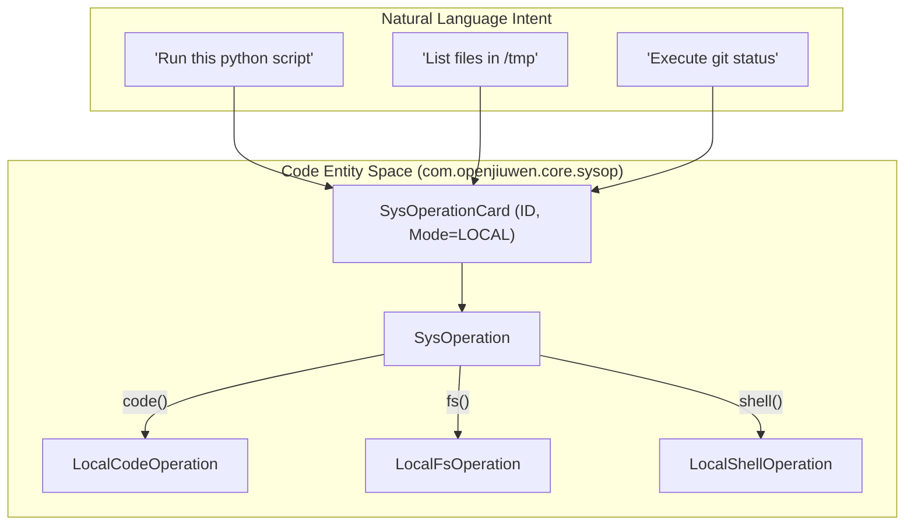
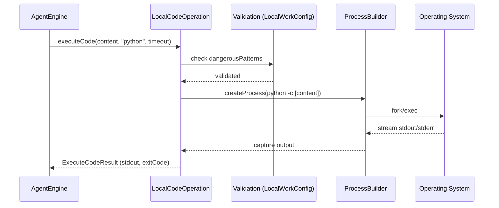

<!-- source: DeepWiki mcp.deepwiki.com · repo openJiuwen-ai/agent-core-java · page 8.1 Local Shell and Code Execution · fetched 2026-11-02 -->

# Local Shell and Code Execution

Relevant source files

The following files were used as context for generating this wiki page:

- [src/main/java/com/openjiuwen/core/sysop/BaseCodeOperation.java](src/main/java/com/openjiuwen/core/sysop/BaseCodeOperation.java)
- [src/main/java/com/openjiuwen/core/sysop/BaseFsOperation.java](src/main/java/com/openjiuwen/core/sysop/BaseFsOperation.java)
- [src/main/java/com/openjiuwen/core/sysop/BaseOperation.java](src/main/java/com/openjiuwen/core/sysop/BaseOperation.java)
- [src/main/java/com/openjiuwen/core/sysop/BaseShellOperation.java](src/main/java/com/openjiuwen/core/sysop/BaseShellOperation.java)
- [src/main/java/com/openjiuwen/core/sysop/FsConstants.java](src/main/java/com/openjiuwen/core/sysop/FsConstants.java)
- [src/main/java/com/openjiuwen/core/sysop/OperationMode.java](src/main/java/com/openjiuwen/core/sysop/OperationMode.java)
- [src/main/java/com/openjiuwen/core/sysop/SysOperation.java](src/main/java/com/openjiuwen/core/sysop/SysOperation.java)
- [src/main/java/com/openjiuwen/core/sysop/SysOperationCard.java](src/main/java/com/openjiuwen/core/sysop/SysOperationCard.java)
- [src/main/java/com/openjiuwen/core/sysop/SysOperationToolAdapter.java](src/main/java/com/openjiuwen/core/sysop/SysOperationToolAdapter.java)
- [src/main/java/com/openjiuwen/core/sysop/ToolIdProxy.java](src/main/java/com/openjiuwen/core/sysop/ToolIdProxy.java)
- [src/main/java/com/openjiuwen/core/sysop/config/LocalWorkConfig.java](src/main/java/com/openjiuwen/core/sysop/config/LocalWorkConfig.java)
- [src/main/java/com/openjiuwen/core/sysop/local/LocalFsOperation.java](src/main/java/com/openjiuwen/core/sysop/local/LocalFsOperation.java)
- [src/test/java/com/openjiuwen/core/sysop/local/LocalCodeOperationTest.java](src/test/java/com/openjiuwen/core/sysop/local/LocalCodeOperationTest.java)
- [src/test/java/com/openjiuwen/core/sysop/local/LocalShellOperationTest.java](src/test/java/com/openjiuwen/core/sysop/local/LocalShellOperationTest.java)
- [src/test/java/com/openjiuwen/core/systemtest/ContextEngineAdvancedSystemTest.java](src/test/java/com/openjiuwen/core/systemtest/ContextEngineAdvancedSystemTest.java)
- [src/test/java/com/openjiuwen/core/systemtest/SessionAdvancedSystemTest.java](src/test/java/com/openjiuwen/core/systemtest/SessionAdvancedSystemTest.java)
- [src/test/java/com/openjiuwen/core/systemtest/SysOpAdvancedSystemTest.java](src/test/java/com/openjiuwen/core/systemtest/SysOpAdvancedSystemTest.java)
- [src/test/java/com/openjiuwen/core/systemtest/ToolAdvancedSystemTest.java](src/test/java/com/openjiuwen/core/systemtest/ToolAdvancedSystemTest.java)
- [src/test/java/com/openjiuwen/core/systemtest/WorkflowAdvancedSystemTest.java](src/test/java/com/openjiuwen/core/systemtest/WorkflowAdvancedSystemTest.java)

The `agent-core-java` framework provides a robust System Operation (SysOp) subsystem that allows agents to interact with the host environment. When configured in `LOCAL` mode, agents can execute shell commands, run arbitrary code snippets (Python/JavaScript), and manipulate the filesystem directly on the machine running the agent engine.

## Overview of Local Operations

Local operations are encapsulated within the `com.openjiuwen.core.sysop.local` package. These operations are managed by `SysOperation` [src/main/java/com/openjiuwen/core/sysop/SysOperation.java:23-23](), which acts as a facade to access specific operation types: `LocalShellOperation`, `LocalCodeOperation`, and `LocalFsOperation`.

### System Operation Configuration
Execution behavior is defined via the `SysOperationCard` [src/test/java/com/openjiuwen/core/sysop/local/LocalShellOperationTest.java:44-48](). Key configuration parameters for local execution reside in `LocalWorkConfig` [src/main/java/com/openjiuwen/core/sysop/config/LocalWorkConfig.java](), including:
*   `workDir`: The base directory for all operations.
*   `shellAllowlist`: A list of permitted commands.
*   `dangerousPatterns`: Regex patterns used to block malicious strings (e.g., `rm -rf /`).
*   `sandboxRoot`: Restricts filesystem operations to a specific root path for pseudo-isolation.

### Component Relationship: Natural Language to Code Entity
This diagram illustrates how an agent's intent to perform a system action maps to specific Java entities.

**SysOp Entity Mapping**

Sources: [src/main/java/com/openjiuwen/core/sysop/SysOperation.java:58-69](), [src/test/java/com/openjiuwen/core/sysop/local/LocalShellOperationTest.java:41-48]()

---

## Local Shell Execution

The `LocalShellOperation` class handles direct command line interactions. It supports various execution modes to accommodate synchronous results, streaming output, or long-running background tasks.

### Key Execution Methods
1.  **`executeCmd`**: A standard synchronous execution that returns an `ExecuteCmdResult` containing `stdout`, `stderr`, and `exitCode` [src/test/java/com/openjiuwen/core/sysop/local/LocalShellOperationTest.java:101-107]().
2.  **`executeCmdStream`**: Returns a reactive stream of `ExecuteCmdStreamResult`, allowing the agent to process output line-by-line as it is generated [src/test/java/com/openjiuwen/core/sysop/local/LocalShellOperationTest.java:55-75]().
3.  **`executeCmdBackground`**: Initiates a process that runs independently of the main agent loop, returning a process handle/ID.

### Shell Types
The system supports different shell environments via `ShellType`:
*   `BASH`: Standard Unix shell.
*   `POWERSHELL` / `CMD`: Windows-specific environments.
*   `AUTO`: Automatically detects the appropriate shell based on the host OS [src/test/java/com/openjiuwen/core/sysop/local/LocalShellOperationTest.java:101-101]().

Sources: [src/main/java/com/openjiuwen/core/sysop/local/LocalShellOperation.java](), [src/test/java/com/openjiuwen/core/sysop/local/LocalShellOperationTest.java:101-129]()

---

## Local Code Execution

`LocalCodeOperation` allows the agent to execute snippets of code. This is primarily used for data processing or algorithmic tasks that are complex to express in natural language or prompts.

### Supported Languages
*   **Python**: Executed via the local `python` or `python3` interpreter [src/test/java/com/openjiuwen/core/sysop/local/LocalCodeOperationTest.java:83-97]().
*   **JavaScript (Node.js)**: Executed via the local `node` runtime [src/test/java/com/openjiuwen/core/systemtest/SysOpAdvancedSystemTest.java:88-90]().

### Data Flow for Code Execution
The following diagram describes the lifecycle of a code execution request.

**Code Execution Data Flow**

Sources: [src/test/java/com/openjiuwen/core/sysop/local/LocalCodeOperationTest.java:81-135](), [src/main/java/com/openjiuwen/core/sysop/config/LocalWorkConfig.java]()

---

## Local Filesystem Operations

`LocalFsOperation` provides a programmatic interface for file manipulation, mirroring standard POSIX operations but with framework-level safety checks.

### Primary Functions
*   **`readFile`**: Reads content from a specific path. Supports reading the `head`, `tail`, or a specific `lineRange` [src/main/java/com/openjiuwen/core/sysop/local/LocalFsOperation.java:54-74]().
*   **`writeFile`**: Writes or appends data to a file [src/test/java/com/openjiuwen/core/systemtest/SysOpAdvancedSystemTest.java:142-145]().
*   **Path Resolution**: Automatically resolves relative paths against the configured `workDir` [src/main/java/com/openjiuwen/core/sysop/local/LocalFsOperation.java:95-101]().

Sources: [src/main/java/com/openjiuwen/core/sysop/local/LocalFsOperation.java:27-135](), [src/test/java/com/openjiuwen/core/systemtest/SysOpAdvancedSystemTest.java:131-158]()

---

## Security and Tool Adaptation

Because local execution is inherently risky, the framework implements several layers of protection.

### Security Mechanisms
| Feature | Implementation | Description |
| :--- | :--- | :--- |
| **Shell Allowlist** | `shellAllowlist` | If defined, only commands in this list are permitted. |
| **Pattern Blocking** | `dangerousPatterns` | Regex-based rejection of commands like `rm`, `mkfs`, etc. |
| **Directory Jail** | `sandboxRoot` | Prevents `../` traversal attacks by enforcing a root boundary. |
| **Timeout Control** | `timeout` parameter | Ensures long-running or hanging scripts are killed after a threshold. |

Sources: [src/main/java/com/openjiuwen/core/sysop/config/LocalWorkConfig.java](), [src/test/java/com/openjiuwen/core/sysop/local/LocalShellOperationTest.java:41-43]()

### SysOperationToolAdapter
The framework uses the `SysOperationToolAdapter` [src/main/java/com/openjiuwen/core/sysop/SysOperationToolAdapter.java:29-29]() to expose these system operations as standard tools that an LLM can call. 

The adapter iterates through the operations registered in `OperationRegistry` [src/main/java/com/openjiuwen/core/sysop/SysOperationToolAdapter.java:57-58](), identifies methods matching `ToolCard` definitions, and wraps them into `LocalFunction` instances [src/main/java/com/openjiuwen/core/sysop/SysOperationToolAdapter.java:79-81](). This allows the agent to treat "shell execution" exactly like any other tool (e.g., a search tool or calculator).

Sources: [src/main/java/com/openjiuwen/core/sysop/SysOperationToolAdapter.java:54-86](), [src/test/java/com/openjiuwen/core/systemtest/SysOpAdvancedSystemTest.java:95-127]()

---

