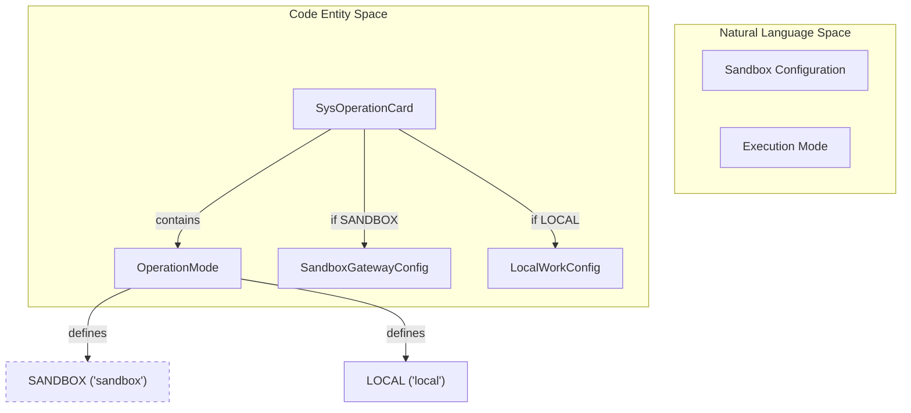

<!-- source: DeepWiki mcp.deepwiki.com · repo openJiuwen-ai/agent-core-java · page 8.2 Sandbox Execution (JiuwenBox) · fetched 2026-11-02 -->

# Sandbox Execution (JiuwenBox)

<details>
<summary>Relevant source files</summary>

The following files were used as context for generating this wiki page:

- [src/main/java/com/openjiuwen/core/sysop/BaseCodeOperation.java](src/main/java/com/openjiuwen/core/sysop/BaseCodeOperation.java)
- [src/main/java/com/openjiuwen/core/sysop/BaseFsOperation.java](src/main/java/com/openjiuwen/core/sysop/BaseFsOperation.java)
- [src/main/java/com/openjiuwen/core/sysop/BaseOperation.java](src/main/java/com/openjiuwen/core/sysop/BaseOperation.java)
- [src/main/java/com/openjiuwen/core/sysop/BaseShellOperation.java](src/main/java/com/openjiuwen/core/sysop/BaseShellOperation.java)
- [src/main/java/com/openjiuwen/core/sysop/FsConstants.java](src/main/java/com/openjiuwen/core/sysop/FsConstants.java)
- [src/main/java/com/openjiuwen/core/sysop/OperationMode.java](src/main/java/com/openjiuwen/core/sysop/OperationMode.java)
- [src/main/java/com/openjiuwen/core/sysop/SysOperation.java](src/main/java/com/openjiuwen/core/sysop/SysOperation.java)
- [src/main/java/com/openjiuwen/core/sysop/SysOperationCard.java](src/main/java/com/openjiuwen/core/sysop/SysOperationCard.java)
- [src/main/java/com/openjiuwen/core/sysop/SysOperationToolAdapter.java](src/main/java/com/openjiuwen/core/sysop/SysOperationToolAdapter.java)
- [src/main/java/com/openjiuwen/core/sysop/ToolIdProxy.java](src/main/java/com/openjiuwen/core/sysop/ToolIdProxy.java)
- [src/main/java/com/openjiuwen/core/sysop/config/LocalWorkConfig.java](src/main/java/com/openjiuwen/core/sysop/config/LocalWorkConfig.java)
- [src/test/java/com/openjiuwen/core/sysop/local/LocalCodeOperationTest.java](src/test/java/com/openjiuwen/core/sysop/local/LocalCodeOperationTest.java)
- [src/test/java/com/openjiuwen/core/sysop/local/LocalShellOperationTest.java](src/test/java/com/openjiuwen/core/sysop/local/LocalShellOperationTest.java)

</details>


The `agent-core-java` framework provides a secure, isolated environment for executing potentially unsafe code or system commands through the **JiuwenBox** sandbox system. This mechanism is primarily triggered by setting the `OperationMode` to `SANDBOX` within a `SysOperationCard`. It allows agents to perform filesystem operations, execute shell scripts, and run Python or JavaScript code without risking the host system's integrity.

## Sandbox Architecture and Configuration

Sandbox execution is managed through the `SysOperation` facade, which delegates requests to remote execution environments based on the provided `SandboxGatewayConfig` [src/main/java/com/openjiuwen/core/sysop/SysOperationCard.java:71-71](). Unlike the `LOCAL` mode, which uses classes like `LocalShellOperation` to interact with the host OS [src/main/java/com/openjiuwen/core/sysop/SysOperation.java:88-90](), the sandbox mode routes these calls through a gateway to an isolated container or remote service.

### Configuration Entities

The behavior of the sandbox is governed by two primary configuration objects within the `SysOperationCard`:

| Class | Responsibility | Key Fields |
| :--- | :--- | :--- |
| `SysOperationCard` | The root configuration for a system operation instance. | `id`, `mode`, `gatewayConfig` [src/main/java/com/openjiuwen/core/sysop/SysOperationCard.java:108-117]() |
| `SandboxGatewayConfig` | Defines the connection parameters for the remote sandbox service. | `gatewayUrl`, `apiKey`, `timeout` |
| `OperationMode` | An enum that determines if execution is `LOCAL` or `SANDBOX`. | `SANDBOX`, `LOCAL` [src/main/java/com/openjiuwen/core/sysop/OperationMode.java:17-18]() |

### Code Entity Space: Configuration Mapping
The following diagram illustrates how the configuration classes map to the execution mode selection.


Sources: [src/main/java/com/openjiuwen/core/sysop/SysOperationCard.java:65-118](), [src/main/java/com/openjiuwen/core/sysop/OperationMode.java:16-61]()

## Sandbox Operation Logic

When a `SysOperation` is initialized with `OperationMode.SANDBOX`, the framework creates tool adapters that proxy requests to the remote sandbox. The `SysOperationToolAdapter` extracts these operations (e.g., `executeCmd`, `executeCode`) and wraps them as `LocalFunction` tools for the agent to use [src/main/java/com/openjiuwen/core/sysop/SysOperationToolAdapter.java:54-86]().

### Data Flow: Remote Execution
The flow of a sandbox request typically follows this path:
1.  **Agent Tool Call**: The agent invokes a tool (e.g., `test_op.shell.executeCmd`).
2.  **Adapter Routing**: `SysOperationToolAdapter` identifies the `toolId` and routes it to the `SysOperation` instance [src/main/java/com/openjiuwen/core/sysop/SysOperationToolAdapter.java:75-80]().
3.  **Sandbox Proxy**: If the mode is `SANDBOX`, the operation is dispatched via the `gatewayConfig` to the remote JiuwenBox service.
4.  **Result Return**: The remote service returns an `ExecuteCmdResult` or `ExecuteCodeResult` containing the `stdout`, `stderr`, and `exitCode` [src/main/java/com/openjiuwen/core/sysop/result/ExecuteCmdResult.java:1-20]().

### Fallback Behavior
While not explicitly detailed in the basic `SysOperation` class, the framework supports `fallback_on_failure` logic where, if a sandbox environment is unavailable, the system can be configured to either fail safely or attempt a restricted local execution (depending on security policies defined in `LocalWorkConfig`) [src/main/java/com/openjiuwen/core/sysop/config/LocalWorkConfig.java:34-44]().

## Supported Sandbox Operations

The sandbox environment supports three primary categories of operations, mirrored from the local implementation:

### 1. Shell Operations (`BaseShellOperation`)
Allows execution of shell commands. The sandbox environment typically restricts the available commands to a safe subset.
*   `executeCmd`: Synchronous command execution [src/main/java/com/openjiuwen/core/sysop/BaseShellOperation.java:59-60]().
*   `executeCmdStream`: Returns an `Iterator` for real-time output streaming [src/main/java/com/openjiuwen/core/sysop/BaseShellOperation.java:73-74]().
*   `executeCmdBackground`: Runs a process in the background and returns a PID [src/main/java/com/openjiuwen/core/sysop/BaseShellOperation.java:87-88]().

### 2. Code Operations (`BaseCodeOperation`)
Executes snippets of programming languages.
*   **Python**: Supports `print()`, library imports, and environment variable access [src/test/java/com/openjiuwen/core/sysop/local/LocalCodeOperationTest.java:83-97]().
*   **JavaScript**: Supports Node.js execution [src/test/java/com/openjiuwen/core/sysop/local/LocalCodeOperationTest.java:101-117]().

### 3. Filesystem Operations (`BaseFsOperation`)
Provides isolated file access. The sandbox uses an `isolationKeyTemplate` to ensure that different agent sessions or users cannot access each other's files [src/main/java/com/openjiuwen/core/sysop/SysOperation.java:54-56]().

### Code Entity Space: Operation Hierarchy
This diagram shows the relationship between the base operation classes and their functional implementations.

```mermaid
graph TD
    subgraph "Base Classes"
        Base["BaseOperation"]
        Code["BaseCodeOperation"]
        Shell["BaseShellOperation"]
        FS["BaseFsOperation"]
    end

    subgraph "Implementation Entities"
        LCode["LocalCodeOperation"]
        LShell["LocalShellOperation"]
        LFS["LocalFsOperation"]
        SProxy["SandboxProxyOperation"]
    end

    Base <|-- Code
    Base <|-- Shell
    Base <|-- FS

    Code <|-- LCode
    Shell <|-- LShell
    FS <|-- LFS
    
    Code -.-> SProxy
    Shell -.-> SProxy
    FS -.-> SProxy

    subgraph "Result Types"
        R1["ExecuteCodeResult"]
        R2["ExecuteCmdResult"]
    end

    LCode -- "returns" --> R1
    LShell -- "returns" --> R2
```
Sources: [src/main/java/com/openjiuwen/core/sysop/BaseOperation.java:16-24](), [src/main/java/com/openjiuwen/core/sysop/BaseCodeOperation.java:22-42](), [src/main/java/com/openjiuwen/core/sysop/BaseShellOperation.java:23-89](), [src/main/java/com/openjiuwen/core/sysop/SysOperation.java:81-92]()

## Security and Isolation

Security in the sandbox is enforced at multiple levels:
1.  **Network Isolation**: The `SandboxGatewayConfig` ensures communication happens only with verified endpoints.
2.  **Resource Constraints**: Timeouts are enforced for all operations (default 300s) to prevent infinite loops or resource exhaustion [src/main/java/com/openjiuwen/core/sysop/BaseShellOperation.java:53-53]().
3.  **Command Filtering**: Even in sandbox mode, a `shellAllowlist` and `dangerousPatterns` check can be applied to block commands like `rm -rf /` [src/main/java/com/openjiuwen/core/sysop/config/LocalWorkConfig.java:26-31]().
4.  **Filesystem Rooting**: The `sandboxRoot` and `restrictToSandbox` flags ensure the execution environment cannot escape its assigned directory [src/main/java/com/openjiuwen/core/sysop/config/LocalWorkConfig.java:34-44]().

Sources:
*   [src/main/java/com/openjiuwen/core/sysop/SysOperation.java:23-93]()
*   [src/main/java/com/openjiuwen/core/sysop/SysOperationCard.java:16-119]()
*   [src/main/java/com/openjiuwen/core/sysop/OperationMode.java:16-61]()
*   [src/main/java/com/openjiuwen/core/sysop/SysOperationToolAdapter.java:29-86]()
*   [src/main/java/com/openjiuwen/core/sysop/BaseShellOperation.java:23-89]()
*   [src/main/java/com/openjiuwen/core/sysop/config/LocalWorkConfig.java:19-65]()

---

