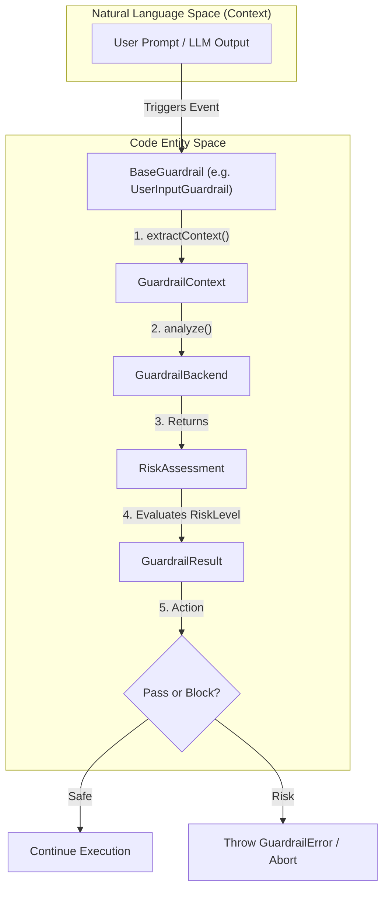
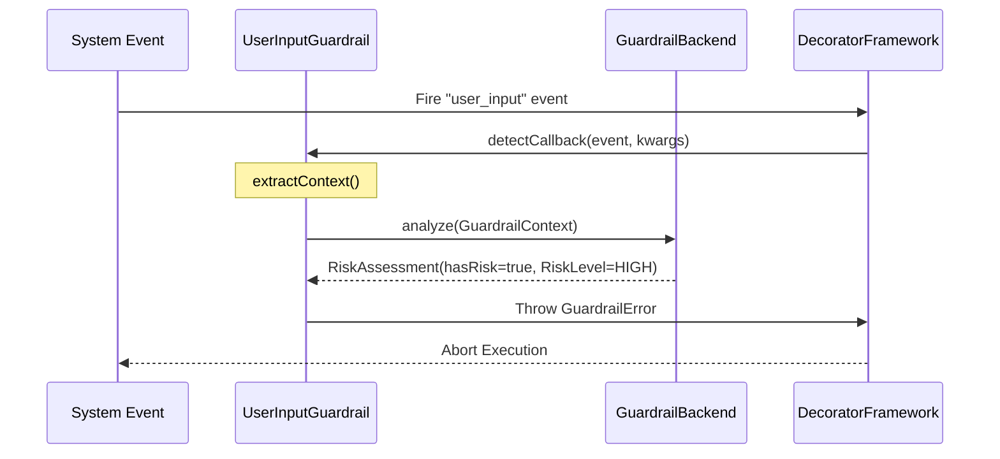

<!-- source: DeepWiki mcp.deepwiki.com · repo openJiuwen-ai/agent-core-java · page 9 Security and Guardrails · fetched 2026-11-02 -->

# Security and Guardrails

Relevant source files

The following files were used as context for generating this wiki page:

- [src/main/java/com/openjiuwen/core/security/guardrail/BaseGuardrail.java](src/main/java/com/openjiuwen/core/security/guardrail/BaseGuardrail.java)
- [src/main/java/com/openjiuwen/core/security/guardrail/GuardrailBackend.java](src/main/java/com/openjiuwen/core/security/guardrail/GuardrailBackend.java)
- [src/main/java/com/openjiuwen/core/security/guardrail/GuardrailResult.java](src/main/java/com/openjiuwen/core/security/guardrail/GuardrailResult.java)
- [src/main/java/com/openjiuwen/core/security/guardrail/RiskAssessment.java](src/main/java/com/openjiuwen/core/security/guardrail/RiskAssessment.java)
- [src/main/java/com/openjiuwen/core/security/guardrail/RiskLevel.java](src/main/java/com/openjiuwen/core/security/guardrail/RiskLevel.java)
- [src/main/java/com/openjiuwen/core/security/guardrail/UserInputGuardrail.java](src/main/java/com/openjiuwen/core/security/guardrail/UserInputGuardrail.java)

The **Guardrail Subsystem** in `agent-core-java` provides a robust safety layer for agent interactions. It allows developers to intercept, analyze, and potentially block or modify data flowing into and out of an agent. By implementing a standardized risk assessment pipeline, the framework ensures that inputs and outputs adhere to safety policies before they reach the core logic or the end user.

For implementation details, see [Guardrail Configuration and Risk Assessment](#9.1) and [Error Handling and Exception Hierarchy](#9.2).

## Guardrail Architecture

The subsystem is built around a pluggable backend architecture. Every guardrail extends `BaseGuardrail` [src/main/java/com/openjiuwen/core/security/guardrail/BaseGuardrail.java:31-31](), which manages the lifecycle of safety checks and coordinates with the `DecoratorFramework` [src/main/java/com/openjiuwen/core/security/guardrail/BaseGuardrail.java:166-168]() to listen for specific system events.

### Component Relationship: Code to Logic Space

The following diagram bridges the abstract safety concepts with the specific classes responsible for execution.

**Guardrail Execution Pipeline**

**Sources:** [src/main/java/com/openjiuwen/core/security/guardrail/BaseGuardrail.java:122-164](), [src/main/java/com/openjiuwen/core/security/guardrail/GuardrailBackend.java:13-15](), [src/main/java/com/openjiuwen/core/security/guardrail/UserInputGuardrail.java:45-59]()

## Guardrail Configuration and Risk Assessment

The framework uses a structured approach to evaluate safety. A `GuardrailBackend` [src/main/java/com/openjiuwen/core/security/guardrail/GuardrailBackend.java:13-13]() performs the actual analysis, returning a `RiskAssessment` [src/main/java/com/openjiuwen/core/security/guardrail/RiskAssessment.java:19-19]() containing a `RiskLevel` [src/main/java/com/openjiuwen/core/security/guardrail/RiskLevel.java:14-14]().

### Risk Categorization
| Entity | Role | Key Properties |
| :--- | :--- | :--- |
| `RiskLevel` | Enum defining the severity of the threat. | `SAFE`, `LOW`, `MEDIUM`, `HIGH`, `CRITICAL` |
| `RiskAssessment` | Internal raw assessment from a backend. | `hasRisk`, `riskType`, `confidence`, `details` |
| `GuardrailResult` | Final decision returned to the agent engine. | `isSafe`, `modifiedData` |

For details on implementing custom backends and configuring event triggers, see [Guardrail Configuration and Risk Assessment](#9.1).

**Sources:** [src/main/java/com/openjiuwen/core/security/guardrail/RiskLevel.java:14-19](), [src/main/java/com/openjiuwen/core/security/guardrail/RiskAssessment.java:21-34](), [src/main/java/com/openjiuwen/core/security/guardrail/GuardrailResult.java:19-34]()

## Security Interception: UserInputGuardrail

The primary entry point for input safety is the `UserInputGuardrail` [src/main/java/com/openjiuwen/core/security/guardrail/UserInputGuardrail.java:13-13](). It specifically listens for the `user_input` event [src/main/java/com/openjiuwen/core/security/guardrail/UserInputGuardrail.java:32-32]() and extracts text from the execution context to provide to the detection backend.

**Interception Logic**

**Sources:** [src/main/java/com/openjiuwen/core/security/guardrail/UserInputGuardrail.java:45-74](), [src/main/java/com/openjiuwen/core/security/guardrail/BaseGuardrail.java:178-202]()

## Error Handling and Exception Hierarchy

When a guardrail detects a risk, or when other framework components encounter failures, the system relies on a specialized exception hierarchy. The base of this system is `BaseError`, which branches into categories such as `GuardrailError` for safety violations [src/main/java/com/openjiuwen/core/common/exception/GuardrailError.java]() and `FrameworkError` for internal engine issues.

The framework uses a `StatusCode` system to ensure that errors are machine-readable across distributed components. For more information on the exception types and how they propagate through the `DecoratorFramework`, see [Error Handling and Exception Hierarchy](#9.2).

**Sources:** [src/main/java/com/openjiuwen/core/security/guardrail/BaseGuardrail.java:7-8]()

---

