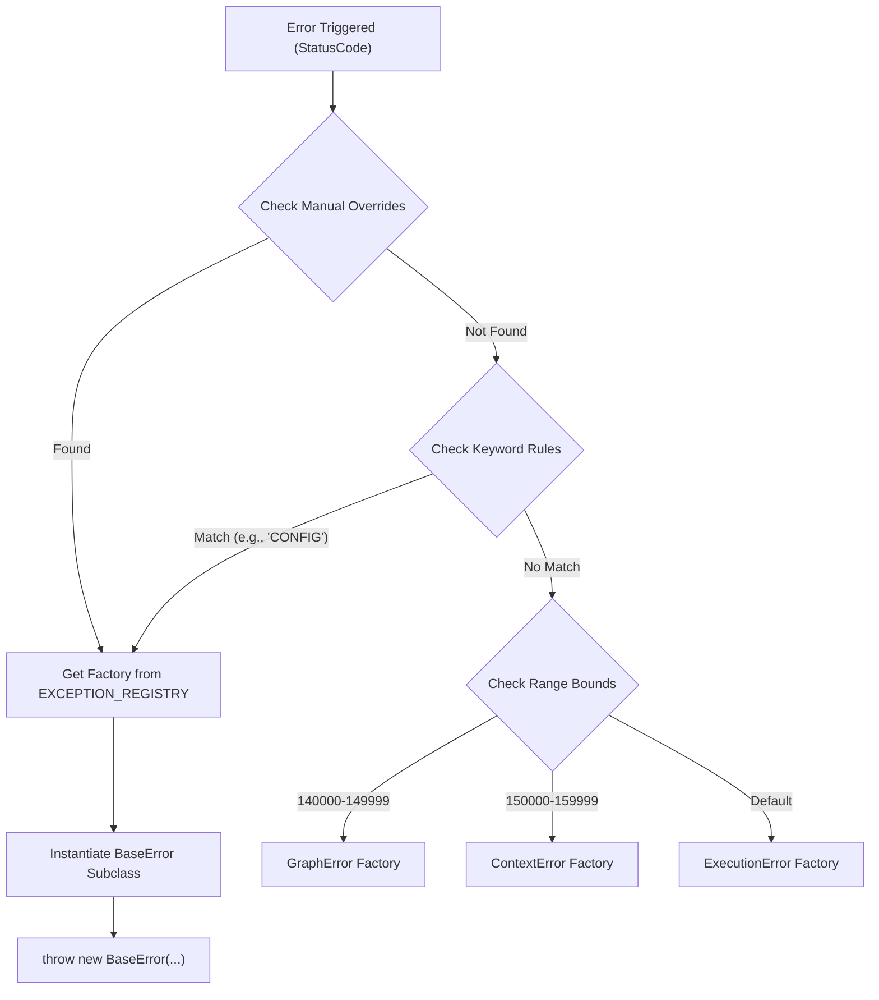

<!-- source: DeepWiki mcp.deepwiki.com · repo openJiuwen-ai/agent-core-java · page 9.2 Error Handling and Exception Hierarchy · fetched 2026-11-02 -->

# Error Handling and Exception Hierarchy

<details>
<summary>Relevant source files</summary>

The following files were used as context for generating this wiki page:

- [src/main/java/com/openjiuwen/core/common/constants/Constant.java](src/main/java/com/openjiuwen/core/common/constants/Constant.java)
- [src/main/java/com/openjiuwen/core/common/constants/TaskType.java](src/main/java/com/openjiuwen/core/common/constants/TaskType.java)
- [src/main/java/com/openjiuwen/core/common/exception/AgentError.java](src/main/java/com/openjiuwen/core/common/exception/AgentError.java)
- [src/main/java/com/openjiuwen/core/common/exception/ApplicationError.java](src/main/java/com/openjiuwen/core/common/exception/ApplicationError.java)
- [src/main/java/com/openjiuwen/core/common/exception/BaseError.java](src/main/java/com/openjiuwen/core/common/exception/BaseError.java)
- [src/main/java/com/openjiuwen/core/common/exception/ComponentError.java](src/main/java/com/openjiuwen/core/common/exception/ComponentError.java)
- [src/main/java/com/openjiuwen/core/common/exception/ConfigurationError.java](src/main/java/com/openjiuwen/core/common/exception/ConfigurationError.java)
- [src/main/java/com/openjiuwen/core/common/exception/ContextError.java](src/main/java/com/openjiuwen/core/common/exception/ContextError.java)
- [src/main/java/com/openjiuwen/core/common/exception/ErrorHelper.java](src/main/java/com/openjiuwen/core/common/exception/ErrorHelper.java)
- [src/main/java/com/openjiuwen/core/common/exception/ExecutionError.java](src/main/java/com/openjiuwen/core/common/exception/ExecutionError.java)
- [src/main/java/com/openjiuwen/core/common/exception/ExternalDataError.java](src/main/java/com/openjiuwen/core/common/exception/ExternalDataError.java)
- [src/main/java/com/openjiuwen/core/common/exception/ExternalServiceError.java](src/main/java/com/openjiuwen/core/common/exception/ExternalServiceError.java)
- [src/main/java/com/openjiuwen/core/common/exception/FrameworkError.java](src/main/java/com/openjiuwen/core/common/exception/FrameworkError.java)
- [src/main/java/com/openjiuwen/core/common/exception/RunnerTermination.java](src/main/java/com/openjiuwen/core/common/exception/RunnerTermination.java)
- [src/main/java/com/openjiuwen/core/common/exception/StatusMapping.java](src/main/java/com/openjiuwen/core/common/exception/StatusMapping.java)
- [src/main/java/com/openjiuwen/core/common/exception/Termination.java](src/main/java/com/openjiuwen/core/common/exception/Termination.java)
- [src/main/java/com/openjiuwen/core/common/exception/ValidationError.java](src/main/java/com/openjiuwen/core/common/exception/ValidationError.java)
- [src/main/java/com/openjiuwen/core/common/logging/LogManager.java](src/main/java/com/openjiuwen/core/common/logging/LogManager.java)
- [src/main/java/com/openjiuwen/core/foundation/llm/output_parsers/BaseOutputParser.java](src/main/java/com/openjiuwen/core/foundation/llm/output_parsers/BaseOutputParser.java)
- [src/main/java/com/openjiuwen/core/foundation/llm/output_parsers/JsonOutputParser.java](src/main/java/com/openjiuwen/core/foundation/llm/output_parsers/JsonOutputParser.java)
- [src/main/java/com/openjiuwen/core/foundation/llm/schema/AssistantMessage.java](src/main/java/com/openjiuwen/core/foundation/llm/schema/AssistantMessage.java)

</details>


The `agent-core-java` framework employs a unified exception handling system designed to provide consistent error reporting, categorization, and recovery strategies across the Agent Engine and Pregel Graph Execution Engine. The hierarchy mirrors the Python core implementation to ensure cross-language compatibility in multi-agent environments.

## Exception Hierarchy

All framework exceptions derive from `BaseError`, which extends `RuntimeException` [src/main/java/com/openjiuwen/core/common/exception/BaseError.java:21-21](). This design allows for clean propagation through graph nodes without mandatory `throws` clauses, while providing rich metadata for logging and debugging.

### Core Hierarchy Diagram

The following diagram illustrates the relationship between the primary exception classes and their categorization into Recoverable vs. Fatal errors.

**Diagram: Framework Exception Inheritance and Code Space**
```mermaid
classDiagram
    class BaseError {
        +StatusCode status
        +int code
        +Map params
        +boolean recoverable
        +boolean fatal
        +toMap() Map
    }
    
    class FrameworkError {
        <<Fatal>>
    }
    
    class ExecutionError {
        <<Recoverable>>
    }
    
    BaseError <|-- FrameworkError
    BaseError <|-- ValidationError
    BaseError <|-- Termination
    FrameworkError <|-- ConfigurationError
    ExecutionError <|-- ApplicationError
    ExecutionError <|-- ExternalServiceError
    ExecutionError <|-- ExternalDataError
    BaseError <|-- WorkflowError
    BaseError <|-- AgentError
    BaseError <|-- ContextError
    BaseError <|-- ToolError
    
    ExecutionError <|-- BaseError : extends
    
    style FrameworkError stroke-dasharray: 5 5
    style ExecutionError stroke-width:2px
```
**Sources:** [src/main/java/com/openjiuwen/core/common/exception/BaseError.java:21-46](), [src/main/java/com/openjiuwen/core/common/exception/FrameworkError.java:13-13](), [src/main/java/com/openjiuwen/core/common/exception/ExecutionError.java:13-13](), [src/main/java/com/openjiuwen/core/common/exception/ExternalServiceError.java:13-13]().

### Primary Exception Classes

| Class | Purpose | Default Recovery Strategy |
| :--- | :--- | :--- |
| `BaseError` | Root class providing `StatusCode`, `params`, and `details`. | `recoverable=false`, `fatal=false` [src/main/java/com/openjiuwen/core/common/exception/BaseError.java:160-166]() |
| `FrameworkError` | Internal system failures (e.g., initialization, registry errors). | `recoverable=false`, `fatal=true` [src/main/java/com/openjiuwen/core/common/exception/FrameworkError.java:19-20]() |
| `ExecutionError` | Runtime failures during task processing or LLM calls. | `recoverable=true`, `fatal=false` [src/main/java/com/openjiuwen/core/common/exception/ExecutionError.java:19-20]() |
| `ValidationError` | Input schema violations or missing required parameters. | `recoverable=false`, `fatal=false` [src/main/java/com/openjiuwen/core/common/exception/ValidationError.java:19-20]() |
| `ContextError` | Failures in memory retrieval, KVCache, or context window management. | Defined by `StatusMapping` |
| `ExternalServiceError` | Failures from remote APIs, LLM providers, or databases. | `recoverable=true` (via `ExecutionError`) |

## Status Codes and Mapping

The framework uses a centralized `StatusCode` enum to categorize errors. The `StatusMapping` class dynamically resolves which `BaseError` subclass to instantiate based on three criteria:

1.  **Manual Overrides**: Explicit mappings for specific codes (e.g., `MODEL_CALL_FAILED` maps to `ModelError`) [src/main/java/com/openjiuwen/core/common/exception/StatusMapping.java:87-106]().
2.  **Keyword Rules**: Pattern matching on the status name (e.g., names containing "INVALID" map to `ValidationError`) [src/main/java/com/openjiuwen/core/common/exception/StatusMapping.java:18-32]().
3.  **Range Bounds**: Numeric ranges determine the component (e.g., 120000-129999 maps to `AgentError`) [src/main/java/com/openjiuwen/core/common/exception/StatusMapping.java:34-56]().

**Diagram: Error Resolution Data Flow**

**Sources:** [src/main/java/com/openjiuwen/core/common/exception/StatusMapping.java:112-128](), [src/main/java/com/openjiuwen/core/common/exception/ErrorHelper.java:70-96]().

## Error Propagation and Utilities

### ErrorHelper
`ErrorHelper` provides static methods to simplify error creation and throwing, ensuring that the correct exception type is used based on the `StatusCode`.

*   `raiseError(StatusCode status, ...)`: Resolves the exception type via `StatusMapping` and throws it [src/main/java/com/openjiuwen/core/common/exception/ErrorHelper.java:42-44]().
*   `systemError(StatusCode status, ...)`: Force-throws a `FrameworkError` [src/main/java/com/openjiuwen/core/common/exception/ErrorHelper.java:50-52]().
*   `terminate(StatusCode status)`: Throws a `Termination` exception to stop graph execution [src/main/java/com/openjiuwen/core/common/exception/ErrorHelper.java:62-64]().

### Message Rendering
`BaseError` supports template-based message rendering. If a `StatusCode` has a message template like `Model {model_name} failed`, and the `params` map contains `model_name="gpt-4"`, the final exception message is automatically formatted [src/main/java/com/openjiuwen/core/common/exception/BaseError.java:71-97]().

### Serialization
Exceptions can be serialized to JSON or Maps for transmission across distributed runners:
*   `toMap()` / `toDict()`: Returns a map containing `code`, `status`, `message`, `params`, and `details` [src/main/java/com/openjiuwen/core/common/exception/BaseError.java:99-108]().
*   `toJson()`: Uses `ObjectMapper` to serialize the error state [src/main/java/com/openjiuwen/core/common/exception/BaseError.java:114-120]().

**Sources:** [src/main/java/com/openjiuwen/core/common/exception/ErrorHelper.java:14-97](), [src/main/java/com/openjiuwen/core/common/exception/BaseError.java:60-120]().

---

