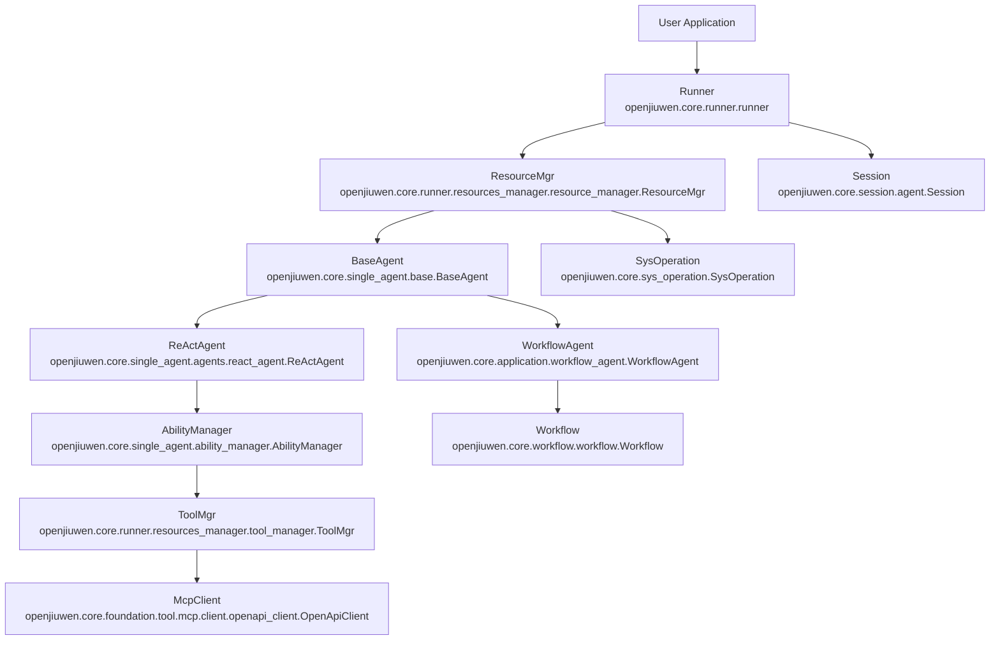
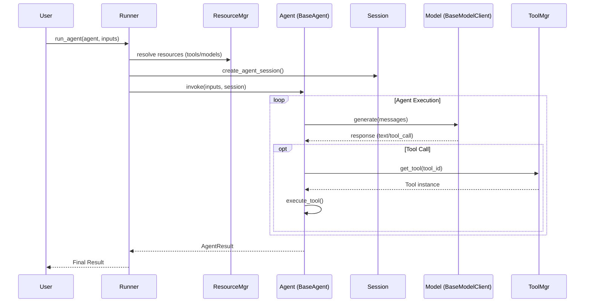

<!-- source: DeepWiki mcp.deepwiki.com · repo openJiuwen-ai/agent-core · page 1 Overview · fetched 2026-11-02 -->

# Overview

<details>
<summary>Relevant source files</summary>

The following files were used as context for generating this wiki page:

- [.gitignore](.gitignore)
- [LICENSE](LICENSE)
- [Makefile](Makefile)
- [README.md](README.md)
- [README.zh.md](README.zh.md)
- [examples/README.md](examples/README.md)
- [examples/interact/weather_assistant_interact.ipynb](examples/interact/weather_assistant_interact.ipynb)
- [examples/react_agent/build_react_agent.ipynb](examples/react_agent/build_react_agent.ipynb)
- [examples/workflow_agent/build_workflow_agent.ipynb](examples/workflow_agent/build_workflow_agent.ipynb)
- [openjiuwen/core/common/exception/codes.py](openjiuwen/core/common/exception/codes.py)
- [openjiuwen/core/foundation/tool/mcp/client/openapi_client.py](openjiuwen/core/foundation/tool/mcp/client/openapi_client.py)
- [openjiuwen/core/memory/common/base.py](openjiuwen/core/memory/common/base.py)
- [openjiuwen/core/retrieval/__init__.py](openjiuwen/core/retrieval/__init__.py)
- [openjiuwen/core/runner/resources_manager/resource_manager.py](openjiuwen/core/runner/resources_manager/resource_manager.py)
- [openjiuwen/core/runner/resources_manager/tool_manager.py](openjiuwen/core/runner/resources_manager/tool_manager.py)
- [openjiuwen/core/single_agent/__init__.py](openjiuwen/core/single_agent/__init__.py)
- [pyproject.toml](pyproject.toml)
- [tests/system_tests/runner/test_runner.py](tests/system_tests/runner/test_runner.py)
- [tests/system_tests/tune/test_prompt_tune.py](tests/system_tests/tune/test_prompt_tune.py)
- [tests/system_tests/workflow/test_real_workflow.py](tests/system_tests/workflow/test_real_workflow.py)
- [tests/test_logger.py](tests/test_logger.py)
- [tests/unit_tests/agent_teams/observability/test_team_observability_mock_llm.py](tests/unit_tests/agent_teams/observability/test_team_observability_mock_llm.py)
- [tests/unit_tests/core/context_engine/conftest.py](tests/unit_tests/core/context_engine/conftest.py)
- [uv.lock](uv.lock)

</details>


This page introduces the **openJiuwen agent-core** SDK: its purpose as a high-performance Python framework for building LLM-powered agents, its key feature pillars, and a high-level map of its major subsystems.

---

## What Is openJiuwen agent-core?

`openjiuwen` is a feature-rich AI agent SDK designed for developing, running, tuning, and improving AI agents [pyproject.toml:6-8](). It provides a high-performance runtime supporting asynchronous IO, streaming processing, and stateful session management [README.md:7-10]().

The SDK balances flexibility and stability, offering:
- **Agent Framework**: High-level APIs for `ReActAgent`, `WorkflowAgent`, and `DeepAgent` that encapsulate LLM orchestration and tool use [README.md:146-148]().
- **Workflow Engine**: A graph-based engine for composing multi-step LLM pipelines from reusable components like `LLMComponent` and `IntentDetectionComponent` [README.md:11-13]().
- **Autonomous Harness**: The `harness` package provides a coding-agent framework with built-in task loops, safety rails, and workspace management [pyproject.toml:169-170]().
- **Multi-Agent Teams**: Support for hierarchical agent groups and team-based collaboration via `agent_teams` [pyproject.toml:170-171]().
- **Evolution & RL**: Built-in capabilities for skill self-evolution and Reinforcement Learning (PPO/GRPO) to improve agent performance over time [pyproject.toml:107-114]().

The project is published at version `0.1.16` [pyproject.toml:7]().

---

## Key Feature Pillars

| Pillar | Description | Primary Modules |
|---|---|---|
| **Agent Engine** | ReAct intelligent interaction and workflow automatic jumping [README.md:148-149]() | `openjiuwen.core.single_agent`, `openjiuwen.core.application` |
| **Workflow DSL** | Async parallel graph execution with streaming and branching [README.md:13-14]() | `openjiuwen.core.workflow` |
| **DeepAgent & Harness** | Autonomous framework with task loops, safety rails, and CLI [pyproject.toml:169]() | `openjiuwen.harness` |
| **Memory & Retrieval** | Persistent long-term memory and multi-strategy knowledge retrieval [openjiuwen/core/retrieval/__init__.py:3-5]() | `openjiuwen.core.memory`, `openjiuwen.core.retrieval` |
| **Agent Teams** | Multi-agent coordination with leader/teammate roles [pyproject.toml:170]() | `openjiuwen.agent_teams` |
| **Self-Evolution** | Trajectory collection and RL training (JiuwenClaw) [pyproject.toml:107-114]() | `openjiuwen.agent_evolving` |
| **Tool & MCP** | Support for Model Context Protocol (MCP), REST APIs, and local tools [openjiuwen/core/runner/resources_manager/tool_manager.py:13-19]() | `openjiuwen.core.foundation.tool` |
| **System Ops** | Local or sandboxed shell, code, and file system execution [openjiuwen/core/runner/resources_manager/resource_manager.py:32-34]() | `openjiuwen.core.sys_operation` |

Sources: [README.md:7-18](), [pyproject.toml:71-125](), [openjiuwen/core/retrieval/__init__.py:1-88]()

---

## Package Layout

The SDK is organized into several primary namespaces under the `openjiuwen` distribution:

```
openjiuwen/
├── core/               # Base SDK: agents, workflows, LLM, memory, retrieval
│   ├── runner/         # Async runtime & ResourceMgr [openjiuwen/core/runner/resources_manager/resource_manager.py:68]()
│   ├── single_agent/   # ReActAgent [openjiuwen/core/single_agent/__init__.py:24]() and Agent identity
│   ├── application/    # WorkflowAgent [README.md:43]()
│   ├── workflow/       # Graph DSL and built-in components [openjiuwen/core/workflow/workflow.py:35]()
│   ├── foundation/     # LLM clients, Tool primitives, Storage (KV/Object)
│   ├── memory/         # LongTermMemory and context management
│   ├── retrieval/      # KnowledgeBase, VectorStore, Embeddings [openjiuwen/core/retrieval/__init__.py:3-5]()
│   └── sys_operation/  # Shell, Code, and File system operations [openjiuwen/core/sys_operation/registry.py:34]()
├── harness/            # DeepAgent framework: task loops, rails, and tools
├── agent_teams/        # Multi-agent coordination [pyproject.toml:170]()
├── agent_evolving/     # Skill evolution and RL (Offline/Online)
├── dev_tools/          # Prompt builders, optimizers, and evaluators
└── extensions/         # Optional: A2A, Sandbox, Redis/Pulsar adapters [pyproject.toml:162-166]()
```

Sources: [README.md:142-150](), [openjiuwen/core/retrieval/__init__.py:1-88](), [pyproject.toml:162-172]()

---

## Major Subsystems

**High-level subsystem map: code entities by module path**



Sources: [openjiuwen/core/runner/resources_manager/resource_manager.py:68-103](), [openjiuwen/core/single_agent/__init__.py:20-27](), [openjiuwen/core/runner/resources_manager/tool_manager.py:39-44](), [openjiuwen/core/foundation/tool/mcp/client/openapi_client.py:52]()

---

## Core Runtime Flow

**Request lifecycle through the Runner to an agent**



Sources: [README.md:128-131](), [openjiuwen/core/runner/resources_manager/resource_manager.py:97-103](), [openjiuwen/core/runner/resources_manager/tool_manager.py:66-68]()

---

## Optional Dependencies

The core package provides a lean base, with heavy dependencies available as extras in `pyproject.toml` [pyproject.toml:73-125]():

| Extra | Purpose | Key Packages |
|---|---|---|
| `all-mq` | Message queue support | `pulsar-client` |
| `all-storage` | Database & object storage | `sqlalchemy`, `redis`, `aioboto3`, `aiomysql`, `elasticsearch` |
| `all-vector` | Vector database backends | `chromadb`, `pgvector`, `pymilvus` |
| `sandbox` | Remote code execution | `agent-sandbox` |
| `online-rl` | Online RL training loop | `fastapi`, `uvicorn`, `omegaconf` |
| `cli` | Interactive shell and chat | `click`, `rich`, `prompt-toolkit` |

Sources: [pyproject.toml:73-125]()

---

## Subsystem Cross-Reference

For detailed documentation on specific subsystems, please refer to the following child pages:

- **[Getting Started](#1.1)**: Installation via pip, optional extras, and a minimal end-to-end quickstart.
- **[Architecture Overview](#1.2)**: Deep dive into all major subsystems and their interconnections.

| Subsystem | Primary Module Path |
|---|---|
| Runner & Resources | `openjiuwen.core.runner` |
| Agents | `openjiuwen.core.single_agent`, `openjiuwen.core.application` |
| DeepAgent & Harness | `openjiuwen.harness` |
| Workflow Engine | `openjiuwen.core.workflow` |
| LLM Integration | `openjiuwen.core.foundation.llm` |
| Memory System | `openjiuwen.core.memory` |
| Knowledge Retrieval | `openjiuwen.core.retrieval` |
| Tools & Skills | `openjiuwen.core.foundation.tool` |
| Agent Teams | `openjiuwen.agent_teams` |
| Agent Evolving | `openjiuwen.agent_evolving` |
| System Operations | `openjiuwen.core.sys_operation` |

Sources: [README.md:142-150](), [openjiuwen/core/retrieval/__init__.py:1-88](), [pyproject.toml:162-172]()

---

