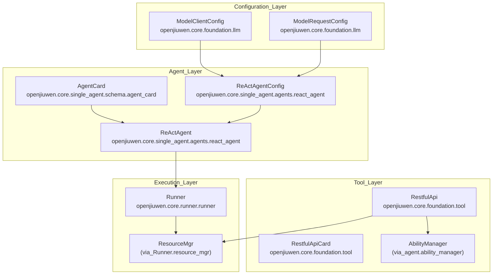
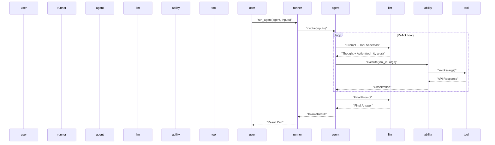
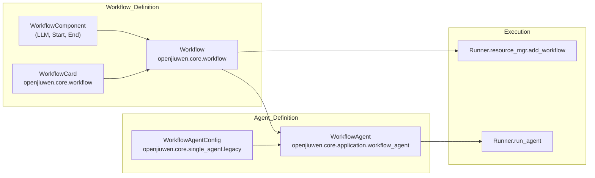

<!-- source: DeepWiki mcp.deepwiki.com · repo openJiuwen-ai/agent-core · page 1.1 Getting Started · fetched 2026-11-02 -->

# Getting Started

<details>
<summary>Relevant source files</summary>

The following files were used as context for generating this wiki page:

- [.gitignore](.gitignore)
- [LICENSE](LICENSE)
- [Makefile](Makefile)
- [README.md](README.md)
- [README.zh.md](README.zh.md)
- [examples/README.md](examples/README.md)
- [examples/interact/weather_assistant_interact.ipynb](examples/interact/weather_assistant_interact.ipynb)
- [examples/react_agent/build_react_agent.ipynb](examples/react_agent/build_react_agent.ipynb)
- [examples/workflow_agent/build_workflow_agent.ipynb](examples/workflow_agent/build_workflow_agent.ipynb)
- [openjiuwen/core/common/exception/codes.py](openjiuwen/core/common/exception/codes.py)
- [openjiuwen/core/foundation/tool/mcp/client/openapi_client.py](openjiuwen/core/foundation/tool/mcp/client/openapi_client.py)
- [openjiuwen/core/memory/common/base.py](openjiuwen/core/memory/common/base.py)
- [openjiuwen/core/retrieval/__init__.py](openjiuwen/core/retrieval/__init__.py)
- [openjiuwen/core/runner/resources_manager/resource_manager.py](openjiuwen/core/runner/resources_manager/resource_manager.py)
- [openjiuwen/core/runner/resources_manager/tool_manager.py](openjiuwen/core/runner/resources_manager/tool_manager.py)
- [openjiuwen/core/single_agent/__init__.py](openjiuwen/core/single_agent/__init__.py)
- [pyproject.toml](pyproject.toml)
- [tests/system_tests/runner/test_runner.py](tests/system_tests/runner/test_runner.py)
- [tests/system_tests/tune/test_prompt_tune.py](tests/system_tests/tune/test_prompt_tune.py)
- [tests/system_tests/workflow/test_real_workflow.py](tests/system_tests/workflow/test_real_workflow.py)
- [tests/test_logger.py](tests/test_logger.py)
- [tests/unit_tests/agent_teams/observability/test_team_observability_mock_llm.py](tests/unit_tests/agent_teams/observability/test_team_observability_mock_llm.py)
- [tests/unit_tests/core/context_engine/conftest.py](tests/unit_tests/core/context_engine/conftest.py)
- [uv.lock](uv.lock)

</details>


This page covers installing the `openjiuwen` package and running a minimal end-to-end example with a `ReActAgent`. It is intended for developers new to the SDK who want to move from zero to a working agent as quickly as possible. For a conceptual overview of all subsystems, see **Architecture Overview (1.2)**. For detailed `ReActAgent` configuration options, see **ReActAgent (2.1)**. For `WorkflowAgent` usage, see **WorkflowAgent (2.3)**.

---

## Prerequisites

| Requirement | Value |
|---|---|
| Python version | `>=3.11`, `<3.14` (3.11.4 recommended) |
| OS | Windows, Linux, macOS |
| Package manager | `pip` or `uv` |

Sources: [pyproject.toml:10-10](), [README.md:23-24]()

---

## Installation

Install the base package from PyPI:

```bash
pip install -U openjiuwen
```

The base install includes core dependencies for HTTP clients (`aiohttp`, `requests`), database ORM (`sqlalchemy`, `sqlmodel`), and primary AI providers (`openai`, `anthropic`, `dashscope`). For the complete list of core dependencies, see [pyproject.toml:21-69]().

### Optional Dependency Extras

Several backend integrations and specialized features are gated behind optional extras. Install them as needed using the bracket syntax.

| Extra group | What it enables | Underlying packages |
|---|---|---|
| `pulsar` | Apache Pulsar message queue | `pulsar-client` |
| `redis` | Redis KV store and checkpointer | `redis` |
| `sqlite` | Async SQLite KV/DB store | `aiosqlite` |
| `mysql` | Async MySQL KV/DB store | `aiomysql` |
| `pgvector` | pgvector vector store support | `pgvector` |
| `chromadb` | Chroma vector store | `chromadb`, `opentelemetry-proto` |
| `obs` | S3-compatible object storage (OBS) | `aioboto3` |
| `online-rl` | Online RL training loop (JiuwenClaw) | `fastapi`, `uvicorn`, `pandas` |
| `all-mq` | All message queue backends | `pulsar` |
| `all-storage` | All storage backends | `sqlite`, `postgres`, `mysql`, `gaussdb`, `redis`, `elasticsearch`, `obs` |
| `all-vector` | All vector store backends | `pgvector`, `chromadb`, `gaussvector` |
| `all` | Comprehensive integration bundle | `all-mq`, `all-storage`, `all-vector`, `all-a2a` |

Sources: [pyproject.toml:73-124]()

Example installations:

```bash
# Install with SQLite and Redis storage support
pip install "openjiuwen[sqlite,redis]"

# Install with all vector store support
pip install "openjiuwen[all-vector]"

# Install with all optional backends
pip install "openjiuwen[all]"
```

---

## Core Concepts Before the Quickstart

The diagram below maps the key runtime objects you will encounter in a minimal example to their Python classes and import paths.

**Key runtime objects and their classes**



Sources: [openjiuwen/core/single_agent/__init__.py:23-26](), [openjiuwen/core/runner/resources_manager/resource_manager.py:68-81](), [README.md:144-150]()

---

## Quickstart: ReActAgent with a Tool

This example builds a `ReActAgent` that can call an external HTTP tool.

### Step 1 — Configure environment variables

```python
import os

os.environ["API_BASE"]      = "https://your-api-base"
os.environ["API_KEY"]       = "your-api-key"
os.environ["MODEL_NAME"]    = "your-model-name"
os.environ["MODEL_PROVIDER"] = "your-provider"   # e.g. "openai", "dashscope"
os.environ["LLM_SSL_VERIFY"] = "false"
```

Sources: [README.md:48-52]()

### Step 2 — Create model configuration objects

`ModelClientConfig` describes the API endpoint and credentials. `ModelRequestConfig` describes per-request model parameters such as the model name and temperature.

```python
from openjiuwen.core.foundation.llm import ModelRequestConfig, ModelClientConfig

model_client = ModelClientConfig(
    client_provider=os.getenv("MODEL_PROVIDER"),
    api_key=os.getenv("API_KEY"),
    api_base=os.getenv("API_BASE"),
    verify_ssl=os.getenv("LLM_SSL_VERIFY").lower() == "true"
)
model_config = ModelRequestConfig(
    model=os.getenv("MODEL_NAME")
)
```

Sources: [README.md:55-63]()

### Step 3 — Define a tool

In `openjiuwen`, tools are defined using a `ToolCard` (metadata/schema) and a `Tool` implementation. For external APIs, `RestfulApi` is the primary wrapper.

```python
from openjiuwen.core.foundation.tool import RestfulApiCard, RestfulApi

weather_card = RestfulApiCard(
    id="weather_tool",
    name="WeatherReporter",
    description="Query weather for a city and date",
    input_params={
        "type": "object",
        "properties": {
            "location": {"description": "City name", "type": "string"},
            "date":     {"description": "Date (YYYY-MM-DD)", "type": "string"},
        },
        "required": ["location", "date"],
    },
    url="https://your-weather-service/weather",
    method="GET",
)
weather_tool = RestfulApi(card=weather_card)
```

Sources: [openjiuwen/core/runner/resources_manager/resource_manager.py:57-61](), [openjiuwen/core/foundation/tool/__init__.py:1-20]()

### Step 4 — Create and configure the ReActAgent

`AgentCard` is the identity descriptor. `ReActAgentConfig` bundles model configs and the prompt. The agent is registered with the global `Runner.resource_mgr`.

```python
from openjiuwen.core.single_agent import AgentCard, ReActAgentConfig, ReActAgent
from openjiuwen.core.runner import Runner

agent_card = AgentCard(
    id="weather_assistant",
    description="Weather query assistant",
)

react_agent_config = ReActAgentConfig(
    model_client_config=model_client,
    model_config_obj=model_config,
    prompt_template=[{"role": "system", "content": "Use tools to find weather info."}],
)

react_agent = ReActAgent(card=agent_card).configure(react_agent_config)

# Register the tool and expose it to this agent
Runner.resource_mgr.add_tool(weather_tool.card.id, weather_tool)
react_agent.ability_manager.add(weather_tool.card)
```

Sources: [openjiuwen/core/single_agent/__init__.py:24-26](), [openjiuwen/core/runner/resources_manager/resource_manager.py:82-90]()

### Step 5 — Run the agent

`Runner.run_agent` is the primary execution entry point.

```python
import asyncio

async def main():
    await Runner.start()
    result = await Runner.run_agent(
        agent=react_agent,
        inputs={"query": "What's the weather in Paris?"},
    )
    print(result)
    await Runner.stop()

asyncio.run(main())
```

Sources: [openjiuwen/core/runner/runner.py:100-115](), [tests/system_tests/runner/test_runner.py:49-55]()

---

## Execution Flow

The diagram below shows the runtime call sequence from user code through the `Runner` to the `ReActAgent` and its tool integrations.

**ReActAgent invocation sequence**



Sources: [openjiuwen/core/single_agent/agents/react_agent.py:1-50](), [openjiuwen/core/single_agent/ability_manager.py:1-30](), [README.md:144-150]()

---

## Optional: WorkflowAgent Quickstart

If your use case follows a fixed multi-step pipeline rather than open-ended reasoning, a `WorkflowAgent` is more appropriate.

**WorkflowAgent setup objects**



Sources: [README.md:37-133](), [tests/system_tests/runner/test_runner.py:141-205]()

Key steps for a `WorkflowAgent`:
- Define a `Workflow` with components (`Start`, `End`, `LLMComponent`) and connections [README.md:79-110]().
- Register it via `Runner.resource_mgr.add_workflow` [README.md:112-115]().
- Instantiate a `WorkflowAgent` and bind the workflow using `add_workflows([flow])` [README.md:118-124]().
- Execute using `Runner.run_agent` [README.md:129]().

---

## Development Workflow

The `Makefile` at the repository root provides convenience targets for contributors:

| Target | Purpose |
|---|---|
| `make install` | Install dev dependencies via `uv` or `pip` |
| `make test` | Run pytest (supports `TESTFLAGS="..."`) |
| `make format` | Check formatting on staged Python files via `ruff` |
| `make lint` | Lint staged files via `ruff` and `pylint` |
| `make type-check` | Type-check staged files via `mypy` |
| `make fix` | Auto-fix lint and format issues |
| `make flame FLAME=script.py` | Generate a flame graph HTML |
| `make speedscope SPEEDSCOPE=script.py` | Generate a speedscope profile JSON for https://www.speedscope.app |

Pass `COMMITS=N` to check files changed in the last N commits instead of staged files.

Sources: [Makefile:98-166]()

---

